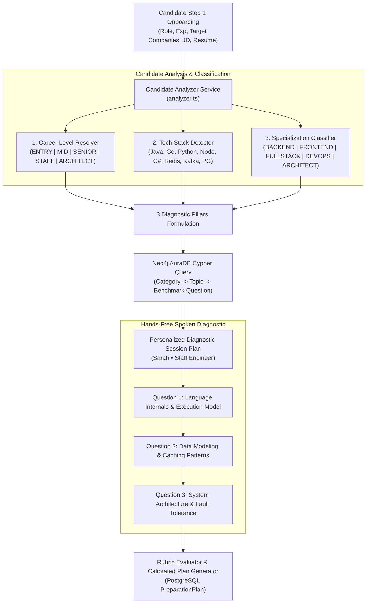

# AI Diagnostic Question Selection & Knowledge Graph Architecture

This specification document details the complete end-to-end intelligence pipeline that determines **what, why, and how** the AI Assessor (*Sarah • Staff Engineer*) selects and delivers diagnostic technical questions to candidates during the AI Assessment ([`/ai-assessment/session`](file:///Users/saurav/Desktop/development/prep-in-minutes/src/app/ai-assessment/session/page.tsx)).

---

## 1. High-Level Architecture Overview



---

## 2. Step 1: Input Data Ingestion

The candidate setup data collected during Step 1 (`/dashboard`) serves as the foundational profile context:

| Field | Source | Example Value | Diagnostic Purpose |
| :--- | :--- | :--- | :--- |
| `targetRole` | Form input | `Senior Backend Engineer` | Determines role scope, system boundaries, and baseline expectations |
| `experienceLevel` | Form select | `4–5 years` (Senior) | Sets difficulty threshold (`INTERMEDIATE` vs. `ADVANCED`) |
| `targetCompanies` | Form input | `["Google", "Uber"]` | Contextualizes scale (e.g. billion-request QPS, geo-distribution) |
| `resumeText` | Uploaded PDF | Parsed text & skill tokens | Discovers languages (Java, Go, Python, C#) and tools (Redis, Kafka) |
| `jobDescriptionText` | Form modal | Text snippet of target JD | Identifies high-priority requirements (e.g. multithreading, event streams) |

---

## 3. Step 2: Candidate Analyzer Engine (`analyzer.ts`)

Located in [`src/server/domain/analyzer.ts`](file:///Users/saurav/Desktop/development/prepinminutes-backend/src/server/domain/analyzer.ts), the analyzer executes three classification passes:

### 3.1. Career Level Resolution
```typescript
function resolveCareerLevel(role: string, exp: string): CareerLevel {
  const r = role.toLowerCase();
  const e = exp.toLowerCase();
  if (r.includes("architect") || r.includes("principal")) return "ARCHITECT";
  if (r.includes("staff") || r.includes("lead") || e.includes("8+") || e.includes("10+")) return "STAFF";
  if (r.includes("senior") || r.includes("sde 3") || e.includes("4-5") || e.includes("6-8")) return "SENIOR";
  if (r.includes("junior") || r.includes("entry") || e.includes("0-1") || e.includes("0-2")) return "ENTRY";
  return "MID";
}
```

### 3.2. Primary Language & Stack Detection
Scans the combined profile text against a canonical technology dictionary:
- **Languages**: Java, Go/Golang, Python, TypeScript/JavaScript, C#/.NET, PHP
- **Data Layers**: PostgreSQL, MySQL, MongoDB, Redis, Kafka, Elasticsearch
- **Infrastructure**: Docker, Kubernetes, AWS, Cloudflare Workers

### 3.3. Formulation of 3 Diagnostic Pillars
Every diagnostic assessment spans 3 complementary engineering dimensions:
1. **Pillar 1: Language Internals & Concurrency**
   - *Senior Java*: G1/ZGC Garbage Collection, Thread visibility, `ConcurrentHashMap`, JMM happens-before.
   - *Senior Go*: GMP runtime scheduler, Goroutine memory overhead, race detection, channel channels vs. mutexes.
   - *Senior Node/TS*: Event loop microtask queues, cluster worker threads, memory leak profiling.
   - *Senior Python*: GIL implications, async event loop vs multiprocessing, memory allocation.
2. **Pillar 2: Data Modeling & Caching Patterns**
   - Database indexing (B-Tree vs LSM trees), schema normalization, Redis cache-aside, cache stampede prevention, write-through vs write-back.
3. **Pillar 3: System Architecture & Fault Tolerance**
   - High-level distributed architecture, consistent hashing, horizontal sharding, circuit breakers, rate limiters, multi-AZ failover.

---

## 4. Step 3: Neo4j AuraDB Knowledge Graph Traversal

The backend queries the live **Neo4j AuraDB** graph instance (`Instance01`) using Cypher:

```cypher
MATCH (c:Category)-[:HAS_TOPIC]->(t:Topic)-[:HAS_QUESTION]->(q:Question)
WHERE c.name = $categoryName 
  AND q.status = 'PUBLISHED' 
  AND q.difficulty IN $allowedDifficulties
RETURN 
  c.name AS category, 
  t.title AS topicTitle,
  q.id AS questionId, 
  q.title AS title, 
  q.prompt AS prompt, 
  q.difficulty AS difficulty, 
  q.rubricGuide AS rubricGuide
ORDER BY rand()
LIMIT 1
```

### Difficulty Mapping Matrix:
| Candidate Career Level | Allowed Neo4j Difficulties | Expected Answer Depth |
| :--- | :--- | :--- |
| `ENTRY` | `["BEGINNER", "INTERMEDIATE"]` | Mechanical accuracy, syntax, basic patterns |
| `MID` | `["INTERMEDIATE"]` | Implementation clarity, performance fundamentals |
| `SENIOR` | `["INTERMEDIATE", "ADVANCED"]` | Trade-offs, edge cases, failure modes, caching |
| `STAFF` / `ARCHITECT` | `["ADVANCED"]` | System boundaries, scalability, organizational cost |

---

## 5. Step 4: Conversational Delivery by Sarah • Staff Engineer

Sarah synthesizes the selected questions into a supportive technical conversation:

1. **Opening Spoken Greeting**:
   > *"Hi Saurav! Welcome. I see you're preparing for a Senior Backend Engineer role with a background in Go and PostgreSQL, targeting Google and Uber. Today isn't a high-pressure exam—it's a 15-minute technical conversation to understand your depth across architecture and core engineering so we can skip what you already know and focus your preparation plan on high-impact areas."*

2. **Sequential Spoken Questions**:
   - Sarah presents Question 1 aloud via **Cartesia Sonic-3.6**.
   - Listens to the candidate's spoken response via **Deepgram Nova-2**.
   - Evaluates response depth against the topic's `rubricGuide`.
   - Acknowledges candidate's points (*"That's a very clear analysis of cache invalidation under heavy write load..."*) and transitions to the next question.

3. **Clarification Handling**:
   - If the candidate asks *"Can you repeat the question?"* or asks for clarifying scale parameters, Sarah detects the intent, clarifies, and re-reads the prompt without scoring penalty.

---

## 6. Step 5: Plan Calibration & PostgreSQL Assembly

On concluding the assessment (`POST /api/ai-assessment/finish`):
1. **Rubric Evaluation**: Transcript scored across 6 dimensions (`Technical Depth`, `Trade-offs`, `Communication`, `Scalability`, `Failure Modes`, `Code Quality`).
2. **Readiness Score Computation**: Calculates baseline readiness (e.g. $68\%$) with delta.
3. **Confirmed Strengths & Blind Spots**: Extracted directly from candidate answers.
4. **Neo4j Prerequisite Calibration**: Weak areas identified in the diagnostic unlock foundational prerequisite topic nodes in the graph; strong areas skip basic topics.
5. **Plan Storage**: Saves calibrated multi-week milestones and daily tasks in PostgreSQL table `PreparationPlan`, and marks onboarding complete.

---

## 7. Implementation Roadmap & Next Steps

To make this pipeline even more dynamic and comprehensive, we proceed in the following phases:

### Phase 1: Dynamic Question Template Expansion in Neo4j
- **Objective**: Seed language-specific questions for all top 6 languages (Java, Go, Python, TypeScript, C#, PHP) across all 3 seniority levels into Neo4j.
- **Deliverable**: 36 curated benchmark questions linked with `[:HAS_QUESTION]` edges.

### Phase 2: Live AI Conversational Follow-Up Prompts
- **Objective**: Enable Sarah to ask one dynamic follow-up challenge per question (e.g. *"What happens if that Redis primary node crashes during the write?"*).
- **Deliverable**: Pipelined 2-stage question loop per category.

### Phase 3: Resume Skill Token Auto-Extractor
- **Objective**: Parse candidate resume PDF text using regex + embeddings to automatically detect candidate's weakest vs. strongest claimed skills before Sarah asks Question 1.
- **Deliverable**: High-precision question targeting based on candidate's actual projects.

