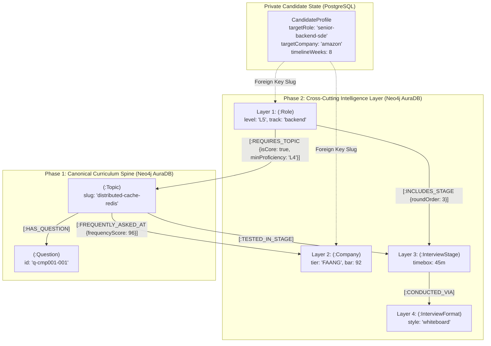
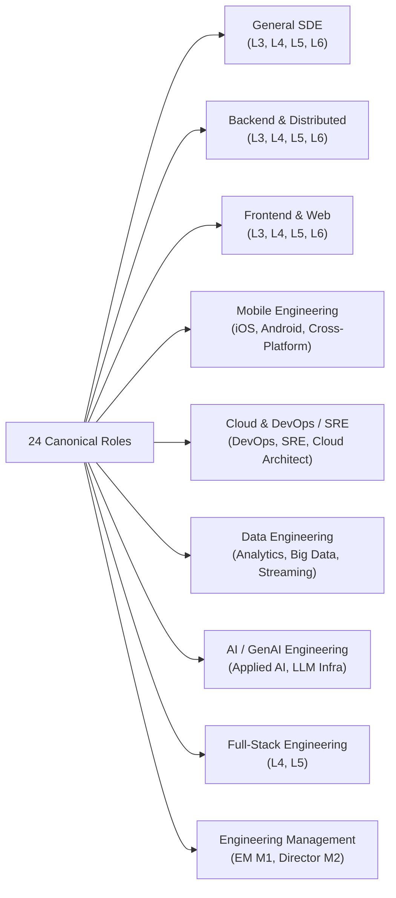

# PrepInMinutes — Cross-Cutting Intelligence Layer Specification (L1–L4)
## Universal Ontology for Roles, Companies, Interview Stages & Formats

> **Document Version:** 1.0.0  
> **Target Graph Engine:** Neo4j AuraDB (Cypher 5.x) & PostgreSQL (Neon DB State)  
> **Status:** 🟢 **APPROVED ARCHITECTURAL SPECIFICATION**  
> **Governing Standard:** [`docs/GENERIC_KNOWLEDGE_GRAPH_SCHEMA_SPEC.md`](./GENERIC_KNOWLEDGE_GRAPH_SCHEMA_SPEC.md) & [`docs/TASK_EXECUTION_SEQUENCE.md`](./TASK_EXECUTION_SEQUENCE.md)

---

## 1. Executive Summary & Purpose

In PrepInMinutes, technical curriculum domains (**10 Domains | 122 Categories | 371 Topics | 7,420 Master Questions**) provide the deep, immutable computer science taxonomy. However, software engineering candidates **do not prepare for abstract computer science in a vacuum**:
- They prepare for **specific career roles** at **distinct seniority levels** (e.g., *Senior Backend SDE [L5]* vs *Staff Distributed Systems Architect [L6]*).
- They interview with **specific target employers** with idiosyncratic hiring bars (e.g., *Amazon Leadership Principles + System Design* vs *Google Hard Algorithmic LeetCode + Concurrency*).
- They advance through **specific interview stages** (e.g., *Online Assessment $\to$ Technical Screen $\to$ Machine Coding $\to$ High-Level Design $\to$ Bar Raiser*).
- They operate inside **calibrated interview formats** with fixed timeboxes (e.g., *45-minute interactive whiteboard* vs *90-minute live machine coding*).

The **Cross-Cutting Intelligence Layer (L1–L4)** binds candidate onboarding profiles to the underlying curriculum graph through **four graph entities and their semantic relationships**:



---

## 2. Layer 1: Roles & Career Levels (`:Role`)

### 2.1 The Career Seniority Framework (L3 to L7 & M1 to M2)

PrepInMinutes adopts the canonical industry leveling standard mapped across Google, Amazon, Meta, and Microsoft:

| Career Level | Level Tag | Canonical Titles | Scope of Impact & Evaluation Expectation |
| :---: | :---: | :--- | :--- |
| **Junior / Associate** | **L3** | SDE-1, Software Engineer I, Frontend/Backend I | Core implementation, clean code, basic data structures, unit testing, task-level execution. |
| **Mid-Level** | **L4** | SDE-2, Software Engineer II | Independent feature delivery, end-to-end component design, debugging, concurrency, relational modeling. |
| **Senior** | **L5** | Senior SDE, Senior Engineer | System architecture, distributed trade-offs, operational resilience, tech debt management, mentoring. |
| **Staff** | **L6** | Staff SDE, Tech Lead Architect | Multi-team architectural strategy, platform scalability, cross-service contracts, high-leverage organizational influence. |
| **Principal** | **L7** | Principal Engineer, Distinguished Architect | Multi-year company technical vision, foundational platform redesigns, industry-wide engineering standards. |
| **Manager** | **M1** | Engineering Manager (EM) | Team delivery, sprint execution, talent acquisition, performance reviews, 1-on-1s, culture. |
| **Senior Director** | **M2** | Senior EM, Director of Engineering | Multi-team headcount strategy, executive stakeholder alignment, budget/FinOps, organizational health. |

### 2.2 The 24 Canonical Engineering Roles across 9 Disciplines

Every engineering role has a deterministic primary track and maps to a curated subset of the 371 curriculum topics:



#### Detailed Role Inventory:

1. `junior-general-sde` (SDE-1 / L3): General Software Engineer
2. `mid-general-sde` (SDE-2 / L4): Mid-Level Software Engineer
3. `senior-general-sde` (Senior SDE / L5): Senior Software Engineer
4. `staff-general-sde` (Staff SDE / L6): Staff Software Architect
5. `junior-backend-sde` (Junior Backend SDE / L3): Backend Developer
6. `mid-backend-sde` (Backend SDE-2 / L4): Backend Engineer
7. `senior-backend-sde` (Senior Backend SDE / L5): Senior Backend Engineer
8. `staff-backend-sde` (Staff Backend Architect / L6): Staff Distributed Systems Architect
9. `junior-frontend-sde` (Junior Frontend SDE / L3): Frontend Developer
10. `mid-frontend-sde` (Frontend SDE-2 / L4): Frontend Engineer
11. `senior-frontend-sde` (Senior Frontend SDE / L5): Senior Web Architect
12. `staff-frontend-sde` (Staff Frontend Architect / L6): Staff Frontend Platform Architect
13. `ios-native-engineer` (iOS Specialist / L4-L5): Native iOS Engineer
14. `android-native-engineer` (Android Specialist / L4-L5): Native Android Engineer
15. `crossplatform-mobile-engineer` (React Native / Flutter Lead / L5): Mobile Cross-Platform Lead
16. `devops-engineer` (DevOps SDE / L4): DevOps & CI/CD Engineer
17. `site-reliability-engineer` (SRE / L5): Site Reliability Engineer
18. `cloud-platform-architect` (Cloud Architect / L6): Enterprise Cloud Infrastructure Architect
19. `analytics-engineer` (Analytics Engineer / L4): Analytics & Modern Data Stack Engineer
20. `data-platform-engineer` (Data Engineer / L5): Big Data & Lakehouse Platform Engineer
21. `applied-ai-engineer` (Applied AI SDE / L4): GenAI & RAG Applications Engineer
22. `llm-infra-architect` (AI Systems Architect / L6): LLM Infrastructure & Serving Architect
23. `engineering-manager` (Engineering Manager / M1): Engineering Manager
24. `director-of-engineering` (Director / M2): Director of Engineering

### 2.3 Neo4j Role Schema & Property Invariants

```cypher
(:Role {
  slug: string,                    // Primary key: "senior-backend-sde" (UNIQUE)
  name: string,                    // "Senior Backend Engineer"
  level: string,                   // "L5" (L3, L4, L5, L6, L7, M1, M2)
  track: string,                   // "backend" (general, backend, frontend, mobile, cloud, data, ai, leadership)
  description: string,             // Role purpose and scope of responsibilities
  minProficiency: string,          // "L4" (Target learning level threshold: L1 to L5)
  expectedExperienceYears: string, // "5-8 years"
  createdAt: datetime(),
  updatedAt: datetime()
})
```

### 2.4 The `[:REQUIRES_TOPIC]` Semantic Edge

```cypher
(:Role)-[:REQUIRES_TOPIC {
  isCore: boolean,              // true for mandatory foundational topics; false for high-yield electives
  priorityScore: integer,       // 1 to 100 (relative importance of this topic to passing this role's interview)
  targetLevel: string,          // "L4" (Minimum depth expected: L1-L5)
  minimumDifficulty: string     // "ADVANCED" (BEGINNER, INTERMEDIATE, ADVANCED, EXPERT)
}]->(:Topic)
```

---

## 3. Layer 2: Companies & Interview Archetypes (`:Company`)

### 3.1 The 20 Canonical Tier-1 Tech Companies

PrepInMinutes models 20 high-frequency hiring tech enterprises, categorized into 3 market tiers:

| Company Name | Slug | Tier | Hiring Bar (0–100) | Distinctive Interview Culture & Weighting |
| :--- | :--- | :---: | :---: | :--- |
| **Google** | `google` | `TIER_1_FAANG` | 96 | Pure algorithmic problem solving (hard DSA), rigorous concurrency, large-scale systems, Googleiness. |
| **Meta** | `meta` | `TIER_1_FAANG` | 95 | Velocity, fast product coding, scalable systems design, API design, behavioral "Move Fast". |
| **Amazon** | `amazon` | `TIER_1_FAANG` | 92 | 16 Leadership Principles (LP), LP-driven STAR stories, operational excellence, Bar Raiser veto. |
| **Apple** | `apple` | `TIER_1_FAANG` | 94 | Hardware-software co-design, native performance, memory optimization, privacy, low-level internals. |
| **Netflix** | `netflix` | `TIER_1_FAANG` | 96 | High autonomy & responsibility, deep distributed systems, microservice resilience (Chaos Engineering), Senior ICs only. |
| **Microsoft** | `microsoft` | `TIER_1_FAANG` | 91 | Collaborative design, object-oriented principles, enterprise architecture, Growth Mindset. |
| **Uber** | `uber` | `TIER_1_UNICORN` | 94 | High-throughput low-latency systems, geospatial algorithms, 90-minute machine coding, distributed data. |
| **Stripe** | `stripe` | `TIER_1_UNICORN` | 97 | Clean code, practical bug-finding in real codebases, API ergonomics, idempotent financial transaction safety. |
| **Airbnb** | `airbnb` | `TIER_1_UNICORN` | 93 | End-to-end architecture, cross-functional collaboration, core values, high-polish UI and distributed caching. |
| **Databricks** | `databricks` | `TIER_1_UNICORN` | 96 | Distributed compute internals (Spark/Tungsten), open table formats (Delta/Iceberg), kernel performance. |
| **Snowflake** | `snowflake` | `TIER_1_UNICORN` | 95 | Database engine internals, query optimization, C++ vectorization, multi-tenant cloud storage. |
| **DoorDash** | `doordash` | `TIER_1_UNICORN` | 92 | Practical machine coding, logistics optimization, event-driven streaming, bias for action. |
| **Block (Square)** | `block` | `TIER_1_UNICORN` | 93 | Pair programming with engineers, clean architecture, financial ledger idempotency, open-source ethos. |
| **ByteDance (TikTok)**| `bytedance`| `TIER_1_UNICORN` | 95 | High-velocity LeetCode hard rounds, extreme scale recommendation systems, live streaming infra. |
| **Coinbase** | `coinbase` | `TIER_1_UNICORN` | 92 | Blockchain security, cryptographic key management, high-volume order book matching engines. |
| **Spotify** | `spotify` | `TIER_1_UNICORN` | 91 | Agile squads, client-side caching, audio streaming protocols, cultural autonomy & alignment. |
| **LinkedIn** | `linkedin` | `TIER_1_UNICORN` | 93 | Kafka streaming origins, graph processing, distributed consensus, Member First values. |
| **Salesforce** | `salesforce` | `ENTERPRISE` | 89 | Multi-tenant SaaS architecture, data security, enterprise CRM workflows, Ohana culture. |
| **Atlassian** | `atlassian` | `ENTERPRISE` | 90 | Values interview ("Open Company, No Bullshit"), clean machine coding, distributed team collaboration. |
| **Adobe** | `adobe` | `ENTERPRISE` | 89 | Creative Cloud rendering, digital media pipelines, document security, scalable web services. |

### 3.2 Neo4j Company Schema & Property Invariants

```cypher
(:Company {
  slug: string,                  // Primary key: "amazon" (UNIQUE)
  name: string,                  // "Amazon"
  tier: string,                  // "TIER_1_FAANG" (TIER_1_FAANG, TIER_1_UNICORN, ENTERPRISE)
  hiringBar: integer,            // 92 (Overall bar score out of 100)
  headquarters: string,          // "Seattle, WA"
  interviewCulture: string,      // "Leadership Principles heavy; Bar Raiser round has absolute veto power."
  focusAreas: string[],          // ["Distributed Systems", "Leadership Principles", "Operational Excellence"]
  createdAt: datetime(),
  updatedAt: datetime()
})
```

### 3.3 The `[:FREQUENTLY_ASKED_AT]` Semantic Edge

```cypher
(:Topic)-[:FREQUENTLY_ASKED_AT {
  frequencyScore: integer,       // 0 to 100 (relative frequency of this topic appearing in company interviews)
  lastTrend: string,             // "HOT" (SURGING, HOT, STABLE, COOLING)
  interviewStage: string,        // "system-design-hld" (default round where this topic is tested)
  weight: integer                // Weight multiplier in roadmap ranking
}]->(:Company)
```

---

## 4. Layer 3: Interview Stages & Evaluation Rounds (`:InterviewStage`)

### 4.1 The 8 Canonical Interview Rounds

Hiring loops at premier tech companies are broken down into standard evaluative rounds:

| Stage Name | Slug | Default Timebox | Core Evaluative Focus | Target Domains |
| :--- | :--- | :---: | :--- | :--- |
| **Online Assessment** | `online-assessment` | 75 min | Automated automated screening, LeetCode style correctness, algorithmic Big-O, edge cases. | `dsa` |
| **Technical Phone Screen** | `technical-phone-screen` | 45 min | Live problem solving, communication, baseline algorithmic fluency, technical background. | `dsa`, `backend-engineering` |
| **Live Coding Round** | `live-coding-dsa` | 60 min | Problem breakdown, optimal data structure selection, runtime invariants, edge case verification. | `dsa` |
| **Machine Coding / LLD** | `machine-coding-lld` | 90 min | Object-oriented design, clean code, SOLID principles, concurrency, unit tests, working implementation. | `low-level-design` |
| **High-Level System Design** | `system-design-hld` | 45 min | Scalability, trade-offs, fault tolerance, data modeling, network protocols, distributed consensus. | `system-design`, `ai-system-design` |
| **Domain Deep Dive** | `domain-deep-dive` | 45 min | Specialized framework/runtime depth: Swift ARC, Compose, Spark Catalyst, Kubernetes, React fiber. | `frontend`, `mobile`, `cloud`, `data` |
| **Behavioral & STAR Round** | `behavioral-leadership`| 45 min | Conflict resolution, leadership, failure ownership, customer focus, cross-functional collaboration. | `behavioral-leadership` |
| **Bar Raiser / Executive** | `bar-raiser-executive` | 45 min | Company culture alignment, high-leverage decision making, strategic influence, hiring calibration. | `behavioral-leadership` |

### 4.2 Neo4j Interview Stage Schema

```cypher
(:InterviewStage {
  slug: string,                  // Primary key: "system-design-hld" (UNIQUE)
  name: string,                  // "High-Level System Design (HLD)"
  category: string,              // "ARCHITECTURE" (CODING, ARCHITECTURE, DOMAIN, BEHAVIORAL)
  defaultTimeboxMin: integer,    // 45
  evaluationFocus: string,       // "Scalability, distributed storage, reliability, trade-offs."
  description: string,
  createdAt: datetime(),
  updatedAt: datetime()
})
```

### 4.3 Stage Relationships: `[:INCLUDES_STAGE]` & `[:TESTED_IN_STAGE]`

```cypher
// Role includes interview round in its standard hiring loop:
(:Role)-[:INCLUDES_STAGE {
  roundOrder: integer,           // 1, 2, 3, 4, 5
  isMandatory: boolean,          // true for required rounds, false for optional screens
  weight: integer                // Weight in hiring decision
}]->(:InterviewStage)

// Topic is evaluated during specific stage:
(:Topic)-[:TESTED_IN_STAGE {
  relevanceScore: integer        // 1 to 100
}]->(:InterviewStage)
```

---

## 5. Layer 4: Interview Formats & Timebox Calibrations (`:InterviewFormat`)

### 5.1 The 5 Canonical Formats

Interview formats dictate how the candidate interacts with the interviewer and tools during a stage:

| Format Name | Slug | Default Timebox | Interactive Tooling & Pacing Rules |
| :--- | :--- | :---: | :--- |
| **Interactive Whiteboard** | `interactive-whiteboard` | 45 min | Box-and-arrow canvas, vector component nodes (DB, Cache, LB), 10m requirements $\to$ 15m HLD $\to$ 15m deep-dive $\to$ 5m scale. |
| **Pair Programming IDE** | `pair-programming-ide` | 45–60 min | Live synchronized code editor, syntax highlighting, test runner execution, collaborative debugging. |
| **Timed Machine Coding** | `timed-machine-coding` | 90 min | Full scaffolding workspace, multi-file design, running unit test suite, timebox submit confirmation. |
| **Conversational Voice Q&A** | `conversational-voice-qa`| 45 min | Low-latency audio dock with Sarah AI persona, animated waveform, barge-in interruption handler, STAR probes. |
| **Architecture Defense / RFC**| `take-home-defense` | 45 min | Deep dive into technical trade-offs, defensive design questions, defending design decisions under scrutiny. |

### 5.2 Neo4j Interview Format Schema

```cypher
(:InterviewFormat {
  slug: string,                  // Primary key: "interactive-whiteboard" (UNIQUE)
  name: string,                  // "Interactive Architecture Whiteboard"
  style: string,                 // "DIAGRAM_COLLABORATIVE" (CODE_EXECUTION, DIAGRAM_COLLABORATIVE, AUDIO_CONVERSATIONAL)
  defaultTimeboxMin: integer,    // 45
  pacingGuide: string,           // "0-5m Scope | 5-20m High-Level Design | 20-35m Deep Dive | 35-45m Failure & Scale"
  createdAt: datetime(),
  updatedAt: datetime()
})

// Stage is conducted via format:
(:InterviewStage)-[:CONDUCTED_VIA]->(:InterviewFormat)
```

---

## 6. Graph Schema Integrity & Database Constraints

To guarantee zero duplicate nodes and deterministic upsert operations, the following constraints must be enforced in **Neo4j AuraDB**:

```cypher
// 1. Role Constraints
CREATE CONSTRAINT role_slug_unique IF NOT EXISTS FOR (r:Role) REQUIRE r.slug IS UNIQUE;

// 2. Company Constraints
CREATE CONSTRAINT company_slug_unique IF NOT EXISTS FOR (c:Company) REQUIRE c.slug IS UNIQUE;

// 3. Interview Stage Constraints
CREATE CONSTRAINT interview_stage_slug_unique IF NOT EXISTS FOR (s:InterviewStage) REQUIRE s.slug IS UNIQUE;

// 4. Interview Format Constraints
CREATE CONSTRAINT interview_format_slug_unique IF NOT EXISTS FOR (f:InterviewFormat) REQUIRE f.slug IS UNIQUE;

// 5. Index for fast frequency score sorting
CREATE INDEX topic_frequency_score_idx IF NOT EXISTS FOR ()-[r:FREQUENTLY_ASKED_AT]-() ON (r.frequencyScore);
CREATE INDEX role_topic_priority_idx IF NOT EXISTS FOR ()-[r:REQUIRES_TOPIC]-() ON (r.priorityScore);
```

---

## 7. The Tailored Preparation Roadmap Engine (`TASK-P2-03`)

### 7.1 Algorithmic Formulation

When a candidate inputs:
$$\text{Input} = \big( \text{targetRoleSlug}, \text{targetCompanySlug}, \text{timelineWeeks}, \text{currentReadinessScore} \big)$$

The roadmap engine executes a deterministic graph synthesis:

$$\text{RoadmapScore}(t) = \alpha \cdot \text{RolePriority}(t) + \beta \cdot \text{CompanyFrequency}(t) + \gamma \cdot \text{DomainWeight}(t)$$

Where:
- $\alpha = 0.55$: Role essentiality (guarantees candidate learns core principles required by their seniority level).
- $\beta = 0.35$: Target company hiring trends (guarantees candidate practices high-frequency topics asked at their target employer).
- $\gamma = 0.10$: Market trend multiplier (SURGING = $1.15$, HOT = $1.05$, STABLE = $1.00$).

### 7.2 The Master Cypher Query for Personalized Roadmap Generation

```cypher
MATCH (r:Role {slug: $targetRoleSlug})
MATCH (c:Company {slug: $targetCompanySlug})

// Match all topics required by Role
MATCH (r)-[req:REQUIRES_TOPIC]->(t:Topic)
MATCH (cat:Category)-[:HAS_TOPIC]->(t)
MATCH (d:Domain)-[:CONTAINS]->(cat)

// Optionally match company frequency edge
OPTIONAL MATCH (t)-[freq:FREQUENTLY_ASKED_AT]->(c)

WITH r, c, d, cat, t, req,
     coalesce(freq.frequencyScore, 50) AS companyFreqScore,
     CASE t.trend
       WHEN 'SURGING' THEN 1.15
       WHEN 'HOT' THEN 1.05
       ELSE 1.0
     END AS trendMultiplier

// Calculate blended composite score
WITH d, cat, t, req, companyFreqScore,
     round((0.55 * req.priorityScore + 0.35 * companyFreqScore) * trendMultiplier) AS compositeScore

// Fetch prerequisites to build valid DAG
OPTIONAL MATCH (prereq:Topic)-[:PREREQUISITE_OF]->(t)

RETURN t.slug AS topicSlug,
       t.topicId AS topicId,
       t.title AS title,
       t.difficulty AS difficulty,
       t.durationMin AS durationMin,
       cat.slug AS categorySlug,
       d.slug AS domainSlug,
       req.isCore AS isCore,
       compositeScore AS priorityScore,
       collect(DISTINCT prereq.slug) AS prerequisites
ORDER BY compositeScore DESC, t.priority ASC
```

### 7.3 Prerequisite Topological Ordering Guarantee

To guarantee the generated preparation plan has **zero ordering violations** (i.e. a candidate is never assigned a complex system design before mastering foundational caching), the backend executes Kahn's Algorithm on the returned Cypher topic nodes:

```ts
export function scheduleTopologicalRoadmap(
  topics: Array<{ slug: string; prerequisites: string[]; priorityScore: number }>,
  timelineWeeks: number,
  weeklyHours: number
): WeeklyMilestone[] {
  // 1. Construct DAG adjacency and in-degree map
  // 2. Prioritize zero in-degree nodes using max-heap sorted by priorityScore
  // 3. Bucket into weekly milestones based on durationMin <= weeklyHours * 60
  // 4. Return strictly ordered milestones
}
```

---

## 8. Seeding & Implementation Architecture

### 8.1 File Structure in `prepinminutes-backend`

```
prepinminutes-backend/scripts/
├── seed-data/
│   ├── roles/
│   │   ├── types.ts                     // RoleSeed interface
│   │   ├── roles-list.ts                // 24 Canonical Roles
│   │   └── role-topic-mappings.ts       // [:REQUIRES_TOPIC] edges across 371 topics
│   ├── companies/
│   │   ├── types.ts                     // CompanySeed interface
│   │   ├── companies-list.ts            // 20 Tier-1 Tech Companies
│   │   └── company-topic-mappings.ts    // [:FREQUENTLY_ASKED_AT] edges
│   └── stages-formats/
│       ├── types.ts
│       ├── stages.ts                    // 8 Canonical Interview Stages
│       └── formats.ts                   // 5 Canonical Interview Formats
├── seed-roles-incremental.ts            // Seeds :Role nodes & [:REQUIRES_TOPIC]
├── seed-companies-incremental.ts        // Seeds :Company nodes & [:FREQUENTLY_ASKED_AT]
├── seed-stages-formats-incremental.ts   // Seeds :InterviewStage, :InterviewFormat & links
└── audit-intelligence-layer.ts          // Audits graph integrity & tests roadmap generation
```

### 8.2 Execution & Verification Checklist

1. **Dry-Run Validation**:
   - `npm run tsx scripts/seed-roles-incremental.ts --dry-run`
   - `npm run tsx scripts/seed-companies-incremental.ts --dry-run`
   - `npm run tsx scripts/seed-stages-formats-incremental.ts --dry-run`
   - Verify: 24 roles, 20 companies, 8 stages, 5 formats, 0 broken topic slugs.
2. **Schema Constraints Enforcement**:
   - Verify unique constraints for `Role.slug`, `Company.slug`, `InterviewStage.slug`, `InterviewFormat.slug`.
3. **Live Sync to Neo4j AuraDB**:
   - Pure `MERGE` statements; idempotent and safe to re-run.
4. **End-to-End Roadmap Query Test**:
   - Execute `scripts/audit-intelligence-layer.ts` to test roadmap synthesis for Amazon Senior SDE, Google L4, and Uber Staff Architect.
