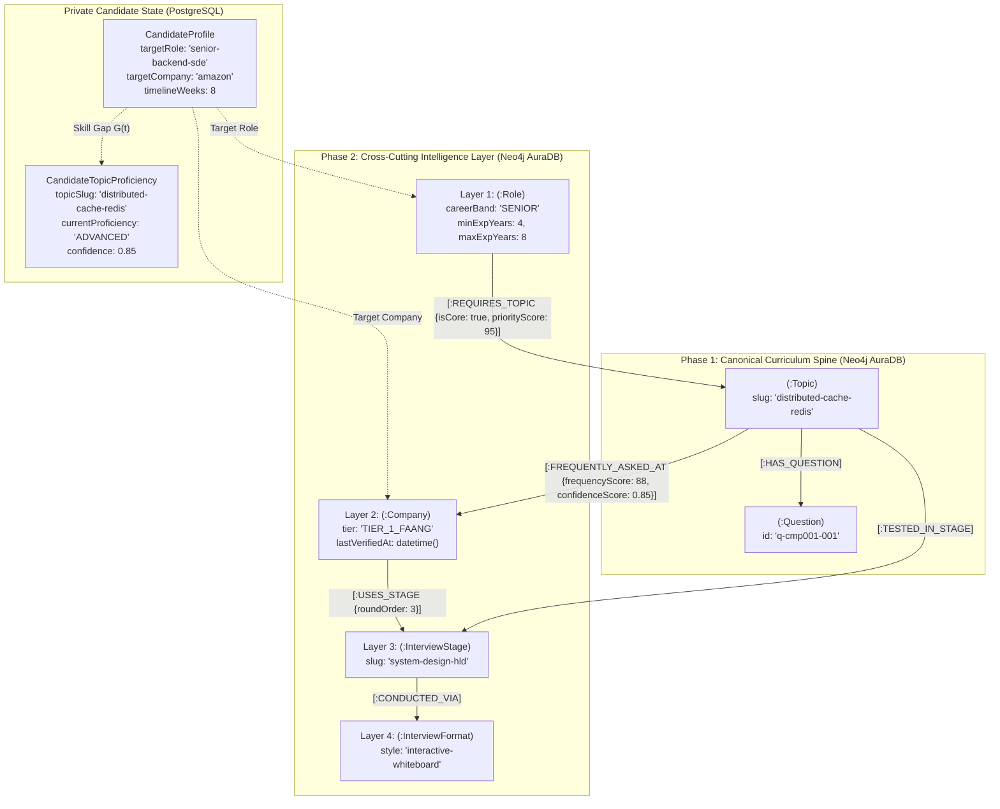
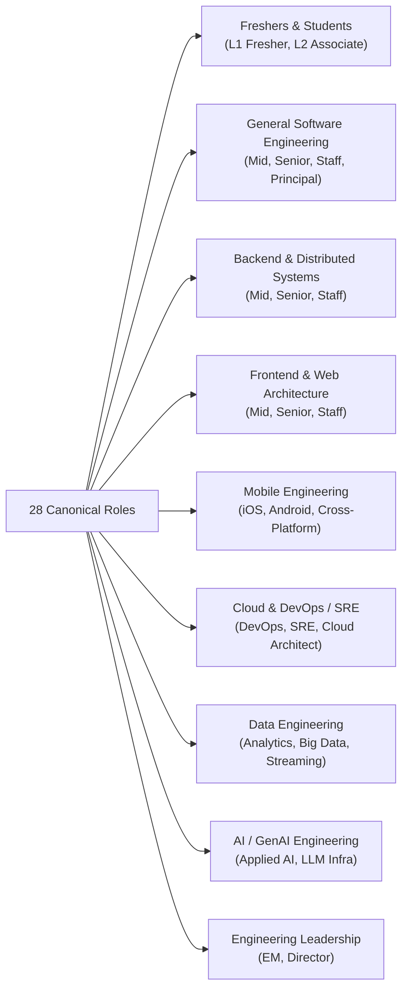
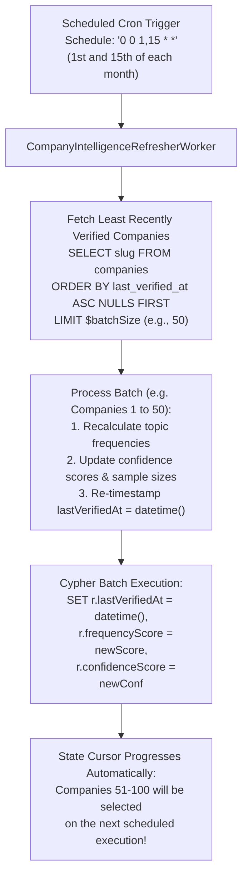
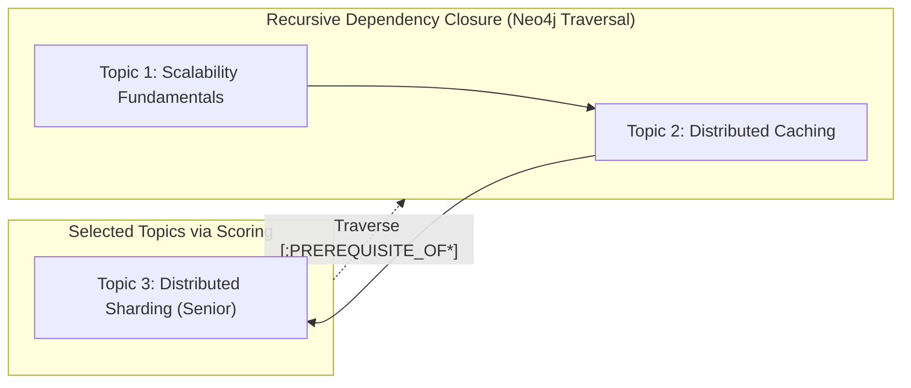
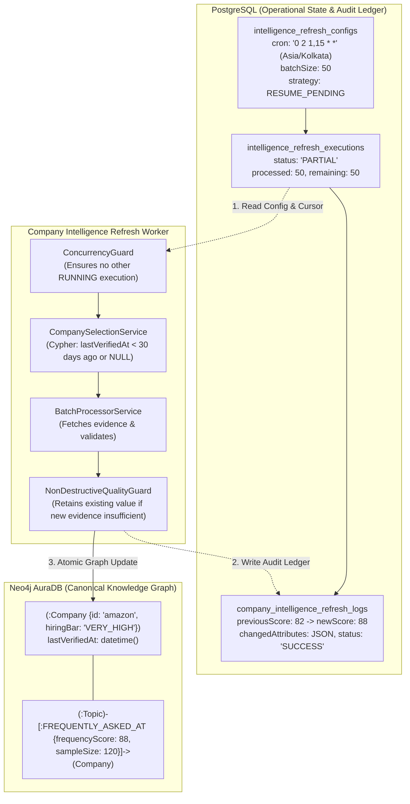

# PrepInMinutes — Cross-Cutting Intelligence Layer Specification (L1–L4)
## Universal Ontology for Roles, Companies, Interview Stages & Formats

> **Document Version:** 1.1.0 (Production Architectural Revision)  
> **Target Graph Engine:** Neo4j AuraDB (Cypher 5.x) & PostgreSQL (Neon DB State)  
> **Status:** 🟢 **APPROVED ARCHITECTURAL SPECIFICATION**  
> **Governing Standard:** [`docs/GENERIC_KNOWLEDGE_GRAPH_SCHEMA_SPEC.md`](./GENERIC_KNOWLEDGE_GRAPH_SCHEMA_SPEC.md) & [`docs/TASK_EXECUTION_SEQUENCE.md`](./TASK_EXECUTION_SEQUENCE.md)

---

## 1. Executive Summary & Purpose

In PrepInMinutes, Phase 1 established the canonical computer science curriculum (**10 Domains | 122 Categories | 371 Topics | 7,420 Master Questions**). However, software engineering candidates **do not prepare for computer science in an abstract vacuum**:
- They prepare for **specific career roles** at **distinct career bands**, from college students with 0 experience to Staff/Principal architects.
- They interview with **specific target employers** with distinctive evaluation bars and high-frequency topics.
- They advance through **specific interview stages** in company-specific interview loops.
- They operate inside **calibrated interview formats** with fixed timeboxes and tooling.
- Crucially, they arrive with **existing knowledge and skill gaps** that must dynamically shape their learning priority.

The **Cross-Cutting Intelligence Layer (L1–L4)** binds candidate onboarding intent and existing proficiency directly to the 371 curriculum topics through an evidence-backed, prerequisite-closed graph traversal:



---

## 2. Layer 1: Roles, Career Bands & Fresher Architecture (`:Role`)

### 2.1 The 7 Standardized Career Bands (Decoupled from Company Payroll Codes)

To eliminate confusion between Big Tech internal payroll levels (like Google L5 vs Amazon L6) and provide clear, intuitive entry points for college freshers with 0 experience, PrepInMinutes standardizes on **7 universal career bands**:

| Career Band | Code | Experience Bounds | Target Audience & Hiring Context | Evaluation Focus |
| :--- | :---: | :---: | :--- | :--- |
| **Student / Fresher** | `STUDENT_FRESHER` | **0 – 1 Years** | College students, campus placements, internships, career switchers with 0 production experience. | Core DSA (Arrays, Strings, Trees), CS fundamentals (OS, DBMS, CN), SQL queries, academic resume project defense. |
| **Associate Engineer** | `ASSOCIATE` | **0.5 – 2 Years** | First full-time engineering role, Junior Associate SDE. | Clean code, unit testing, Git hygiene, REST APIs, basic OOP design patterns, intermediate DSA. |
| **Mid-Level Engineer** | `MID_LEVEL` | **2 – 5 Years** | SDE-2, Independent feature owner. | Low-Level Design (LLD), microservices, database sharding/indexing, concurrency, end-to-end features. |
| **Senior Engineer** | `SENIOR` | **4 – 8 Years** | Senior SDE, Tech Lead. | High-Level Design (HLD), distributed trade-offs, fault tolerance, non-functional requirements, team mentorship. |
| **Staff Architect** | `STAFF` | **8 – 12+ Years** | Staff SDE, Principal Architect. | Multi-system scalability, tech strategy, organizational architecture, cross-domain technical influence. |
| **Principal / Fellow** | `PRINCIPAL` | **12+ Years** | Principal Engineer, Distinguished Architect. | Enterprise platform evolution, multi-year technology vision, executive-level technical leadership. |
| **Management** | `MANAGEMENT` | **4+ Years Lead** | Engineering Manager (EM), Director of Engineering. | Delivery management, hiring bar, 1-on-1s, performance management, engineering culture, executive reporting. |

### 2.2 Decoupled Company Level Equivalents

The `:Role` node stores company-specific equivalents as an explicit mapping rather than conflating them with universal seniority:

```json
{
  "careerBand": "SENIOR",
  "companyEquivalents": {
    "google": "L5",
    "amazon": "L6 (Senior SDE)",
    "meta": "E5",
    "microsoft": "63-64",
    "apple": "ICT4",
    "uber": "L5b"
  }
}
```

### 2.3 The 28 Canonical Engineering Roles across 9 Disciplines



#### Detailed Role Inventory:
1. `campus-fresher-sde` (`STUDENT_FRESHER`): College Campus Placement & Graduate SDE (Exp: 0–1 yrs)
2. `fresher-frontend-engineer` (`STUDENT_FRESHER`): Entry-Level Web Developer (Exp: 0–1 yrs)
3. `fresher-backend-engineer` (`STUDENT_FRESHER`): Entry-Level Backend Developer (Exp: 0–1 yrs)
4. `associate-software-engineer` (`ASSOCIATE`): Early Career Associate SDE (Exp: 0.5–2 yrs)
5. `mid-general-sde` (`MID_LEVEL`): Mid-Level Software Engineer (Exp: 2–5 yrs)
6. `senior-general-sde` (`SENIOR`): Senior Software Engineer (Exp: 4–8 yrs)
7. `staff-general-sde` (`STAFF`): Staff Software Architect (Exp: 8–12 yrs)
8. `principal-software-engineer` (`PRINCIPAL`): Principal Engineer (Exp: 12+ yrs)
9. `mid-backend-sde` (`MID_LEVEL`): Backend Engineer (Exp: 2–5 yrs)
10. `senior-backend-sde` (`SENIOR`): Senior Backend Engineer (Exp: 4–8 yrs)
11. `staff-backend-sde` (`STAFF`): Staff Distributed Systems Architect (Exp: 8–12 yrs)
12. `mid-frontend-sde` (`MID_LEVEL`): Frontend Engineer (Exp: 2–5 yrs)
13. `senior-frontend-sde` (`SENIOR`): Senior Web Architect (Exp: 4–8 yrs)
14. `staff-frontend-sde` (`STAFF`): Staff Frontend Platform Architect (Exp: 8–12 yrs)
15. `ios-native-engineer` (`MID_LEVEL` / `SENIOR`): Native iOS Engineer
16. `android-native-engineer` (`MID_LEVEL` / `SENIOR`): Native Android Engineer
17. `crossplatform-mobile-engineer` (`SENIOR`): React Native / Flutter Platform Lead
18. `devops-engineer` (`MID_LEVEL`): DevOps & CI/CD Engineer
19. `site-reliability-engineer` (`SENIOR`): Site Reliability Engineer (SRE)
20. `cloud-platform-architect` (`STAFF`): Enterprise Cloud Infrastructure Architect
21. `analytics-engineer` (`MID_LEVEL`): Analytics & Modern Data Stack Engineer
22. `data-platform-engineer` (`SENIOR`): Big Data & Lakehouse Platform Engineer
23. `streaming-data-engineer` (`SENIOR`): Real-Time Streaming Systems Engineer
24. `applied-ai-engineer` (`MID_LEVEL`): GenAI & RAG Applications Engineer
25. `llm-infra-architect` (`STAFF`): LLM Infrastructure & Serving Architect
26. `engineering-manager` (`MANAGEMENT`): Engineering Manager (EM)
27. `director-of-engineering` (`MANAGEMENT`): Director of Engineering
28. `fullstack-engineer` (`MID_LEVEL` / `SENIOR`): Full-Stack Product Engineer

### 2.4 Neo4j Role Schema & Property Invariants

```cypher
(:Role {
  slug: string,                     // Primary key: "campus-fresher-sde" (UNIQUE)
  name: string,                     // "Campus Graduate & Fresher SDE"
  careerBand: string,               // "STUDENT_FRESHER" (STUDENT_FRESHER, ASSOCIATE, MID_LEVEL, SENIOR, STAFF, PRINCIPAL, MANAGEMENT)
  track: string,                    // "general" (general, backend, frontend, mobile, cloud, data, ai, leadership)
  description: string,              // Comprehensive role scope
  minProficiency: string,           // "L1" (Target learning level threshold: L1 to L5)
  minExperienceYears: integer,      // 0 (Numeric bound for precise candidate filtering)
  maxExperienceYears: integer,      // 1 (Numeric bound)
  companyEquivalents: string,       // Serialized JSON map of company-specific leveling
  createdAt: datetime(),
  updatedAt: datetime()
})
```

### 2.5 The `[:REQUIRES_TOPIC]` Semantic Edge

```cypher
(:Role)-[:REQUIRES_TOPIC {
  isCore: boolean,               // true for mandatory foundational topics; false for high-yield electives
  priorityScore: integer,        // 1 to 100 (relative importance of this topic to passing this role's interview)
  targetLevel: string,           // "L2" (Target Bloom taxonomy level: L1 to L5)
  minimumDifficulty: string      // "BEGINNER" (BEGINNER, INTERMEDIATE, ADVANCED, EXPERT)
}]->(:Topic)
```

---

## 3. Layer 2: Companies, Evidence Provenance & Periodic Refresh (`:Company`)

### 3.1 Eliminating Fabricated Precision: Evidence & Confidence Standards

Rather than assigning arbitrary hiring bar scores (e.g. `hiringBar: 96`), company interview intelligence is backed by **statistical provenance and confidence metrics**:

```cypher
(:Topic)-[:FREQUENTLY_ASKED_AT {
  frequencyScore: integer,       // 0 to 100 (relative frequency score)
  confidenceScore: float,        // 0.00 to 1.00 (statistical confidence based on sample size and verification)
  sampleSize: integer,           // Number of verified interview experiences analyzed
  sourceType: string,            // "VERIFIED_DEBRIEFS" | "CURATED_CURRICULUM" | "COMMUNITY_REPORTED"
  lastVerifiedAt: datetime(),    // Timestamp of last verification
  primaryStage: string,          // "system-design-hld" (default round where this topic is tested)
  weight: integer                // Weight multiplier in roadmap ranking (1 to 100)
}]->(:Company)
```

> **Evaluation Rule**: A topic with `frequency: 85, confidence: 0.90` mathematically outranks a topic with `frequency: 90, confidence: 0.20` because unverified signals carry higher risk of wasting the candidate's finite preparation time.

### 3.2 The 20 Canonical Tier-1 Tech Companies

| Company Name | Slug | Market Tier | Verified Interview Culture & Distinctive Philosophy | Primary Hiring Pillars |
| :--- | :--- | :---: | :--- | :--- |
| **Google** | `google` | `TIER_1_FAANG` | Pure algorithmic problem solving (hard DSA), rigorous concurrency, large-scale systems, Googleiness. | Hard DSA, System Design, Concurrency |
| **Meta** | `meta` | `TIER_1_FAANG` | Fast execution velocity, product architecture, live coding with speed, behavioral "Move Fast". | Fast Coding, System Design, API Design |
| **Amazon** | `amazon` | `TIER_1_FAANG` | 16 Leadership Principles (LP), STAR behavioral stories, operational excellence, Bar Raiser veto. | Leadership Principles, HLD, LLD |
| **Apple** | `apple` | `TIER_1_FAANG` | Hardware-software co-design, native performance, memory optimization, low-level OS internals. | Low-Level Systems, Performance, Architecture |
| **Netflix** | `netflix` | `TIER_1_FAANG` | High autonomy & responsibility, deep distributed systems, microservice resilience, Senior ICs. | Distributed Systems, Microservices, Chaos |
| **Microsoft** | `microsoft` | `TIER_1_FAANG` | Collaborative design, object-oriented principles, enterprise architecture, Growth Mindset. | OOP / Clean Code, System Design, DSA |
| **Uber** | `uber` | `TIER_1_UNICORN` | High-throughput low-latency systems, geospatial algorithms, 90-minute machine coding. | Machine Coding, HLD, Concurrency |
| **Stripe** | `stripe` | `TIER_1_UNICORN` | Clean code, practical bug-finding in real codebases, API ergonomics, idempotent financial transactions. | Bug Hunting, API Design, Idempotency |
| **Airbnb** | `airbnb` | `TIER_1_UNICORN` | End-to-end architecture, cross-functional collaboration, core values, high-polish UI & caching. | Full-Stack Architecture, Core Values, Caching |
| **Databricks** | `databricks` | `TIER_1_UNICORN` | Distributed compute internals (Spark/Tungsten), open table formats (Delta/Iceberg), kernel speed. | Spark Internals, Distributed Storage, C++ |
| **Snowflake** | `snowflake` | `TIER_1_UNICORN` | Database engine internals, query optimization, C++ vectorization, multi-tenant cloud storage. | Query Optimizers, Database Internals, C++ |
| **DoorDash** | `doordash` | `TIER_1_UNICORN` | Practical machine coding, logistics optimization, event-driven streaming, bias for action. | Machine Coding, Event Streaming, LLD |
| **Block (Square)** | `block` | `TIER_1_UNICORN` | Pair programming with engineers, clean architecture, financial ledger idempotency, open-source. | Pair Programming, Ledger Safety, TDD |
| **ByteDance** | `bytedance` | `TIER_1_UNICORN` | High-velocity LeetCode hard rounds, extreme scale recommendation systems, live streaming infra. | Hard DSA, High-Throughput Streaming, HLD |
| **Coinbase** | `coinbase` | `TIER_1_UNICORN` | Blockchain security, cryptographic key management, high-volume order book matching engines. | Cryptography, Security, Concurrency |
| **Spotify** | `spotify` | `TIER_1_UNICORN` | Autonomous squads, client-side caching, audio streaming protocols, cultural autonomy. | Mobile / Web Architecture, Event Streaming |
| **LinkedIn** | `linkedin` | `TIER_1_UNICORN` | Kafka streaming origins, graph processing, distributed consensus, Member First values. | Distributed Logs, Kafka, System Design |
| **Salesforce** | `salesforce` | `ENTERPRISE` | Multi-tenant SaaS architecture, data security, enterprise CRM workflows, Ohana culture. | Multi-Tenancy, Enterprise Architecture, OOP |
| **Atlassian** | `atlassian` | `ENTERPRISE` | Values interview ("Open Company, No Bullshit"), clean machine coding, distributed collaboration. | Machine Coding, Values Round, Clean Code |
| **Adobe** | `adobe` | `ENTERPRISE` | Creative Cloud rendering, digital media pipelines, document security, scalable web services. | C++ / Graphics, Web Architecture, Microservices |

### 3.3 Company-Specific Interview Loops: `(:Company)-[:USES_STAGE]`

Companies do not run the same interview stages. PrepInMinutes models each company's verified hiring loop:

```cypher
(:Company)-[:USES_STAGE {
  roundOrder: integer,           // 1, 2, 3, 4, 5 (Order in hiring loop)
  isEliminationRound: boolean,   // true for rounds that cause immediate rejection if failed (e.g. Amazon Bar Raiser, OA)
  stageWeight: integer           // Relative weight in final hiring debrief (1 to 100)
}]->(:InterviewStage)
```

### 3.4 Periodic Company Intelligence Batch Refresh Worker (Cron with State Cursor)

To prevent market trend staleness without incurring massive API/LLM rate-limits or database contention, PrepInMinutes implements a **periodic round-robin batch refresher**:



#### Configuration & Behavior Contract:
1. **Configurable Schedule**: Defaults to twice a month (`0 0 1,15 * *` at midnight UTC).
2. **Configurable Batch Window**: `BATCH_SIZE = 50` (or `MAX_COMPANIES_PER_RUN`).
3. **State Cursor via Timestamp Sorting**: By querying `ORDER BY c.lastVerifiedAt ASC NULLS FIRST LIMIT $BATCH_SIZE`, the worker naturally maintains a self-healing state cursor. The 50 companies updated on the 1st of the month will have the newest timestamps; the next run on the 15th will automatically pick the remaining 50 companies.
4. **Audit Trail**: Every update writes an immutable audit record to `company_intelligence_audit_log` with before/after frequency deltas.

---

## 4. Layer 3: Interview Stages & Evaluation Rounds (`:InterviewStage`)

### 4.1 The 9 Canonical Interview Stages

| Stage Name | Slug | Default Timebox | Core Evaluative Focus | Target Domains |
| :--- | :--- | :---: | :--- | :--- |
| **Online Assessment (OA)** | `online-assessment` | 75 min | Automated screening, LeetCode correctness, algorithmic complexity, boundary edge cases. | `dsa` |
| **Technical Phone Screen** | `technical-phone-screen` | 45 min | Live coding fluency, communication clarity, problem breakdown, candidate background. | `dsa`, `backend-engineering` |
| **Live Coding & Algorithms** | `live-coding-dsa` | 60 min | Optimal data structures, runtime analysis, edge case defensive handling, clean code. | `dsa` |
| **Machine Coding / LLD** | `machine-coding-lld` | 90 min | Object-oriented design, clean code, SOLID principles, concurrency, unit tests, working code. | `low-level-design` |
| **High-Level System Design** | `system-design-hld` | 45 min | Scalability, trade-offs, fault tolerance, data modeling, network protocols, distributed consensus. | `system-design`, `ai-system-design` |
| **Domain Deep Dive** | `domain-deep-dive` | 45 min | Specialized platform internals: Swift ARC, Jetpack Compose, Spark Catalyst, Kubernetes. | `frontend`, `mobile`, `cloud`, `data` |
| **Behavioral & STAR Round** | `behavioral-leadership`| 45 min | Conflict resolution, leadership, failure ownership, customer focus, cross-functional impact. | `behavioral-leadership` |
| **Bar Raiser / Values Round** | `bar-raiser-values` | 45 min | Company culture calibration (e.g. Amazon LP, Googleiness), hiring bar veto authority. | `behavioral-leadership` |
| **Architecture Defense / RFC** | `architecture-defense-rfc`| 60 min | Defending technical trade-offs, handling counter-proposals, architectural decision records (ADR). | `system-design`, `ai-system-design` |

### 4.2 Hierarchical Stages: Parent-Child Stage Groupings

To avoid treating every hiring loop as identical, stages support hierarchical parent-child relationships:

```cypher
(:InterviewStage {slug: "machine-coding-lld"})-[:SUB_STAGE_OF]->(:InterviewStage {slug: "technical-onsite"})
```

---

## 5. Layer 4: Interview Formats & Decoupled Tooling (`:InterviewFormat`)

### 5.1 The 6 Canonical Formats

Interview formats define the interactive tooling and pacing constraints within a session:

| Format Name | Slug | Default Timebox | Interactive Tooling & Pacing Rules |
| :--- | :--- | :---: | :--- |
| **Interactive Whiteboard** | `interactive-whiteboard` | 45 min | Box-and-arrow canvas, vector component nodes (DB, Cache, LB), 10m requirements $\to$ 15m HLD $\to$ 15m deep dive $\to$ 5m scale. |
| **Pair Programming IDE** | `pair-programming-ide` | 45–60 min | Live synchronized code editor, syntax highlighting, test runner execution, collaborative debugging. |
| **Timed Machine Coding** | `timed-machine-coding` | 90 min | Full scaffolding workspace, multi-file design, running unit test suite, timebox submit confirmation. |
| **Conversational Voice Q&A** | `conversational-voice-qa`| 45 min | Low-latency audio dock with Sarah AI persona, animated waveform, barge-in interruption handler, STAR probes. |
| **Take-Home Assignment** | `take-home-assignment` | 180 min | Independent scoped project implementation, GitHub PR submission, test coverage evaluation. |
| **Written RFC Defense** | `written-rfc-defense` | 60 min | Architectural trade-off document presentation, defending design decisions under adversarial cross-examination. |

### 5.2 Decoupled M:N Stage-to-Format Mapping

A stage is not locked into a single format. For example, `system-design-hld` can be conducted via `interactive-whiteboard` or `conversational-voice-qa`:

```cypher
(:InterviewStage)-[:CONDUCTED_VIA {
  isDefault: boolean,
  pacingNotes: string
}]->(:InterviewFormat)
```

---

## 6. Private Candidate Intelligence Bridge (PostgreSQL State)

Neo4j stores the immutable curriculum and cross-cutting relationships. The **PostgreSQL relational database** stores private candidate proficiency:

```sql
-- Private Candidate Topic Proficiency State in PostgreSQL
CREATE TABLE candidate_topic_proficiency (
  id UUID PRIMARY KEY DEFAULT gen_random_uuid(),
  candidate_id UUID NOT NULL REFERENCES candidate_profiles(id) ON DELETE CASCADE,
  topic_slug VARCHAR(128) NOT NULL, -- FK referencing Neo4j Topic.slug
  current_proficiency VARCHAR(16) NOT NULL DEFAULT 'UNKNOWN', -- 'UNKNOWN', 'BEGINNER', 'INTERMEDIATE', 'ADVANCED', 'EXPERT'
  target_proficiency VARCHAR(16) NOT NULL DEFAULT 'ADVANCED',
  confidence_score NUMERIC(3, 2) NOT NULL DEFAULT 0.50, -- 0.00 to 1.00
  last_assessed_at TIMESTAMP WITH TIME ZONE,
  assessment_source VARCHAR(32) NOT NULL DEFAULT 'RESUME_ANALYSIS', -- 'RESUME_ANALYSIS', 'SELF_ASSESSMENT', 'PRACTICE_DRILL', 'MOCK_INTERVIEW'
  total_attempts INTEGER NOT NULL DEFAULT 0,
  last_score INTEGER, -- 0 to 100
  created_at TIMESTAMP WITH TIME ZONE DEFAULT NOW(),
  updated_at TIMESTAMP WITH TIME ZONE DEFAULT NOW(),
  UNIQUE (candidate_id, topic_slug)
);

CREATE INDEX idx_candidate_topic_prof ON candidate_topic_proficiency (candidate_id, topic_slug);
```

### Proficiency Gap Calculation Formula:

$$\text{SkillGap}(t) = \max\Big(0.10, \; \text{NumericLevel}(\text{targetProficiency}) - \text{NumericLevel}(\text{currentProficiency}) \cdot \text{confidenceScore} \Big)$$

- If a candidate targeting Senior Backend already has verified `ADVANCED` proficiency in Redis caching ($\text{confidence} = 0.95$), their $\text{SkillGap}(\text{redis}) \approx 0.10$.
- If their Kafka proficiency is `UNKNOWN` ($\text{confidence} = 0.00$), their $\text{SkillGap}(\text{kafka}) = 1.00$, propelling Kafka to top preparation priority.

---

## 7. The Unified 5-Factor Preparation Roadmap Engine

### 7.1 Multi-Dimensional Preparation Priority Formulation

$$\mathbf{P(t) = w_R \cdot R(t) + w_C \cdot C(t) + w_M \cdot M(t) + w_G \cdot \text{SkillGap}(t) + w_S \cdot S(t)}$$

| Variable | Weight | Name | Description & Formula |
| :---: | :---: | :--- | :--- |
| **$R(t)$** | **30%** | **Role Relevance** | Normalized priority score ($0\text{–}100$) from `(:Role)-[:REQUIRES_TOPIC]->(t)`. |
| **$C(t)$** | **20%** | **Company Relevance** | Confidence-adjusted frequency: $\text{freq}(t) \cdot \text{confidenceScore}$. |
| **$M(t)$** | **10%** | **Market Relevance** | Trend multiplier: SURGING ($1.00$), HOT ($0.85$), STABLE ($0.65$), COOLING ($0.40$). |
| **$G(t)$** | **25%** | **Candidate Skill Gap** | Normalized gap between target and current proficiency: $\text{SkillGap}(t) \times 100$. |
| **$S(t)$** | **15%** | **Stage Relevance** | Urgency matching the candidate's next scheduled round (e.g. OA vs HLD). |

### 7.2 Recursive Prerequisite Dependency Closure

To prevent the **prerequisite truncation bug** (where Kahn's algorithm fails or an advanced topic is scheduled without its required foundational concept), the engine computes the full **transitive dependency closure** before topological scheduling:



#### Cypher Transitive Closure Traversal:
```cypher
MATCH (target:Topic) WHERE target.slug IN $selectedTopicSlugs
OPTIONAL MATCH (prereq:Topic)-[:PREREQUISITE_OF*1..6]->(target)
WITH collect(DISTINCT target) + collect(DISTINCT prereq) AS fullClosure
UNWIND fullClosure AS t
RETURN DISTINCT t.slug AS slug,
       t.title AS title,
       t.durationMin AS durationMin,
       t.difficulty AS difficulty,
       [(p:Topic)-[:PREREQUISITE_OF]->(t) | p.slug] AS prerequisites
```

### 7.3 Kahn's Algorithm Topological Scheduler with Cycle Guard

```ts
export function scheduleRoadmap(
  topics: Array<{ slug: string; prerequisites: string[]; durationMin: number; priorityScore: number }>,
  timelineWeeks: number,
  weeklyHours: number
): WeeklyMilestone[] {
  // 1. Build in-degree map and adjacency list
  const inDegree = new Map<string, number>();
  const adj = new Map<string, string[]>();

  for (const t of topics) {
    inDegree.set(t.slug, 0);
    adj.set(t.slug, []);
  }

  for (const t of topics) {
    for (const p of t.prerequisites) {
      if (inDegree.has(p)) {
        adj.get(p)!.push(t.slug);
        inDegree.set(t.slug, (inDegree.get(t.slug) || 0) + 1);
      }
    }
  }

  // 2. Priority queue for zero in-degree nodes (sorted by priorityScore DESC)
  const queue: string[] = [];
  for (const [slug, deg] of inDegree.entries()) {
    if (deg === 0) queue.push(slug);
  }
  queue.sort((a, b) => getScore(b) - getScore(a));

  const sortedSlugs: string[] = [];
  while (queue.length > 0) {
    const current = queue.shift()!;
    sortedSlugs.push(current);

    for (const neighbor of adj.get(current) || []) {
      inDegree.set(neighbor, inDegree.get(neighbor)! - 1);
      if (inDegree.get(neighbor) === 0) {
        queue.push(neighbor);
        queue.sort((a, b) => getScore(b) - getScore(a));
      }
    }
  }

  // 3. Cycle Detection Guard
  if (sortedSlugs.length !== topics.length) {
    throw new Error(`Cycle detected in curriculum prerequisite graph! Processed ${sortedSlugs.length}/${topics.length}`);
  }

  // 4. Distribute into weekly milestones respecting weeklyHours budget
  return bucketIntoWeeks(sortedSlugs, timelineWeeks, weeklyHours);
}
```

---

## 9. Company Intelligence Refresh & Data Maintenance Engine

### 9.1 Objective & Architectural Pattern

To maintain accurate, up-to-date company interview intelligence (`frequencyScore`, `confidenceScore`, `sampleSize`, `hiringBar`, `interviewStages`, `lastVerifiedAt`) without manual toil or fragile in-memory scripts, PrepInMinutes implements a **lightweight, persistent, and resilient Company Intelligence Refresh Engine**.

Crucially, it follows the **Polyglot State Separation Standard**:
- **PostgreSQL**: Stores scheduling configuration, execution runs, cursor state, per-company retry queues, and historical audit logs. Does **not** duplicate company records into a separate SQL table.
- **Neo4j AuraDB**: Stores the canonical latest company intelligence properties (`:Company`) and `[:FREQUENTLY_ASKED_AT]` graph edges.



---

### 9.2 Governing Principles & Operational Rules

1. **Strict Data Ownership**:
   - Neo4j owns the canonical company records and all intelligence attributes.
   - PostgreSQL owns the scheduling configuration, execution history, and company-level audit logs.
   - No separate company table is maintained in PostgreSQL.

2. **Safe Non-Destructive Update Guarantee**:
   - Never overwrite existing values with empty, unsupported, or low-confidence results.
   - When new evidence is insufficient or below quality thresholds, retain the previous valid value.

3. **Schedule vs. Eligibility**:
   - **Schedule**: Twice monthly — 1st and 15th at 02:00 IST (`0 2 1,15 * *`, timezone `Asia/Kolkata`).
   - **Eligibility**: 30-day refresh interval. Companies whose last successful refresh is $\ge 30$ days old, or companies that have never been refreshed.

4. **Fault Isolation & Retries**:
   - Batch size: 50 companies per execution by default.
   - A single company failure does not abort the batch.
   - Failed companies are retried up to 3 times, with error messages logged to `CompanyIntelligenceRefreshLog`.

5. **Dynamic Changed Attributes Logging**:
   - Records all changed data points in `changedAttributes` (JSON) to track evolutions in `hiringBar`, `interviewStages`, and `interviewFormats` without requiring relational schema migrations.

---

### 9.3 The 3-Table Relational Schema (`prisma/schema.prisma`)

```prisma
model IntelligenceRefreshConfig {
  id                  String                      @id @default(cuid())
  jobName             String                      @unique @map("job_name") // "COMPANY_INTELLIGENCE_REFRESH"
  enabled             Boolean                     @default(true)
  cronExpression      String                      @default("0 2 1,15 * *") @map("cron_expression") // Twice monthly
  timezone            String                      @default("Asia/Kolkata")
  batchSize           Int                         @default(50) @map("batch_size")
  maxRetries          Int                         @default(3) @map("max_retries")
  refreshIntervalDays Int                         @default(30) @map("refresh_interval_days")
  strategy            String                      @default("RESUME_PENDING")
  createdAt           DateTime                    @default(now()) @map("created_at") @db.Timestamptz(6)
  updatedAt           DateTime                    @updatedAt @map("updated_at") @db.Timestamptz(6)

  executions          IntelligenceRefreshExecution[]

  @@map("intelligence_refresh_configs")
}

model IntelligenceRefreshExecution {
  id             String                      @id @default(cuid())
  configId       String                      @map("config_id")
  config         IntelligenceRefreshConfig   @relation(fields: [configId], references: [id], onDelete: Cascade)
  status         String                      @default("PENDING") // "PENDING" | "RUNNING" | "COMPLETED" | "PARTIAL" | "FAILED"
  totalEligible  Int                         @default(0) @map("total_eligible")
  totalProcessed Int                         @default(0) @map("total_processed")
  totalFailed    Int                         @default(0) @map("total_failed")
  totalRemaining Int                         @default(0) @map("total_remaining")
  nextCursor     String?                     @map("next_cursor")
  triggeredAt    DateTime                    @default(now()) @map("triggered_at") @db.Timestamptz(6)
  startedAt      DateTime?                   @map("started_at") @db.Timestamptz(6)
  completedAt    DateTime?                   @map("completed_at") @db.Timestamptz(6)

  logs           CompanyIntelligenceRefreshLog[]

  @@index([configId, triggeredAt])
  @@map("intelligence_refresh_executions")
}

model CompanyIntelligenceRefreshLog {
  id                     String                       @id @default(cuid())
  executionId            String                       @map("execution_id")
  execution              IntelligenceRefreshExecution @relation(fields: [executionId], references: [id], onDelete: Cascade)
  companyId              String                       @map("company_id")
  status                 String                       // "PENDING" | "RUNNING" | "SUCCESS" | "FAILED"
  previousFrequencyScore Decimal?                     @db.Decimal(5, 2) @map("previous_frequency_score")
  newFrequencyScore      Decimal?                     @db.Decimal(5, 2) @map("new_frequency_score")
  previousSampleSize     Int?                         @map("previous_sample_size")
  newSampleSize          Int?                         @map("new_sample_size")
  changedAttributes      Json?                        @map("changed_attributes") // Dynamic diff for hiringBar, interviewStages, formats
  errorMessage           String?                      @db.Text @map("error_message")
  retryCount             Int                          @default(0) @map("retry_count")
  processedAt            DateTime?                    @map("processed_at") @db.Timestamptz(6)

  @@index([executionId, status])
  @@index([companyId])
  @@map("company_intelligence_refresh_logs")
}
```

---

### 9.3 The 10 Invariant Execution Rules

1. **Persistent Progress**: Progress and state are always committed to PostgreSQL transactions. The worker never relies on transient in-memory state or scheduler variables that could be lost on worker restarts.
2. **Resume Pending First**: If a previous execution finished with status `PARTIAL` or failed companies, the scheduler prioritizes those pending/failed companies before selecting fresh companies.
3. **Strict Idempotency**: Re-running a company update multiple times produces deterministic outputs without duplicating audit rows or corrupting scores.
4. **Atomic Transactional Pair**: Updating the company intelligence in Neo4j and writing the success record in PostgreSQL are coupled. If the Neo4j write fails, the PostgreSQL log is marked `FAILED` with retry incremented.
5. **Concurrency Protection (Advisory Lock)**: Uses PostgreSQL advisory transaction locks (`SELECT pg_try_advisory_xact_lock(hash('company_refresh'))`) so multiple worker pods or concurrent scheduler triggers cannot run simultaneously.
6. **Failure Isolation**: A failure on Company #12 (e.g. timeout) does not abort the remaining 49 companies. The failed company is marked `FAILED`, while the remaining 49 proceed.
7. **Fair Round-Robin Selection (Starvation Prevention)**: Companies are ordered by `lastVerifiedAt ASC NULLS FIRST`. Updating the first 50 gives them the newest timestamps, guaranteeing the remaining 50 are selected on the next run.
8. **Auditable Ledger**: Every change records `previousFrequencyScore`, `newFrequencyScore`, `previousSampleSize`, `newSampleSize`, and source metadata.
9. **Evidence Quality Guardrail**: If newly fetched evidence has an insufficient sample size ($N < 5$), the engine **preserves the previous score** and flags the record rather than degrading established data.
10. **Telemetry & Admin Observability**: Exposes real-time stats (processed, remaining, failure rate, next run) and allows immediate manual triggers via `POST /api/admin/intelligence/refresh/trigger`.

---

## 10. Seeding & Implementation Architecture

### 10.1 File Structure in `prepinminutes-backend`

```
prepinminutes-backend/
├── prisma/
│   └── schema.prisma                     // Added: IntelligenceRefreshConfig, Execution & Log models
├── scripts/
│   ├── seed-data/
│   │   ├── roles/
│   │   │   ├── types.ts                  // RoleSeed interface (with careerBand & numeric exp)
│   │   │   ├── roles-list.ts             // 28 Canonical Roles (including L1 Freshers & L2 Associates)
│   │   │   └── role-topic-mappings.ts    // [:REQUIRES_TOPIC] edges across 371 topics
│   │   ├── companies/
│   │   │   ├── types.ts                  // CompanySeed interface
│   │   │   ├── companies-list.ts         // 20 Tier-1 Tech Companies
│   │   │   ├── company-stage-mappings.ts // [:USES_STAGE] hiring loops
│   │   │   └── company-topic-mappings.ts // [:FREQUENTLY_ASKED_AT] with confidenceScore & sampleSize
│   │   └── stages-formats/
│   │       ├── types.ts
│   │       ├── stages.ts                 // 9 Canonical Interview Stages
│   │       └── formats.ts                // 6 Canonical Interview Formats
│   ├── seed-roles-incremental.ts         // Seeds :Role nodes & [:REQUIRES_TOPIC]
│   ├── seed-companies-incremental.ts     // Seeds :Company nodes, [:USES_STAGE] & [:FREQUENTLY_ASKED_AT]
│   ├── seed-stages-formats-incremental.ts// Seeds :InterviewStage, :InterviewFormat & [:CONDUCTED_VIA]
│   └── audit-intelligence-layer.ts       // Validates full dependency closure, scoring, and graph queries
└── src/server/workers/
    ├── company-intelligence/
    │   ├── refresh-config.ts             // Config loader and default seeding
    │   ├── company-selection.service.ts  // State cursor & batch pagination query
    │   ├── intelligence-refresh.service.ts // Core update logic & Neo4j sync
    │   └── company-refresh.worker.ts     // Main entry point for scheduled cron & manual trigger
    └── cron.ts                           // Cloudflare Workers / Node cron dispatcher
```

### 10.2 Execution Tasks & Verification Sequence

1. **`TASK-P2-01`**: Seed the 28 Canonical Roles (`:Role`), including `STUDENT_FRESHER` and `ASSOCIATE`, with their `[:REQUIRES_TOPIC]` edges.
2. **`TASK-P2-02`**: Seed the 20 Companies (`:Company`) with evidence-backed `[:FREQUENTLY_ASKED_AT]` edges and company-specific stage loops (`[:USES_STAGE]`).
3. **`TASK-P2-03`**: Seed the 9 Stages (`:InterviewStage`) & 6 Formats (`:InterviewFormat`), and implement the **5-Factor Roadmap Engine** with **Prerequisite Dependency Closure**.
4. **`TASK-P2-04`**: Scaffold the 3-table Prisma schema, build the **Company Intelligence Refresh & Data Maintenance Engine** with the state cursor, and implement the admin trigger endpoints.
