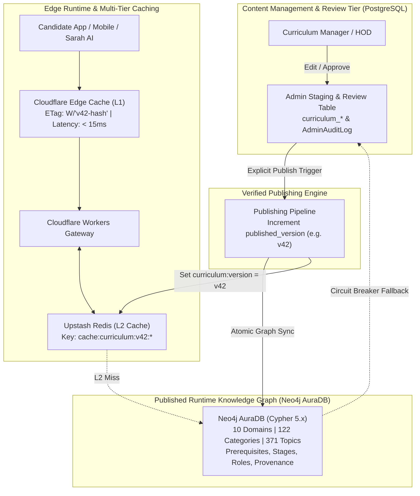
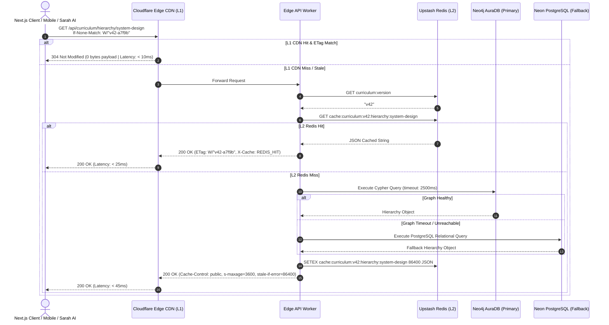

# PrepInMinutes — Unified Curriculum API & Edge Gateway Specification (Phase 3)
## Production-Grade Public Knowledge Graph Endpoints, Versioned Edge Caching & Dual-Repository Resilience

> **Document Version:** 1.1.0 (Production Implementation-Ready Revision)  
> **Target Runtime:** Cloudflare Workers / Hono Edge Gateway (`prepinminutes-backend`)  
> **Primary Graph Engine:** Neo4j AuraDB (Published Knowledge Graph via HTTP/Bolt Data Access Layer)  
> **Failover Mirror:** Neon PostgreSQL (Published Content Mirror with 1:1 Response Contract)  
> **Cache Tier:** Version-Namespaced Upstash Redis (L2) + Cloudflare CDN Edge Cache with ETag (L1)  
> **Status:** 🟢 **APPROVED ARCHITECTURAL SPECIFICATION**  
> **Governing Standards:** [`docs/TASK_EXECUTION_SEQUENCE.md`](./TASK_EXECUTION_SEQUENCE.md) • [`docs/CROSS_CUTTING_INTELLIGENCE_SPEC.md`](./CROSS_CUTTING_INTELLIGENCE_SPEC.md)

---

## 1. Executive Assessment & Architectural Principles

### 1.1 Decoupled Data Ownership Standard
PrepInMinutes enforces a strict separation between **Content Authoring/Review** and **High-Throughput Runtime Serving**:



1. **PostgreSQL owns Content Management**: Admin CRUD, editorial reviews, staff approvals, and draft staging.
2. **Neo4j AuraDB owns Published Knowledge Traversal**: Canonical representation for real-time graph traversal, prerequisite dependencies, company provenance, and stage mappings.
3. **Dual-Repository Equivalence**: The public API strictly serves the **published release**. If Neo4j experiences a network partition, the PostgreSQL fallback returns the **exact same response schema and metadata** with zero client drift.
4. **Version-Based Invalidation**: Content updates increment `curriculum:version` in Redis. Cache keys are namespaced by version (`cache:curriculum:v42:*`), completely eliminating stale CDN cache issues without requiring slow manual cache purges.
5. **Separation of Concerns**: Static curriculum hierarchy is strictly separated from personalized candidate adaptive feeds.

---

## 2. Common TypeScript Contract (`CurriculumHierarchyResponse`)

To eliminate schema divergence between Neo4j and PostgreSQL, both data providers implement the identical interface:

```typescript
// Shared Contract: src/server/graph/types.ts

export interface CurriculumTopicSummary {
  slug: string;
  topicId: string;
  title: string;
  priority: "P0" | "P1";
  difficulty: "BEGINNER" | "INTERMEDIATE" | "ADVANCED" | "EXPERT";
  durationMin: number;
  frequency: number;
  trend: "SURGING" | "HOT" | "STABLE" | "COOLING";
  rubricAtomsCount: number;
  questionsCount: number;
  practiceHref: string;
}

export interface CurriculumCategoryHierarchy {
  slug: string;
  name: string;
  pillar: string;
  sortOrder: number;
  topicsCount: number;
  topics: CurriculumTopicSummary[];
}

export interface CurriculumHierarchyResponse {
  domainSlug: string;
  domainName: string;
  description: string;
  version: string;
  totalCategories: number;
  totalTopics: number;
  totalQuestions: number;
  categories: CurriculumCategoryHierarchy[];
}

export interface DomainCatalogItem {
  slug: string;
  name: string;
  shortName: string;
  description: string;
  version: string;
  sortOrder: number;
  categoriesCount: number;
  topicsCount: number;
  questionsCount: number;
  icon: string;
  colorTheme: string;
}

export interface CurriculumDomainsResponse {
  domains: DomainCatalogItem[];
  meta: {
    curriculumVersion: string;
    totalDomains: number;
    totalCategories: number;
    totalTopics: number;
    totalQuestions: number;
  };
}
```

---

## 3. Data Access Layer Abstraction (`CurriculumRepository`)

```typescript
export interface ICurriculumRepository {
  /**
   * Returns domain catalog summary list
   */
  getDomains(): Promise<DomainCatalogItem[]>;

  /**
   * Returns complete hierarchy tree (Domain -> Categories -> Topics)
   */
  getDomainHierarchy(domainSlug: string): Promise<CurriculumHierarchyResponse | null>;
}
```

### 3.1 Primary Provider: `Neo4jCurriculumRepository`
Supports dual transport:
- **Node.js runtime / Local**: Standard Bolt driver connection pool (`neo4j+s://`).
- **Cloudflare Workers Edge**: Transactional Cypher HTTP Endpoint (`POST https://22941cc5.databases.neo4j.io/db/neo4j/tx/commit`) or Node-compatible driver.

#### Corrected Cypher Query with Accurate `reduce()` Aggregation & Dynamic Question Counts:
```cypher
MATCH (d:Domain {slug: $domainSlug})
OPTIONAL MATCH (d)-[:CONTAINS]->(c:Category)
OPTIONAL MATCH (c)-[:HAS_TOPIC]->(t:Topic)
OPTIONAL MATCH (t)-[:HAS_QUESTION]->(q:Question)

WITH d, c, t, count(q) AS questionCount
ORDER BY c.sortOrder, t.priority, t.title

WITH d, c, collect(CASE WHEN t IS NOT NULL THEN {
  slug: t.slug,
  topicId: coalesce(t.topicId, t.slug),
  title: t.title,
  priority: coalesce(t.priority, "P0"),
  difficulty: coalesce(t.difficulty, "INTERMEDIATE"),
  durationMin: coalesce(t.durationMin, 15),
  frequency: coalesce(t.frequency, 80),
  trend: coalesce(t.trend, "STABLE"),
  rubricAtomsCount: size(coalesce(t.rubricAtoms, [])),
  questionsCount: questionCount,
  practiceHref: '/practice/session/' + d.slug + '?topic=' + t.slug
} ELSE null END) AS rawTopics

WITH d, c, [top IN rawTopics WHERE top IS NOT NULL] AS topics
ORDER BY c.sortOrder

WITH d, collect(CASE WHEN c IS NOT NULL THEN {
  slug: c.slug,
  name: c.name,
  pillar: coalesce(c.pillar, "Core Curriculum"),
  sortOrder: coalesce(c.sortOrder, 1),
  topicsCount: size(topics),
  topics: topics
} ELSE null END) AS rawCategories

WITH d, [cat IN rawCategories WHERE cat IS NOT NULL] AS cleanCategories

RETURN {
  domainSlug: d.slug,
  domainName: d.name,
  description: d.description,
  version: coalesce(d.version, "1.0.0"),
  totalCategories: size(cleanCategories),
  totalTopics: reduce(total = 0, cat IN cleanCategories | total + size(cat.topics)),
  totalQuestions: reduce(total = 0, cat IN cleanCategories | total + reduce(qCount = 0, top IN cat.topics | qCount + top.questionsCount)),
  categories: cleanCategories
} AS domainHierarchy
```

---

### 3.2 Resilient Failover Provider: `PostgresCurriculumRepository`
Implements exact 1:1 parity using PostgreSQL 16+ `json_build_object` and `LEFT JOIN` semantics:

```sql
SELECT 
  d.slug AS domain_slug,
  d.name AS domain_name,
  d.description,
  '1.0.0' AS version,
  COUNT(DISTINCT c.id) AS total_categories,
  COUNT(DISTINCT t.id) AS total_topics,
  COUNT(DISTINCT q.id) AS total_questions,
  COALESCE(
    json_agg(
      json_build_object(
        'slug', c.slug,
        'name', c.name,
        'pillar', COALESCE(c.description, 'Core Curriculum'),
        'sortOrder', c."order",
        'topicsCount', (SELECT COUNT(*) FROM curriculum_topics ct WHERE ct.category_id = c.id),
        'topics', COALESCE(
          (
            SELECT json_agg(
              json_build_object(
                'slug', ct.slug,
                'topicId', ct.topic_id,
                'title', ct.title,
                'priority', ct.priority,
                'difficulty', ct.difficulty,
                'durationMin', ct.duration_min,
                'frequency', 85,
                'trend', 'HOT',
                'rubricAtomsCount', cardinality(ct.rubric_atoms),
                'questionsCount', (SELECT COUNT(*) FROM curriculum_questions cq WHERE cq.topic_id = ct.id),
                'practiceHref', ct.practice_href
              ) ORDER BY ct.priority, ct.title
            )
            FROM curriculum_topics ct
            WHERE ct.category_id = c.id
          ),
          '[]'::json
        )
      ) ORDER BY c."order"
    ) FILTER (WHERE c.id IS NOT NULL),
    '[]'::json
  ) AS categories
FROM curriculum_domains d
LEFT JOIN curriculum_categories c ON c.domain_id = d.id
LEFT JOIN curriculum_topics t ON t.category_id = c.id
LEFT JOIN curriculum_questions q ON q.topic_id = t.id
WHERE d.slug = $1
GROUP BY d.slug, d.name, d.description;
```

---

## 4. Multi-Tier Version-Based Caching & ETag Architecture



### 4.1 Cache Header Standards
Every successful hierarchy response includes:
- `Cache-Control: public, max-age=300, s-maxage=3600, stale-while-revalidate=86400, stale-if-error=86400`
- `ETag: W/"<curriculum-version>-<hash>"`
- `X-Curriculum-Version: v42`
- `X-Data-Source: NEO4J | POSTGRES_FALLBACK | REDIS_CACHE`

---

## 5. Circuit Breaker & Error Handling Taxonomy

Public API responses strictly encapsulate internal database infrastructure and queries:

```json
{
  "success": false,
  "error": {
    "code": "DOMAIN_NOT_FOUND",
    "message": "The curriculum domain 'quantum-computing' was not found.",
    "validDomains": [
      "system-design",
      "ai-system-design",
      "low-level-design",
      "dsa",
      "backend-engineering",
      "frontend-engineering",
      "cloud-devops",
      "behavioral-leadership",
      "data-engineering",
      "mobile-engineering"
    ],
    "requestId": "req_01jb2x89ac72",
    "timestamp": "2026-11-14T18:00:00.000Z"
  }
}
```

### HTTP Status Code Mapping:
- **`200 OK`**: Successful retrieval.
- **`304 Not Modified`**: ETag match on `If-None-Match`.
- **`400 Bad Request`**: Malformed slug or invalid query parameters.
- **`404 Not Found`**: Domain slug does not exist in curriculum.
- **`429 Too Many Requests`**: IP exceeds 120 req/min rate limit.
- **`500 Internal Error`**: Unhandled edge worker error (sanitized without stack traces).
- **`503 Service Unavailable`**: Circuit open on both Neo4j and PostgreSQL.

---

## 6. Revised Phase 3 Task Execution Sequence

| Task Code | Focus Area | Detailed Scope | Target Latency | Status |
| :--- | :--- | :--- | :---: | :---: |
| **`TASK-P3-01`** | **Public Curriculum Endpoints & Repository Abstraction** | Implement `CurriculumRepository` interface, `Neo4jCurriculumRepository` (with corrected `reduce()` Cypher), and `PostgresCurriculumRepository` fallback. Expose `GET /api/curriculum/domains` and `GET /api/curriculum/hierarchy/:domainSlug`. | **$< 35\text{ms}$** | 🟡 **IN PROGRESS** |
| **`TASK-P3-02`** | **Topic Detail & Question Collection Endpoints** | Expose `GET /api/curriculum/topic/:topicSlug` (8-layer metadata) and `GET /api/curriculum/topic/:topicSlug/questions`. Dynamic question counts and rubric atom binding. | **$< 45\text{ms}$** | ⚪ Pending |
| **`TASK-P3-03`** | **Versioned Multi-Tier Cache & Invalidation** | Implement versioned Redis cache keys (`cache:curriculum:v{n}:*`), ETag generation, HTTP 304 handling, and Admin publishing version incrementer. | **$< 15\text{ms}$** | ⚪ Pending |
| **`TASK-P3-04`** | **Edge Resilience, Circuit Breaker & Benchmarks** | Circuit breaker between Neo4j and Neon, timeout guards (2500ms), and automated cold/warm/edge test benchmarks. | **$< 10\text{ms}$ (hit)** | ⚪ Pending |
