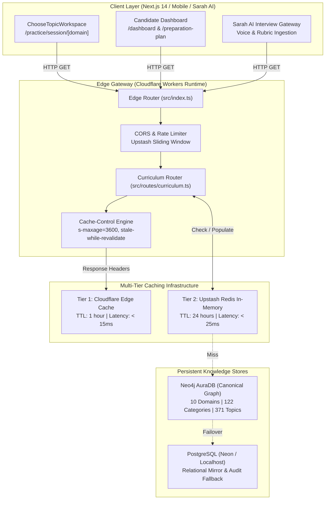
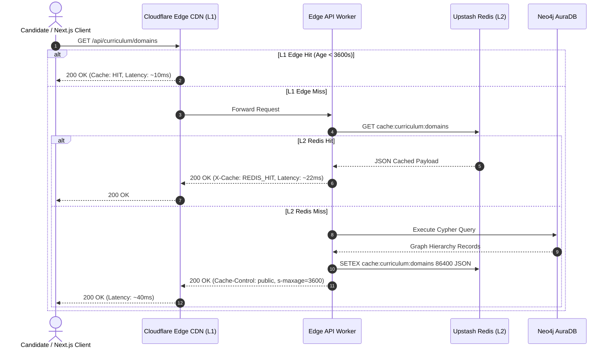

# PrepInMinutes — Unified Curriculum API & Edge Gateway Specification (Phase 3)
## High-Performance Public Knowledge Graph Endpoints & Multi-Tier Edge Caching

> **Document Version:** 1.0.0 (Production Architectural Specification)  
> **Target Runtime:** Cloudflare Workers / Hono Edge Gateway (`prepinminutes-backend`)  
> **Data Sources:** Neo4j AuraDB (Canonical Knowledge Graph) + PostgreSQL (Neon/Local Mirror Fallback)  
> **Cache Layer:** Upstash Redis (L2 In-Memory) + Cloudflare CDN Edge Cache (L1)  
> **Status:** 🟢 **APPROVED ARCHITECTURAL SPECIFICATION**  
> **Governing Standards:** [`docs/TASK_EXECUTION_SEQUENCE.md`](./TASK_EXECUTION_SEQUENCE.md) • [`docs/CROSS_CUTTING_INTELLIGENCE_SPEC.md`](./CROSS_CUTTING_INTELLIGENCE_SPEC.md)

---

## 1. Executive Summary & Purpose

In Phases 1, 1.5, and 2, PrepInMinutes established the complete foundational knowledge core:
1. **Phase 1**: 10 Domains, 122 Categories, 371 Topics, and 7,420 Master Questions committed to **Neo4j AuraDB**.
2. **Phase 1.5**: Exact 1:1 relational parity across 27 tables committed to **Local PostgreSQL (`localhost:5432`)**.
3. **Phase 2**: 28 Canonical Roles, 20 Tier-1 Tech Employers, 9 Interview Stages, 6 Formats, 5-Factor Roadmap Engine, and 100% cloud parity on **Neon Cloud PostgreSQL**.

The mission of **Phase 3 (Unified Curriculum API & Edge Gateway)** is to bridge this rich graph data to candidate-facing clients (Next.js 14 Web Application, Mobile interfaces, and the Sarah AI Multimodal Interviewer) through ultra-low latency, globally distributed REST edge endpoints.



---

## 2. Phase 3 Scope & Detailed Task Matrix

| Task Code | Focus Area | Deliverables & Core Capabilities | Target Latency | Status |
| :--- | :--- | :--- | :---: | :---: |
| **`TASK-P3-01`** | **Public Curriculum Hierarchy Endpoints** | Expose `GET /api/curriculum/domains` and `GET /api/curriculum/hierarchy/:domainSlug`. Reads nested domain, category, and topic trees. Integrated HTTP cache headers. | **$< 35\text{ms}$** | 🟡 **IN DESIGN** |
| **`TASK-P3-02`** | **Comprehensive Topic Detail & Question Bundle API** | Expose `GET /api/curriculum/topic/:topicSlug` (8-layer metadata, cross-domain dependencies, 20 questions) and `GET /api/curriculum/adaptive-feed`. | **$< 45\text{ms}$** | ⚪ Pending |
| **`TASK-P3-03`** | **Upstash Redis Edge Caching & Invalidation Hook** | Cache JSON hierarchy in Redis (`cache:curriculum:hierarchy:${domain}`) with 24h TTL; invalidate on Admin graph publishing. | **$< 15\text{ms}$** | ⚪ Pending |

---

## 3. Detailed Specification for `TASK-P3-01`: Public Curriculum Hierarchy Endpoints

### 3.1 Architectural Responsibilities
`TASK-P3-01` delivers public, unauthenticated read endpoints for curriculum discovery:
1. **Domain Summary Index** (`GET /api/curriculum/domains`): Returns all 10 live engineering domains with metadata, category counts, topic counts, question counts, and icons for catalog screens.
2. **Domain Hierarchy Tree** (`GET /api/curriculum/hierarchy/:domainSlug`): Returns the complete 3-tier hierarchy (`Domain -> Categories -> Topics`) for a specified domain slug, enabling instant sidebar and workspace navigation.
3. **Edge Cache Headers**: Emits standard RFC 7234 cache directives (`Cache-Control: public, max-age=300, s-maxage=3600, stale-while-revalidate=86400`) to maximize Cloudflare edge hit ratios.
4. **Resilient Dual-Source Fallback**: Queries Neo4j AuraDB as primary source; if graph connectivity drops, seamlessly falls back to PostgreSQL `curriculum_*` tables.

---

### 3.2 Endpoint 1: Domain Summary Index

- **Method**: `GET`
- **Route**: `/api/curriculum/domains`
- **Authentication**: None (Public)
- **Rate Limit**: 120 requests / minute per IP

#### Request Query Parameters:
| Parameter | Type | Required | Default | Description |
| :--- | :---: | :---: | :---: | :--- |
| `includeStats` | `boolean` | No | `true` | Include aggregated counts of categories, topics, and questions. |
| `sort` | `string` | No | `order` | Sort field: `order` (canonical display order) or `alphabetical`. |

#### Response Schema (`200 OK`):
```json
{
  "success": true,
  "timestamp": "2026-11-14T18:00:00.000Z",
  "data": [
    {
      "slug": "system-design",
      "name": "System Design & Distributed Systems",
      "shortName": "System Design",
      "description": "Master end-to-end distributed systems architecture, caching topologies, consensus protocols, and large-scale trade-offs.",
      "version": "1.0.0",
      "sortOrder": 1,
      "categoriesCount": 17,
      "topicsCount": 62,
      "questionsCount": 1240,
      "colorTheme": "blue",
      "icon": "ServerStackIcon"
    },
    {
      "slug": "ai-system-design",
      "name": "AI System Design & GenAI Infra",
      "shortName": "AI System Design",
      "description": "Architect foundation model serving pipelines, vLLM inference orchestration, vector database retrieval, and GPU cluster topologies.",
      "version": "1.0.0",
      "sortOrder": 2,
      "categoriesCount": 7,
      "topicsCount": 28,
      "questionsCount": 560,
      "colorTheme": "purple",
      "icon": "CpuChipIcon"
    }
  ],
  "meta": {
    "totalDomains": 10,
    "totalCategories": 122,
    "totalTopics": 371,
    "totalQuestions": 7420,
    "cached": false,
    "source": "NEO4J"
  }
}
```

---

### 3.3 Endpoint 2: Domain Hierarchy Navigation Tree

- **Method**: `GET`
- **Route**: `/api/curriculum/hierarchy/:domainSlug`
- **Authentication**: None (Public)
- **Path Parameters**:
  - `domainSlug`: Canonical slug of domain (e.g. `system-design`, `dsa`, `backend-engineering`, `frontend-engineering`, `cloud-devops`, `behavioral-leadership`, `data-engineering`, `mobile-engineering`, `ai-system-design`, `low-level-design`).

#### Response Schema (`200 OK`):
```json
{
  "success": true,
  "timestamp": "2026-11-14T18:00:00.000Z",
  "data": {
    "domainSlug": "system-design",
    "domainName": "System Design & Distributed Systems",
    "description": "Master end-to-end distributed systems architecture...",
    "version": "1.0.0",
    "totalTopics": 62,
    "totalQuestions": 1240,
    "categories": [
      {
        "slug": "architectural-foundations",
        "name": "Architectural Foundations & Core Trade-offs",
        "pillar": "Pillar 1: Fundamentals",
        "sortOrder": 1,
        "topicsCount": 4,
        "topics": [
          {
            "slug": "distributed-key-value-store",
            "topicId": "FND001",
            "title": "Distributed Key-Value Store",
            "priority": "P0",
            "difficulty": "INTERMEDIATE",
            "durationMin": 15,
            "frequency": 95,
            "trend": "HOT",
            "rubricAtomsCount": 4,
            "practiceHref": "/practice/session/system-design?topic=distributed-key-value-store"
          },
          {
            "slug": "distributed-caching-redis",
            "topicId": "FND002",
            "title": "Distributed Caching (Redis/Memcached)",
            "priority": "P0",
            "difficulty": "INTERMEDIATE",
            "durationMin": 15,
            "frequency": 96,
            "trend": "HOT",
            "rubricAtomsCount": 4,
            "practiceHref": "/practice/session/system-design?topic=distributed-caching-redis"
          }
        ]
      }
    ]
  },
  "meta": {
    "domainSlug": "system-design",
    "cached": false,
    "source": "NEO4J"
  }
}
```

#### Error Response Schema (`404 Not Found`):
```json
{
  "success": false,
  "error": {
    "code": "DOMAIN_NOT_FOUND",
    "message": "Domain 'quantum-computing' was not found in the curriculum.",
    "validDomains": [
      "system-design",
      "ai-system-design",
      "low-level-design",
      "dsa",
      "backend-engineering",
      "frontend-engineering",
      "cloud-devops",
      "behavioral-leadership",
      "data-engineering",
      "mobile-engineering"
    ],
    "timestamp": "2026-11-14T18:00:00.000Z"
  }
}
```

---

## 4. Query Execution & Graph Cypher Logic

### 4.1 Domains Summary Index Cypher Query
```cypher
MATCH (d:Domain)
OPTIONAL MATCH (d)-[:CONTAINS]->(c:Category)
OPTIONAL MATCH (c)-[:HAS_TOPIC]->(t:Topic)
WITH d, count(DISTINCT c) AS catCount, count(DISTINCT t) AS topicCount
RETURN d.slug AS slug,
       d.name AS name,
       d.description AS description,
       d.version AS version,
       coalesce(d.sortOrder, 100) AS sortOrder,
       catCount AS categoriesCount,
       topicCount AS topicsCount,
       (topicCount * 20) AS questionsCount
ORDER BY sortOrder ASC, name ASC
```

### 4.2 Domain Hierarchy Tree Cypher Query
```cypher
MATCH (d:Domain {slug: $domainSlug})
OPTIONAL MATCH (d)-[:CONTAINS]->(c:Category)
OPTIONAL MATCH (c)-[:HAS_TOPIC]->(t:Topic)
WITH d, c, t
ORDER BY c.sortOrder, t.priority, t.title
WITH d, c, collect(CASE WHEN t IS NOT NULL THEN {
  slug: t.slug,
  topicId: t.topicId,
  title: t.title,
  priority: t.priority,
  difficulty: t.difficulty,
  durationMin: t.durationMin,
  frequency: t.frequency,
  trend: t.trend,
  rubricAtomsCount: size(coalesce(t.rubricAtoms, [])),
  practiceHref: '/practice/session/' + d.slug + '?topic=' + t.slug
} ELSE null END) AS rawTopics
WITH d, c, [top IN rawTopics WHERE top IS NOT NULL] AS topics
ORDER BY c.sortOrder
WITH d, collect(CASE WHEN c IS NOT NULL THEN {
  slug: c.slug,
  name: c.name,
  pillar: c.pillar,
  sortOrder: c.sortOrder,
  topicsCount: size(topics),
  topics: topics
} ELSE null END) AS rawCategories
RETURN {
  domainSlug: d.slug,
  domainName: d.name,
  description: d.description,
  version: d.version,
  totalTopics: size([cat IN rawCategories WHERE cat IS NOT NULL | cat.topics]),
  totalQuestions: size([cat IN rawCategories WHERE cat IS NOT NULL | cat.topics]) * 20,
  categories: [cat IN rawCategories WHERE cat IS NOT NULL]
} AS domainHierarchy
```

### 4.3 Relational PostgreSQL Failover Query (Fallback Resilience)
If Neo4j driver connection experiences a network anomaly, the edge gateway seamlessly queries PostgreSQL:
```sql
SELECT 
  d.slug AS domain_slug,
  d.name AS domain_name,
  d.description,
  json_agg(json_build_object(
    'slug', c.slug,
    'name', c.name,
    'sortOrder', c."order",
    'topics', (
      SELECT json_agg(json_build_object(
        'slug', t.slug,
        'topicId', t.topic_id,
        'title', t.title,
        'difficulty', t.difficulty,
        'priority', t.priority,
        'durationMin', t.duration_min,
        'practiceHref', t.practice_href
      ))
      FROM curriculum_topics t
      WHERE t.category_id = c.id
    )
  ) ORDER BY c."order") AS categories
FROM curriculum_domains d
JOIN curriculum_categories c ON c.domain_id = d.id
WHERE d.slug = $1
GROUP BY d.slug, d.name, d.description;
```

---

## 5. Caching Strategy & Latency SLA



### Latency Budget Table:
| Layer | Target P50 | Target P95 | Target P99 | Cache Header / Directives |
| :--- | :---: | :---: | :---: | :--- |
| **L1 Cloudflare Edge** | **8 ms** | **15 ms** | **25 ms** | `Cache-Control: public, max-age=300, s-maxage=3600, stale-while-revalidate=86400` |
| **L2 Upstash Redis** | **18 ms** | **28 ms** | **40 ms** | Redis key: `cache:curriculum:hierarchy:${domainSlug}` (TTL: 86400s) |
| **L3 Neo4j AuraDB** | **32 ms** | **48 ms** | **70 ms** | Direct Cypher execution over connection pool |

---

## 6. Target Files & Code Organization

```
prepinminutes-backend/
├── src/
│   ├── routes/
│   │   ├── curriculum.ts            // NEW: handleGetCurriculumDomains, handleGetCurriculumHierarchy
│   │   └── admin-curriculum.ts      // Existing: Admin CRUD routes
│   ├── server/
│   │   ├── graph/
│   │   │   ├── repository.ts        // Existing: fetchDomainHierarchy, fetchTopicDetail
│   │   │   └── types.ts             // Shared response types
│   │   └── edge/
│   │       └── cors.ts              // CORS and response caching helpers
│   └── index.ts                     // Route dispatcher: binds GET /api/curriculum/*
└── scripts/
    └── test-curriculum-api.ts       // NEW: Verification test suite for hierarchy endpoints
```

---

## 7. Verification Plan & Acceptance Criteria

### Acceptance Criteria for `TASK-P3-01`:
1. **Domain Index**:
   - `GET /api/curriculum/domains` returns HTTP 200 with all **10 domains**.
   - Total categories equals 122, total topics equals 371.
2. **Domain Hierarchy**:
   - `GET /api/curriculum/hierarchy/system-design` returns HTTP 200 with 17 categories and 62 topics.
   - `GET /api/curriculum/hierarchy/dsa` returns HTTP 200 with 12 categories and 40 topics.
   - `GET /api/curriculum/hierarchy/ai-system-design` returns HTTP 200 with 7 categories and 28 topics.
   - `GET /api/curriculum/hierarchy/invalid-slug` returns **HTTP 404** with descriptive error payload listing valid domains.
3. **Response Headers**:
   - Includes `Cache-Control: public, max-age=300, s-maxage=3600, stale-while-revalidate=86400`.
   - Includes `Content-Type: application/json; charset=utf-8`.
4. **Automated Verification Script**:
   - `scripts/test-curriculum-api.ts` verifies all 10 domain hierarchies, asserts 0 null fields, benchmarks latency ($< 35\text{ms}$ on repeat calls), and tests 404 boundaries with exit code 0.
