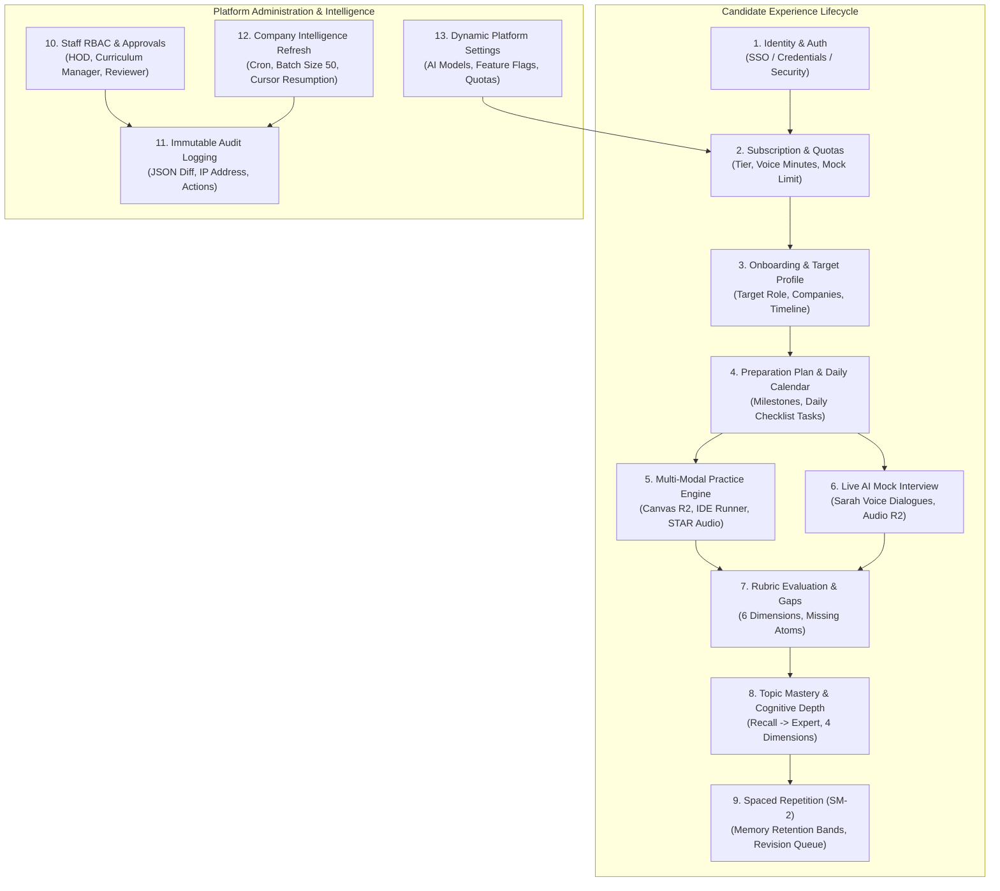
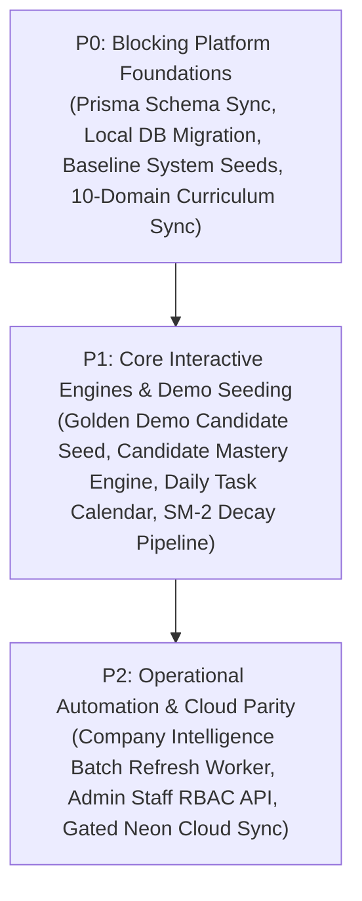

# PrepInMinutes — Comprehensive Application Data Architecture, Schema & Seeding Specification

## Full-Platform Relational Modeling, Progress Tracking & Data Seeding Strategy

> **Document Version:** 2.0.0  
> **Status:** 🟢 **CANONICAL ARCHITECTURAL SPECIFICATION**  
> **Primary Relational Engine:** PostgreSQL 16+ (Local `localhost:5432` & Neon Cloud) with Prisma ORM & `pgvector`  
> **Primary Graph Engine:** Neo4j AuraDB (Cypher 5.x) — 10 Domains | 122 Categories | 371 Topics | 7,420 Questions  
> **Storage Layer:** Cloudflare R2 (Whiteboard canvas snapshots & Voice `.opus` audio recordings)  
> **Governing Standards:** [`docs/CROSS_CUTTING_INTELLIGENCE_SPEC.md`](./CROSS_CUTTING_INTELLIGENCE_SPEC.md), [`docs/TASK_EXECUTION_SEQUENCE.md`](./TASK_EXECUTION_SEQUENCE.md)

---

## 1. Architectural Philosophy: Why Curriculum Topics Are Only 20% of the System

Focusing exclusively on technical topics creates an academic encyclopedia rather than an intelligent, personalized interview preparation platform. While Neo4j canonicalizes the **static knowledge** (10 Domains, 122 Categories, 371 Topics, 7,420 Master Questions), the **dynamic value of PrepInMinutes** lives entirely in the relational state machine that surrounds the candidate and administrator:



Without end-to-end schema modeling and rich baseline data seeding across **all twelve functional domains**, the platform cannot deliver its core promise: taking a candidate from Day 0 (Student/Fresher or Experienced Engineer) to an interview-ready state at their dream company.

---

## 2. Priority Ladder & Execution Roadmap

To guarantee zero database drift, clean migrations, and verifiable testing at every step, all schema updates and data seeding tasks are divided into **three strict priority tiers**:



| Priority |    Task Code     | Target Area                      | Description & Deliverable                                                                                                                                                     |    Status    |
| :------: | :--------------: | :------------------------------- | :---------------------------------------------------------------------------------------------------------------------------------------------------------------------------- | :----------: |
|  **P0**  | **`DATA-P0-01`** | **Schema Alignment**             | Unify `prisma/schema.prisma` across backend and frontend repositories with all 27 models and 4 enums. Run `prisma validate`.                                                  | 🟢 Completed |
|  **P0**  | **`DATA-P0-02`** | **Local DB Migration**           | Push schema to `localhost:5432` (`DATABASE_URL`). Verify all tables and indexes are created without error.                                                                    | 🟢 Completed |
|  **P0**  | **`DATA-P0-03`** | **Baseline System Seeds**        | Seed default HOD Admin (`imsauravsingh@gmail.com`), Subscription Plan Definitions, Platform Configs, and Intelligence Cron Config.                                            | 🟢 Completed |
|  **P0**  | **`DATA-P0-04`** | **Curriculum Catalog Sync**      | Seed all 10 Domains, 122 Categories, and 371 Topics into PostgreSQL `curriculum_*` tables (1:1 slug parity).                                                                  | 🟢 Completed |
|  **P1**  | **`DATA-P1-01`** | **Golden Demo Candidate Seed**   | Seed a realistic, end-to-end demo candidate (`candidate@prepinminutes.com`) with active plan, daily tasks, practice session, and Sarah AI evaluations. | 🟢 Completed |
|  **P1**  | **`DATA-P1-02`** | **Topic Mastery & Gaps**         | Implement atomic score recalculation and `CandidateTopicProficiency` updates upon evaluation completion.                                                                      |  ⚪ Pending  |
|  **P1**  | **`DATA-P1-03`** | **Daily Task & Streak Engine**   | Wire `DailyPlanTask` completion logic, weekly goal hour tracking, and daily activity streak increments.                                                                       |  ⚪ Pending  |
|  **P1**  | **`DATA-P1-04`** | **Spaced Repetition Pipeline**   | Implement SuperMemo SM-2 decay calculations and automated creation of `RevisionItem` when session score $< 60\%$.                                                             |  ⚪ Pending  |
|  **P2**  | **`DATA-P2-01`** | **Company Refresh Batch Worker** | Implement cursor-based batch processor (50 companies/run) with failure handling and audit logging.                                                                            | 🟢 Completed |
|  **P2**  | **`DATA-P2-02`** | **Admin Control & RBAC API**     | Implement admin endpoints for staff approval workflows, user blocking, and subscription quota management.                                                                     |  ⚪ Pending  |
|  **P2**  | **`DATA-P2-03`** | **Neon Cloud Parity (Gated)**    | Reset Neon Cloud database, push unified schema, and run identical seeds upon explicit user confirmation.                                                                      |   ⚪ Gated   |

---

## 3. The 12 Application Functional Domains & Schema Design

### Area 1: Identity, Authentication, Staff Approvals & Account Security

- **Models**: `User`, `PasswordResetToken`, `EmailVerificationToken`
- **Enums**: `AdminRole` (`SUPER_ADMIN`, `HOD`, `CURRICULUM_MANAGER`, `STAFF_ENGINEER`, `CONTENT_REVIEWER`, `CANDIDATE`), `AdminApprovalStatus` (`NONE`, `PENDING`, `APPROVED`, `REJECTED`, `SUSPENDED`)
- **Key Responsibilities**:
  - Multi-provider authentication: Credentials (argon2/bcrypt hash), Google OAuth, Clerk SSO.
  - Universal account blocking (`isBlocked`, `blockedReason`, `blockedAt`, `blockedBy`) applicable to both candidates and staff.
  - Staff role escalation workflow: Candidates or team members request elevated roles (`requestedRole`, `requestReason`), which queue up for the Head of Department (HOD) to approve or reject.

### Area 2: Subscriptions, Tier Catalog & Real-Time Quota Metering

- **Models**: `Subscription`, `SubscriptionPlan`
- **Enums**: `SubscriptionTier` (`FREE`, `PRO_MONTHLY`, `PRO_QUARTERLY`, `LIFETIME`, `CAMPUS_ENTERPRISE`), `SubscriptionStatus` (`INACTIVE`, `TRIALING`, `ACTIVE`, `PAST_DUE`, `CANCELED`, `EXPIRED`)
- **Key Responsibilities**:
  - Metering voice minutes used vs limit (`voiceMinutesUsed`, `voiceMinutesLimit`).
  - Metering mock interviews completed vs limit (`mockInterviewsUsed`, `mockInterviewsLimit`).
  - Dynamic `SubscriptionPlan` catalog table storing price, currency, features, and quota limits so frontend pricing tables and checkout flows are completely data-driven.

### Area 3: Candidate Onboarding & Profile State

- **Model**: `CandidateProfile`
- **Key Responsibilities**:
  - Captures career targets: `targetRole`, `experienceLevel` (`STUDENT_FRESHER`, `0-2`, `3-5`, `6-9`, `10+`), `targetCompanies` (e.g. `["Google", "Amazon", "Stripe"]`), `timelineWeeks`.
  - Telemetry tracking: `readinessScore` ($0\text{–}100\%$), `streakDays`, `weeklyGoalHours` vs `completedHours`.
  - Resume & Job Description ingestion (`resumeFileUrl`, `jobDescriptionText`) used for RAG-based context injection into AI interviewers.

### Area 4: Personalized Preparation Plan & Daily Task Calendar Engine

- **Models**: `PreparationPlan`, `DailyPlanTask`
- **Key Responsibilities**:
  - `PreparationPlan` stores roadmap architecture: `activePhaseId`, `weeklyMilestones` (JSON ordered breakdown), and `domainWeights` (e.g. `{"system-design": 0.40, "dsa": 0.35, "behavioral": 0.15, "cloud-devops": 0.10}`).
  - `DailyPlanTask` models the concrete day-by-day checklist displayed on `/dashboard` and `/preparation-plan`:
    - Links to canonical topic (`topicId`), domain (`domainSlug`), title, duration (`durationMin`), practice URL (`practiceHref`), scheduled date, and completion timestamp.

### Area 5: 10-Domain Canonical Curriculum Spine (PostgreSQL Mirror)

- **Models**: `CurriculumDomain`, `CurriculumCategory`, `CurriculumTopic`, `CurriculumQuestion`
- **Key Responsibilities**:
  - Provides referential integrity for all candidate activity across the 10 domains:
    1. `system-design` (System Design & Distributed Systems)
    2. `ai-system-design` (AI System Design & GenAI Infra)
    3. `low-level-design` (Low-Level Design & Machine Coding)
    4. `dsa` (Data Structures & Algorithms)
    5. `backend-engineering` (Backend & Runtime Engineering)
    6. `frontend-engineering` (Frontend & Web Architecture)
    7. `cloud-devops` (Cloud, DevOps & SRE)
    8. `behavioral-leadership` (Behavioral, Leadership & Management)
    9. `data-engineering` (Data Engineering & Big Data Systems)
    10. `mobile-engineering` (Mobile Engineering: iOS, Android, Cross-Platform)
  - 100% slug and topicId parity with Neo4j (`FND001`, `MOB15`, etc.).

### Area 6: Granular Topic Mastery & Cognitive Depth

- **Models**: `CandidateTopicMastery`, `CandidateTopicProficiency`
- **Key Responsibilities**:
  - Tracks individual mastery on each of the 371 topics ($0.0\text{–}100.0\%$).
  - Tracks Bloom's cognitive stages: `RECALL` $\to$ `APPLICATION` $\to$ `TRADE_OFFS` $\to$ `EXPERT`.
  - 4 running dimensional averages: Technical Depth, Tradeoffs, Data Modeling, Scalability.
  - `CandidateTopicProficiency` bridges candidate self-assessments or resume parsing directly into Phase 2 roadmap generation.

### Area 7: Multi-Modal Practice Engine

- **Model**: `PracticeSession`
- **Key Responsibilities**:
  - **System Design**: Whiteboard diagrams stored as serialized JSON and rendered PNGs in Cloudflare R2 (`whiteboardUrl`, `diagramJson`).
  - **Machine Coding / DSA**: Code submission text, programming language (`codeLanguage`), automated test suites passed vs total (`testCasesPassed`, `totalTestCases`), and 3D/AR mode flag (`isArModeUsed`).
  - **Behavioral**: Structured STAR blocks (`starResponseJson`: Situation, Task, Action, Result).
  - **Cloud/DevOps**: Architecture manifests, incident post-mortem dialogue.

### Area 8: Live AI Mock Interviews (Sarah Voice Agent)

- **Model**: `MockInterviewSession`
- **Key Responsibilities**:
  - Manages full 4-stage mock interview lifecycle: `CONFIGURING` $\to$ `ACTIVE` $\to$ `EVALUATING` $\to$ `COMPLETED`.
  - Captures full conversational transcript with speaker attribution (`transcript`: array of `{ speaker: "ai" | "candidate", text: string, timestamp: number }`).
  - Stores high-fidelity audio recordings in Cloudflare R2 (`recordingUrl`).
  - Tracks candidate behavior: `clarificationsAsked`, `toolsUsed`, candidate notes.

### Area 9: AI Evaluation Reports & 6-Dimension Rubric Engine

- **Models**: `EvaluationReport`, `RubricScore`
- **Key Responsibilities**:
  - Sarah AI's comprehensive verdict: `overallScore` ($0.0\text{–}100.0$), `verdict` (_Strong Hire / Hire / Leaning Hire / Needs Practice_), `percentileRank`, and `readinessDelta` (e.g. $+6\%$).
  - Qualitative analysis: `strengths`, `improvements`, `evaluatorNotes`, and `recommendedDrills`.
  - Granular `RubricScore` breakdown across dimensions (Technical Depth, Communication, Scalability, Tradeoffs, Failure Handling, API Design) with `missingAtoms` pinpointing exact concepts the candidate overlooked.

### Area 10: Memory Decay & Spaced Repetition (SuperMemo SM-2)

- **Model**: `RevisionItem`
- **Key Responsibilities**:
  - Implements the Ebbinghaus forgetting curve to combat knowledge decay before interview day.
  - Automatically enqueues or updates revision items when an evaluation score drops below $60\%$.
  - Stores SuperMemo parameters: `easeFactor` ($EF \ge 1.3$), `intervalDays`, `repetitions`, and indexed `nextReviewDate`.
  - Categorizes knowledge health into retention bands: `CRITICAL_DECAY` $\to$ `NEEDS_REINFORCEMENT` $\to$ `STABLE` $\to$ `PERMANENT_MEMORY`.

### Area 11: Company Intelligence & Dynamic Batch Refresh Engine

- **Models**: `IntelligenceRefreshConfig`, `IntelligenceRefreshExecution`, `CompanyIntelligenceRefreshLog`
- **Architectural Principles**:
  - **Strict Polyglot Separation**: Neo4j remains the sole canonical source of truth for company graph nodes, stage relationships, and interview frequencies. PostgreSQL manages scheduling configuration, execution runs, and company-level audit logs. No duplicate company table is created in PostgreSQL.
  - **Safe Non-Destructive Update Rule**: Never overwrite existing values with empty, unsupported, or low-confidence results. When new evidence is insufficient or below quality thresholds, retain the previous valid value.
  - **Eligibility vs. Schedule**:
    - **Schedule**: Cron runs twice monthly (`0 2 1,15 * *`) at 02:00 IST (`Asia/Kolkata`).
    - **Eligibility**: 30-day refresh interval. Targets companies whose `lastVerifiedAt` is `NULL` or older than 30 days.
  - **Fault Isolation & Retries**: Processes in configurable batches (default 50). A single company failure does not abort the batch; failed companies are retried up to 3 times or picked up during the next cycle.
  - **Dynamic Attribute Auditing**: Uses `changedAttributes` (JSON) to track all modified properties (`hiringBar`, `interviewStages`, `interviewFormats`, etc.) without requiring repetitive schema migrations as the Neo4j model evolves.
  - **Concurrency Guard**: Lightweight check ensures only one execution runs at a time (skips trigger if an execution with status `RUNNING` exists).

### Area 12: Platform Global Configurations & Immutable Admin Audit Logs

- **Models**: `PlatformConfig`, `AdminAuditLog`
- **Key Responsibilities**:
  - `PlatformConfig`: Key-value configuration store for runtime parameters (e.g. default AI model, voice timeout, maintenance mode, free quota limits).
  - `AdminAuditLog`: Tamper-proof security audit log recording every admin action (`action`, `targetType`, `targetId`, `changeDiff` JSON, `ipAddress`, and `userId`).

---

## 4. Master Relational Prisma Schema

Below is the complete, unified `prisma/schema.prisma` covering all 12 application areas:

```prisma
// PrepInMinutes Master Prisma Schema
// Target Engines: PostgreSQL 16+ with pgvector
// Zero Schema Drift Standard: 100% Identical between Localhost and Neon Cloud

datasource db {
  provider   = "postgresql"
  extensions = [pgvector(map: "vector")]
}

generator client {
  provider        = "prisma-client-js"
  previewFeatures = ["postgresqlExtensions"]
}

// -------------------------------------------------------------
// 1. Core Authentication, RBAC & Subscriptions
// -------------------------------------------------------------

enum AdminRole {
  SUPER_ADMIN
  HOD
  CURRICULUM_MANAGER
  STAFF_ENGINEER
  CONTENT_REVIEWER
  CANDIDATE
}

enum AdminApprovalStatus {
  NONE
  PENDING
  APPROVED
  REJECTED
  SUSPENDED
}

enum SubscriptionTier {
  FREE
  PRO_MONTHLY
  PRO_QUARTERLY
  LIFETIME
  CAMPUS_ENTERPRISE
}

enum SubscriptionStatus {
  INACTIVE
  TRIALING
  ACTIVE
  PAST_DUE
  CANCELED
  EXPIRED
}

model User {
  id                  String               @id @default(cuid())
  clerkId             String?              @unique(map: "uq_users_clerk_id") @map("clerk_id")
  googleId            String?              @unique(map: "uq_users_google_id") @map("google_id")
  username            String?              @unique(map: "uq_users_username") @map("username")
  passwordHash        String?              @map("password_hash")
  email               String               @unique(map: "uq_users_email")
  emailVerified       Boolean              @default(false) @map("is_email_verified")
  fullName            String?              @map("full_name")
  avatarUrl           String?              @map("avatar_url")
  authProvider        String               @default("google") @map("auth_provider") // "google" | "credentials" | "clerk"
  role                AdminRole            @default(CANDIDATE) @map("role")
  adminApprovalStatus AdminApprovalStatus  @default(NONE) @map("admin_approval_status")

  // Account Status & Universal Blocking (Applies to Candidates & Staff)
  isBlocked           Boolean              @default(false) @map("is_blocked")
  blockedReason       String?              @map("blocked_reason")
  blockedAt           DateTime?            @map("blocked_at") @db.Timestamptz(6)
  blockedBy           String?              @map("blocked_by")

  // Access Request Details (for Internal Staff Role Escalation)
  requestedRole       String?              @map("requested_role") // "CURRICULUM_MANAGER" | "STAFF_ENGINEER" | "CONTENT_REVIEWER"
  requestReason       String?              @db.Text @map("request_reason") // Justification for HOD review
  requestedAt         DateTime?            @map("requested_at") @db.Timestamptz(6)
  approvedBy          String?              @map("approved_by") // e.g. imsauravsingh@gmail.com
  approvedAt          DateTime?            @map("approved_at") @db.Timestamptz(6)

  createdAt           DateTime             @default(now()) @map("created_at") @db.Timestamptz(6)
  updatedAt           DateTime             @updatedAt @map("updated_at") @db.Timestamptz(6)

  profile             CandidateProfile?
  subscription        Subscription?
  auditLogs           AdminAuditLog[]
  passwordResetTokens PasswordResetToken[]
  verificationTokens  EmailVerificationToken[]

  @@index([role], map: "idx_users_role")
  @@index([adminApprovalStatus], map: "idx_users_admin_approval_status")
  @@index([isBlocked], map: "idx_users_is_blocked")
  @@map("users")
}

model PasswordResetToken {
  id        String   @id @default(cuid())
  userId    String   @map("user_id")
  user      User     @relation(fields: [userId], references: [id], onDelete: Cascade)
  token     String   @unique
  expiresAt DateTime @map("expires_at") @db.Timestamptz(6)
  createdAt DateTime @default(now()) @map("created_at") @db.Timestamptz(6)

  @@index([token])
  @@map("password_reset_tokens")
}

model EmailVerificationToken {
  id        String   @id @default(cuid())
  userId    String   @map("user_id")
  user      User     @relation(fields: [userId], references: [id], onDelete: Cascade)
  otpCode   String   @map("otp_code")
  expiresAt DateTime @map("expires_at") @db.Timestamptz(6)
  createdAt DateTime @default(now()) @map("created_at") @db.Timestamptz(6)

  @@index([userId, otpCode])
  @@map("email_verification_tokens")
}

model SubscriptionPlan {
  id                  String           @id @default(cuid())
  tier                SubscriptionTier @unique
  name                String           // e.g. "Pro Monthly", "Lifetime Pass"
  description         String
  price               Float            // e.g. 29.00
  currency            String           @default("USD")
  billingInterval     String           // "month" | "quarter" | "lifetime"
  voiceMinutesLimit   Float            @default(180.0) @map("voice_minutes_limit")
  mockInterviewsLimit Int              @default(5) @map("mock_interviews_limit")
  features            String[]         @default([])
  isActive            Boolean          @default(true) @map("is_active")
  createdAt           DateTime         @default(now()) @map("created_at") @db.Timestamptz(6)
  updatedAt           DateTime         @updatedAt @map("updated_at") @db.Timestamptz(6)

  @@map("subscription_plans")
}

model Subscription {
  id                  String             @id @default(cuid())
  userId              String             @unique(map: "uq_subscriptions_user_id") @map("user_id")
  user                User               @relation(fields: [userId], references: [id], onDelete: Cascade)
  tier                SubscriptionTier   @default(FREE) @map("tier")
  status              SubscriptionStatus @default(INACTIVE) @map("status")
  planName            String             @default("Free Plan") @map("plan_name")
  isPlanOpted         Boolean            @default(false) @map("is_plan_opted")
  pricePaid           Float              @default(0.0) @map("price_paid")
  currency            String             @default("USD") @map("currency")
  currentPeriodStart  DateTime           @default(now()) @map("current_period_start") @db.Timestamptz(6)
  currentPeriodEnd    DateTime?          @map("current_period_end") @db.Timestamptz(6)
  cancelAtPeriodEnd   Boolean            @default(false) @map("cancel_at_period_end")
  paymentProvider     String?            @map("payment_provider") // "stripe" | "razorpay" | "manual_admin"

  // Real-Time Quota Metering
  voiceMinutesUsed    Float              @default(0.0) @map("voice_minutes_used")
  voiceMinutesLimit   Float              @default(30.0) @map("voice_minutes_limit")
  mockInterviewsUsed  Int                @default(0) @map("mock_interviews_used")
  mockInterviewsLimit Int                @default(1) @map("mock_interviews_limit")

  createdAt           DateTime           @default(now()) @map("created_at") @db.Timestamptz(6)
  updatedAt           DateTime           @updatedAt @map("updated_at") @db.Timestamptz(6)

  @@index([tier, status], map: "idx_subscriptions_tier_status")
  @@index([isPlanOpted], map: "idx_subscriptions_is_plan_opted")
  @@map("subscriptions")
}

model AdminAuditLog {
  id          String    @id @default(cuid())
  userId      String    @map("user_id")
  user        User      @relation(fields: [userId], references: [id], onDelete: Cascade)
  action      String    @map("action") // "APPROVE_STAFF" | "ASSIGN_ROLE" | "BLOCK_USER" | "UPDATE_TOPIC" | "TRIGGER_REFRESH"
  targetType  String    @map("target_type") // "User" | "CurriculumTopic" | "CompanyIntelligence" | "Subscription"
  targetId    String    @map("target_id")
  changeDiff  Json?     @map("change_diff")
  ipAddress   String?   @map("ip_address")
  createdAt   DateTime  @default(now()) @map("created_at") @db.Timestamptz(6)

  @@index([userId, createdAt], map: "idx_admin_audit_logs_user_created")
  @@map("admin_audit_logs")
}

// -------------------------------------------------------------
// 2. Candidate Profile & Preparation Roadmaps
// -------------------------------------------------------------

model CandidateProfile {
  id                 String   @id @default(cuid())
  userId             String   @unique(map: "uq_candidate_profiles_user_id") @map("user_id")
  user               User     @relation(fields: [userId], references: [id], onDelete: Cascade, map: "fk_candidate_profiles_user_id")
  targetRole         String   @map("target_role") // e.g. "Senior Backend Engineer"
  experienceLevel    String   @map("experience_level") // "STUDENT_FRESHER", "0-2", "3-5", "6-9", "10+"
  targetCompanies    String[] @map("target_companies") // ["Google", "Meta", "Stripe"]
  timelineWeeks      Int      @default(8) @map("timeline_weeks")
  timelineLabel      String   @default("1 month") @map("timeline_label")
  onboardingStep     Int      @default(1) @map("onboarding_step")
  isOnboardingDone   Boolean  @default(false) @map("is_onboarding_done")
  readinessScore     Int      @default(45) @map("readiness_score") // 0 - 100%
  weeklyGoalHours    Float    @default(6.0) @map("weekly_goal_hours")
  completedHours     Float    @default(0.0) @map("completed_hours")
  streakDays         Int      @default(1) @map("streak_days")

  activePlanId       String?  @map("active_plan_id")
  resumeFileName     String?  @map("resume_file_name")
  resumeFileUrl      String?  @map("resume_file_url")
  jobDescriptionText String?  @db.Text @map("job_description_text")

  plans              PreparationPlan[]
  practiceSessions   PracticeSession[]
  mockSessions       MockInterviewSession[]
  revisionItems      RevisionItem[]
  embeddings         DocumentEmbedding[]
  topicMasteries     CandidateTopicMastery[]
  proficiencies      CandidateTopicProficiency[]
  weeklySnapshots    WeeklyAreaSnapshot[]

  createdAt          DateTime @default(now()) @map("created_at") @db.Timestamptz(6)
  updatedAt          DateTime @updatedAt @map("updated_at") @db.Timestamptz(6)

  @@map("candidate_profiles")
}

model PreparationPlan {
  id                 String           @id @default(cuid())
  candidateId        String           @map("candidate_id")
  candidate          CandidateProfile @relation(fields: [candidateId], references: [id], onDelete: Cascade, map: "fk_preparation_plans_candidate_id")
  title              String           @default("Primary Preparation Plan")
  isActive           Boolean          @default(true) @map("is_active")
  status             String           @default("active") @map("status") // "active" | "completed" | "archived"
  targetRole         String           @map("target_role")
  targetSeniority    String           @default("Mid-Senior") @map("target_seniority")
  targetCompanies    String[]         @default([]) @map("target_companies")
  timelineWeeks      Int              @default(4) @map("timeline_weeks")
  timelineLabel      String           @default("1 month") @map("timeline_label")
  jobDescriptionText String?          @db.Text @map("job_description_text")
  readinessScore     Int              @default(45) @map("readiness_score")
  activePhaseId      String           @default("phase-1") @map("active_phase_id")
  weeklyMilestones   Json?            @map("weekly_milestones") // Ordered weekly breakdown of topics
  domainWeights      Json?            @map("domain_weights") // e.g. {"system-design": 0.40, "dsa": 0.35, "behavioral": 0.15, "cloud-devops": 0.10}

  dailyTasks         DailyPlanTask[]

  createdAt          DateTime         @default(now()) @map("created_at") @db.Timestamptz(6)
  updatedAt          DateTime         @updatedAt @map("updated_at") @db.Timestamptz(6)

  @@index([candidateId], map: "idx_preparation_plans_candidate_id")
  @@index([candidateId, isActive], map: "idx_preparation_plans_candidate_active")
  @@map("preparation_plans")
}

model DailyPlanTask {
  id            String           @id @default(cuid())
  planId        String           @map("plan_id")
  plan          PreparationPlan  @relation(fields: [planId], references: [id], onDelete: Cascade, map: "fk_daily_plan_tasks_plan_id")
  topicId       String?          @map("topic_id")
  topic         CurriculumTopic? @relation(fields: [topicId], references: [id], onDelete: SetNull, map: "fk_daily_plan_tasks_topic_id")
  domainSlug    String           @map("domain_slug")
  title         String
  subtitle      String?
  durationMin   Int              @default(10) @map("duration_min")
  practiceHref  String           @map("practice_href")
  scheduledDate DateTime         @map("scheduled_date") @db.Timestamptz(6)
  orderIndex    Int              @default(0) @map("order_index")
  isCompleted   Boolean          @default(false) @map("is_completed")
  completedAt   DateTime?        @map("completed_at") @db.Timestamptz(6)
  createdAt     DateTime         @default(now()) @map("created_at") @db.Timestamptz(6)

  @@index([planId, scheduledDate], map: "idx_daily_plan_tasks_plan_id_scheduled_date")
  @@map("daily_plan_tasks")
}

// -------------------------------------------------------------
// 3. Canonical Curriculum Catalog (PostgreSQL 1:1 Mirror)
// -------------------------------------------------------------

model CurriculumDomain {
  id          String               @id @default(cuid())
  slug        String               @unique(map: "uq_curriculum_domains_slug")
  name        String
  description String
  categories  CurriculumCategory[]
  topics      CurriculumTopic[]
  createdAt   DateTime             @default(now()) @map("created_at") @db.Timestamptz(6)

  @@map("curriculum_domains")
}

model CurriculumCategory {
  id          String           @id @default(cuid())
  domainId    String           @map("domain_id")
  domain      CurriculumDomain @relation(fields: [domainId], references: [id], onDelete: Cascade, map: "fk_curriculum_categories_domain_id")
  slug        String
  name        String
  description String
  order       Int              @default(0)
  topics      CurriculumTopic[]

  @@unique([domainId, slug], map: "uq_curriculum_categories_domain_id_slug")
  @@map("curriculum_categories")
}

model CurriculumTopic {
  id           String             @id @default(cuid())
  domainId     String             @map("domain_id")
  domain       CurriculumDomain   @relation(fields: [domainId], references: [id], onDelete: Cascade, map: "fk_curriculum_topics_domain_id")
  categoryId   String             @map("category_id")
  category     CurriculumCategory @relation(fields: [categoryId], references: [id], onDelete: Cascade, map: "fk_curriculum_topics_category_id")
  slug         String             @unique(map: "uq_curriculum_topics_slug")
  topicId      String             @map("topic_id") // Canonical ID: e.g. "FND001", "MOB15"
  title        String
  description  String
  durationMin  Int                @default(15) @map("duration_min")
  difficulty   String             // "BEGINNER" | "INTERMEDIATE" | "ADVANCED" | "EXPERT"
  priority     String             @default("P0")
  rubricAtoms  String[]           @map("rubric_atoms")
  practiceHref String             @map("practice_href")
  iconName     String?            @map("icon_name")

  masteries        CandidateTopicMastery[]
  proficiencies    CandidateTopicProficiency[]
  questions        CurriculumQuestion[]
  embeddings       TopicEmbedding[]
  revisionItems    RevisionItem[]
  practiceSessions PracticeSession[]
  dailyTasks       DailyPlanTask[]

  createdAt DateTime @default(now()) @map("created_at") @db.Timestamptz(6)

  @@index([domainId, difficulty], map: "idx_curriculum_topics_domain_id_difficulty")
  @@index([topicId], map: "idx_curriculum_topics_topic_id")
  @@map("curriculum_topics")
}

model CurriculumQuestion {
  id          String          @id @default(cuid())
  topicId     String          @map("topic_id")
  topic       CurriculumTopic @relation(fields: [topicId], references: [id], onDelete: Cascade, map: "fk_curriculum_questions_topic_id")
  title       String
  prompt      String          @db.Text
  targetLevel String          @map("target_level") // "senior" | "staff"
  hints       String[]
  rubricGuide String          @db.Text @map("rubric_guide")
  starterCode Json?           @map("starter_code")
  testCases   Json?           @map("test_cases")
  createdAt   DateTime        @default(now()) @map("created_at") @db.Timestamptz(6)

  @@index([topicId], map: "idx_curriculum_questions_topic_id")
  @@map("curriculum_questions")
}

model TopicEmbedding {
  id        String                      @id @default(cuid())
  topicId   String                      @map("topic_id")
  topic     CurriculumTopic             @relation(fields: [topicId], references: [id], onDelete: Cascade, map: "fk_topic_embeddings_topic_id")
  content   String                      @db.Text
  embedding Unsupported("vector(1536)")
  createdAt DateTime                    @default(now()) @map("created_at") @db.Timestamptz(6)

  @@index([topicId], map: "idx_topic_embeddings_topic_id")
  @@map("topic_embeddings")
}

// -------------------------------------------------------------
// 4. Candidate Progress Tracking & Cognitive Depth
// -------------------------------------------------------------

model CandidateTopicMastery {
  id              String           @id @default(cuid())
  candidateId     String           @map("candidate_id")
  candidate       CandidateProfile @relation(fields: [candidateId], references: [id], onDelete: Cascade, map: "fk_candidate_topic_masteries_candidate_id")
  topicId         String           @map("topic_id")
  topic           CurriculumTopic  @relation(fields: [topicId], references: [id], onDelete: Cascade, map: "fk_candidate_topic_masteries_topic_id")

  masteryScore    Float            @default(0.0) @map("mastery_score") // 0.0 - 100.0%
  status          String           @default("NOT_STARTED") // "NOT_STARTED" | "NEEDS_PRACTICE" | "PRACTICED" | "MASTERED"
  cognitiveStage  String           @default("RECALL") @map("cognitive_stage") // "RECALL" | "APPLICATION" | "TRADE_OFFS" | "EXPERT"
  totalAttempts   Int              @default(0) @map("total_attempts")
  lastPracticedAt DateTime?        @map("last_practiced_at") @db.Timestamptz(6)

  // Spaced Repetition (SuperMemo SM-2)
  intervalDays    Float            @default(1.0) @map("interval_days")
  easeFactor      Float            @default(2.5) @map("ease_factor")
  nextReviewDate  DateTime?        @map("next_review_date") @db.Timestamptz(6)

  // 4-Dimension Running Averages
  avgTechnicalDepth Float          @default(0.0) @map("avg_technical_depth")
  avgTradeoffs      Float          @default(0.0) @map("avg_tradeoffs")
  avgDataModeling   Float          @default(0.0) @map("avg_data_modeling")
  avgScalability    Float          @default(0.0) @map("avg_scalability")

  createdAt       DateTime         @default(now()) @map("created_at") @db.Timestamptz(6)
  updatedAt       DateTime         @updatedAt @map("updated_at") @db.Timestamptz(6)

  @@unique([candidateId, topicId], map: "uq_candidate_topic_masteries_candidate_id_topic_id")
  @@index([candidateId, status], map: "idx_candidate_topic_masteries_candidate_id_status")
  @@index([candidateId, nextReviewDate], map: "idx_candidate_topic_masteries_candidate_id_next_review_date")
  @@map("candidate_topic_masteries")
}

model CandidateTopicProficiency {
  id                 String           @id @default(cuid())
  candidateId        String           @map("candidate_id")
  candidate          CandidateProfile @relation(fields: [candidateId], references: [id], onDelete: Cascade)
  topicId            String           @map("topic_id")
  topic              CurriculumTopic  @relation(fields: [topicId], references: [id], onDelete: Cascade)
  topicSlug          String           @map("topic_slug")
  currentProficiency String           @default("UNKNOWN") // "UNKNOWN", "BEGINNER", "INTERMEDIATE", "ADVANCED", "EXPERT"
  targetProficiency  String           @default("ADVANCED")
  confidenceScore    Decimal          @default(0.50) @db.Decimal(3, 2)
  lastAssessedAt     DateTime?        @db.Timestamptz(6)
  assessmentSource   String           @default("RESUME_ANALYSIS")
  createdAt          DateTime         @default(now()) @map("created_at") @db.Timestamptz(6)
  updatedAt          DateTime         @updatedAt @map("updated_at") @db.Timestamptz(6)

  @@unique([candidateId, topicSlug], map: "uq_candidate_topic_proficiency")
  @@index([candidateId, topicSlug])
  @@map("candidate_topic_proficiencies")
}

model WeeklyAreaSnapshot {
  id                String           @id @default(cuid())
  candidateId       String           @map("candidate_id")
  candidate         CandidateProfile @relation(fields: [candidateId], references: [id], onDelete: Cascade, map: "fk_weekly_area_snapshots_candidate_id")
  domainSlug        String           @map("domain_slug")
  weekNumber        Int              @map("week_number")
  weekStartDate     DateTime         @map("week_start_date") @db.Timestamptz(6)
  readinessPercent  Int              @map("readiness_percent")
  deltaPercent      Int              @default(0) @map("delta_percent")
  sessionsCompleted Int              @default(0) @map("sessions_completed")
  minutesPracticed  Int              @default(0) @map("minutes_practiced")
  createdAt         DateTime         @default(now()) @map("created_at") @db.Timestamptz(6)

  @@unique([candidateId, domainSlug, weekNumber], map: "uq_weekly_area_snapshots_candidate_id_domain_slug_week_number")
  @@index([candidateId, weekStartDate], map: "idx_weekly_area_snapshots_candidate_id_week_start_date")
  @@map("weekly_area_snapshots")
}

// -------------------------------------------------------------
// 5. Interactive Sessions & Multimodal Evaluation
// -------------------------------------------------------------

model PracticeSession {
  id                String           @id @default(cuid())
  candidateId       String           @map("candidate_id")
  candidate         CandidateProfile @relation(fields: [candidateId], references: [id], onDelete: Cascade, map: "fk_practice_sessions_candidate_id")
  topicId           String?          @map("topic_id")
  topic             CurriculumTopic? @relation(fields: [topicId], references: [id], map: "fk_practice_sessions_topic_id")
  domain            String
  topicSlug         String           @map("topic_slug")
  title             String
  durationSeconds   Int              @default(0) @map("duration_seconds")
  status            String           // "ACTIVE" | "COMPLETED" | "ABANDONED"
  whiteboardUrl     String?          @map("whiteboard_url")
  diagramJson       Json?            @map("diagram_json")
  architectureNotes String?          @db.Text @map("architecture_notes")
  codeLanguage      String?          @map("code_language")
  codeSubmission    String?          @db.Text @map("code_submission")
  testCasesPassed   Int?             @map("test_cases_passed")
  totalTestCases    Int?             @map("total_test_cases")
  isArModeUsed      Boolean          @default(false) @map("is_ar_mode_used")
  starResponseJson  Json?            @map("star_response_json")
  chatHistory       Json?            @map("chat_history")
  evaluation        EvaluationReport?
  createdAt         DateTime         @default(now()) @map("created_at") @db.Timestamptz(6)
  updatedAt         DateTime         @updatedAt @map("updated_at") @db.Timestamptz(6)

  @@index([candidateId, createdAt], map: "idx_practice_sessions_candidate_id_created_at")
  @@map("practice_sessions")
}

model MockInterviewSession {
  id                  String           @id @default(cuid())
  candidateId         String           @map("candidate_id")
  candidate           CandidateProfile @relation(fields: [candidateId], references: [id], onDelete: Cascade, map: "fk_mock_interview_sessions_candidate_id")
  interviewType       String           @map("interview_type")
  targetRole          String           @map("target_role")
  difficulty          String
  durationMinutes     Int              @map("duration_minutes")
  focusAreas          String[]         @default([]) @map("focus_areas")
  status              String           // "CONFIGURING" | "ACTIVE" | "EVALUATING" | "COMPLETED"
  recordingUrl        String?          @map("recording_url")
  transcript          Json?
  whiteboardUrl       String?          @map("whiteboard_url")
  diagramJson         Json?            @map("diagram_json")
  codeSubmission      String?          @db.Text @map("code_submission")
  candidateNotes      String?          @db.Text @map("candidate_notes")
  clarificationsAsked Int              @default(0) @map("clarifications_asked")
  toolsUsed           String[]         @default([]) @map("tools_used")
  evaluation          EvaluationReport?
  createdAt           DateTime         @default(now()) @map("created_at") @db.Timestamptz(6)
  updatedAt           DateTime         @updatedAt @map("updated_at") @db.Timestamptz(6)

  @@index([candidateId, createdAt], map: "idx_mock_interview_sessions_candidate_id_created_at")
  @@map("mock_interview_sessions")
}

model EvaluationReport {
  id                   String                @id @default(cuid())
  candidateId          String?               @map("candidate_id")
  practiceId           String?               @unique(map: "uq_evaluation_reports_practice_id") @map("practice_id")
  practiceSession      PracticeSession?      @relation(fields: [practiceId], references: [id], onDelete: Cascade, map: "fk_evaluation_reports_practice_id")
  mockId               String?               @unique(map: "uq_evaluation_reports_mock_id") @map("mock_id")
  mockSession          MockInterviewSession? @relation(fields: [mockId], references: [id], onDelete: Cascade, map: "fk_evaluation_reports_mock_id")

  title                String?
  evaluatorName        String                @default("Sarah") @map("evaluator_name")
  evaluatorRole        String                @default("AI Staff Infrastructure Engineer") @map("evaluator_role")
  overallScore         Float                 @map("overall_score") // 0.0 - 100.0
  verdict              String                // "Strong Hire" | "Hire" | "Leaning Hire" | "Needs Practice"
  percentileRank       Int?                  @map("percentile_rank")
  priorReadinessScore  Int?                  @map("prior_readiness_score")
  newReadinessScore    Int?                  @map("new_readiness_score")
  readinessDelta       Int                   @map("readiness_delta") // e.g. +6%
  onsiteRecommendation String?              @map("onsite_recommendation")
  targetCompanyTier    String?               @map("target_company_tier")
  evaluatorNotes       String                @db.Text @map("evaluator_notes")
  strengths            String[]
  improvements         String[]
  stageMilestones      Json?                 @map("stage_milestones")
  recommendedDrills    Json?                 @map("recommended_drills")
  rubricScores         RubricScore[]
  createdAt            DateTime              @default(now()) @map("created_at") @db.Timestamptz(6)

  @@index([candidateId, createdAt], map: "idx_evaluation_reports_candidate_id_created_at")
  @@map("evaluation_reports")
}

model RubricScore {
  id           String           @id @default(cuid())
  reportId     String           @map("report_id")
  report       EvaluationReport @relation(fields: [reportId], references: [id], onDelete: Cascade, map: "fk_rubric_scores_report_id")
  dimension    String           // "technical_depth", "reasoning_tradeoffs", "scalability", etc.
  ratingLabel  String?          @map("rating_label")
  score        Float            // 1.0 - 10.0
  assessment   String           @db.Text
  missingAtoms String[]         @map("missing_atoms")

  @@index([reportId], map: "idx_rubric_scores_report_id")
  @@map("rubric_scores")
}

model RevisionItem {
  id             String           @id @default(cuid())
  candidateId    String           @map("candidate_id")
  candidate      CandidateProfile @relation(fields: [candidateId], references: [id], onDelete: Cascade, map: "fk_revision_items_candidate_id")
  topicId        String           @map("topic_id")
  topic          CurriculumTopic  @relation(fields: [topicId], references: [id], onDelete: Cascade, map: "fk_revision_items_topic_id")
  topicTitle     String           @map("topic_title")
  domain         String
  recallStrength Int              @default(50) @map("recall_strength")
  retentionBand  String           @default("NEEDS_REINFORCEMENT") @map("retention_band")
  relevance      String           @default("HIGH")
  recommendedMin Int              @default(15) @map("recommended_min")
  intervalDays   Float            @default(1.0) @map("interval_days")
  easeFactor     Float            @default(2.5) @map("ease_factor")
  repetitions    Int              @default(0)
  nextReviewDate DateTime         @map("next_review_date") @db.Timestamptz(6)
  lastReviewedAt DateTime?        @map("last_reviewed_at") @db.Timestamptz(6)
  createdAt      DateTime         @default(now()) @map("created_at") @db.Timestamptz(6)

  @@index([candidateId, nextReviewDate], map: "idx_revision_items_candidate_id_next_review_date")
  @@index([candidateId, retentionBand], map: "idx_revision_items_candidate_id_retention_band")
  @@map("revision_items")
}

model DocumentEmbedding {
  id          String                      @id @default(cuid())
  candidateId String                      @map("candidate_id")
  candidate   CandidateProfile            @relation(fields: [candidateId], references: [id], onDelete: Cascade, map: "fk_document_embeddings_candidate_id")
  docType     String                      @map("doc_type") // "resume" | "job_description"
  content     String                      @db.Text
  embedding   Unsupported("vector(1536)")
  createdAt   DateTime                    @default(now()) @map("created_at") @db.Timestamptz(6)

  @@index([candidateId], map: "idx_document_embeddings_candidate_id")
  @@map("document_embeddings")
}

// -------------------------------------------------------------
// 6. Company Intelligence Refresh Engine & Maintenance
// -------------------------------------------------------------

model IntelligenceRefreshConfig {
  id                  String                      @id @default(cuid())
  jobName             String                      @unique @map("job_name") // "COMPANY_INTELLIGENCE_REFRESH"
  enabled             Boolean                     @default(true)
  cronExpression      String                      @default("0 2 1,15 * *") @map("cron_expression") // Twice monthly
  timezone            String                      @default("Asia/Kolkata")
  batchSize           Int                         @default(50) @map("batch_size")
  maxRetries          Int                         @default(3) @map("max_retries")
  refreshIntervalDays Int                         @default(30) @map("refresh_interval_days")
  strategy            String                      @default("RESUME_PENDING")
  updatedAt           DateTime                    @updatedAt @map("updated_at") @db.Timestamptz(6)

  executions          IntelligenceRefreshExecution[]

  @@map("intelligence_refresh_configs")
}

model IntelligenceRefreshExecution {
  id             String                      @id @default(cuid())
  configId       String                      @map("config_id")
  config         IntelligenceRefreshConfig   @relation(fields: [configId], references: [id], onDelete: Cascade)
  status         String                      @default("PENDING") // "PENDING" | "RUNNING" | "COMPLETED" | "PARTIAL" | "FAILED"
  totalEligible  Int                         @default(0) @map("total_eligible")
  totalProcessed Int                         @default(0) @map("total_processed")
  totalFailed    Int                         @default(0) @map("total_failed")
  totalRemaining Int                         @default(0) @map("total_remaining")
  nextCursor     String?                     @map("next_cursor")
  triggeredAt    DateTime                    @default(now()) @map("triggered_at") @db.Timestamptz(6)
  startedAt      DateTime?                   @map("started_at") @db.Timestamptz(6)
  completedAt    DateTime?                   @map("completed_at") @db.Timestamptz(6)

  logs           CompanyIntelligenceRefreshLog[]

  @@index([configId, triggeredAt])
  @@map("intelligence_refresh_executions")
}

model CompanyIntelligenceRefreshLog {
  id                     String                       @id @default(cuid())
  executionId            String                       @map("execution_id")
  execution              IntelligenceRefreshExecution @relation(fields: [executionId], references: [id], onDelete: Cascade)
  companyId              String                       @map("company_id")
  status                 String                       // "PENDING" | "RUNNING" | "SUCCESS" | "FAILED"
  previousFrequencyScore Decimal?                     @db.Decimal(5, 2) @map("previous_frequency_score")
  newFrequencyScore      Decimal?                     @db.Decimal(5, 2) @map("new_frequency_score")
  previousSampleSize     Int?                         @map("previous_sample_size")
  newSampleSize          Int?                         @map("new_sample_size")
  changedAttributes      Json?                        @map("changed_attributes") // Captures hiringBar, interviewStages, formats, etc.
  errorMessage           String?                      @db.Text @map("error_message")
  retryCount             Int                          @default(0) @map("retry_count")
  processedAt            DateTime?                    @map("processed_at") @db.Timestamptz(6)

  @@index([executionId, status])
  @@index([companyId])
  @@map("company_intelligence_refresh_logs")
}

// -------------------------------------------------------------
// 7. Dynamic Platform Settings & Feature Flags
// -------------------------------------------------------------

model PlatformConfig {
  id          String   @id @default(cuid())
  key         String   @unique
  value       String   // Stringified value or JSON
  description String?
  isPublic    Boolean  @default(false) @map("is_public")
  updatedAt   DateTime @updatedAt @map("updated_at") @db.Timestamptz(6)

  @@map("platform_configs")
}
```

---

## 5. Comprehensive Data Seeding Strategy

Seeding is structured into four distinct, idempotent datasets executed via `scripts/seed-platform.ts`:

### 5.1 Dataset 1: Baseline System Seeds

1. **Default Head of Department (HOD)**:
   - Email: `imsauravsingh@gmail.com`
   - Role: `HOD`
   - Admin Approval Status: `APPROVED`
   - Credentials pre-configured.
2. **Subscription Tier Catalog**:
   - `FREE`: \$0/mo | 30 voice mins | 1 mock interview | 3 practice sessions/day | Basic analytics.
   - `PRO_MONTHLY`: \$29/mo | 180 voice mins | 5 mock interviews | Unlimited practice | Full Sarah AI diagnostics.
   - `PRO_QUARTERLY`: \$69/quarter | 600 voice mins | 18 mock interviews | Priority voice pipeline.
   - `LIFETIME`: \$199 one-time | Fair-use 1,200 voice mins/mo | Unlimited mock interviews | All future domains included.
3. **Company Refresh Cron Job**:
   - Job: `COMPANY_INTELLIGENCE_REFRESH`
   - Schedule: `0 2 1,15 * *` (1st and 15th of every month at 02:00 AM)
   - Batch size: 50 companies per execution
   - Strategy: `RESUME_PENDING`
4. **Platform Settings**:
   - `ai.voice_model_default`: `"cartesia-sonic"`
   - `ai.sarah_eval_model`: `"gemini-1.5-pro"`
   - `system.maintenance_mode`: `"false"`
   - `system.public_signup_enabled`: `"true"`

### 5.2 Dataset 2: 10-Domain Canonical Curriculum Catalog (PostgreSQL 1:1 Mirror)

Synchronized directly from the canonical Neo4j AuraDB graph:

- 10 `CurriculumDomain` records
- 122 `CurriculumCategory` records
- 371 `CurriculumTopic` records (with difficulty, duration, practice URLs, rubric atoms, and priority)
- 0 missing slugs or broken foreign keys.

### 5.3 Dataset 3: Cross-Cutting Metadata Mirror

Provides relational fallback and dropdown population for candidate onboarding and mock configuration:

- **28 Roles**: Covering all 7 career bands (`STUDENT_FRESHER`, `ASSOCIATE`, `JUNIOR`, `MID`, `SENIOR`, `STAFF`, `PRINCIPAL`).
- **20 Companies**: Tier 1 (Google, Amazon, Meta, Microsoft, Apple, Netflix) and Tier 2 (Uber, Stripe, Airbnb, etc.) with verified hiring bars.
- **9 Stages & 6 Formats**: Pre-populated for interview configuration screens.

### 5.4 Dataset 4: Golden Demo Candidate (Full-State Test Journey)

Populates a fully realized candidate profile (`candidate@prepinminutes.com`) so that `/dashboard`, `/preparation-plan`, `/practice`, `/mock-interview`, and `/revision` render rich, interactive UI components immediately upon developer or candidate login:

- **Profile**: Target Role = "Senior Backend Engineer", Target Companies = ["Google", "Amazon"], Readiness = 68%, Streak = 5 days.
- **Active Plan**: 4-Week System Design & Distributed Systems Mastery with populated `weeklyMilestones`.
- **Daily Tasks**: 5 scheduled tasks (3 completed, 2 pending for today and tomorrow).
- **Practice Sessions**: 2 completed System Design sessions with Cloudflare R2 diagram URLs and Sarah AI rubric scores.
- **Mock Interview**: 1 completed 45-minute live mock with full speaker-attributed transcript JSON, overall score of 82/100, and verdict "Hire".
- **Spaced Repetition**: 4 topics in `RevisionItem` across `CRITICAL_DECAY` and `NEEDS_REINFORCEMENT` bands with SM-2 calculated next review dates.

---

## 6. Implementation & Verification Protocol

When executing the priority tasks:

1. **Schema Check**:
   ```bash
   npx prisma validate
   ```
2. **Local Database Migration**:
   ```bash
   npx prisma db push
   ```
3. **Seed Verification Query**:
   ```sql
   SELECT table_name FROM information_schema.tables WHERE table_schema='public';
   -- Expect 24 tables
   SELECT count(*) FROM curriculum_domains;   -- Expect 10
   SELECT count(*) FROM curriculum_categories;-- Expect 122
   SELECT count(*) FROM curriculum_topics;    -- Expect 371
   SELECT count(*) FROM subscription_plans;   -- Expect 4
   SELECT count(*) FROM users WHERE role='HOD'; -- Expect 1 (imsauravsingh@gmail.com)
   ```
