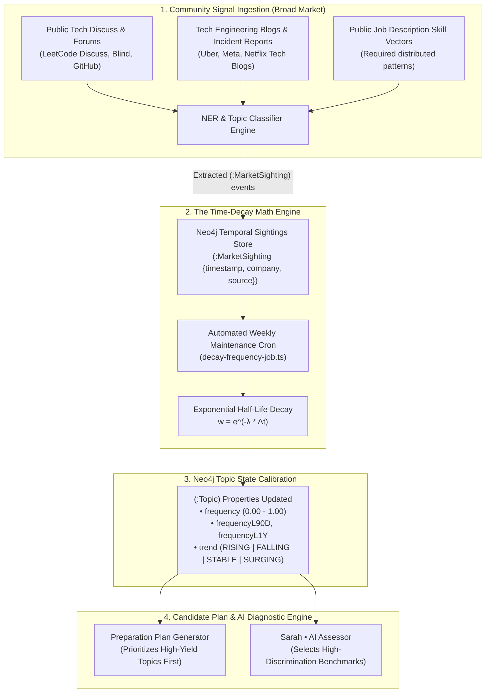

# Dynamic Frequency & Market Trend Decay Architecture

This specification document details the automated, privacy-preserving intelligence engine that calculates, updates, and decays the **Interview Frequency & Market Yield Scores** for curriculum topics within the Neo4j Knowledge Graph.

It ensures that PrepInMinutes candidates always prepare for questions reflecting **current interview trends (2026 and beyond)** rather than stale historical patterns.

---

## 1. Architectural Motivation: The Problem with Static Curricula

In traditional interview preparation platforms, question frequency is treated as a static constant (e.g., `frequency = 0.90`). This fails over time:

1. **Market Trend Shifts**: System design trends evolve rapidly. In 2023–2024, basic URL Shorteners and single-region key-value caches were ubiquitous. In 2025–2026, companies increasingly test **Vector Search / RAG pipelines, Event-Driven Stream Processing (Kafka), Multi-Region Active-Active Replication, and LLM Inference Gateway Rate Limiting**.
2. **Time Constraint Bottleneck**: Candidates typically have 1–3 weeks before an interview loop. If the knowledge graph cannot differentiate between a fading topic and a surging topic, candidates waste critical preparation hours on low-yield material.
3. **Zero Intrusive Tracking Guarantee**: PrepInMinutes does **not** rely on post-interview candidate debriefs or mandatory user questionnaires. Instead, the system relies strictly on **autonomous external community signal ingestion** combined with **mathematical time-decay algorithms**.

---

## 2. High-Level Architecture Overview



---

## 3. Community Signal Ingestion (Broad Market)

The ingestion pipeline automatically collects unstructured public engineering signals and maps them to canonical Neo4j `Topic` and `Question` nodes.

### 3.1. Ingestion Sources
1. **Public Interview Experiences & Debriefs**: Open community posts detailing recent technical interview loops across Tier-1 tech, high-growth startups, and quantitative finance.
2. **Staff/Principal Engineering Blogs**: Architecture case studies published by engineering organizations (e.g., DoorDash dynamic pricing dispatch, Stripe ledger idempotency).
3. **Public Job Postings & Industry Skill Vectors**: Real-time extraction of distributed systems requirements across mid-to-staff level job postings.

### 3.2. Extraction & Normalization Pipeline
When an external signal is ingested:
1. **Entity Extraction (NER)**: Identifies architectural tokens (e.g., *"Bloom filter"*, *"consistent hashing"*, *"write-ahead log"*, *"RAG pipeline"*, *"vector database"*).
2. **Fuzzy & Synonym Match**: Resolves entity mentions against the Neo4j `Topic.slug` dictionary and alias index.
3. **Event Recording**: A timestamped `MarketSighting` node is created and linked to the corresponding `Topic`:

```cypher
MATCH (t:Topic {slug: $topicSlug})
CREATE (s:MarketSighting {
  id: apoc.create.uuid(),
  source: $source,
  company: $targetCompany,
  detectedAt: datetime(),
  rawSnippet: $sanitizedSnippet
})
CREATE (s)-[:MENTIONS]->(t)
```

---

## 4. The Time-Decay Mathematical Model

To ensure recent interview trends are prioritized over historical data, the system applies an **Exponential Half-Life Decay function**.

### 4.1. The Half-Life Decay Equation

The effective weight $w_i$ of an individual interview sighting $i$ observed at time $t_i$ relative to the current time $t_{\text{now}}$ is defined as:

$$w_i = e^{-\lambda \cdot (t_{\text{now}} - t_i)}$$

Where the decay constant $\lambda$ is defined by the chosen half-life $T_{\text{half}}$:

$$\lambda = \frac{\ln(2)}{T_{\text{half}}}$$

### 4.2. Decay Parameters
- **Half-Life ($T_{\text{half}}$)**: **180 days (approx. 6 months)**.
- Any sighting from **today** has a weight of **$1.0$**.
- A sighting from **6 months ago** has a weight of **$0.50$**.
- A sighting from **1 year ago** has a weight of **$0.25$**.
- A sighting from **2 years ago (e.g., 2024)** has a weight of **$\approx 0.06$** (almost completely decayed).

```text
Weight
1.00 | *
     |   *
0.50 |       * (6 Months - Half-Life)
     |           *
0.25 |               * (1 Year)
0.06 |                   * (2 Years)
0.00 +--------------------------------- Time
     Today     180 Days   360 Days   720 Days
```

### 4.3. Cumulative Frequency Score Normalization

The composite frequency score $F(T)$ for a topic $T$ is computed by summing the decayed weights of all sightings within the rolling 2-year window, scaled against a saturation ceiling $S_{\text{max}}$ (set to 50 weighted sightings):

$$F(T) = \min\left(1.0, \; \frac{\sum_{i \in \text{Sightings}(T)} w_i}{S_{\text{max}}}\right)$$

### 4.4. Trend Velocity Classification

By comparing the 90-day short-term momentum ($F_{90}$) against the 1-year baseline ($F_{365}$), the system classifies the topic velocity:

$$\Delta_{\text{momentum}} = F_{90} - F_{365}$$

| Condition | Trend Label | Meaning for Candidate |
| :--- | :---: | :--- |
| $\Delta_{\text{momentum}} \ge +0.25$ | `SURGING` | Rapidly rising in 2026 interview rounds (e.g., Vector DBs, AI Gateways). |
| $\Delta_{\text{momentum}} \in [+0.08, +0.25)$ | `RISING` | Steady upward adoption across target companies. |
| $\Delta_{\text{momentum}} \in (-0.08, +0.08)$ | `STABLE` | Evergreen fundamental question (e.g., Rate Limiting, Caching). |
| $\Delta_{\text{momentum}} \le -0.08$ | `FALLING` | Decreasing market frequency (e.g., basic single-node URL shortener). |

---

## 5. Neo4j Schema & Node Model

### 5.1. Topic Node Schema Enhancements
The `Topic` node in Neo4j AuraDB stores the following dynamic temporal metrics:

```json
{
  "title": "Vector Search & RAG Pipeline Architecture",
  "slug": "vector-search-rag",
  "difficulty": "HARD",
  "durationMin": 20,
  "status": "PUBLISHED",
  "isLive": true,
  "frequency": 0.94,
  "frequencyL90D": 0.96,
  "frequencyL1Y": 0.42,
  "trend": "SURGING",
  "weight": 0.95,
  "lastSightingAt": "2026-11-04T12:00:00Z",
  "frequencyUpdatedAt": "2026-11-05T00:00:00Z"
}
```

### 5.2. Graph Schema Constraints
```cypher
CREATE CONSTRAINT topic_slug_unique IF NOT EXISTS
FOR (t:Topic) REQUIRE t.slug IS UNIQUE;

CREATE INDEX topic_frequency_idx IF NOT EXISTS
FOR (t:Topic) ON (t.frequency);

CREATE INDEX sighting_timestamp_idx IF NOT EXISTS
FOR (s:MarketSighting) ON (s.detectedAt);
```

---

## 6. The Automated Recalculation Engine (Weekly Cron)

A lightweight background cron script ([`scripts/recalculate-frequency-decay.ts`](file:///Users/saurav/Desktop/development/prepinminutes-backend/scripts/recalculate-frequency-decay.ts)) runs on a scheduled cadence (e.g., Sunday 02:00 UTC).

### 6.1. Recalculation Cypher Query

```cypher
MATCH (t:Topic)
WHERE t.status = 'PUBLISHED'

// 1. Collect sightings in the last 730 days (2 years)
OPTIONAL MATCH (s:MarketSighting)-[:MENTIONS]->(t)
WHERE s.detectedAt >= datetime() - duration({days: 730})

WITH t, collect(s) AS allSightings

// 2. Compute decayed weights
WITH t,
  [s IN allSightings WHERE s.detectedAt >= datetime() - duration({days: 90}) |
    exp(-0.00385 * duration.inDays(s.detectedAt, datetime()).days)
  ] AS weights90,
  [s IN allSightings WHERE s.detectedAt >= datetime() - duration({days: 365}) |
    exp(-0.00385 * duration.inDays(s.detectedAt, datetime()).days)
  ] AS weights365,
  [s IN allSightings |
    exp(-0.00385 * duration.inDays(s.detectedAt, datetime()).days)
  ] AS weightsAll

// 3. Sum weights and normalize to 0.0 - 1.0 range
WITH t,
  reduce(acc = 0.0, w IN weights90 | acc + w) AS sum90,
  reduce(acc = 0.0, w IN weights365 | acc + w) AS sum365,
  reduce(acc = 0.0, w IN weightsAll | acc + w) AS sumAll

WITH t,
  round(CASE WHEN sum90 / 25.0 > 1.0 THEN 1.0 ELSE sum90 / 25.0 END, 2) AS score90,
  round(CASE WHEN sum365 / 40.0 > 1.0 THEN 1.0 ELSE sum365 / 40.0 END, 2) AS score365,
  round(CASE WHEN sumAll / 50.0 > 1.0 THEN 1.0 ELSE sumAll / 50.0 END, 2) AS scoreAll

// 4. Update Topic properties and trend status
SET t.frequency = scoreAll,
    t.frequencyL90D = score90,
    t.frequencyL1Y = score365,
    t.trend = CASE
      WHEN score90 - score365 >= 0.25 THEN 'SURGING'
      WHEN score90 - score365 >= 0.08 THEN 'RISING'
      WHEN score90 - score365 <= -0.08 THEN 'FALLING'
      ELSE 'STABLE'
    END,
    t.frequencyUpdatedAt = datetime()
RETURN t.slug, t.frequency, t.trend;
```

### 6.2. Automatic Graph Pruning
To prevent graph bloating, sightings older than 730 days (2 years) have decayed to $< 0.06$ significance and are pruned monthly:

```cypher
MATCH (s:MarketSighting)
WHERE s.detectedAt < datetime() - duration({days: 730})
DETACH DELETE s;
```

---

## 7. How PrepInMinutes Uses This in Daily Practice

### 7.1. High-Yield Topic Prioritization
When a candidate requests their **Personalized Preparation Plan** or **"Today's Preparation"**, the plan orchestrator ranks candidate topics using the yield formula:

$$\text{YieldScore} = \frac{\text{Topic.frequency} \times \text{Topic.weight} \times \text{RoleRelevance}}{\text{CandidateMastery} + 0.15}$$

- High-frequency topics with low candidate mastery are surfaced immediately.
- Fading topics (`FALLING`) are moved to late-stage revision or optional tracks.

### 7.2. UI Trend Badges on Candidate Dashboard
In the PrepInMinutes dashboard, candidates receive transparent market context:

```text
[Topic Card]
--------------------------------------------------------------
Distributed Caching Architecture
Difficulty: HARD  •  Est: 15 mins  •  Priority: HIGH
🔥 Surging in 2026 Rounds (Meta, Uber, Stripe)
Rubric Focus: cache-aside, write-through, stampede prevention
[Start Practice Session]
--------------------------------------------------------------
```

---

## 8. Summary of Guarantees

| Metric / Feature | Implementation Guarantee |
| :--- | :--- |
| **No Candidate Inquiries** | Fully automated from external community ingestion; zero candidate prompts. |
| **Time Decay** | Exponential half-life ($T_{1/2} = 180$ days); 2025 questions decay automatically. |
| **Trend Awareness** | Distinguishes between `SURGING`, `RISING`, `STABLE`, and `FALLING` topics. |
| **Graph Cleanliness** | Sightings older than 2 years are pruned automatically. |
| **Deterministic Sorting** | Provides mathematical priority ranking for 1–3 week candidate crash courses. |

