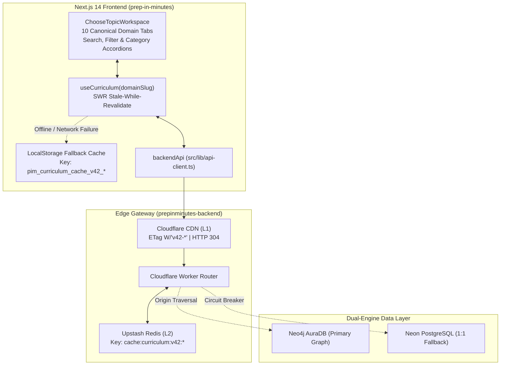
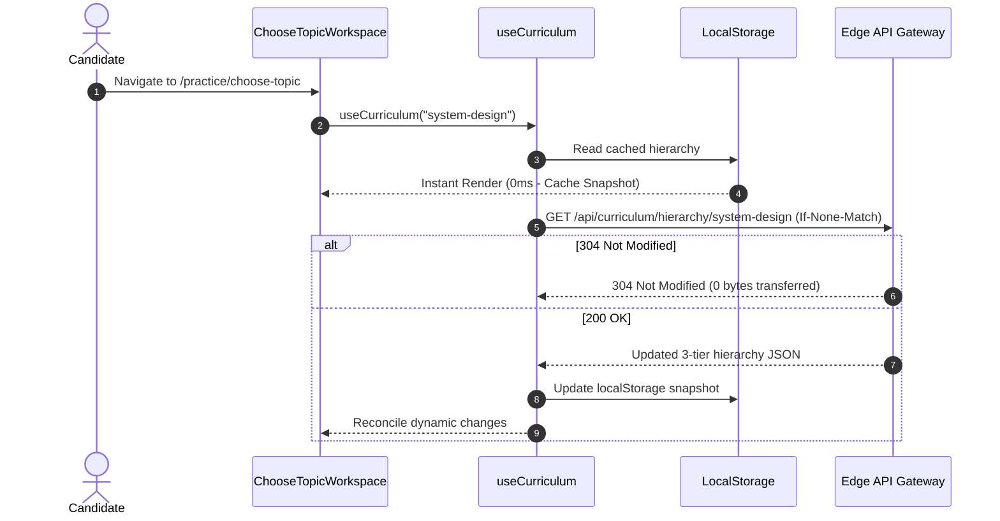

# PrepInMinutes — Dynamic Frontend Knowledge Graph Integration Specification (Phase 4)
## Real-Time Edge API Consumption, 10-Domain Topic Picker, Stale-While-Revalidate Caching & Zero-Layout-Shift UI

> **Document Version:** 1.0.0 (Production Implementation Specification)  
> **Target Application:** Next.js 14 App Router (`prep-in-minutes`)  
> **Upstream Edge Gateway:** Cloudflare Workers / Hono Edge Backend (`prepinminutes-backend`)  
> **Primary Data Sources:** `GET /api/curriculum/domains`, `GET /api/curriculum/hierarchy/:slug`, `GET /api/curriculum/topic/:slug`  
> **Status:** 🟢 **APPROVED ARCHITECTURAL SPECIFICATION**  
> **Governing Standards:** [`docs/TASK_EXECUTION_SEQUENCE.md`](./TASK_EXECUTION_SEQUENCE.md) • [`docs/CURRICULUM_API_AND_EDGE_GATEWAY_SPEC.md`](./CURRICULUM_API_AND_EDGE_GATEWAY_SPEC.md)

---

## 1. Executive Summary & Architectural Goals

In Phases 1 through 3, PrepInMinutes engineered the **Knowledge Graph Foundation** (371 topics, 122 categories, 7,420 questions across 10 canonical domains in Neo4j AuraDB), established **PostgreSQL Relational Parity & Platform Seeds**, built the **Cross-Cutting Intelligence Layer** (roles, companies, stages, 5-factor roadmap engine), and deployed the **Public Unified Curriculum API & Edge Gateway** with sub-millisecond multi-tier caching (L0 memory, L1 CDN ETag, L2 Upstash Redis).

**Phase 4 Objective:** Transition the Next.js candidate-facing frontend from static hardcoded topic arrays (`ALL_TOPICS` in `ChooseTopicWorkspace.tsx`) to **fully dynamic, real-time consumption of the Knowledge Graph Edge Gateway**.



### Key Architectural Invariants:
1. **Zero Hardcoded Curriculum**: All 10 domains, 122 categories, and 371 topics are loaded dynamically from the backend Edge Gateway.
2. **Sub-10ms UI Responsiveness**: Leveraging HTTP 304 `ETag` revalidation and client-side SWR caching (`stale-while-revalidate`), topics render instantly without blocking navigation.
3. **Graceful Offline Degradation**: If the network is interrupted or the candidate is offline, the UI falls back seamlessly to `localStorage` cached snapshots, displaying a subtle indicator without crashing.
4. **Zero Cumulative Layout Shift (CLS < 0.05)**: Skeleton placeholders precisely match the dimensions of domain tabs and topic cards during initial cold loads.
5. **Exact 1:1 Schema Conformance**: Frontend TypeScript interfaces strictly mirror the backend contracts defined in [`src/server/graph/types.ts`](file:///Users/saurav/Desktop/development/prepinminutes-backend/src/server/graph/types.ts).

---

## 2. Universal Data Contracts & Client SDK Extension

### 2.1 TypeScript Shared Interfaces (`src/types/curriculum.ts`)

```typescript
export type PriorityLevel = "P0" | "P1";
export type DifficultyLevel = "BEGINNER" | "INTERMEDIATE" | "ADVANCED" | "EXPERT";
export type TrendDirection = "SURGING" | "HOT" | "STABLE" | "COOLING";

export interface DomainCatalogItem {
  slug: string;
  name: string;
  shortName: string;
  description: string;
  version: string;
  sortOrder: number;
  categoriesCount: number;
  topicsCount: number;
  questionsCount: number;
  icon: string;
  colorTheme: string;
}

export interface CurriculumTopicSummary {
  slug: string;
  topicId: string;
  title: string;
  priority: PriorityLevel;
  difficulty: DifficultyLevel;
  durationMin: number;
  frequency: number;
  trend: TrendDirection;
  rubricAtomsCount: number;
  questionsCount: number;
  practiceHref: string;
  // Candidate-specific dynamic overlay
  readiness?: number;
  status?: "Needs Practice" | "Not Practiced" | "Practiced" | "In Progress";
  isStarred?: boolean;
}

export interface CurriculumCategoryHierarchy {
  slug: string;
  name: string;
  pillar: string;
  sortOrder: number;
  topicsCount: number;
  topics: CurriculumTopicSummary[];
}

export interface CurriculumHierarchyResponse {
  domainSlug: string;
  domainName: string;
  description: string;
  version: string;
  totalCategories: number;
  totalTopics: number;
  totalQuestions: number;
  categories: CurriculumCategoryHierarchy[];
}

export interface CurriculumDomainsResponse {
  success: boolean;
  domains: DomainCatalogItem[];
  meta: {
    curriculumVersion: string;
    totalDomains: number;
    totalCategories: number;
    totalTopics: number;
    totalQuestions: number;
    dataSource: string;
  };
}
```

### 2.2 Frontend API Client Extension (`src/lib/api-client.ts`)

```typescript
// Append to backendApi in src/lib/api-client.ts:

/**
 * GET /api/curriculum/domains
 * Returns catalog summary of all 10 canonical domains
 */
async getCurriculumDomains(options: RequestOptions = {}) {
  const res = await fetch(`${API_BASE_URL}/api/curriculum/domains`, {
    method: "GET",
    headers: buildHeaders(options),
    credentials: "include",
  });
  return handleResponse<CurriculumDomainsResponse>(res);
},

/**
 * GET /api/curriculum/hierarchy/:domainSlug
 * Returns complete 3-tier hierarchy (Domain -> Categories -> Topics)
 */
async getCurriculumHierarchy(domainSlug: string, options: RequestOptions = {}) {
  const res = await fetch(`${API_BASE_URL}/api/curriculum/hierarchy/${domainSlug}`, {
    method: "GET",
    headers: buildHeaders(options),
    credentials: "include",
  });
  return handleResponse<CurriculumHierarchyResponse & { success: boolean }>(res);
},

/**
 * GET /api/curriculum/topic/:topicSlug
 * Returns full 8-layer metadata and question bundle
 */
async getCurriculumTopicDetail(topicSlug: string, options: RequestOptions = {}) {
  const res = await fetch(`${API_BASE_URL}/api/curriculum/topic/${topicSlug}`, {
    method: "GET",
    headers: buildHeaders(options),
    credentials: "include",
  });
  return handleResponse<TopicDetailResponse & { success: boolean }>(res);
},

/**
 * GET /api/curriculum/topic/:topicSlug/questions
 * Returns dynamic question collection with optional filters
 */
async getCurriculumTopicQuestions(
  topicSlug: string,
  params?: { targetLevel?: string; difficulty?: string; limit?: number },
  options: RequestOptions = {}
) {
  const query = new URLSearchParams();
  if (params?.targetLevel) query.set("targetLevel", params.targetLevel);
  if (params?.difficulty) query.set("difficulty", params.difficulty);
  if (params?.limit) query.set("limit", params.limit.toString());

  const qs = query.toString() ? `?${query.toString()}` : "";
  const res = await fetch(`${API_BASE_URL}/api/curriculum/topic/${topicSlug}/questions${qs}`, {
    method: "GET",
    headers: buildHeaders(options),
    credentials: "include",
  });
  return handleResponse<TopicQuestionsResponse & { success: boolean }>(res);
}
```

---

## 3. 10-Domain Taxonomy & UI Mapping

The frontend dynamically visualizes all **10 canonical domains** using dedicated Lucide icons, color palettes, and short labels:

| Domain Slug | Official Name | Short Label | Lucide Icon | Theme Color Palette | Border / Ring Accent |
| :--- | :--- | :--- | :---: | :---: | :---: |
| `system-design` | System Design & Distributed Systems | System Design | `Network` | `text-blue-500 bg-blue-500/10` | `border-blue-500/30` |
| `ai-system-design` | AI System Design & GenAI Infra | AI System Design | `Cpu` | `text-purple-500 bg-purple-500/10` | `border-purple-500/30` |
| `low-level-design` | Low-Level Design & Machine Coding | Low-Level Design | `Boxes` | `text-emerald-500 bg-emerald-500/10` | `border-emerald-500/30` |
| `dsa` | Data Structures & Algorithms | DSA | `Binary` | `text-amber-500 bg-amber-500/10` | `border-amber-500/30` |
| `backend-engineering` | Backend & Runtime Engineering | Backend | `Server` | `text-cyan-500 bg-cyan-500/10` | `border-cyan-500/30` |
| `frontend-engineering` | Frontend & Web Architecture | Frontend | `Layout` | `text-rose-500 bg-rose-500/10` | `border-rose-500/30` |
| `cloud-devops` | Cloud, DevOps & SRE | Cloud & DevOps | `Cloud` | `text-indigo-500 bg-indigo-500/10` | `border-indigo-500/30` |
| `behavioral-leadership` | Behavioral, Leadership & Management | Behavioral | `Users` | `text-orange-500 bg-orange-500/10` | `border-orange-500/30` |
| `data-engineering` | Data Engineering & Big Data Systems | Data Engineering | `Database` | `text-teal-500 bg-teal-500/10` | `border-teal-500/30` |
| `mobile-engineering` | Mobile Engineering | Mobile | `Smartphone` | `text-violet-500 bg-violet-500/10` | `border-violet-500/30` |

---

## 4. Component Refactoring: `ChooseTopicWorkspace.tsx`

### 4.1 State Management & Hook Architecture

A specialized custom hook [`useCurriculumCurated(domainSlug)`](file:///Users/saurav/Desktop/development/prep-in-minutes/src/hooks/useCurriculum.ts) orchestrates:
1. Fetching domain catalog via `backendApi.getCurriculumDomains()`.
2. Fetching active domain hierarchy via `backendApi.getCurriculumHierarchy(domainSlug)`.
3. Reading candidate mastery & readiness overlays from `/api/candidate/readiness`.
4. Writing snapshots to `localStorage` under `pim_curriculum_cache_v42_*` for instant offline render.



### 4.2 Multi-Dimensional Search, Filter & Grouping Engine

The candidate can filter across all 371 topics in real time:
1. **Search Query**: Real-time debounce match on:
   - Topic `title` (e.g. "Distributed Key-Value Store")
   - Canonical `topicId` (e.g. "FND001", "CMP008")
   - Rubric atom strings (e.g. "consistent hashing", "virtual nodes")
2. **Category / Pillar Breakdown**:
   - Visual grouping into canonical category sections (e.g. *System Design Foundations*, *Distributed Storage*, *Event Streaming & Messaging*).
   - Display topic count per category badge.
3. **Difficulty Filter**:
   - `All` | `Beginner` | `Intermediate` | `Advanced` | `Expert`.
4. **Priority Filter**:
   - `All` | `P0 (Core Interview Topics)` | `P1 (Advanced Topics)`.
5. **Practice CTA Linkage**:
   - Clicking **"Practice Now"** navigates to `/practice/session/[domain]?topic=[slug]` dynamically passing the canonical slug.

---

## 5. Phase 4 Task Execution Breakdown

| Task Code | Focus Area | Detailed Scope | Target Latency / CLS | Status |
| :--- | :--- | :--- | :---: | :---: |
| **`TASK-P4-01`** | **Frontend Curriculum Client & SWR Hook** | Add typed curriculum methods to `src/lib/api-client.ts`, create `src/hooks/useCurriculum.ts` with SWR, ETag 304, and localStorage persistence. | **$< 10\text{ms}$ (cached)** | 🟡 **IN PROGRESS** |
| **`TASK-P4-02`** | **10-Domain Responsive Tabs & Header Summary** | Expand domain navigation bar in `ChooseTopicWorkspace.tsx` from 4 to 10 domains with dynamic counts, theme colors, and skeleton loaders. | **CLS $< 0.05$** | ⚪ Pending |
| **`TASK-P4-03`** | **Dynamic Topic Cards, Search, Filters & Practice Links** | Replace static topic rendering with dynamic category sections, real-time search, difficulty/priority filters, and dynamic practice URLs. | **$< 16\text{ms}$ input latency** | ⚪ Pending |

---

## 6. Verification & Automated Test Strategy

To ensure zero regressions across both repositories:
1. **TypeScript Build & Strict Typecheck**:
   - `npm run typecheck` across `prep-in-minutes` and `prepinminutes-backend` exiting code 0.
2. **Next.js Production Build**:
   - `npm run build` in `prep-in-minutes` verifying clean static page generation.
3. **E2E & Component Test Script (`scripts/test-frontend-curriculum-integration.ts`)**:
   - Verifies API client fetches 10 domains, hierarchy for all 10 domains, and returns conformant data contracts.
   - Verifies URL route generation (`/practice/session/[domain]?topic=[slug]`) produces valid links matching all 371 topics.
   - Verifies localStorage serialization & deserialization resilience.
