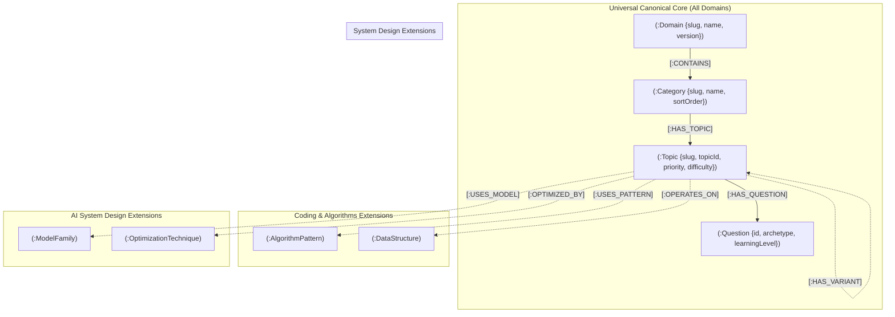

# PrepInMinutes Generic Knowledge Graph Schema & Fetching Standard
## Universal Metamodel for Multi-Domain Curriculum (System Design, Coding, AI, DevOps)

**Version:** 1.1.0  
**Target Engine:** Neo4j AuraDB (Property Graph + Cypher 5.x) & PostgreSQL (Relational Attempts & Plans)  
**Governing Pattern:** Canonical Core Backbone + Domain-Specific Graph Extensions + Polyglot State Separation  
**Status:** 🟢 **CANONICAL SPECIFICATION**

---

## 1. Architectural Philosophy: The "Canonical Core + Extension" Metamodel

To support multiple domains (System Design, Coding & Algorithms, AI System Design, Cloud/DevOps) without fragmentation or code duplication, the PrepInMinutes Knowledge Graph is structured in three architectural layers:

### 1.1 The Canonical Core Backbone (Universal across ALL domains)
Every domain shares the exact same 4-tier structural spine:
$$\text{Domain} \xrightarrow{\text{CONTAINS}} \text{Category} \xrightarrow{\text{HAS\_TOPIC}} \text{Topic} \xrightarrow{\text{HAS\_QUESTION}} \text{Question}$$
This guarantees that:
- The same frontend UI components can render *any* domain curriculum.
- The learning engine, readiness tracker, and AI interviewer operate against a single, universal interface.
- Database queries for navigation, catalog generation, and breadcrumbs are 100% reusable.

### 1.2 Domain-Specific Extensions (Custom to each engineering discipline)
Each domain specializes its graph with specialized node labels and relationship types without breaking the canonical spine:
- **System Design**: `[:PREREQUISITE_OF]`, `[:USES_COMPONENT]`, `[:FOUNDED_ON]`.
- **Coding & Algorithms**: `(:AlgorithmPattern)`, `(:DataStructure)`, `[:USES_PATTERN]`, `[:OPERATES_ON]`, `[:HAS_VARIANT]`, `[:TIME_COMPLEXITY]`, `[:SPACE_COMPLEXITY]`.
- **AI System Design**: `(:ModelFamily)`, `(:OptimizationTechnique)`, `[:USES_MODEL]`, `[:OPTIMIZED_BY]`.
- **DevOps / Cloud Architecture**: `(:CloudService)`, `(:InfraPattern)`, `[:RUNS_ON]`, `[:DEPLOYS_VIA]`.



### 1.3 Polyglot Storage Architecture: Neo4j vs PostgreSQL Separation
PrepInMinutes strictly bifurcates static curriculum knowledge from dynamic candidate execution state:

| Layer | Primary Engine | Managed Entities | Access Characteristics | Isolation Guarantee |
| :--- | :--- | :--- | :--- | :--- |
| **Curriculum Knowledge Graph** | **Neo4j AuraDB** | `Domain`, `Category`, `Topic`, `Question`, `Concept`, Prerequisite DAGs (`[:PREREQUISITE_OF]`) | 95% Read-Heavy, Sub-10ms graph traversals, Cypher pattern queries | **Zero Candidate PII**, Shared across all users |
| **Candidate Execution State** | **PostgreSQL (Neon)** | `CandidateProfile`, `QuestionAttempt`, `TopicMastery`, `PreparationPlan`, `DailyPlanTask` | Write-Heavy, ACID transactions, relational joins, row-level security | Private, strictly isolated per tenant |

> [!IMPORTANT]
> PostgreSQL stores **foreign-key references** (`topic_id` and `question_id` as strings) pointing to the canonical Neo4j graph nodes. The relational database **never duplicates** the curriculum hierarchy, topic descriptions, rubrics, or graph edges.

---

## 2. Canonical Core Node & Relationship Specifications

### A. `(:Domain)` Node (The Domain Root Anchor)
Unique business identifier: `slug`

| Property | Type | Required | Description | Example |
| :--- | :--- | :---: | :--- | :--- |
| `slug` | `String` | **Yes** | Unique URL-safe identifier (Indexed / Unique) | `"system-design"`, `"ai-system-design"` |
| `name` | `String` | **Yes** | Human-readable domain name | `"System Design"`, `"AI System Design"` |
| `description` | `String` | **Yes** | Executive curriculum description | `"Classical distributed systems, high availability..."` |
| `pillarCount` | `Integer` | No | Number of internal syllabus pillars/dimensions | `3` |
| `categoryCount`| `Integer`| **Yes** | Total categories in domain | `17` |
| `topicCount` | `Integer` | **Yes** | Total topics in domain | `62` |
| `questionCount`| `Integer`| **Yes** | Total master questions | `1240` |
| `version` | `String` | **Yes** | Semantic version of curriculum | `"5.1.0"` |
| `updatedAt` | `DateTime`| **Yes** | Timestamp of last graph sync | `datetime()` |

---

### B. `(:Category)` Node (Thematic Grouping)
Unique business identifier: `slug`

| Property | Type | Required | Description | Example |
| :--- | :--- | :---: | :--- | :--- |
| `slug` | `String` | **Yes** | Unique identifier (Indexed / Unique) | `"traffic-management-components"` |
| `name` | `String` | **Yes** | Category display title | `"Traffic Management & Networking"` |
| `description` | `String` | **Yes** | Scope of topics in category | `"Load balancing, reverse proxies, CDNs..."` |
| `pillar` | `String` | No | Syllabus pillar/dimension identifier | `"principles"`, `"components"`, `"case-studies"` |
| `sortOrder` | `Integer` | **Yes** | Global UI display sort sequence | `1`, `2`, `3` ... |
| `updatedAt` | `DateTime`| **Yes** | Timestamp of update | `datetime()` |

---

### C. `(:Topic)` Node (The Core Learnable Unit)
Unique business identifier: `slug`

| Property | Type | Required | Description | Example |
| :--- | :--- | :---: | :--- | :--- |
| `slug` | `String` | **Yes** | Unique URL-safe identifier (Indexed / Unique) | `"load-balancers-traffic"` |
| `topicId` | `String` | **Yes** | Human-readable catalog ID | `"CMP001"`, `"FND001"`, `"SYS001"` |
| `title` | `String` | **Yes** | Full display title | `"Load Balancers & Traffic Distribution"` |
| `pillar` | `String` | No | Structural syllabus pillar | `"components"` |
| `priority` | `String` | **Yes** | Preparation priority tier (`P0` \| `P1` \| `P2`) | `"P0"` (Must-Master Core) |
| `difficulty` | `String` | **Yes** | Baseline entry level (`BEGINNER` \| `INTERMEDIATE` \| `ADVANCED` \| `EXPERT`) | `"BEGINNER"` |
| `durationMin` | `Integer` | **Yes** | Target deep-dive study duration | `20`, `45` |
| `frequency` | `Float` | **Yes** | Interview appearance probability ($0.0 \rightarrow 1.0$) | `0.92` |
| `weight` | `Float` | **Yes** | Curricular depth importance ($0.0 \rightarrow 1.0$) | `0.95` |
| `trend` | `String` | **Yes** | Market momentum (`SURGING` \| `RISING` \| `STABLE` \| `FALLING`) | `"STABLE"` |
| `description` | `String` | **Yes** | 8-layer comprehensive technical overview | `"L4 vs L7 balancing, consistent hashing..."` |
| `rubricAtoms` | `List<String>`| **Yes** | Key technical concepts candidate must address | `["l4 vs l7", "consistent hashing"]` |
| `updatedAt` | `DateTime`| **Yes** | Timestamp of update | `datetime()` |

#### Priority Tiers:
- **`P0` (Core Must-Master)**: Fast-track essentials (24 topics). Foundational principles, vital components, and iconic interview case studies.
- **`P1` (High-Frequency & Senior Breadth)**: Standard interview loop breadth (24 topics). Enterprise patterns, consistency models, and advanced architectures.
- **`P2` (Specialized & Staff/Principal Mastery)**: Staff/Principal deep dives (14 topics). Byzantine fault tolerance, Raft consensus internals, SWIM gossip, CRDT collaborative editors, and IoT OTA updates.

---

### D. `(:Question)` Node (The Assessment Atom)
Unique business identifier: `id`

| Property | Type | Required | Description | Example |
| :--- | :--- | :---: | :--- | :--- |
| `id` | `String` | **Yes** | Unique question ID (Indexed / Unique) | `"q_load_balancers_traffic_01"` |
| `title` | `String` | **Yes** | Concise question title | `"Layer 4 vs Layer 7 Load Balancing Trade-Offs"` |
| `difficulty` | `String` | **Yes** | `BEGINNER` \| `INTERMEDIATE` \| `ADVANCED` \| `EXPERT` | `"BEGINNER"` |
| `learningLevel`| `String`| **Yes** | Progression depth `L1` \| `L2` \| `L3` \| `L4` \| `L5` | `"L1"` |
| `archetype` | `String` | **Yes** | 10 Archetypes: `conceptual`, `mechanism`, `implementation`, `comparison`, `scenario-based`, `troubleshooting`, `architecture`, `trade-off`, `failure-analysis`, `follow-up-probe` | `"comparison"` |
| `questionType` | `String` | No | Evaluation mode (`DESIGN_SCENARIO`, `DEEP_DIVE`, `INCIDENT_TRIAGE`, `TRADE_OFF`) | `"DESIGN_SCENARIO"` |
| `expectedAnswerStructure` | `List<String>` | No | Expected response phases | `["requirements", "high-level-design", "deep-dive", "bottlenecks"]` |
| `timeLimitSec` | `Integer` | No | Recommended timebox for assessment | `900` (15 min) |
| `prompt` | `String` | **Yes** | Real-world scenario/interview prompt text | `"Contrast Layer 4 and Layer 7 load balancing..."` |
| `scaleAnchor` | `String` | No | Quantitative scale constraint | `"50,000 QPS, p99 < 50ms"` |
| `rubricGuide` | `String` | **Yes** | Evaluation guidelines for AI/human grader | `"Candidate must articulate that Layer 4..."` |
| `rubricAtoms` | `List<String>`| **Yes** | Exact grading atoms required for score | `["l4 vs l7", "packet inspection"]` |
| `hints` | `List<String>`| **Yes** | Socratic hints when candidate is stuck | `["Does L4 unpack the HTTP payload?"]` |
| `followUpProbes`| `List<String>`| **Yes** | Deepening questions for Senior/Principal | `["How does TLS offload affect CPU usage?"]` |
| `expectedKeywords`| `List<String>`| **Yes** | Keywords for semantic scoring | `["Layer 4", "Layer 7", "TCP", "SSL"]` |
| `antiPatterns` | `List<String>`| No | Red-flag answers or common mistakes | `["Assuming L4 can inspect JWT headers"]` |
| `frequencyScore` | `Integer` | No | Popularity score ($0 \rightarrow 100$) governing sorting & "Most Asked" ($score \ge 80$) | `98` |
| `isTop150` | `Boolean` | No | Curated Top 150 interview checklist membership | `true` |
| `isBlind75` | `Boolean` | No | Curated Blind 75 emergency sprint membership | `true` |
| `companies` | `List<String>` | No | Real-world company sighting tags | `["Google", "Amazon", "Meta"]` |
| `isActive` | `Boolean` | No | Publication flag | `true` |
| `version` | `String` | No | Question content revision | `"1.0"` |

---

## 3. Domain-Specific Extensions Schema

### Domain 1: System Design (`system-design`)
* **Core Relationships**:
  - `(:Topic)-[:PREREQUISITE_OF]->(:Topic)`: Enforces topological curriculum sequencing (DAG, 0 cycles).
  - `(:Topic)-[:USES_COMPONENT]->(:Topic)`: Maps Problem/System case studies to constituent Component topics (e.g., `SYS008` Amazon uses `CMP001` Load Balancer, `CMP007` Redis, `CMP009` Kafka).
  - `(:Topic)-[:FOUNDED_ON]->(:Topic)`: Connects Problem/System case studies to bedrock Principles (e.g., `SYS009` Payment Gateway founded on `FND007` ACID Transactions and `FND010` CAP Theorem).

### Domain 2: Coding & Algorithms (`coding-algorithms`)
* **Specialized Nodes**:
  - `(:AlgorithmPattern {slug, name, category, timeComplexity, spaceComplexity})`
  - `(:DataStructure {slug, name, operations, memoryOverhead})`
* **Specialized Relationships**:
  - `(t:Topic)-[:USES_PATTERN]->(p:AlgorithmPattern)`
  - `(t:Topic)-[:OPERATES_ON]->(ds:DataStructure)`
  - `(t:Topic)-[:HAS_VARIANT]->(t2:Topic)`

### Domain 3: AI System Design (`ai-system-design`)
* **Core Relationships (Identical to System Design)**:
  - `(:Topic)-[:PREREQUISITE_OF]->(:Topic)`: Enforces topological curriculum sequencing (DAG, 0 cycles).
  - `(:Topic)-[:USES_COMPONENT]->(:Topic)`: Maps Problem/System case studies to constituent AI component topics (e.g., `AIS001` Copilot uses `AIC004` vLLM, `AIC005` KV-Cache, `AIC006` Speculative Decoding).
  - `(:Topic)-[:FOUNDED_ON]->(:Topic)`: Connects Problem/System case studies to bedrock AI Principles (e.g., `AIS002` Voice AI founded on `AIP001` Tokens and `AIP003` Attention Mechanism).
* **Specialized Nodes**:
  - `(:ModelFamily {slug, name, modality, architecture, contextWindow})`
  - `(:OptimizationTechnique {slug, name, category, memorySavings})`
* **Specialized Relationships**:
  - `(t:Topic)-[:USES_MODEL]->(mf:ModelFamily)`
  - `(t:Topic)-[:OPTIMIZED_BY]->(opt:OptimizationTechnique)`

---

## 4. Graph Constraints & Indexes

To ensure integrity and sub-10ms queries, the following constraints must be created in Neo4j AuraDB:

```cypher
// Canonical Core Constraints
CREATE CONSTRAINT domain_slug_unique IF NOT EXISTS FOR (d:Domain) REQUIRE d.slug IS UNIQUE;
CREATE CONSTRAINT category_slug_unique IF NOT EXISTS FOR (c:Category) REQUIRE c.slug IS UNIQUE;
CREATE CONSTRAINT topic_slug_unique IF NOT EXISTS FOR (t:Topic) REQUIRE t.slug IS UNIQUE;
CREATE CONSTRAINT topic_id_unique IF NOT EXISTS FOR (t:Topic) REQUIRE t.topicId IS UNIQUE;
CREATE CONSTRAINT question_id_unique IF NOT EXISTS FOR (q:Question) REQUIRE q.id IS UNIQUE;

// Performance Indexes
CREATE INDEX topic_priority_idx IF NOT EXISTS FOR (t:Topic) ON (t.priority);
CREATE INDEX topic_difficulty_idx IF NOT EXISTS FOR (t:Topic) ON (t.difficulty);
CREATE INDEX question_difficulty_idx IF NOT EXISTS FOR (q:Question) ON (q.difficulty);
CREATE INDEX question_learning_level_idx IF NOT EXISTS FOR (q:Question) ON (q.learningLevel);
CREATE INDEX question_archetype_idx IF NOT EXISTS FOR (q:Question) ON (q.archetype);
```

---

## 5. Universal Cypher Query Contracts

### 1. Fetch Domain Navigation Hierarchy
Returns nested JSON containing Domain $\rightarrow$ Categories (ordered by sortOrder) $\rightarrow$ Topics (with priority & difficulty).

```cypher
MATCH (d:Domain {slug: $domainSlug})
OPTIONAL MATCH (d)-[:CONTAINS]->(c:Category)
OPTIONAL MATCH (c)-[:HAS_TOPIC]->(t:Topic)
WITH d, c, t
ORDER BY c.sortOrder, t.priority, t.title
WITH d, c, collect({
  slug: t.slug,
  topicId: t.topicId,
  title: t.title,
  priority: t.priority,
  difficulty: t.difficulty,
  durationMin: t.durationMin,
  frequency: t.frequency,
  trend: t.trend
}) AS topics
ORDER BY c.sortOrder
RETURN {
  domainSlug: d.slug,
  domainName: d.name,
  description: d.description,
  version: d.version,
  totalTopics: d.topicCount,
  totalQuestions: d.questionCount,
  categories: collect({
    slug: c.slug,
    name: c.name,
    pillar: c.pillar,
    sortOrder: c.sortOrder,
    topics: topics
  })
} AS domainHierarchy;
```

---

### 2. Fetch Topic Detail with Full 8-Layer Data & Questions
Fetches a single topic, its questions (ordered by difficulty/level), and all inbound/outbound graph relationships without Cartesian row multiplication:

```cypher
MATCH (t:Topic {slug: $topicSlug})
MATCH (c:Category)-[:HAS_TOPIC]->(t)
MATCH (d:Domain)-[:CONTAINS]->(c)

// Inbound Prerequisites
OPTIONAL MATCH (prereq:Topic)-[:PREREQUISITE_OF]->(t)

// Outbound Dependents
OPTIONAL MATCH (t)-[:PREREQUISITE_OF]->(dependent:Topic)

// Domain-Specific Cross Edges
OPTIONAL MATCH (t)-[:USES_COMPONENT]->(component:Topic)
OPTIONAL MATCH (t)-[:FOUNDED_ON]->(principle:Topic)
OPTIONAL MATCH (t)-[:USES_PATTERN]->(pattern)

// Topic Questions
OPTIONAL MATCH (t)-[:HAS_QUESTION]->(q:Question)

WITH d, c, t,
     collect(DISTINCT {slug: prereq.slug, title: prereq.title, topicId: prereq.topicId}) AS rawPrereqs,
     collect(DISTINCT {slug: dependent.slug, title: dependent.title, topicId: dependent.topicId}) AS rawDependents,
     collect(DISTINCT {slug: component.slug, title: component.title}) AS rawComponents,
     collect(DISTINCT {slug: principle.slug, title: principle.title}) AS rawPrinciples,
     collect(DISTINCT {slug: pattern.slug, name: pattern.name}) AS rawPatterns,
     collect(DISTINCT {
       id: q.id,
       title: q.title,
       difficulty: q.difficulty,
       learningLevel: q.learningLevel,
       archetype: q.archetype,
       prompt: q.prompt,
       scaleAnchor: q.scaleAnchor,
       rubricGuide: q.rubricGuide,
       rubricAtoms: q.rubricAtoms,
       hints: q.hints,
       followUpProbes: q.followUpProbes,
       expectedKeywords: q.expectedKeywords,
       antiPatterns: q.antiPatterns
     }) AS rawQuestions

RETURN {
  domain: { slug: d.slug, name: d.name },
  category: { slug: c.slug, name: c.name, pillar: c.pillar },
  topic: {
    slug: t.slug,
    topicId: t.topicId,
    title: t.title,
    pillar: t.pillar,
    priority: t.priority,
    difficulty: t.difficulty,
    durationMin: t.durationMin,
    frequency: t.frequency,
    weight: t.weight,
    trend: t.trend,
    description: t.description,
    rubricAtoms: t.rubricAtoms
  },
  graphRelationships: {
    prerequisites: [p IN rawPrereqs WHERE p.slug IS NOT NULL],
    dependents: [dep IN rawDependents WHERE dep.slug IS NOT NULL],
    usedComponents: [uc IN rawComponents WHERE uc.slug IS NOT NULL],
    foundedOn: [fo IN rawPrinciples WHERE fo.slug IS NOT NULL],
    algorithmPatterns: [ap IN rawPatterns WHERE ap.slug IS NOT NULL]
  },
  questions: [qn IN rawQuestions WHERE qn.id IS NOT NULL]
} AS topicDetail;
```

---

### 3. Fetch Adaptive Question Assessment Feed
Selects targeted questions for a candidate based on their current experience level and target archetype without returning the entire question bank.

```cypher
MATCH (t:Topic {slug: $topicSlug})-[:HAS_QUESTION]->(q:Question)
WHERE ($targetLevel IS NULL OR q.learningLevel = $targetLevel)
  AND ($difficulty IS NULL OR q.difficulty = $difficulty)
RETURN q.id AS id,
       q.title AS title,
       q.difficulty AS difficulty,
       q.learningLevel AS learningLevel,
       q.archetype AS archetype,
       q.prompt AS prompt,
       q.scaleAnchor AS scaleAnchor,
       q.rubricGuide AS rubricGuide,
       q.rubricAtoms AS rubricAtoms,
       q.hints AS hints,
       q.followUpProbes AS followUpProbes,
       q.expectedKeywords AS expectedKeywords,
       q.antiPatterns AS antiPatterns
ORDER BY q.learningLevel, q.id
LIMIT toInteger($limit);
```

---

### 4. Fetch Topological Learning Path to a Goal Topic
Traverses the `[:PREREQUISITE_OF]` directed acyclic graph to return the optimal linear path of prerequisite topics leading to a goal topic.

```cypher
MATCH path = (prereq:Topic)-[:PREREQUISITE_OF*1..6]->(target:Topic {slug: $goalTopicSlug})
WITH nodes(path) AS topicNodes
UNWIND topicNodes AS node
WITH DISTINCT node
RETURN node.slug AS slug,
       node.topicId AS topicId,
       node.title AS title,
       node.priority AS priority,
       node.difficulty AS difficulty,
       node.durationMin AS durationMin
ORDER BY node.priority, node.difficulty;
```
