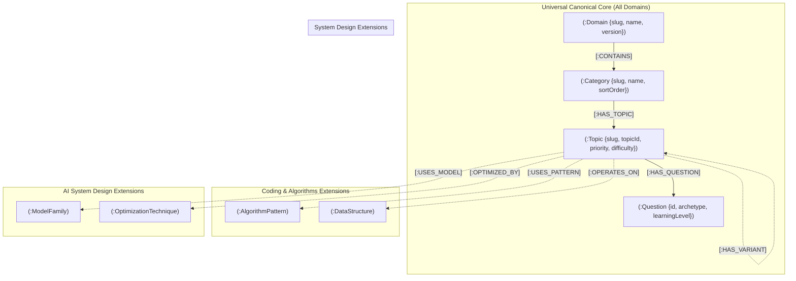

# PrepInMinutes Generic Knowledge Graph Schema & Fetching Standard
## Universal Metamodel for Multi-Domain Curriculum (System Design, Coding, AI, DevOps)

**Version:** 1.0.0  
**Target Engine:** Neo4j AuraDB (Property Graph + Cypher)  
**Governing Pattern:** Canonical Core Backbone + Domain-Specific Graph Extensions  
**Status:** 🟢 **CANONICAL SPECIFICATION**

---

## 1. Architectural Philosophy: The "Canonical Core + Extension" Metamodel

To support multiple domains (System Design, Coding & Algorithms, AI System Design, Cloud/DevOps) without fragmentation or code duplication, the PrepInMinutes Knowledge Graph is structured in two layers:

1. **The Canonical Core Backbone (Universal across ALL domains)**:
   Every domain shares the exact same 4-tier structural spine:
   $$\text{Domain} \xrightarrow{\text{CONTAINS}} \text{Category} \xrightarrow{\text{HAS\_TOPIC}} \text{Topic} \xrightarrow{\text{HAS\_QUESTION}} \text{Question}$$
   This guarantees that:
   - The same frontend UI components can render *any* domain curriculum.
   - The learning engine, readiness tracker, and AI interviewer operate against a single, universal interface.
   - Database queries for navigation, catalog generation, and breadcrumbs are 100% reusable.

2. **Domain-Specific Extensions (Custom to each engineering discipline)**:
   Each domain specializes its graph with specialized node labels and relationship types without breaking the canonical spine:
   - **System Design**: `[:PREREQUISITE_OF]`, `[:USES_COMPONENT]`, `[:FOUNDED_ON]`.
   - **Coding & Algorithms**: `(:Pattern)`, `(:DataStructure)`, `[:USES_PATTERN]`, `[:HAS_VARIANT]`, `[:TIME_COMPLEXITY]`, `[:SPACE_COMPLEXITY]`.
   - **AI System Design**: `(:ModelFamily)`, `(:OptimizationTechnique)`, `[:USES_TECHNIQUE]`, `[:OPTIMIZED_BY]`.
   - **DevOps / Cloud Architecture**: `(:CloudService)`, `(:InfraPattern)`, `[:RUNS_ON]`, `[:DEPLOYS_VIA]`.



---

## 2. Canonical Core Node & Relationship Specifications

### A. `(:Domain)` Node (The Domain Root Anchor)
Unique business identifier: `slug`

| Property | Type | Required | Description | Example |
| :--- | :--- | :---: | :--- | :--- |
| `slug` | `String` | **Yes** | Unique URL-safe identifier (Indexed / Unique) | `"system-design"`, `"coding-algorithms"` |
| `name` | `String` | **Yes** | Human-readable domain name | `"System Design"`, `"Coding & Algorithms"` |
| `description` | `String` | **Yes** | Executive curriculum description | `"Classical distributed systems, high availability..."` |
| `pillarCount` | `Integer` | No | Number of internal syllabus pillars/dimensions | `3` |
| `categoryCount`| `Integer`| **Yes** | Total categories in domain | `16` |
| `topicCount` | `Integer` | **Yes** | Total topics in domain | `54` |
| `questionCount`| `Integer`| **Yes** | Total master questions | `1080` |
| `version` | `String` | **Yes** | Semantic version of curriculum | `"5.0.0"` |
| `updatedAt` | `DateTime`| **Yes** | Timestamp of last graph sync | `datetime()` |

---

### B. `(:Category)` Node (Thematic Grouping)
Unique business identifier: `slug`

| Property | Type | Required | Description | Example |
| :--- | :--- | :---: | :--- | :--- |
| `slug` | `String` | **Yes** | Unique identifier (Indexed / Unique) | `"traffic-management-components"` |
| `name` | `String` | **Yes** | Category display title | `"Traffic Management & Networking"` |
| `description` | `String` | **Yes** | Scope of topics in category | `"Load balancing, reverse proxies, CDNs..."` |
| `pillar` | `String` | No | Syllabus pillar/dimension identifier | `"principles"`, `"components"`, `"case-studies"` |
| `sortOrder` | `Integer` | **Yes** | Global UI display sort sequence | `1`, `2`, `3` ... |
| `updatedAt` | `DateTime`| **Yes** | Timestamp of update | `datetime()` |

---

### C. `(:Topic)` Node (The Core Learnable Unit)
Unique business identifier: `slug`

| Property | Type | Required | Description | Example |
| :--- | :--- | :---: | :--- | :--- |
| `slug` | `String` | **Yes** | Unique identifier (Indexed / Unique) | `"load-balancers-traffic"` |
| `topicId` | `String` | **Yes** | Human-readable catalog ID | `"CMP001"`, `"DSA042"`, `"AIS015"` |
| `title` | `String` | **Yes** | Full display title | `"Load Balancers & Traffic Distribution"` |
| `pillar` | `String` | No | Structural syllabus pillar | `"components"` |
| `priority` | `String` | **Yes** | Market priority (`P1` \| `P2` \| `P3`) | `"P1"` |
| `difficulty` | `String` | **Yes** | Baseline entry level (`BEGINNER` \| `INTERMEDIATE` \| `ADVANCED` \| `EXPERT`) | `"BEGINNER"` |
| `durationMin` | `Integer` | **Yes** | Target deep-dive study duration | `20`, `45` |
| `frequency` | `Float` | **Yes** | Interview appearance probability ($0.0 \rightarrow 1.0$) | `0.92` |
| `weight` | `Float` | **Yes** | Curricular depth importance ($0.0 \rightarrow 1.0$) | `0.95` |
| `trend` | `String` | **Yes** | Market momentum (`SURGING` \| `RISING` \| `STABLE` \| `FALLING`) | `"STABLE"` |
| `description` | `String` | **Yes** | 8-layer comprehensive technical overview | `"L4 vs L7 balancing, consistent hashing..."` |
| `rubricAtoms` | `List<String>`| **Yes** | Key technical concepts candidate must address | `["l4 vs l7", "consistent hashing"]` |
| `updatedAt` | `DateTime`| **Yes** | Timestamp of update | `datetime()` |

---

### D. `(:Question)` Node (The Assessment Atom)
Unique business identifier: `id`

| Property | Type | Required | Description | Example |
| :--- | :--- | :---: | :--- | :--- |
| `id` | `String` | **Yes** | Unique question ID (Indexed / Unique) | `"q_load_balancers_traffic_01"` |
| `title` | `String` | **Yes** | Concise question title | `"Layer 4 vs Layer 7 Load Balancing Trade-Offs"` |
| `difficulty` | `String` | **Yes** | `BEGINNER` \| `INTERMEDIATE` \| `ADVANCED` \| `EXPERT` | `"BEGINNER"` |
| `learningLevel`| `String`| **Yes** | Progression depth `L1` \| `L2` \| `L3` \| `L4` \| `L5` | `"L1"` |
| `archetype` | `String` | **Yes** | 10 Archetypes: `conceptual`, `mechanism`, `implementation`, `comparison`, `scenario-based`, `troubleshooting`, `architecture`, `trade-off`, `failure-analysis`, `follow-up-probe` | `"comparison"` |
| `prompt` | `String` | **Yes** | Real-world scenario/interview prompt text | `"Contrast Layer 4 and Layer 7 load balancing..."` |
| `scaleAnchor` | `String` | No | Quantitative scale constraint | `"50,000 QPS, p99 < 50ms"` |
| `rubricGuide` | `String` | **Yes** | Evaluation guidelines for AI/human grader | `"Candidate must articulate that Layer 4..."` |
| `rubricAtoms` | `List<String>`| **Yes** | Exact grading atoms required for score | `["l4 vs l7", "packet inspection"]` |
| `hints` | `List<String>`| **Yes** | Socratic hints when candidate is stuck | `["Does L4 unpack the HTTP payload?"]` |
| `followUpProbes`| `List<String>`| **Yes** | Deepening questions for Senior/Principal | `["How does TLS offload affect CPU usage?"]` |
| `expectedKeywords`| `List<String>`| **Yes** | Keywords for semantic scoring | `["Layer 4", "Layer 7", "TCP", "SSL"]` |
| `antiPatterns` | `List<String>`| No | Red-flag answers or common mistakes | `["Assuming L4 can inspect JWT headers"]` |

---

## 3. Domain-Specific Extensions Schema

### Domain 1: Coding & Algorithms (`coding-algorithms`)
* **Specialized Nodes**:
  - `(:AlgorithmPattern {slug, name, category, timeComplexityBaseline, spaceComplexityBaseline})`  
    *(e.g., Two Pointers, Sliding Window, Monotonic Stack, Backtracking, Union-Find)*
  - `(:DataStructure {slug, name, memoryOverhead, traversalType})`  
    *(e.g., Trie, Segment Tree, Disjoint Set, Min-Heap, Circular Queue)*
* **Specialized Edges**:
  - `(t:Topic)-[:USES_PATTERN]->(p:AlgorithmPattern)`
  - `(t:Topic)-[:OPERATES_ON]->(ds:DataStructure)`
  - `(t:Topic)-[:HAS_VARIANT {variationType: "OPTIMIZED_SPACE"}]->(t2:Topic)`
  - `(t:Topic)-[:PREREQUISITE_OF]->(t2:Topic)`

### Domain 2: AI System Design (`ai-system-design`)
* **Specialized Nodes**:
  - `(:ModelFamily {slug, name, architectureType, memoryPerBillionParams})`  
    *(e.g., Dense Transformer, Mixture of Experts, Latent Diffusion, Vector Embedding)*
  - `(:OptimizationTechnique {slug, name, layerTarget, latencyReductionPct})`  
    *(e.g., PagedAttention, KV-Cache Compression, FP8 Quantization, Speculative Decoding)*
* **Specialized Edges**:
  - `(t:Topic)-[:USES_MODEL]->(mf:ModelFamily)`
  - `(t:Topic)-[:OPTIMIZED_BY]->(opt:OptimizationTechnique)`
  - `(t:Topic)-[:PREREQUISITE_OF]->(t2:Topic)`
  - `(t:Topic)-[:FOUNDED_ON]->(principle:Topic)`

### Domain 3: System Design (`system-design`)
* **Specialized Edges**:
  - `(prereq:Topic)-[:PREREQUISITE_OF]->(target:Topic)`
  - `(system:Topic)-[:USES_COMPONENT]->(component:Topic)`
  - `(node:Topic)-[:FOUNDED_ON]->(principle:Topic)`

---

## 4. Standard Fetching Queries (Cypher API Contracts)

These standardized Cypher queries execute identically across any domain by passing `$domainSlug`.

### 1. Fetch Complete Domain Navigation Hierarchy
Returns nested JSON containing Domain $\rightarrow$ Categories (ordered by sortOrder) $\rightarrow$ Topics (with priority & difficulty).

```cypher
MATCH (d:Domain {slug: $domainSlug})
OPTIONAL MATCH (d)-[:CONTAINS]->(c:Category)
OPTIONAL MATCH (c)-[:HAS_TOPIC]->(t:Topic)
WITH d, c, t
ORDER BY c.sortOrder, t.priority, t.title
WITH d, c, collect({
  slug: t.slug,
  topicId: t.topicId,
  title: t.title,
  priority: t.priority,
  difficulty: t.difficulty,
  durationMin: t.durationMin,
  frequency: t.frequency,
  trend: t.trend
}) AS topics
ORDER BY c.sortOrder
RETURN {
  domainSlug: d.slug,
  domainName: d.name,
  description: d.description,
  version: d.version,
  totalTopics: d.topicCount,
  totalQuestions: d.questionCount,
  categories: collect({
    slug: c.slug,
    name: c.name,
    pillar: c.pillar,
    sortOrder: c.sortOrder,
    topics: topics
  })
} AS domainHierarchy;
```

---

### 2. Fetch Topic Detail with Full 8-Layer Data & Questions
Fetches a single topic, its questions (ordered by difficulty/level), and all inbound/outbound graph relationships.

```cypher
MATCH (t:Topic {slug: $topicSlug})
MATCH (c:Category)-[:HAS_TOPIC]->(t)
MATCH (d:Domain)-[:CONTAINS]->(c)

// Inbound Prerequisites
OPTIONAL MATCH (prereq:Topic)-[:PREREQUISITE_OF]->(t)

// Outbound Dependents
OPTIONAL MATCH (t)-[:PREREQUISITE_OF]->(dependent:Topic)

// Domain-Specific Edges (System Design / AI / DSA)
OPTIONAL MATCH (t)-[:USES_COMPONENT]->(component:Topic)
OPTIONAL MATCH (t)-[:FOUNDED_ON]->(principle:Topic)
OPTIONAL MATCH (t)-[:USES_PATTERN]->(pattern)

// Topic Questions
OPTIONAL MATCH (t)-[:HAS_QUESTION]->(q:Question)

WITH d, c, t,
     collect(DISTINCT {slug: prereq.slug, title: prereq.title, topicId: prereq.topicId}) AS prerequisites,
     collect(DISTINCT {slug: dependent.slug, title: dependent.title, topicId: dependent.topicId}) AS dependents,
     collect(DISTINCT {slug: component.slug, title: component.title}) AS usedComponents,
     collect(DISTINCT {slug: principle.slug, title: principle.title}) AS foundedOn,
     collect(DISTINCT {slug: pattern.slug, name: pattern.name}) AS algorithmPatterns,
     collect(DISTINCT {
       id: q.id,
       title: q.title,
       difficulty: q.difficulty,
       learningLevel: q.learningLevel,
       archetype: q.archetype,
       prompt: q.prompt,
       scaleAnchor: q.scaleAnchor,
       rubricGuide: q.rubricGuide,
       rubricAtoms: q.rubricAtoms,
       hints: q.hints,
       followUpProbes: q.followUpProbes,
       expectedKeywords: q.expectedKeywords,
       antiPatterns: q.antiPatterns
     }) AS questions

RETURN {
  domain: { slug: d.slug, name: d.name },
  category: { slug: c.slug, name: c.name, pillar: c.pillar },
  topic: {
    slug: t.slug,
    topicId: t.topicId,
    title: t.title,
    pillar: t.pillar,
    priority: t.priority,
    difficulty: t.difficulty,
    durationMin: t.durationMin,
    frequency: t.frequency,
    weight: t.weight,
    trend: t.trend,
    description: t.description,
    rubricAtoms: t.rubricAtoms
  },
  graphRelationships: {
    prerequisites: [p IN prerequisites WHERE p.slug IS NOT NULL],
    dependents: [d IN dependents WHERE d.slug IS NOT NULL],
    usedComponents: [uc IN usedComponents WHERE uc.slug IS NOT NULL],
    foundedOn: [fo IN foundedOn WHERE fo.slug IS NOT NULL],
    algorithmPatterns: [ap IN algorithmPatterns WHERE ap.slug IS NOT NULL]
  },
  questions: questions
} AS topicDetail;
```

---

### 3. Fetch Adaptive Question Assessment Feed
Selects targeted questions for a candidate based on their current experience level and target archetype without returning the entire question bank.

```cypher
MATCH (t:Topic {slug: $topicSlug})-[:HAS_QUESTION]->(q:Question)
WHERE ($targetLevel IS NULL OR q.learningLevel = $targetLevel)
  AND ($difficulty IS NULL OR q.difficulty = $difficulty)
RETURN q.id AS id,
       q.title AS title,
       q.difficulty AS difficulty,
       q.learningLevel AS learningLevel,
       q.archetype AS archetype,
       q.prompt AS prompt,
       q.scaleAnchor AS scaleAnchor,
       q.hints AS hints,
       q.rubricAtoms AS rubricAtoms
ORDER BY q.learningLevel, q.id
LIMIT $limit;
```

---

### 4. Fetch Topological Learning Path to a Goal Topic
Traverses the `[:PREREQUISITE_OF]` directed acyclic graph to return the optimal linear path of prerequisite topics leading to a goal topic.

```cypher
MATCH path = (prereq:Topic)-[:PREREQUISITE_OF*1..6]->(target:Topic {slug: $goalTopicSlug})
WITH nodes(path) AS topicNodes
UNWIND topicNodes AS node
WITH DISTINCT node
RETURN node.slug AS slug,
       node.topicId AS topicId,
       node.title AS title,
       node.priority AS priority,
       node.difficulty AS difficulty,
       node.durationMin AS durationMin
ORDER BY node.priority, node.difficulty;
```

