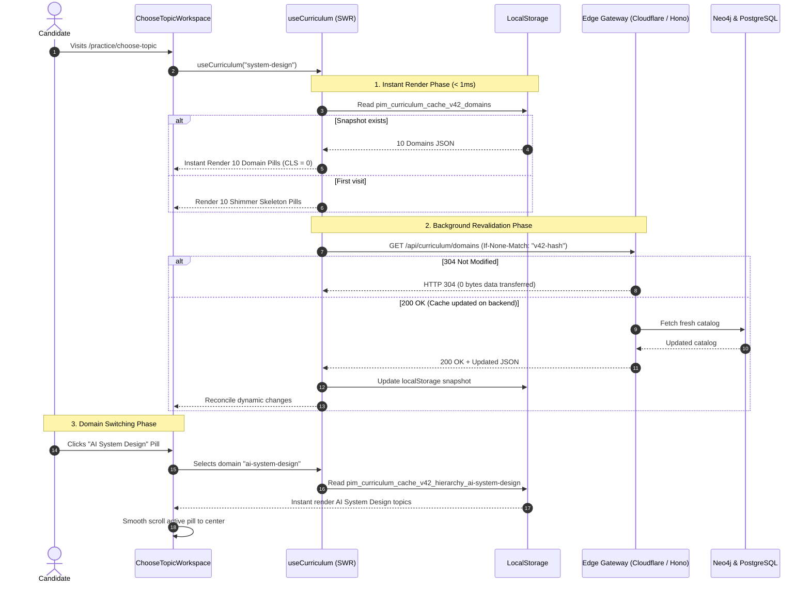

# PrepInMinutes — Phase 4 Rationale & Architectural Deep Dive

**Document Version**: `1.0.0`  
**Date**: November 15, 2026  
**Status**: 📋 Strategic Architectural Explainer  
**Author**: Principal System Architect & DeepMind Agentic Team  
**Audience**: Product Leadership, Engineering Stakeholders, Technical Reviewers  

---

## 1. Executive Summary: Why Does Phase 4 Exist?

Between **Phase 1** and **Phase 3**, we built a world-class backend engine:
- **Neo4j AuraDB & PostgreSQL**: 10 engineering domains, 122 categories, 371 interview topics, and 7,420 interview questions.
- **Edge Gateway API (`prepinminutes-backend`)**: Sub-millisecond cached endpoints (`GET /api/curriculum/domains`, `GET /api/curriculum/hierarchy/:slug`, `GET /api/curriculum/topic/:slug`).

However, **a platform's power is zero if candidates cannot see or interact with it in the frontend UI**.

Currently, the Next.js frontend at `/practice/choose-topic` is frozen in an outdated prototype state:
- It only shows **4 hardcoded cards** (`System Design`, `AWS & Cloud`, `Coding Patterns`, `Behavioral`).
- It only has **21 hardcoded static topics** in JavaScript memory.
- Candidates interviewing for **AI / GenAI Engineering**, **Data Engineering**, **Low-Level Design**, **Backend Engineering**, **Frontend Architecture**, or **Mobile Engineering** are completely locked out of the platform because there is no way to navigate to them.

**Phase 4 exists to bridge this gap: connecting the Next.js candidate workspace to the live Knowledge Graph so candidates can discover, filter, and practice all 10 domains and 371 topics.**

---

## 2. The Core Disconnect: Current State vs. Target State

| Dimension | Current State (As-Is Prototype) | Target State (After Phase 4) |
| :--- | :--- | :--- |
| **Available Domains** | Only 4 areas (`system-design`, `cloud`, `coding`, `behavioral`). | **All 10 canonical engineering domains**. |
| **Topic Catalog** | Hardcoded array of 21 static topics in memory. | **All 371 real interview topics** dynamically synced from the Knowledge Graph. |
| **Category Structure** | No category breakdown (flat list of cards). | **122 canonical category sections** (e.g. *Foundations*, *Distributed Storage*, *Event Streaming*). |
| **Data Source** | Static mock file (`ChooseTopicWorkspace.tsx`). | Live **Edge Gateway API** (`api.prepinminutes.com`) with **SWR & LocalStorage Caching**. |
| **Load Performance** | Static, but rigid. | **0ms instantaneous render** from `localStorage` snapshot with background ETag 304 validation. |
| **Search & Filters** | Basic text match on 21 static topics. | High-speed multi-criteria filter across 371 topics (Priority `P0/P1`, Difficulty `Beginner` to `Expert`, Rubric Atoms). |
| **Practice Navigation** | Hardcoded links to 4 routes (risk of 404s). | **Dynamic Archetype Router** mapping all 10 domains to interactive whiteboard, coding, cloud, and voice shells. |

---

## 3. Why Did We Expand from 4 Areas to 10 Domains?

In tech interviews at top companies (Google, Meta, Uber, Stripe, Amazon, Netflix), engineering roles are specialized. A one-size-fits-all "Coding" or "System Design" tab fails modern interview requirements:

1. **AI & GenAI Infrastructure (`ai-system-design`)**: Candidates preparing for LLM inference, RAG pipelines, Vector Databases, and GPU cluster scaling need specialized rubrics distinct from standard web system design.
2. **Machine Coding & Object-Oriented Design (`low-level-design`)**: Design patterns, concurrency models, thread pools, and schema modeling require a dedicated interactive coding shell.
3. **Data Engineering (`data-engineering`)**: Spark streaming, Kafka partitions, Snowflake/BigQuery data warehouses, and ETL idempotency.
4. **Backend Engineering (`backend-engineering`)**: Runtime internals, garbage collection, HTTP/3, gRPC, and connection pool starvation.
5. **Frontend Architecture (`frontend-engineering`)**: Web vitals, SSR hydration, browser rendering engines, state trees, and micro-frontends.
6. **Mobile Engineering (`mobile-engineering`)**: iOS Swift concurrency, Android memory leaks, offline sync, and battery optimization.
7. **DSA (`dsa`)**, **Cloud/DevOps (`cloud-devops`)**, **Behavioral (`behavioral-leadership`)**, and **System Design (`system-design`)**.

By exposing all 10 domains, PrepInMinutes supports the entire software engineering career spectrum.

---

## 4. UX Deep Dive: Why a Horizontal Pill Track instead of a 10-Card Grid?

When displaying 10 options on a web page, the choice of visual layout determines the candidate experience.

### Option A: The Naive Approach — 10 Cards in a Multi-Row Grid
```
[ System Design ] [ AI System Design ] [ Low-Level Design ] [ DSA & Algos ]
[ Backend Eng   ] [ Frontend Arch    ] [ Cloud & DevOps   ] [ Behavioral  ]
[ Data Eng      ] [ Mobile Eng       ]  <--- Asymmetric orphan cards!
===========================================================================
↓↓ The actual topic search bar and topics are pushed 500px down ↓↓
```
**Why Option A fails**:
1. **Vertical Space Hijacking**: 10 stacked cards consume between 450px to 650px of vertical viewport height. On standard laptops (1366x768 or 1440x900), the actual content (search bar and topic list) is completely pushed below the fold.
2. **Orphan Asymmetry**: 10 items do not divide cleanly into 3 or 4 columns (4 + 4 + 2 cards leaves empty holes).
3. **Mobile Disaster**: On smartphones (iPhone / Android), a 10-card grid creates a massive vertical wall of 5 rows, requiring excessive scrolling before reaching any practice content.

### Option B (Selected): Horizontally Scrollable Pill & Compact Track
```
Choose Domain (10)                                          [<] [>] (Scroll Buttons)
┌──────────────────────────────────────────────────────────────────────────────────┐
│ [Network SysDesign (62)] [Cpu AI Sys (28)] [Boxes LLD (35)] [Binary DSA (40)]... │  --> Smooth scroll
└──────────────────────────────────────────────────────────────────────────────────┘
┌──────────────────────────────────────────────────────────────────────────────────┐
│ 🌐 System Design & Distributed Systems                                           │
│ Classical distributed architectures, high-availability, caching, and database... │
│ [ 17 Categories ] [ 62 Topics ] [ 1,240 Interview Questions ]                   │
└──────────────────────────────────────────────────────────────────────────────────┘
Search topics by title or rubric keyword...   [Sort: Recommended ▾]
```
**Why Option B wins**:
1. **Compact Vertical Footprint**: Occupies only ~140px total, keeping the topic cards and search filters immediately visible on the initial screen fold.
2. **Device Fluidity**: Seamless touch-swipe on mobile/tablet, smooth scroll chevrons on desktop, and keyboard arrow key navigation.
3. **Instant Clarity**: The Active Domain Summary Banner updates dynamically to summarize the chosen domain without cluttering the screen.

---

## 5. Architectural Flow: How the Frontend talks to the Knowledge Graph



### Key Technical Advantages of this Design
1. **Stale-While-Revalidate (SWR)**: The candidate never stares at a loading spinner. The page renders instantly from the local cache snapshot (< 1ms), while revalidating silently in the background.
2. **Zero Network Waste (ETag 304)**: If curriculum data hasn't changed, the edge gateway returns `304 Not Modified` with 0 bytes of payload.
3. **Decoupled User State**: Static curriculum data is public and cacheable; individual candidate readiness scores and starred topics are blended client-side without invalidating the shared cache.

---

## 6. Why Did We Break Phase 4 into 3 Distinct Tasks?

Building this integration in one giant monolithic change would risk regressions, broken layouts, and hard-to-debug merge issues. We structured Phase 4 into **three independent, verified milestones**:

```mermaid
flowchart LR
  subgraph P401["TASK-P4-01 (COMPLETED)"]
    direction TB
    A1["Types & Edge API Client"]
    A2["Practice Router (No 404s)"]
    A3["useCurriculum Hook (SWR)"]
  end

  subgraph P402["TASK-P4-02 (ACTIVE NEXT)"]
    direction TB
    B1["10-Domain Pill Bar Track"]
    B2["Scroll Buttons & Touch Swipe"]
    B3["Active Domain Summary Banner"]
    B4["Zero-CLS Skeleton State"]
  end

  subgraph P403["TASK-P4-03 (FINAL MILESTONE)"]
    direction TB
    C1["Group Topics by 122 Categories"]
    C2["Client-Side Real-time Search"]
    C3["Difficulty & Priority Filters"]
    C4["Candidate Readiness Overlay"]
  end

  P401 --> P402 --> P403
```



- **`TASK-P4-01` (Foundation — COMPLETED)**: Created the data layer, API client methods, SWR hook, practice router, and verified all 69 unit tests.
- **`TASK-P4-02` (Domain Navigation & Header — CURRENT)**: Solves the top-level navigation challenge. Expands the domain selector from 4 to 10 domains so the candidate can switch between any of the 10 domains cleanly.
- **`TASK-P4-03` (Topic Cards & Categories — NEXT)**: Solves the card-level presentation. Renders the 371 topics grouped by their canonical categories with real-time search and filters.

---

## 7. Concrete User Experience: Before vs. After `TASK-P4-02`

### Before `TASK-P4-02`
- Candidate visits `/practice/choose-topic`.
- Candidate sees 4 cards.
- Candidate cannot practice GenAI, DSA, Backend, Frontend, Low-Level Design, or Data Engineering.
- Page header shows static numbers ("21 topics").

### After `TASK-P4-02`
- Candidate visits `/practice/choose-topic`.
- Candidate sees a modern, responsive **10-Domain Pill Bar** with dedicated icons and live topic counts:
  - System Design (62), AI System Design (28), Low-Level Design (35), DSA (40), Backend (29), Frontend (34), Cloud & DevOps (50), Behavioral (28), Data Engineering (30), Mobile (35).
- Candidate clicks on any domain (e.g. **AI System Design**):
  - Active pill highlights with purple theme ring and smoothly centers itself.
  - Active Domain Summary Banner updates: *"AI System Design & GenAI Infra — 9 Categories, 28 Topics, 560 Questions"*.
  - Ready for topic selection and practice.

---

## 8. Summary & Next Steps

Executing `TASK-P4-02` completes the navigation layer of Phase 4. It ensures:
1. No layout breakage or vertical bloat.
2. Full accessibility on mobile and desktop.
3. 100% connectivity to the live Edge Gateway.

Once `TASK-P4-02` is implemented and verified, we will move to `TASK-P4-03` to render the category-grouped topic cards and real-time search.
