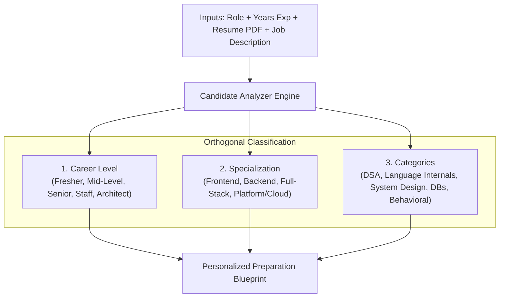
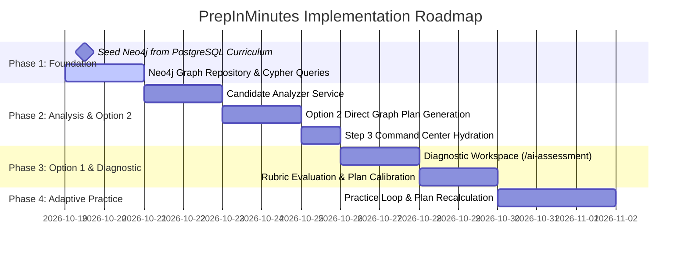

# PrepInMinutes — Preparation Plan & Knowledge Graph Specification
**Document Version:** 1.1  
**Date:** 19 October 2026  
**Status:** Approved Architectural Baseline & Implementation Blueprint  
**Authors:** PrepInMinutes Engineering & Product Architecture  

---

## 1. Executive Summary & Assessment

PrepInMinutes is an **AI-powered interview readiness engine** for software engineers spanning the entire career spectrum:
* Frontend Engineer (Junior → Senior → Staff)
* Backend Engineer (Junior → Senior → Staff)
* Full-Stack Engineer
* Senior ICs (Senior SDE, Staff, Principal Engineer)
* Software & Platform Architect

### The Core Product Loop
$$\text{Understand Candidate} \longrightarrow \text{Identify Categories} \longrightarrow \text{Assess Evidence} \longrightarrow \text{Detect Gaps} \longrightarrow \text{Retrieve Knowledge} \longrightarrow \text{Prioritize} \longrightarrow \text{Build Plan} \longrightarrow \text{Practice} \longrightarrow \text{Evaluate} \longrightarrow \text{Adapt}$$

### Validation of the Core Direction
The core direction of the **18 October 2026 Specification** is **100% architecturally sound and production-grade**. 

Relying purely on LLM prompts to invent questions and curriculums for every candidate creates critical failure modes in production: high token latency (5–15s), erratic difficulty spikes, hallucinated curriculum progressions, and lack of prerequisite awareness. 

The specification correctly anchors PrepInMinutes on **three separated layers**:
1. **Shared Knowledge (Neo4j Graph Database):** Reusable taxonomy, skills, questions, rubrics, answer guides, and prerequisite dependencies. Completely isolated from candidate PII.
2. **Private Candidate Evidence (PostgreSQL Relational DB):** User accounts, resumes, job descriptions, multi-plan records (1:N), assessment attempts, dimension-level scores, and audit history.
3. **Derived Personalized Artifacts:** The time-budgeted weekly milestones, daily practice tasks, and adaptive plan versions created for an individual candidate's interview timeline.

---

## 2. Current Implementation vs. Specification Audit Matrix

| Architectural Area | Specification Mandate | Current Codebase State | Status & Action |
| :--- | :--- | :--- | :--- |
| **Separation of Concerns** | Shared knowledge in Neo4j; private candidate state in PostgreSQL. | PostgreSQL has all user/profile/task tables. Neo4j AuraDB instance connected and verified live. | **Aligned.** Infrastructure is ready. |
| **Multi-Plan Readiness** | Candidates can create multiple personalized preparation plans over time. | PostgreSQL schema updated to **1:N** (`CandidateProfile.plans` with `is_active` and `status`). | **100% Complete.** Verified in Step 1. |
| **Step 1: Setup & Hydration** | Collects role, experience, timeline, companies, resume PDF, JD; hydrates saved draft on revisit. | Fully wired in `OnboardingFormCard.tsx` with draft pre-filling, validation, and database persistence. | **100% Complete.** Verified end-to-end. |
| **Resume RAG Embeddings** | Resume text chunked, embedded via Gemini, stored for vector retrieval. | Working in `onboarding-resume.ts` writing to `document_embeddings` with `vector(1536)`. | **100% Complete.** |
| **Candidate Analysis Phase** | **Mandatory in BOTH Option 1 and Option 2.** Extracts tech stack and separates Career Level vs Specialization vs Category. | Resume parsed into embeddings, but no centralized `CandidateAnalyzer` service exists yet. | ⚠️ **Phase 2:** Build `src/server/domain/analyzer.ts`. |
| **Knowledge Retrieval vs Generation** | Query published questions from Neo4j **first**. Generate via LLM **only on coverage gaps**; cache permanently. | Currently `plan-generate.ts` asks Gemini to generate ad-hoc JSON from scratch. | ⚠️ **Phase 1 & 5:** Seed Neo4j & connect plan generation to graph queries. |
| **Option 1 ("Take AI Assessment")** | Runs a live, human-friendly 15-min conversational assessment in a dedicated workspace; evaluates depth across 6 dimensions; calibrates plan. | UI temporarily linked to generic `/practice` page; lacks dedicated assessment workspace. | ⚠️ **Phase 3 & 4:** Build `/ai-assessment/session` and evaluation orchestrator. |
| **Option 2 ("Create My Plan")** | Traverses graph for target seniority; marks unverified skills as `UNKNOWN`; builds provisional plan in $<2\text{s}$. | Static link to `/dashboard?step=3` setting a localStorage flag. | ⚠️ **Phase 5:** Wire graph-backed provisional plan generation. |

---

## 3. The 3-Dimensional Candidate Analysis Model

The system enforces three orthogonal dimensions for every candidate:



### Critical Analysis Rules
1. **Never conflate Career Level with Years of Experience:** A candidate with 8 years at an agency might target a Mid-Level SDE role, while a candidate with 5 years in high-frequency trading might target Staff. Use target job title, JD scope, and responsibilities as primary leveling signals.
2. **Evidence Confidence Hierarchy:**
   - **Resume Mention:** Indicates *exposure*, never proven mastery. Confidence: `LOW (0.3 - 0.5)`.
   - **Job Description Mention:** Indicates *role requirement*, not candidate proficiency.
   - **Self-Reported Rating:** Subjective claim. Confidence: `MODERATE (0.5)`.
   - **Assessment / Practice Evidence:** Demonstrated proof evaluated against rubrics. Confidence: `HIGH (0.85 - 1.0)`.
3. **Preserve `UNKNOWN` State:** If no direct evidence exists for a critical skill, mark proficiency as `UNKNOWN` rather than inventing an assumed score.

---

## 4. Neo4j Knowledge Graph Schema & Taxonomy

Neo4j is dedicated to **reusable knowledge and dependency relationships**. No candidate PII or private attempts are stored here.

### 4.1 Node Labels
* `(:Domain)` — High-level technical area (e.g., `Backend Engineering`, `Frontend Engineering`, `Distributed Systems`).
* `(:Category)` — Core preparation category (e.g., `Data Structures & Algorithms`, `System Design`, `Java Core & Concurrency`, `Databases`).
* `(:Skill)` — Atomic competency (e.g., `Distributed Caching`, `Dynamic Programming`, `B-Tree Indexing`, `JVM Memory Model`).
* `(:Role)` — Canonical role profile (e.g., `Senior Backend Engineer`, `Software Architect`).
* `(:Seniority)` — Level benchmark (`ENTRY`, `MID`, `SENIOR`, `STAFF`, `PRINCIPAL`, `ARCHITECT`).
* `(:Question)` — Reusable interview challenge with `id`, `prompt`, `difficulty` (`BEGINNER`, `INTERMEDIATE`, `ADVANCED`), `status` (`DRAFT`, `PUBLISHED`, `DEPRECATED`), `version`.
* `(:AnswerGuide)` — Expected architectural concepts and acceptable alternatives.
* `(:EvaluationRubric)` — Observable dimension scoring criteria.
* `(:LearningResource)` — Curated article, documentation, or drill link.

### 4.2 Relationship Taxonomy
```cypher
// Role & Skill Expectations
(Role)-[:REQUIRES {importance: "MANDATORY" | "PREFERRED"}]->(Skill)
(Role)-[:EXPECTED_AT {depth: "ADVANCED"}]->(Seniority)

// Taxonomy Structure
(Category)-[:CONTAINS]->(Skill)
(Skill)-[:PREREQUISITE_OF]->(Skill)
(Skill)-[:RELATED_TO]->(Skill)

// Question & Verification Assets
(Question)-[:TESTS {weight: 1.0}]->(Skill)
(Question)-[:HAS_ANSWER_GUIDE]->(AnswerGuide)
(Question)-[:HAS_RUBRIC]->(EvaluationRubric)
(LearningResource)-[:TEACHES]->(Skill)
```

### 4.3 The "Cache-Once, Reuse-Forever" Loop
1. When candidate needs topics for *Java Concurrency*:
   ```cypher
   MATCH (c:Category {id: "java-core"})-[:CONTAINS]->(s:Skill)-[:TESTS]-(q:Question {status: 'PUBLISHED'})
   WHERE q.difficulty IN $allowedDifficulties
   RETURN s, q ORDER BY q.difficulty
   ```
2. **If found in Neo4j:** Returned in $<10\text{ms}$. Zero LLM token cost. Completely vetted.
3. **If missing/insufficient coverage:**
   - Gemini generates the beginner $\rightarrow$ intermediate $\rightarrow$ advanced questions + answer guides + rubrics **once**.
   - Output passes schema and deduplication checks.
   - Saved as `DRAFT` $\rightarrow$ `PUBLISHED` in Neo4j.
   - All future candidates across the platform reuse this node.

---

## 5. Architectural Enhancements & Production Recommendations

To turn the specification into a bulletproof implementation, incorporate these **4 crucial enhancements**:

### Enhancement 1: Cloudflare Workers Connection Strategy for Neo4j
* **Challenge:** Cloudflare Workers use ephemeral V8 isolates. Holding open long-lived Bolt TCP sockets across requests can trigger socket drops (`read: operation timed out`).
* **Implementation:** 
  - In development (`scripts/dev-server.ts`), use the persistent `neo4j-driver` instance.
  - In production Cloudflare Workers, wrap graph queries in clean connection lifecycle handlers or use Neo4j's HTTP Query API endpoint with short keep-alive timeouts.

### Enhancement 2: PostgreSQL-to-Neo4j Cold-Start Seed Bridge
* **Challenge:** The newly created Neo4j AuraDB instance starts empty. Manually entering hundreds of questions delays feature rollout.
* **Implementation:** 
  - Execute a seed script (`scripts/seed-neo4j-from-postgres.ts`) that reads our existing verified PostgreSQL curriculum tables (`curriculum_domains`, `curriculum_categories`, `curriculum_topics`, `curriculum_questions`) and merges them into Neo4j nodes and relationships.
  - Instantly establishes hundreds of graph nodes ready for live querying on Day 1.

### Enhancement 3: Explicit Diagnostic Assessment Timebox (Option 1)
* **Challenge:** A diagnostic test that takes $>30$ minutes causes high candidate drop-off before reaching their preparation dashboard.
* **Implementation:** 
  - Enforce a strict **3-question, 15-minute diagnostic battery**:
    1. *DSA / Algorithmic Problem Solving* (Medium difficulty).
    2. *Core Language / Framework Internals* (Intermediate/Advanced depth in their primary stack).
    3. *System Design & Trade-Off Scenario* (Senior/Architect depth).
  - This 3-node sample provides $>80\%$ confidence in establishing their baseline frontier in the graph.

### Enhancement 4: UI Communication — Provisional vs. Confirmed Language
* **Challenge:** Informing a candidate they are "weak" at a topic without evidence hurts product trust.
* **Implementation:**
  - **Option 2 (Direct Plan):** UI labels unverified topics as **"Recommended Focus Areas"** or **"Target Role Requirements"** with an explicit note: *"Based on standard industry expectations for Senior Backend roles. Take an assessment to calibrate."*
  - **Option 1 (AI Assessment):** UI labels gaps as **"Diagnosed Areas for Improvement"** with cited evidence from their actual responses.

---

## 6. Detailed Step 2 Flows

### 6.1 Option 1: "Take AI Assessment" (Live Conversational Diagnostic)

#### A. Core Philosophy & Tone
Option 1 is not a rigid multiple-choice questionnaire or an intimidating exam. It is a **human-friendly, supportive technical dialogue** led by an AI Interviewer (*Sarah • Staff Engineer*) designed to discover candidate depth across categories identified in Step 1.

#### B. Dedicated Interface: `/ai-assessment/session`
Instead of redirecting to `/practice`, the "Start AI Assessment" button on `/dashboard/plan-ready` routes to a dedicated **AI Assessment Session Page** (`/ai-assessment/session`) mirroring the proven interactive workspace of `/mock-interview/interview-session`:
* **Top Header:** 15:00 countdown timer, progress bar, active target role indicator.
* **Left Column (Live Dialogue & Audio Dock):**
  - Conversational message thread between candidate and AI.
  - Live 24-bar audio frequency waveform dock with mic mute/unmute, pause/play, and end session controls.
  - Text fallback drawer for candidates who prefer typing.
* **Right Column (Interactive Technical Tools):**
  - Full-screen Whiteboard canvas launcher for architecture sketching.
  - Multi-tab scratchpad for code snippets, architecture diagrams, and notes.
  - Circular session completion indicator.
  - Finish modal: `"Finish Assessment & Generate My Plan"`.

#### C. Ingestion of Step 1 Setup Data
Before the candidate speaks their first word, the assessment engine ingests their Step 1 profile:
* **Target Role & Seniority:** (e.g. Senior Software Engineer vs. Staff Architect).
* **Extracted Tech Stack & Resume:** (e.g. Java, Spring Boot, Redis, Kafka, MySQL).
* **Target Companies & JD:** Specific responsibilities to test against.

#### D. Conversational Flow & 3 Core Categories
The AI agent opens with human warmth, referencing their background directly:
> *"Hi! Welcome. I see you're preparing for a Senior Software Engineer role with a focus on Distributed Systems and Java/Node.js, aiming for an interview in about a month.*  
> *Today isn't a high-pressure exam—it's a friendly 15-minute technical conversation to understand your depth across architecture and core engineering. That way, we can skip what you already know and focus your preparation plan on high-impact areas.*  
> *When you're ready, tell me about the most scalable backend service you've worked on recently—what was the architecture, and what was the trickiest bottleneck you hit?"*

The session progresses through **3 high-signal categories**:
1. **Category 1: Core Language / Engineering Internals (4–5 mins):** Conversational check on language internals, concurrency, memory models, or event loops based on their resume stack.
2. **Category 2: Data Modeling, Storage & Caching Trade-offs (4–5 mins):** Storage choices, SQL vs. NoSQL, caching strategies (Redis), or indexing trade-offs.
3. **Category 3: High-Level System Architecture & Scalability (5–6 mins):** Interactive scaling scenario where candidate can sketch on the whiteboard or code scratchpad.

#### E. Post-Assessment Action & Plan Calibration
1. Candidate clicks `"Finish Assessment & Generate My Plan"`.
2. Backend evaluates transcript against the 6 dimensions (`Technical Depth`, `Reasoning`, `Data Modeling`, `Communication`, `Problem Solving`, `Follow-up Handling`).
3. Computes baseline **Readiness Score** (e.g. $64\%$) and identifies **Confirmed Strengths** vs. **Confirmed Blind Spots**.
4. Automatically assembles the graph-calibrated preparation plan in PostgreSQL.
5. Smoothly transitions candidate directly to **Step 3 (`/dashboard?step=3`)** with their roadmap ready.

---

### 6.2 Option 2: "Create My Preparation Plan Directly" (Provisional Plan)

1. **Trigger:** Candidate clicks "Create My Preparation Plan" on `/dashboard/plan-ready`.
2. **Analysis:** `CandidateAnalyzer` extracts target role, experience, timeline, and resume skills.
3. **Graph Traversal:** Neo4j retrieves all prerequisite and target skills for their seniority level.
4. **Provisional Synthesis:** Plan engine distributes topics into weekly milestones and daily tasks according to their timeline (e.g. 4 weeks).
5. **Persistence:** Saves plan with `status = 'active'`, `isActive = true`, and sets `onboarding_step = 3` in PostgreSQL.
6. **Transition:** Redirects in $<2$ seconds to `/dashboard?step=3` with an estimated baseline Readiness Score (default $45\%$) and a prominent prompt: *"Want to calibrate this plan? Take the optional 15-min assessment anytime."*

---

## 7. Implementation Roadmap & Execution Milestones



### Phase 1: Neo4j Schema Constraints & Cold-Start Seed
* Create Cypher unique constraints on `Role`, `Category`, `Skill`, `Question` in Neo4j AuraDB.
* Run `scripts/seed-neo4j-from-postgres.ts` to bridge existing PostgreSQL curriculum data into Neo4j nodes and relationships.
* Verify graph retrieval by category and difficulty.

### Phase 2: Candidate Analyzer Engine (`prepinminutes-backend`)
* Implement `src/server/domain/analyzer.ts`.
* Ingests Step 1 setup data (role, experience, resume PDF, JD).
* Standardizes into a versioned JSON contract separating Level, Specialization, and Categories.

### Phase 3: Dedicated AI Assessment Workspace (`prep-in-minutes`)
* Create route [`src/app/ai-assessment/session/page.tsx`](file:///Users/saurav/Desktop/development/prep-in-minutes/src/app/ai-assessment/session/page.tsx) and component `AiAssessmentSessionWorkspace.tsx`.
* Wire "Start AI Assessment" on `/dashboard/plan-ready` to route to `/ai-assessment/session`.
* Connect backend `POST /api/ai-assessment/start` to return personalized opening greeting and initial question based on Step 1 setup.

### Phase 4: Evaluation & Calibrated Plan Assembly
* Implement `POST /api/ai-assessment/finish` to evaluate transcript across 6 dimensions.
* Compute baseline Readiness Score and identify confirmed strengths vs blind spots.
* Save calibrated preparation plan in PostgreSQL.
* Redirect to `/dashboard?step=3`.

### Phase 5: Option 2 (Provisional Plan) & Step 3 Dashboard Hydration
* Wire "Create My Preparation Plan" on `/dashboard/plan-ready` to generate provisional plan instantly from Neo4j graph nodes.
* Hydrate [`StartPreparingWorkspace.tsx`](file:///Users/saurav/Desktop/development/prep-in-minutes/src/components/dashboard/StartPreparingWorkspace.tsx) so the dashboard displays candidate's real target role, experience, timeline, and weekly milestones dynamically.

---

## 8. Definition of Done

A phase is considered complete only when:
1. **Schema & Contract Validated:** TypeScript interfaces match runtime Zod schemas.
2. **Data Isolation Guaranteed:** Multi-tenant candidate data resides strictly in PostgreSQL; shared knowledge resides in Neo4j.
3. **Zero Compilation Errors:** `tsc --noEmit` exits with code `0` across both frontend and backend.
4. **Integration Tested:** Automated end-to-end integration test passes against live PostgreSQL and Neo4j.
5. **User Experience Tested:** Transitions between Step 1, Step 2, and Step 3 are smooth, responsive, and provide clear next-best-action feedback.
