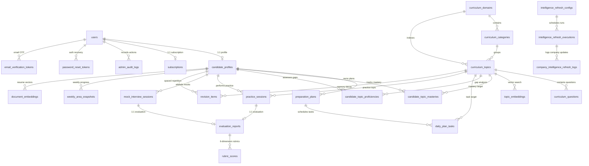

# PrepInMinutes — Master Relational Schema & Data Dictionary
## Complete Database Catalog, Table Specifications & Seed Data Dictionary

> **Document Version:** 1.0.0  
> **Status:** 🟢 **CANONICAL DATA DICTIONARY**  
> **Engine:** PostgreSQL 16+ with `pgvector` & Prisma ORM  
> **Total Models:** 27 Tables | 4 Enums | Zero Schema Drift Standard  
> **Governing Specifications:** [`docs/DATABASE_ARCHITECTURE_AND_PROGRESS_TRACKING_SPEC.md`](./DATABASE_ARCHITECTURE_AND_PROGRESS_TRACKING_SPEC.md), [`docs/TASK_EXECUTION_SEQUENCE.md`](./TASK_EXECUTION_SEQUENCE.md)

---

## 1. System Entity-Relationship Architecture

---

## 2. Table Catalog by Functional Area

### Cluster 1: Identity, Authentication, Staff RBAC & Security

#### Table 1.1: `users`
Core user account model supporting Candidates, Staff Engineers, Curriculum Managers, and HOD Admins.

| Column | Type | Constraints | Description |
| :--- | :--- | :--- | :--- |
| `id` | `VARCHAR(30)` | PK, Default CUID | Unique system identifier |
| `clerk_id` | `VARCHAR(100)` | Unique, Nullable | Third-party Clerk identity ID |
| `google_id` | `VARCHAR(100)` | Unique, Nullable | Google OAuth identifier |
| `username` | `VARCHAR(50)` | Unique, Nullable | Candidate/Staff handle |
| `password_hash` | `TEXT` | Nullable | Argon2/Bcrypt hash for credential login |
| `email` | `VARCHAR(255)` | Unique, Not Null | Primary contact & authentication email |
| `is_email_verified` | `BOOLEAN` | Default `false` | Email verification flag |
| `full_name` | `VARCHAR(100)` | Nullable | Display name |
| `avatar_url` | `TEXT` | Nullable | User avatar image URL |
| `auth_provider` | `VARCHAR(30)` | Default `"google"` | Provider: `"credentials" \| "google" \| "clerk"` |
| `role` | `AdminRole` | Default `CANDIDATE` | `SUPER_ADMIN \| HOD \| CURRICULUM_MANAGER \| STAFF_ENGINEER \| CONTENT_REVIEWER \| CANDIDATE` |
| `admin_approval_status` | `AdminApprovalStatus` | Default `NONE` | `NONE \| PENDING \| APPROVED \| REJECTED \| SUSPENDED` |
| `is_blocked` | `BOOLEAN` | Default `false` | Universal killswitch for malicious or revoked accounts |
| `blocked_reason` | `TEXT` | Nullable | Reason for account blocking |
| `blocked_at` | `TIMESTAMPTZ` | Nullable | Timestamp of account block |
| `blocked_by` | `VARCHAR(100)` | Nullable | Admin ID who enforced the block |
| `requested_role` | `VARCHAR(50)` | Nullable | Staff role requested during escalation |
| `request_reason` | `TEXT` | Nullable | Written justification for HOD review |
| `requested_at` | `TIMESTAMPTZ` | Nullable | Timestamp of role escalation request |
| `approved_by` | `VARCHAR(100)` | Nullable | HOD who reviewed the access request |
| `approved_at` | `TIMESTAMPTZ` | Nullable | Timestamp of role grant |
| `created_at` | `TIMESTAMPTZ` | Default `NOW()` | Audit creation timestamp |
| `updated_at` | `TIMESTAMPTZ` | Auto-update | Audit modification timestamp |

#### Table 1.2: `password_reset_tokens`
Ephemeral tokens for secure self-serve password recovery.

| Column | Type | Constraints | Description |
| :--- | :--- | :--- | :--- |
| `id` | `VARCHAR(30)` | PK, Default CUID | Token record identifier |
| `user_id` | `VARCHAR(30)` | FK $\to$ `users.id` (Cascade) | Target user |
| `token` | `VARCHAR(255)` | Unique, Not Null | Cryptographically secure random reset token |
| `expires_at` | `TIMESTAMPTZ` | Not Null | Expiration cutoff (default 1 hour) |
| `created_at` | `TIMESTAMPTZ` | Default `NOW()` | Creation timestamp |

#### Table 1.3: `email_verification_tokens`
Time-bounded 6-digit OTP codes for candidate email confirmation.

| Column | Type | Constraints | Description |
| :--- | :--- | :--- | :--- |
| `id` | `VARCHAR(30)` | PK, Default CUID | Token record identifier |
| `user_id` | `VARCHAR(30)` | FK $\to$ `users.id` (Cascade) | Target user |
| `otp_code` | `VARCHAR(10)` | Not Null | 6-digit verification code |
| `expires_at` | `TIMESTAMPTZ` | Not Null | Expiration cutoff (default 15 minutes) |
| `created_at` | `TIMESTAMPTZ` | Default `NOW()` | Creation timestamp |

#### Table 1.4: `admin_audit_logs`
Immutable audit ledger for security, compliance, and staff action tracing.

| Column | Type | Constraints | Description |
| :--- | :--- | :--- | :--- |
| `id` | `VARCHAR(30)` | PK, Default CUID | Audit log record ID |
| `user_id` | `VARCHAR(30)` | FK $\to$ `users.id` (Cascade) | Actor who performed the action |
| `action` | `VARCHAR(100)` | Not Null | e.g. `"APPROVE_STAFF" \| "BLOCK_USER" \| "UPDATE_TOPIC"` |
| `target_type` | `VARCHAR(50)` | Not Null | Entity type: `"User" \| "Subscription" \| "CurriculumTopic"` |
| `target_id` | `VARCHAR(100)` | Not Null | ID of the target record |
| `change_diff` | `JSONB` | Nullable | Before/after state snapshot JSON |
| `ip_address` | `VARCHAR(50)` | Nullable | Remote IP address of the actor |
| `created_at` | `TIMESTAMPTZ` | Default `NOW()` | Log timestamp |

---

### Cluster 2: Subscriptions, Pricing Catalog & Quota Metering

#### Table 2.1: `subscription_plans`
Dynamic plan catalog defining feature entitlements, pricing, and quota boundaries.

| Column | Type | Constraints | Description |
| :--- | :--- | :--- | :--- |
| `id` | `VARCHAR(30)` | PK, Default CUID | Plan definition ID |
| `tier` | `SubscriptionTier` | Unique, Not Null | `FREE \| PRO_MONTHLY \| PRO_QUARTERLY \| LIFETIME \| CAMPUS_ENTERPRISE` |
| `name` | `VARCHAR(100)` | Not Null | Public display name |
| `description` | `TEXT` | Not Null | Plan description |
| `price` | `DOUBLE PRECISION` | Not Null | Billing amount (e.g. `29.00`) |
| `currency` | `VARCHAR(10)` | Default `"USD"` | Currency code |
| `billing_interval`| `VARCHAR(20)` | Not Null | `"month" \| "quarter" \| "lifetime"` |
| `voice_minutes_limit` | `DOUBLE PRECISION` | Default `180.0` | Monthly voice allotment with Sarah AI |
| `mock_interviews_limit` | `INTEGER` | Default `5` | Mock interview attempts per billing cycle |
| `features` | `TEXT[]` | Default `[]` | List of highlighted plan features |
| `is_active` | `BOOLEAN` | Default `true` | Availability in frontend pricing tables |
| `created_at` | `TIMESTAMPTZ` | Default `NOW()` | Creation timestamp |
| `updated_at` | `TIMESTAMPTZ` | Auto-update | Modification timestamp |

#### Table 2.2: `subscriptions`
Active candidate billing state and real-time quota consumption meters.

| Column | Type | Constraints | Description |
| :--- | :--- | :--- | :--- |
| `id` | `VARCHAR(30)` | PK, Default CUID | Subscription record ID |
| `user_id` | `VARCHAR(30)` | Unique, FK $\to$ `users.id` | Candidate reference |
| `tier` | `SubscriptionTier` | Default `FREE` | Current tier |
| `status` | `SubscriptionStatus` | Default `INACTIVE` | `INACTIVE \| TRIALING \| ACTIVE \| PAST_DUE \| CANCELED \| EXPIRED` |
| `plan_name` | `VARCHAR(100)` | Default `"Free Plan"` | Plan label |
| `is_plan_opted` | `BOOLEAN` | Default `false` | True if paid plan chosen |
| `price_paid` | `DOUBLE PRECISION` | Default `0.0` | Actual price paid |
| `currency` | `VARCHAR(10)` | Default `"USD"` | Currency |
| `current_period_start` | `TIMESTAMPTZ` | Default `NOW()` | Start of current billing window |
| `current_period_end` | `TIMESTAMPTZ` | Nullable | End of billing window |
| `cancel_at_period_end`| `BOOLEAN` | Default `false` | Whether renewal is cancelled |
| `payment_provider` | `VARCHAR(50)` | Nullable | `"stripe" \| "razorpay" \| "manual_admin"` |
| `voice_minutes_used` | `DOUBLE PRECISION` | Default `0.0` | Accumulated voice minutes used |
| `voice_minutes_limit`| `DOUBLE PRECISION` | Default `30.0` | Current monthly limit |
| `mock_interviews_used` | `INTEGER` | Default `0` | Completed mock interviews |
| `mock_interviews_limit`| `INTEGER` | Default `1` | Max mock interviews allowed |
| `created_at` | `TIMESTAMPTZ` | Default `NOW()` | Creation timestamp |
| `updated_at` | `TIMESTAMPTZ` | Auto-update | Modification timestamp |

---

### Cluster 3: Candidate Profiles, Roadmaps & Daily Task Calendars

#### Table 3.1: `candidate_profiles`
Target role telemetry, experience, weekly commitments, and readiness metrics.

| Column | Type | Constraints | Description |
| :--- | :--- | :--- | :--- |
| `id` | `VARCHAR(30)` | PK, Default CUID | Profile record ID |
| `user_id` | `VARCHAR(30)` | Unique, FK $\to$ `users.id` | User reference |
| `target_role` | `VARCHAR(100)` | Not Null | Target job title (e.g. `"Senior Backend Engineer"`) |
| `experience_level` | `VARCHAR(50)` | Not Null | `"STUDENT_FRESHER" \| "0-2" \| "3-5" \| "6-9" \| "10+"` |
| `target_companies` | `TEXT[]` | Default `[]` | e.g. `["Google", "Amazon", "Stripe"]` |
| `timeline_weeks` | `INTEGER` | Default `8` | Weeks until target interview date |
| `timeline_label` | `VARCHAR(50)` | Default `"1 month"` | Display label |
| `onboarding_step` | `INTEGER` | Default `1` | Step index in onboarding wizard |
| `is_onboarding_done`| `BOOLEAN` | Default `false` | True when onboarding is finalized |
| `readiness_score` | `INTEGER` | Default `45` | Global readiness percentage ($0\text{–}100\%$) |
| `weekly_goal_hours`| `DOUBLE PRECISION` | Default `6.0` | Target study budget per week |
| `completed_hours` | `DOUBLE PRECISION` | Default `0.0` | Actual study hours logged this week |
| `streak_days` | `INTEGER` | Default `1` | Daily consecutive practice streak counter |
| `active_plan_id` | `VARCHAR(30)` | Nullable | Reference to currently active `preparation_plans.id` |
| `resume_file_name` | `VARCHAR(255)` | Nullable | Uploaded resume file name |
| `resume_file_url` | `TEXT` | Nullable | Presigned Cloudflare R2 resume asset URL |
| `job_description_text`| `TEXT` | Nullable | Ingested job description for RAG context |
| `created_at` | `TIMESTAMPTZ` | Default `NOW()` | Creation timestamp |
| `updated_at` | `TIMESTAMPTZ` | Auto-update | Modification timestamp |

#### Table 3.2: `preparation_plans`
Multi-phase personalized curriculum roadmaps with domain weightings and milestone schedules.

| Column | Type | Constraints | Description |
| :--- | :--- | :--- | :--- |
| `id` | `VARCHAR(30)` | PK, Default CUID | Plan record ID |
| `candidate_id` | `VARCHAR(30)` | FK $\to$ `candidate_profiles.id` | Candidate profile reference |
| `title` | `VARCHAR(200)` | Default `"Primary Plan"` | Roadmap title |
| `is_active` | `BOOLEAN` | Default `true` | Active plan flag |
| `status` | `VARCHAR(30)` | Default `"active"` | `"active" \| "completed" \| "archived"` |
| `target_role` | `VARCHAR(100)` | Not Null | Target role |
| `target_seniority` | `VARCHAR(50)` | Default `"Mid-Senior"` | Target seniority level |
| `target_companies` | `TEXT[]` | Default `[]` | Selected companies |
| `timeline_weeks` | `INTEGER` | Default `4` | Total duration |
| `readiness_score` | `INTEGER` | Default `45` | Snapshot readiness score |
| `active_phase_id` | `VARCHAR(50)` | Default `"phase-1"` | Active milestone phase identifier |
| `weekly_milestones`| `JSONB` | Nullable | Array of weekly milestone phase objects |
| `domain_weights` | `JSONB` | Nullable | e.g. `{"system-design": 0.40, "dsa": 0.35}` |
| `created_at` | `TIMESTAMPTZ` | Default `NOW()` | Creation timestamp |
| `updated_at` | `TIMESTAMPTZ` | Auto-update | Modification timestamp |

#### Table 3.3: `daily_plan_tasks`
Day-by-day practice checklists with scheduled dates and direct practice links.

| Column | Type | Constraints | Description |
| :--- | :--- | :--- | :--- |
| `id` | `VARCHAR(30)` | PK, Default CUID | Daily task record ID |
| `plan_id` | `VARCHAR(30)` | FK $\to$ `preparation_plans.id` | Owning plan reference |
| `topic_id` | `VARCHAR(30)` | Nullable, FK $\to$ `curriculum_topics.id` | Relational link to canonical topic |
| `domain_slug` | `VARCHAR(100)` | Not Null | Domain slug (e.g. `"system-design"`) |
| `title` | `VARCHAR(255)` | Not Null | Task title |
| `subtitle` | `VARCHAR(255)` | Nullable | Supporting subtitle |
| `duration_min` | `INTEGER` | Default `10` | Estimated task duration |
| `practice_href` | `VARCHAR(255)` | Not Null | Deep-link to practice session route |
| `scheduled_date` | `TIMESTAMPTZ` | Not Null | Scheduled calendar date |
| `order_index` | `INTEGER` | Default `0` | Display order within the day |
| `is_completed` | `BOOLEAN` | Default `false` | Completion status |
| `completed_at` | `TIMESTAMPTZ` | Nullable | Completion timestamp |
| `created_at` | `TIMESTAMPTZ` | Default `NOW()` | Creation timestamp |

#### Table 3.4: `weekly_area_snapshots`
Weekly telemetry aggregates for dashboard trend charts.

| Column | Type | Constraints | Description |
| :--- | :--- | :--- | :--- |
| `id` | `VARCHAR(30)` | PK, Default CUID | Snapshot record ID |
| `candidate_id` | `VARCHAR(30)` | FK $\to$ `candidate_profiles.id` | Candidate profile reference |
| `domain_slug` | `VARCHAR(100)` | Not Null | Domain slug |
| `week_number` | `INTEGER` | Not Null | Week index (1, 2, 3...) |
| `week_start_date`| `TIMESTAMPTZ` | Not Null | Start of week timestamp |
| `readiness_percent`| `INTEGER` | Not Null | Readiness percentage ($0\text{–}100$) |
| `delta_percent` | `INTEGER` | Default `0` | Week-over-week change (e.g. `+8`) |
| `sessions_completed`| `INTEGER` | Default `0` | Number of practice sessions completed |
| `minutes_practiced`| `INTEGER` | Default `0` | Total minutes practiced |
| `created_at` | `TIMESTAMPTZ` | Default `NOW()` | Creation timestamp |

---

### Cluster 4: Canonical Curriculum Spine (1:1 with Neo4j)

#### Table 4.1: `curriculum_domains` (10 Domains)
Top-level technical disciplines mirroring Neo4j `:Domain` nodes.

| Column | Type | Constraints | Description |
| :--- | :--- | :--- | :--- |
| `id` | `VARCHAR(30)` | PK, Default CUID | Domain record ID |
| `slug` | `VARCHAR(100)` | Unique, Not Null | Canonical slug (e.g. `"system-design"`, `"dsa"`) |
| `name` | `VARCHAR(100)` | Not Null | Display title |
| `description` | `TEXT` | Not Null | Domain summary |
| `created_at` | `TIMESTAMPTZ` | Default `NOW()` | Creation timestamp |

#### Table 4.2: `curriculum_categories` (122 Categories)
Thematic categories grouping topics within each domain.

| Column | Type | Constraints | Description |
| :--- | :--- | :--- | :--- |
| `id` | `VARCHAR(30)` | PK, Default CUID | Category record ID |
| `domain_id` | `VARCHAR(30)` | FK $\to$ `curriculum_domains.id` | Owning domain reference |
| `slug` | `VARCHAR(100)` | Not Null | Canonical category slug |
| `name` | `VARCHAR(150)` | Not Null | Category title |
| `description` | `TEXT` | Not Null | Category summary |
| `order` | `INTEGER` | Default `0` | Display sort order |

#### Table 4.3: `curriculum_topics` (371 Topics)
The atomic technical topics matching Neo4j `:Topic` nodes 1:1.

| Column | Type | Constraints | Description |
| :--- | :--- | :--- | :--- |
| `id` | `VARCHAR(30)` | PK, Default CUID | Topic record ID |
| `domain_id` | `VARCHAR(30)` | FK $\to$ `curriculum_domains.id` | Owning domain reference |
| `category_id` | `VARCHAR(30)` | FK $\to$ `curriculum_categories.id` | Owning category reference |
| `slug` | `VARCHAR(100)` | Unique, Not Null | Canonical topic slug (e.g. `"consistent-hashing"`) |
| `topic_id` | `VARCHAR(50)` | Not Null, Indexed | Canonical ID (e.g. `"FND001"`, `"MOB15"`) |
| `title` | `VARCHAR(200)` | Not Null | Topic display title |
| `description` | `TEXT` | Not Null | Technical summary |
| `duration_min` | `INTEGER` | Default `15` | Recommended practice duration |
| `difficulty` | `VARCHAR(30)` | Not Null | `"BEGINNER" \| "INTERMEDIATE" \| "ADVANCED" \| "EXPERT"` |
| `priority` | `VARCHAR(10)` | Default `"P0"` | `"P0" \| "P1" \| "P2"` |
| `rubric_atoms` | `TEXT[]` | Default `[]` | Core rubric concept keywords |
| `practice_href` | `VARCHAR(255)` | Not Null | Deep-link to practice interface |
| `icon_name` | `VARCHAR(50)` | Nullable | Lucide icon identifier |
| `created_at` | `TIMESTAMPTZ` | Default `NOW()` | Creation timestamp |

#### Table 4.4: `curriculum_questions`
Master interview questions, prompts, test cases, and starter code.

| Column | Type | Constraints | Description |
| :--- | :--- | :--- | :--- |
| `id` | `VARCHAR(30)` | PK, Default CUID | Question record ID |
| `topic_id` | `VARCHAR(30)` | FK $\to$ `curriculum_topics.id` | Parent topic reference |
| `title` | `VARCHAR(255)` | Not Null | Question title |
| `prompt` | `TEXT` | Not Null | Full scenario/question prompt |
| `target_level` | `VARCHAR(30)` | Not Null | `"junior" \| "mid" \| "senior" \| "staff"` |
| `hints` | `TEXT[]` | Default `[]` | Progressive interview hints |
| `rubric_guide` | `TEXT` | Not Null | Guidance for AI evaluator |
| `starter_code` | `JSONB` | Nullable | Multi-language templates (TS, Python, Java, Go) |
| `test_cases` | `JSONB` | Nullable | Automated verification test cases |
| `created_at` | `TIMESTAMPTZ` | Default `NOW()` | Creation timestamp |

#### Table 4.5: `topic_embeddings`
Vector embeddings (`vector(1536)`) for semantic search across the curriculum.

| Column | Type | Constraints | Description |
| :--- | :--- | :--- | :--- |
| `id` | `VARCHAR(30)` | PK, Default CUID | Embedding record ID |
| `topic_id` | `VARCHAR(30)` | FK $\to$ `curriculum_topics.id` | Topic reference |
| `content` | `TEXT` | Not Null | Text content embedded |
| `embedding` | `vector(1536)` | Not Null | OpenAI ada-002 / text-embedding-3 vector |
| `created_at` | `TIMESTAMPTZ` | Default `NOW()` | Creation timestamp |

---

### Cluster 5: Candidate Understanding, Mastery & Skill Gaps

#### Table 5.1: `candidate_topic_masteries`
Candidate deep skill levels, Bloom's cognitive stages, and running multi-dimensional ratings.

| Column | Type | Constraints | Description |
| :--- | :--- | :--- | :--- |
| `id` | `VARCHAR(30)` | PK, Default CUID | Mastery record ID |
| `candidate_id` | `VARCHAR(30)` | FK $\to$ `candidate_profiles.id` | Candidate reference |
| `topic_id` | `VARCHAR(30)` | FK $\to$ `curriculum_topics.id` | Canonical topic reference |
| `mastery_score` | `DOUBLE PRECISION`| Default `0.0` | Running mastery score ($0.0\text{–}100.0\%$) |
| `status` | `VARCHAR(30)` | Default `"NOT_STARTED"` | `"NOT_STARTED" \| "NEEDS_PRACTICE" \| "PRACTICED" \| "MASTERED"` |
| `cognitive_stage`| `VARCHAR(30)` | Default `"RECALL"` | `"RECALL" \| "APPLICATION" \| "TRADE_OFFS" \| "EXPERT"` |
| `total_attempts` | `INTEGER` | Default `0` | Count of sessions attempted on this topic |
| `last_practiced_at`| `TIMESTAMPTZ`| Nullable | Timestamp of most recent attempt |
| `interval_days` | `DOUBLE PRECISION`| Default `1.0` | SuperMemo SM-2 interval |
| `ease_factor` | `DOUBLE PRECISION`| Default `2.5` | SuperMemo SM-2 multiplier ($EF \ge 1.3$) |
| `next_review_date`| `TIMESTAMPTZ`| Nullable | Next scheduled spaced repetition review |
| `avg_technical_depth`| `DOUBLE PRECISION`| Default `0.0` | Running dimension average ($1.0\text{–}10.0$) |
| `avg_tradeoffs` | `DOUBLE PRECISION`| Default `0.0` | Running dimension average ($1.0\text{–}10.0$) |
| `avg_data_modeling`| `DOUBLE PRECISION`| Default `0.0` | Running dimension average ($1.0\text{–}10.0$) |
| `avg_scalability`| `DOUBLE PRECISION`| Default `0.0` | Running dimension average ($1.0\text{–}10.0$) |
| `created_at` | `TIMESTAMPTZ` | Default `NOW()` | Creation timestamp |
| `updated_at` | `TIMESTAMPTZ` | Auto-update | Modification timestamp |

#### Table 5.2: `candidate_topic_proficiencies`
Candidate skill gap bridge feeding directly into the 5-factor roadmap generation formula.

| Column | Type | Constraints | Description |
| :--- | :--- | :--- | :--- |
| `id` | `VARCHAR(30)` | PK, Default CUID | Proficiency record ID |
| `candidate_id` | `VARCHAR(30)` | FK $\to$ `candidate_profiles.id` | Candidate reference |
| `topic_id` | `VARCHAR(30)` | FK $\to$ `curriculum_topics.id` | Canonical topic reference |
| `topic_slug` | `VARCHAR(100)` | Not Null | Topic slug |
| `current_proficiency`| `VARCHAR(30)` | Default `"UNKNOWN"` | `"UNKNOWN" \| "BEGINNER" \| "INTERMEDIATE" \| "ADVANCED" \| "EXPERT"` |
| `target_proficiency` | `VARCHAR(30)` | Default `"ADVANCED"`| Required proficiency level for target role |
| `confidence_score`| `DECIMAL(3,2)` | Default `0.50` | Assessment confidence ($0.00\text{–}1.00$) |
| `last_assessed_at`| `TIMESTAMPTZ` | Nullable | Assessment timestamp |
| `assessment_source`| `VARCHAR(50)` | Default `"RESUME_ANALYSIS"` | `"RESUME_ANALYSIS" \| "SELF_ASSESSMENT" \| "EVALUATION"` |
| `created_at` | `TIMESTAMPTZ` | Default `NOW()` | Creation timestamp |
| `updated_at` | `TIMESTAMPTZ` | Auto-update | Modification timestamp |

---

### Cluster 6: Interactive Sessions, Sarah AI Evaluations & Spaced Repetition

#### Table 6.1: `practice_sessions`
Interactive candidate attempts across System Design, Machine Coding, Behavioral, and Cloud.

| Column | Type | Constraints | Description |
| :--- | :--- | :--- | :--- |
| `id` | `VARCHAR(30)` | PK, Default CUID | Session record ID |
| `candidate_id` | `VARCHAR(30)` | FK $\to$ `candidate_profiles.id` | Candidate reference |
| `topic_id` | `VARCHAR(30)` | Nullable, FK $\to$ `curriculum_topics.id` | Canonical topic reference |
| `domain` | `VARCHAR(50)` | Not Null | Domain slug |
| `topic_slug` | `VARCHAR(100)` | Not Null | Topic slug |
| `title` | `VARCHAR(255)` | Not Null | Session exercise title |
| `duration_seconds`| `INTEGER` | Default `0` | Active duration spent |
| `status` | `VARCHAR(30)` | Not Null | `"ACTIVE" \| "COMPLETED" \| "ABANDONED"` |
| `whiteboard_url` | `TEXT` | Nullable | Cloudflare R2 presigned URL for whiteboard snapshot |
| `diagram_json` | `JSONB` | Nullable | Serialized canvas diagram object |
| `architecture_notes`| `TEXT` | Nullable | Candidate design notes |
| `code_language` | `VARCHAR(30)` | Nullable | e.g. `"typescript"`, `"python"` |
| `code_submission`| `TEXT` | Nullable | Full code submission |
| `test_cases_passed`| `INTEGER` | Nullable | Number of test cases passed |
| `total_test_cases`| `INTEGER` | Nullable | Total test cases executed |
| `is_ar_mode_used` | `BOOLEAN` | Default `false` | True if 3D/AR mode was engaged |
| `star_response_json`| `JSONB` | Nullable | Structured Situation, Task, Action, Result blocks |
| `chat_history` | `JSONB` | Nullable | Interactive session dialogue history |
| `created_at` | `TIMESTAMPTZ` | Default `NOW()` | Creation timestamp |
| `updated_at` | `TIMESTAMPTZ` | Auto-update | Modification timestamp |

#### Table 6.2: `mock_interview_sessions`
Live 45-minute multi-stage voice interviews conducted by Sarah AI.

| Column | Type | Constraints | Description |
| :--- | :--- | :--- | :--- |
| `id` | `VARCHAR(30)` | PK, Default CUID | Mock session record ID |
| `candidate_id` | `VARCHAR(30)` | FK $\to$ `candidate_profiles.id` | Candidate reference |
| `interview_type` | `VARCHAR(50)` | Not Null | `"system-design" \| "technical" \| "behavioral"` |
| `target_role` | `VARCHAR(100)` | Not Null | Target role |
| `difficulty` | `VARCHAR(30)` | Not Null | `"senior" \| "staff"` |
| `duration_minutes`| `INTEGER` | Not Null | Planned duration (typically 45) |
| `focus_areas` | `TEXT[]` | Default `[]` | Selected focus topics |
| `status` | `VARCHAR(30)` | Not Null | `"CONFIGURING" \| "ACTIVE" \| "EVALUATING" \| "COMPLETED"` |
| `recording_url` | `TEXT` | Nullable | Cloudflare R2 URL for `.opus` audio recording |
| `transcript` | `JSONB` | Nullable | Timestamped speaker-attributed dialogue array |
| `whiteboard_url` | `TEXT` | Nullable | Diagram snapshot URL |
| `diagram_json` | `JSONB` | Nullable | Final canvas snapshot |
| `code_submission`| `TEXT` | Nullable | Final code submission |
| `candidate_notes` | `TEXT` | Nullable | Candidate rough scratchpad |
| `clarifications_asked`| `INTEGER`| Default `0` | Number of clarifying questions candidate asked |
| `tools_used` | `TEXT[]` | Default `[]` | Interactive tools used during the session |
| `created_at` | `TIMESTAMPTZ` | Default `NOW()` | Creation timestamp |
| `updated_at` | `TIMESTAMPTZ` | Auto-update | Modification timestamp |

#### Table 6.3: `evaluation_reports`
Sarah AI's comprehensive rubric verdict, percentile rank, and readiness delta.

| Column | Type | Constraints | Description |
| :--- | :--- | :--- | :--- |
| `id` | `VARCHAR(30)` | PK, Default CUID | Report record ID |
| `candidate_id` | `VARCHAR(30)` | Nullable | Candidate reference |
| `practice_id` | `VARCHAR(30)` | Unique, FK $\to$ `practice_sessions.id` | Linked practice session (if applicable) |
| `mock_id` | `VARCHAR(30)` | Unique, FK $\to$ `mock_interview_sessions.id` | Linked mock interview (if applicable) |
| `title` | `VARCHAR(255)` | Nullable | Report title |
| `evaluator_name` | `VARCHAR(50)` | Default `"Sarah"` | Evaluator display name |
| `evaluator_role` | `VARCHAR(100)` | Default `"AI Staff Infrastructure Engineer"` | Evaluator title |
| `overall_score` | `DOUBLE PRECISION`| Not Null | Final overall score ($0.0\text{–}100.0$) |
| `verdict` | `VARCHAR(50)` | Not Null | `"Strong Hire" \| "Hire" \| "Leaning Hire" \| "Needs Practice"` |
| `percentile_rank` | `INTEGER` | Nullable | Percentile rank vs peer candidate pool |
| `prior_readiness_score`| `INTEGER`| Nullable | Candidate readiness before session |
| `new_readiness_score`| `INTEGER` | Nullable | Updated readiness after session |
| `readiness_delta` | `INTEGER` | Not Null | Absolute delta (e.g. `+6`) |
| `onsite_recommendation`| `VARCHAR(255)`| Nullable | Recommendation for real-world onsite loop |
| `target_company_tier`| `VARCHAR(50)` | Nullable | e.g. `"Tier 1 (FAANG)"` |
| `evaluator_notes` | `TEXT` | Not Null | Qualitative evaluation summary |
| `strengths` | `TEXT[]` | Default `[]` | Key strengths exhibited |
| `improvements` | `TEXT[]` | Default `[]` | Actionable areas for improvement |
| `stage_milestones`| `JSONB` | Nullable | Milestone progression breakdown |
| `recommended_drills`| `JSONB` | Nullable | Targeted follow-up drill topics |
| `created_at` | `TIMESTAMPTZ` | Default `NOW()` | Creation timestamp |

#### Table 6.4: `rubric_scores`
Granular scores ($1.0\text{–}10.0$) across specific evaluation dimensions and missing rubric atoms.

| Column | Type | Constraints | Description |
| :--- | :--- | :--- | :--- |
| `id` | `VARCHAR(30)` | PK, Default CUID | Rubric record ID |
| `report_id` | `VARCHAR(30)` | FK $\to$ `evaluation_reports.id` | Parent evaluation report reference |
| `dimension` | `VARCHAR(50)` | Not Null | e.g. `"technical_depth"`, `"reasoning_tradeoffs"` |
| `rating_label` | `VARCHAR(50)` | Nullable | e.g. `"Strong"`, `"Exceptional"` |
| `score` | `DOUBLE PRECISION`| Not Null | Dimension score ($1.0\text{–}10.0$) |
| `assessment` | `TEXT` | Not Null | Detailed dimension assessment |
| `missing_atoms` | `TEXT[]` | Default `[]` | Specific architectural atoms candidate missed |

#### Table 6.5: `revision_items`
Spaced repetition queue tracking memory decay via the SuperMemo SM-2 algorithm.

| Column | Type | Constraints | Description |
| :--- | :--- | :--- | :--- |
| `id` | `VARCHAR(30)` | PK, Default CUID | Revision record ID |
| `candidate_id` | `VARCHAR(30)` | FK $\to$ `candidate_profiles.id` | Candidate reference |
| `topic_id` | `VARCHAR(30)` | FK $\to$ `curriculum_topics.id` | Canonical topic reference |
| `topic_title` | `VARCHAR(200)` | Not Null | Topic title |
| `domain` | `VARCHAR(50)` | Not Null | Domain slug |
| `recall_strength` | `INTEGER` | Default `50` | Current recall health ($0\text{–}100\%$) |
| `retention_band` | `VARCHAR(50)` | Default `"NEEDS_REINFORCEMENT"` | `"CRITICAL_DECAY" \| "NEEDS_REINFORCEMENT" \| "STABLE" \| "PERMANENT_MEMORY"` |
| `relevance` | `VARCHAR(20)` | Default `"HIGH"` | Interview priority |
| `recommended_min`| `INTEGER` | Default `15` | Rapid review drill duration |
| `interval_days` | `DOUBLE PRECISION`| Default `1.0` | SM-2 days until next review |
| `ease_factor` | `DOUBLE PRECISION`| Default `2.5` | SM-2 multiplier ($EF \ge 1.3$) |
| `repetitions` | `INTEGER` | Default `0` | Number of successful reviews |
| `next_review_date`| `TIMESTAMPTZ` | Not Null | Next review date index |
| `last_reviewed_at`| `TIMESTAMPTZ` | Nullable | Last review timestamp |
| `created_at` | `TIMESTAMPTZ` | Default `NOW()` | Creation timestamp |

#### Table 6.6: `document_embeddings`
Candidate resume and job description vector embeddings for RAG retrieval during AI interviews.

| Column | Type | Constraints | Description |
| :--- | :--- | :--- | :--- |
| `id` | `VARCHAR(30)` | PK, Default CUID | Document embedding record ID |
| `candidate_id` | `VARCHAR(30)` | FK $\to$ `candidate_profiles.id` | Candidate reference |
| `doc_type` | `VARCHAR(30)` | Not Null | `"resume" \| "job_description"` |
| `content` | `TEXT` | Not Null | Text chunk embedded |
| `embedding` | `vector(1536)` | Not Null | Vector embedding |
| `created_at` | `TIMESTAMPTZ` | Default `NOW()` | Creation timestamp |

---

### Cluster 7: Company Intelligence Refresh & Platform Configuration

#### Table 7.1: `intelligence_refresh_configs`
Configuration store for the twice-monthly scheduled company refresh worker.

| Column | Type | Constraints | Description |
| :--- | :--- | :--- | :--- |
| `id` | `VARCHAR(30)` | PK, Default CUID | Configuration record ID |
| `job_name` | `VARCHAR(100)` | Unique, Not Null | `"COMPANY_INTELLIGENCE_REFRESH"` |
| `enabled` | `BOOLEAN` | Default `true` | Job enabled toggle |
| `cron_expression` | `VARCHAR(50)` | Default `"0 2 1,15 * *"` | Twice monthly on 1st & 15th at 02:00 IST |
| `timezone` | `VARCHAR(50)` | Default `"Asia/Kolkata"`| Scheduler timezone |
| `batch_size` | `INTEGER` | Default `50` | Maximum companies processed per execution |
| `max_retries` | `INTEGER` | Default `3` | Retry ceiling for failed updates |
| `refresh_interval_days`| `INTEGER` | Default `30` | Re-refresh eligibility threshold |
| `strategy` | `VARCHAR(50)` | Default `"RESUME_PENDING"` | Processing strategy |
| `created_at` | `TIMESTAMPTZ` | Default `NOW()` | Creation timestamp |
| `updated_at` | `TIMESTAMPTZ` | Auto-update | Modification timestamp |

#### Table 7.2: `intelligence_refresh_executions`
Individual execution runs tracking cursor position, company totals, and final status.

| Column | Type | Constraints | Description |
| :--- | :--- | :--- | :--- |
| `id` | `VARCHAR(30)` | PK, Default CUID | Execution run record ID |
| `config_id` | `VARCHAR(30)` | FK $\to$ `intelligence_refresh_configs.id` | Config reference |
| `status` | `VARCHAR(30)` | Default `"PENDING"` | `"PENDING" \| "RUNNING" \| "COMPLETED" \| "PARTIAL" \| "FAILED"` |
| `total_eligible` | `INTEGER` | Default `0` | Companies matching 30-day eligibility rule |
| `total_processed` | `INTEGER` | Default `0` | Successfully updated companies |
| `total_failed` | `INTEGER` | Default `0` | Failed companies |
| `total_remaining` | `INTEGER` | Default `0` | Remaining un-refreshed companies |
| `next_cursor` | `VARCHAR(100)` | Nullable | Resume cursor for subsequent execution |
| `triggered_at` | `TIMESTAMPTZ` | Default `NOW()` | Trigger timestamp |
| `started_at` | `TIMESTAMPTZ` | Nullable | Execution start timestamp |
| `completed_at` | `TIMESTAMPTZ` | Nullable | Execution finish timestamp |

#### Table 7.3: `company_intelligence_refresh_logs`
Per-company audit records logging old vs updated values and dynamic changed attributes.

| Column | Type | Constraints | Description |
| :--- | :--- | :--- | :--- |
| `id` | `VARCHAR(30)` | PK, Default CUID | Log record ID |
| `execution_id` | `VARCHAR(30)` | FK $\to$ `intelligence_refresh_executions.id` | Execution run reference |
| `company_id` | `VARCHAR(100)` | Not Null, Indexed | Neo4j Company identifier/slug |
| `status` | `VARCHAR(30)` | Not Null | `"PENDING" \| "RUNNING" \| "SUCCESS" \| "FAILED"` |
| `previous_frequency_score`| `DECIMAL(5,2)`| Nullable | Previous frequency score |
| `new_frequency_score`| `DECIMAL(5,2)` | Nullable | Updated frequency score |
| `previous_sample_size`| `INTEGER` | Nullable | Previous evidence observation count |
| `new_sample_size` | `INTEGER` | Nullable | Updated evidence observation count |
| `changed_attributes`| `JSONB` | Nullable | Dynamic diff (captures `hiringBar`, `interviewStages`, `interviewFormats`) |
| `error_message` | `TEXT` | Nullable | Detailed failure reason |
| `retry_count` | `INTEGER` | Default `0` | Number of retry attempts made |
| `processed_at` | `TIMESTAMPTZ` | Nullable | Processing timestamp |

#### Table 7.4: `platform_configs`
Dynamic key-value store for runtime parameters and feature flags without redeployment.

| Column | Type | Constraints | Description |
| :--- | :--- | :--- | :--- |
| `id` | `VARCHAR(30)` | PK, Default CUID | Config record ID |
| `key` | `VARCHAR(100)` | Unique, Not Null | Configuration key (e.g. `"ai.voice_model_default"`) |
| `value` | `TEXT` | Not Null | Config value or serialized JSON |
| `description` | `TEXT` | Nullable | Functional explanation |
| `is_public` | `BOOLEAN` | Default `false` | Whether value can be exposed to frontend |
| `updated_at` | `TIMESTAMPTZ` | Auto-update | Last modification timestamp |

---

## 3. Seed Data File Registry

All baseline and demo seed data is organized cleanly into modular TypeScript source files:

| File Path | Target Table(s) | Records Seeded |
| :--- | :--- | :--- |
| [`scripts/seed-data/platform-schema/subscription-plans.ts`](file:///Users/saurav/Desktop/development/prepinminutes-backend/scripts/seed-data/platform-schema/subscription-plans.ts) | `subscription_plans` | 4 Tiers (`FREE`, `PRO_MONTHLY`, `PRO_QUARTERLY`, `LIFETIME`) |
| [`scripts/seed-data/platform-schema/platform-configs.ts`](file:///Users/saurav/Desktop/development/prepinminutes-backend/scripts/seed-data/platform-schema/platform-configs.ts) | `platform_configs` | 10 Runtime settings & feature flags |
| [`scripts/seed-data/platform-schema/intelligence-refresh-config.ts`](file:///Users/saurav/Desktop/development/prepinminutes-backend/scripts/seed-data/platform-schema/intelligence-refresh-config.ts) | `intelligence_refresh_configs` | 1 Cron config (`COMPANY_INTELLIGENCE_REFRESH`, batch 50, IST) |
| [`scripts/seed-data/platform-schema/demo-candidate.ts`](file:///Users/saurav/Desktop/development/prepinminutes-backend/scripts/seed-data/platform-schema/demo-candidate.ts) | `users`, `candidate_profiles`, `subscriptions`, `preparation_plans`, `daily_plan_tasks`, `evaluation_reports`, `rubric_scores`, `revision_items` | Full Golden Candidate journey (`candidate@prepinminutes.com`) |
| `scripts/seed-data/{domain}/` (10 directories) | `curriculum_domains`, `curriculum_categories`, `curriculum_topics` | 10 Domains, 122 Categories, 371 Topics |
