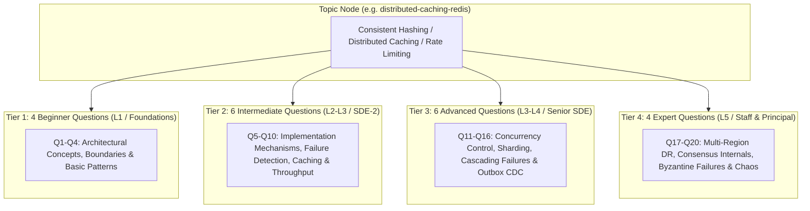

# System Design Curriculum & Question Taxonomy Specification
## Classical Distributed Systems Taxonomy Standard (62 Topics, 17 Categories, 1,240 Questions)

> [!NOTE]
> **Curriculum v5.1 Alignment Notice**:  
> The early 20-topic / 300-question prototype has evolved into the frozen **v5.1 Knowledge Graph Architecture** across **62 Topics, 17 Categories, and 1,240 Questions** stored in **Neo4j AuraDB**. For the complete topic-by-topic syllabus and component relationship catalog, refer directly to [`docs/domains/system-design.md`](./domains/system-design.md).

**Domain Slug:** `system-design`  
**Domain Name:** `System Design`  
**Version:** 5.1.0  
**Target Database:** Neo4j AuraDB Knowledge Graph  
**Target Scale:** 62 Curated Topics × 20 Questions = **1,240 Benchmark Questions**  
**Priority Hierarchy:** **P0: 24 Core Must-Master | P1: 24 High-Frequency/Senior | P2: 14 Specialized/Staff+**  
**Governing Excellence Standard:** [`docs/SYSTEM_DESIGN_CURRICULUM_EXCELLENCE_STANDARD.md`](./SYSTEM_DESIGN_CURRICULUM_EXCELLENCE_STANDARD.md)

---

## 1. Executive Summary & Architectural Goals

This specification defines the complete curriculum structure, question taxonomy, and data contracts for the **System Design** domain on PrepInMinutes.

### Core Objectives
1. **20-Question Depth per Topic (4 Beginner, 6 Intermediate, 6 Advanced, 4 Expert)**:
   - Eliminates repetition fatigue across repeated practice sessions.
   - Enables **Sarah (Staff AI Assessor)** to dynamically calibrate difficulty up or down in real time.
2. **Zero Orphan Topics**:
   - Every single topic has 20 pre-curated interview questions with realistic prompts, scoring rubrics, hints, and dynamic follow-up probes.
3. **Real-World Engineering Depth**:
   - Moves beyond generic textbook theory into **production incident triage, back-of-the-envelope capacity constraints, and architectural trade-offs**.
4. **Three-Tier Priority Triage (P0, P1, P2)**:
   - Enables candidates with tight interview timelines (2–3 weeks) to fast-track through the 24 P0 must-master topics.

---

## 2. The 20-Question Taxonomy Model

Each of the 62 topics in Neo4j AuraDB is populated with exactly 20 questions distributed across four difficulty tiers:



---

## 3. High-Signal Question Architecture (The 8-Layer Standard)

To elevate questions from generic interview trivia to elite, high-signal assessments, every question adheres to four structural design principles:

### 3.1. Concrete Scale & Capacity Anchors
Prompts must never be abstract (e.g., *"How do you design a cache?"*). They include concrete capacity numbers:
- **Traffic**: `100k read QPS`, `5k write QPS`
- **Data Size**: `100 million active keys`, `1KB avg payload`
- **SLA**: `p99 latency < 15ms`, `availability 99.99%`

### 3.2. Incident & Failure Mode Scenarios (Chaos Engineering)
Rather than asking how things work when everything is normal, senior questions introduce active failure:
- *"Your Redis primary crashes while a high-write transaction is in flight. How does your replica election prevent split-brain without dropping writes?"*
- *"A viral tweet creates 500,000 requests/sec for a single key on a single Redis node. How do you prevent CPU saturation?"*

### 3.3. Explicit Trade-Off Enforcement ("No Free Lunch")
Questions force the candidate to articulate what they are willing to sacrifice:
- Strong Consistency vs. High Availability (CAP / PACELC).
- Write latency vs. Read throughput.
- Memory efficiency vs. Hash collision probability.

### 3.4. Dynamic Follow-Up Probes (For Sarah • AI Assessor)
Each question includes 2 **Dynamic Follow-Up Probes** stored in Neo4j. During the voice/text assessment, after the candidate provides an initial answer, Sarah probes deeper:
- *Candidate:* "I will use Redis with TTL."
- *Sarah (Follow-Up Probe 1):* "What happens if 100,000 concurrent requests arrive at the exact millisecond that key's TTL expires?"
- *Sarah (Follow-Up Probe 2):* "Would you use an early probabilistic recomputation (XFetch) or a distributed mutex?"

---

## 4. System Design Curriculum Taxonomy (62 Topics across 3 Pillars)

### Pillar 1: Fundamentals & Principles (21 Topics | 420 Questions)
- **1.1 Foundations**: `FND001` (P0), `FND002` (P0), `FND003` (P1), `FND021` (P0)
- **1.2 Networking**: `FND004` (P0), `FND005` (P1), `FND020` (P2)
- **1.3 Database Fundamentals**: `FND006` (P0), `FND007` (P1), `FND017` (P1), `FND018` (P2)
- **1.4 Scalability Principles**: `FND008` (P0), `FND009` (P1), `FND019` (P1)
- **1.5 Distributed Systems Principles**: `FND010` (P0), `FND011` (P1), `FND012` (P1), `FND013` (P2)
- **1.6 Security Fundamentals**: `FND014` (P0), `FND015` (P1), `FND016` (P2)

### Pillar 2: Components & Patterns (17 Topics | 340 Questions)
- **2.1 Traffic Management**: `CMP001` (P0), `CMP002` (P0), `CMP003` (P1), `CMP004` (P0)
- **2.2 Storage Components**: `CMP005` (P0), `CMP006` (P0), `CMP007` (P0), `CMP008` (P2)
- **2.3 Messaging & Streaming**: `CMP009` (P0), `CMP010` (P1), `CMP011` (P1)
- **2.4 Distributed Coordination**: `CMP012` (P2), `CMP013` (P2), `CMP014` (P1), `CMP017` (P2)
- **2.5 Reliability Patterns**: `CMP015` (P0), `CMP016` (P1)

### Pillar 3: Real-World Systems & Case Studies (24 Topics | 480 Questions)
- **3.1 Foundations & Storage**: `SYS001` (P0), `SYS002` (P1), `SYS003` (P1)
- **3.2 Communication Systems**: `SYS004` (P0), `SYS005` (P1), `SYS006` (P2), `SYS007` (P2), `SYS024` (P2)
- **3.3 Commerce & Transactions**: `SYS008` (P0), `SYS009` (P0), `SYS010` (P1), `SYS011` (P2)
- **3.4 Social & Content Platforms**: `SYS012` (P0), `SYS013` (P1), `SYS014` (P0)
- **3.5 Streaming, Media & Location**: `SYS015` (P1), `SYS016` (P0), `SYS017` (P1)
- **3.6 Distributed Infrastructure**: `SYS018` (P0), `SYS019` (P1), `SYS020` (P1), `SYS021` (P2), `SYS022` (P2), `SYS023` (P1)

---

## 5. TypeScript Data Contract

```typescript
export type PriorityLevel = 'P0' | 'P1' | 'P2';
export type DifficultyLevel = 'BEGINNER' | 'INTERMEDIATE' | 'ADVANCED' | 'EXPERT';
export type LearningProgressionLevel = 'L1' | 'L2' | 'L3' | 'L4' | 'L5';
export type QuestionArchetype =
  | 'conceptual'
  | 'mechanism'
  | 'implementation'
  | 'comparison'
  | 'scenario-based'
  | 'troubleshooting'
  | 'architecture'
  | 'trade-off'
  | 'failure-analysis'
  | 'follow-up-probe';

export interface SystemDesignQuestion {
  id: string;                      // e.g. "q_fnd001_01"
  title: string;                   // "Layer 4 vs Layer 7 Load Balancing Trade-Offs"
  difficulty: DifficultyLevel;
  learningLevel: LearningProgressionLevel;
  archetype: QuestionArchetype;
  scaleAnchor?: string;            // "500k read QPS, 50k requests on single viral key"
  prompt: string;                  // Full interview scenario prompt
  rubricGuide: string;             // Detailed grading guide for AI assessor
  rubricAtoms: string[];           // ["mutex-locking", "xfetch-algorithm", "stale-fallback"]
  hints: string[];                 // 2-3 progressive hints
  followUpProbes: string[];        // 2 real-time probing questions for Sarah
  expectedKeywords: string[];      // Key technical concepts expected in candidate transcript
  antiPatterns?: string[];         // Red-flag answers or common antipatterns
}

export interface SystemDesignTopic {
  slug: string;                    // "distributed-caching-redis"
  topicId: string;                 // "CMP007"
  title: string;                   // "Distributed Caching: Redis & Memcached"
  categorySlug: string;            // "database-storage-components"
  pillar: 'principles' | 'components' | 'case-studies';
  priority: PriorityLevel;         // "P0" | "P1" | "P2"
  difficulty: DifficultyLevel;
  durationMin: number;             // 15
  frequency: number;               // 0.98
  weight: number;                  // 0.95
  trend: 'SURGING' | 'RISING' | 'STABLE' | 'FALLING';
  description: string;             // 8-layer comprehensive overview
  rubricAtoms: string[];           // Atomic concepts covered across the topic
  prerequisites: string[];         // Slugs of required prerequisite topics
  usedComponents?: string[];       // Slugs of component topics used (for Case Studies)
  foundedOn?: string[];            // Slugs of fundamental principles founded on
  questions: SystemDesignQuestion[]; // Exactly 20 questions
}
```

---

## 6. Graph Synchronization & Seed Architecture

1. **Safety Backup**: Backups persisted under `prepinminutes-backend/backups/`.
2. **Modular File Structure**: Seed data partitioned by pillar under `scripts/seed-data/system-design/`:
   - `categories.ts` (17 categories)
   - `pillar-1-fundamentals.ts` (21 topics = 420 questions)
   - `pillar-2-components.ts` (17 topics = 340 questions)
   - `pillar-3-case-studies.ts` (24 topics = 480 questions)
3. **Execution**: Seeded via idempotent Cypher `MERGE` statements without wiping or duplicating existing nodes.
4. **Validation**: All 62 topics, 1,240 questions, and 98 DAG prerequisite edges verified with zero cycles in Neo4j AuraDB.
