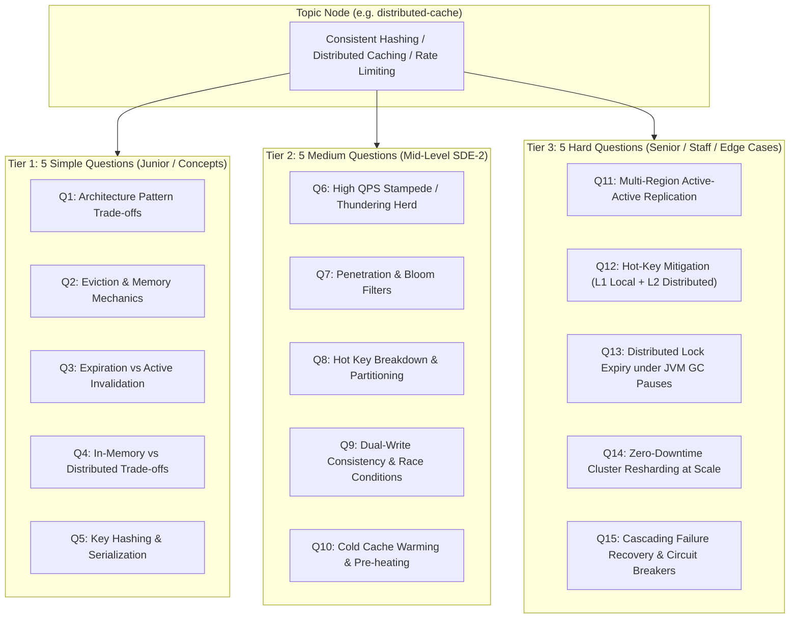

# System Design Curriculum & Question Taxonomy Specification
## The 5-5-5 Tiered Architecture (15 Questions Per Topic)

**Status:** Approved for Implementation  
**Target Domain:** System Design  
**Target Database:** Neo4j AuraDB Knowledge Graph  
**Target Scale:** 20 Core Curated Topics × 15 Questions = **300 Benchmark Questions**

---

## 1. Executive Summary & Architectural Goals

This specification defines the complete curriculum structure, question taxonomy, and data contracts for the **System Design** domain on PrepInMinutes.

### Core Objectives
1. **15-Question Depth per Topic (5 Simple, 5 Medium, 5 Hard)**:
   - Eliminates repetition fatigue.
   - Enables **Sarah (Staff AI Assessor)** to dynamically calibrate difficulty up or down in real time.
2. **Zero Orphan Topics**:
   - Every single topic has comprehensive, pre-curated interview questions with realistic prompts, scoring rubrics, hints, and dynamic follow-up probes.
3. **Real-World Engineering Depth**:
   - Moves beyond generic textbook theory into **production incident triage, back-of-the-envelope capacity constraints, and architectural trade-offs**.

---

## 2. The 5-5-5 Question Taxonomy Model



---

## 3. High-Signal Question Architecture (Key Suggestions & Enhancements)

To elevate questions from generic interview trivia to elite, high-signal assessments, every question adheres to four structural design principles:

### 3.1. Concrete Scale & Capacity Anchors
Prompts must never be abstract (e.g., *"How do you design a cache?"*). They must include concrete capacity numbers:
- **Traffic**: `100k read QPS`, `5k write QPS`
- **Data Size**: `100 million active keys`, `1KB avg payload`
- **SLA**: `p99 latency < 15ms`, `availability 99.99%`

### 3.2. Incident & Failure Mode Scenarios (Chaos Engineering)
Rather than asking how things work when everything is normal, senior questions introduce active failure:
- *"Your Redis primary crashes while a high-write transaction is in flight. How does your replica election prevent split-brain without dropping writes?"*
- *"A viral tweet creates 500,000 requests/sec for a single key on a single Redis node. How do you prevent CPU saturation?"*

### 3.3. Explicit Trade-Off Enforcement ("No Free Lunch")
Questions force the candidate to articulate what they are willing to sacrifice:
- Strong Consistency vs. High Availability (CAP / PACELC).
- Write latency vs. Read throughput.
- Memory efficiency vs. Hash collision probability.

### 3.4. Dynamic Follow-Up Probes (For Sarah • AI Assessor)
Each question includes 2 **Dynamic Follow-Up Probes** stored in Neo4j. During the voice/text assessment, after the candidate provides an initial answer, Sarah probes deeper:
- *Candidate:* "I will use Redis with TTL."
- *Sarah (Follow-Up Probe 1):* "What happens if 100,000 concurrent requests arrive at the exact millisecond that key's TTL expires?"
- *Sarah (Follow-Up Probe 2):* "Would you use an early probabilistic recomputation (XFetch) or a distributed mutex?"

---

## 4. System Design Curriculum Taxonomy (20 Curated Topics)

The 20 core topics are divided across 5 coherent architectural categories:

### Category 1: Distributed Core Fundamentals (`distributed-fundamentals`)
1. **`consistent-hashing`**: Consistent Hashing & Distributed Hash Tables (Virtual nodes, node ring, data migration).
2. **`cap-pacelc-theorems`**: CAP & PACELC Theorems in Real-World Systems (CP vs AP trade-offs, network partition handling).
3. **`distributed-consensus`**: Distributed Consensus & Leader Election (Raft, Paxos, Quorums, Split-Brain prevention).
4. **`distributed-locking`**: Distributed Locking & Concurrency Control (Redlock, ZooKeeper ephemeral nodes, fencing tokens).

### Category 2: Data Architecture, Storage & Caching (`data-storage-scale`)
5. **`distributed-cache`**: Distributed Caching Architecture (Memcached vs Redis, Stampede, Penetration, Multi-Region invalidation).
6. **`database-sharding`**: Horizontal Database Sharding & Partitioning (Shard keys, cross-shard joins, resharding strategies).
7. **`sql-vs-nosql-engines`**: Storage Engines: B-Trees vs LSM-Trees (Read-heavy vs Write-heavy, RocksDB, Cassandra vs PostgreSQL).
8. **`event-sourcing-cqrs`**: Event Sourcing & CQRS Pattern (Append-only event stores, materialized read views, eventual consistency).

### Category 3: Traffic Management, Networking & Edge (`traffic-networking`)
9. **`rate-limiter`**: Rate Limiting & Throttling at Scale (Token Bucket, Leaky Bucket, Sliding Window Counter, Distributed Redis sync).
10. **`load-balancing`**: Load Balancing & Layer 4 vs Layer 7 Traffic Routing (Consistent IP hash, Weighted round-robin, Health probes).
11. **`websockets-realtime`**: Real-Time WebSockets & SSE Architecture (Connection pooling, sticky sessions, Redis Pub/Sub backplane).
12. **`cdn-edge-architecture`**: CDN & Edge Caching Architecture (Cache headers, stale-while-revalidate, edge compute / Cloudflare Workers).

### Category 4: Asynchronous Processing & Event Streaming (`asynchronous-streaming`)
13. **`message-queues-kafka`**: Distributed Message Queues & Event Streaming (Apache Kafka, Partitioning, Consumer Groups, Log compaction).
14. **`exactly-once-semantics`**: Idempotency & Exactly-Once Processing (Deduplication IDs, Two-Phase Commit, Outbox pattern).
15. **`resiliency-circuit-breakers`**: Resiliency, Retries & Circuit Breakers (Bulkheads, Exponential backoff with jitter, Chaos recovery).
16. **`unique-id-generation`**: High-Throughput Distributed ID Generation (Twitter Snowflake, UUIDv7, Ticket Servers).

### Category 5: Modern 2026 Architectures & High-Scale Systems (`modern-ai-scale`)
17. **`vector-search-rag`**: Vector Search & RAG Pipeline Architecture (Embeddings, HNSW / IVFFlat, Milvus/Qdrant, Chunking & Latency).
18. **`multi-region-active-active`**: Multi-Region Active-Active DR (Cross-datacenter replication, Conflict-Free Replicated Data Types - CRDTs).
19. **`high-concurrency-booking`**: High-Concurrency Flash Sale / Ticket Booking (Inventory locking, Redis atomic decrement, Oversell prevention).
20. **`distributed-tracing-observability`**: Distributed Tracing & Telemetry (OpenTelemetry, Trace context propagation, Sampling strategies).

---

## 5. TypeScript Data Contract

```typescript
export interface SystemDesignQuestion {
  id: string;                      // e.g. "q_dist_cache_06"
  title: string;                   // "Cache Stampede & Probabilistic Early Expiration"
  difficulty: 'BEGINNER' | 'INTERMEDIATE' | 'ADVANCED';
  scaleAnchor: string;             // "500k read QPS, 50k requests on single viral key"
  prompt: string;                  // Full interview scenario prompt
  rubricGuide: string;             // Detailed grading guide for AI assessor
  rubricAtoms: string[];           // ["mutex-locking", "xfetch-algorithm", "stale-fallback"]
  hints: string[];                 // 2-3 progressive hints
  followUpProbes: string[];        // 2 real-time probing questions for Sarah
  expectedKeywords: string[];      // Key technical concepts expected in candidate transcript
  failureScenario?: string;        // Active crisis or edge case condition
  status: 'PUBLISHED';
  isLive: true;
}

export interface SystemDesignTopic {
  slug: string;                    // "distributed-cache"
  title: string;                   // "Distributed Cache Architecture"
  categorySlug: string;            // "data-storage-scale"
  difficulty: 'BEGINNER' | 'INTERMEDIATE' | 'ADVANCED';
  durationMin: number;             // 15
  frequency: number;               // 0.92
  weight: number;                  // 0.95
  trend: 'SURGING' | 'RISING' | 'STABLE' | 'FALLING';
  rubricAtoms: string[];           // Atomic concepts covered across the topic
  prerequisites: string[];         // Slugs of required prerequisite topics
  questions: SystemDesignQuestion[]; // Exactly 15 questions (5 Beginner, 5 Intermediate, 5 Advanced)
}
```

---

## 6. Execution & Safety Protocol

1. **Safety Backup**: Run `scripts/backup-neo4j-current.ts` to generate `backups/neo4j-backup-2026-11-05.json`.
2. **Modular File Structure**: Store seed data in clean modular files under `scripts/seed-data/system-design/`:
   - `category-1-fundamentals.ts` (4 topics = 60 questions)
   - `category-2-storage.ts` (4 topics = 60 questions)
   - `category-3-networking.ts` (4 topics = 60 questions)
   - `category-4-streaming.ts` (4 topics = 60 questions)
   - `category-5-modern-scale.ts` (4 topics = 60 questions)
3. **User Inspection Gate**: Present preview for review before executing the cleanup script.
4. **Execution**: Wipe existing nodes via Cypher and seed the complete 300-question graph.
5. **Validation**: Run verification script confirming 300 questions, 20 topics, and 5 categories with zero orphans.

