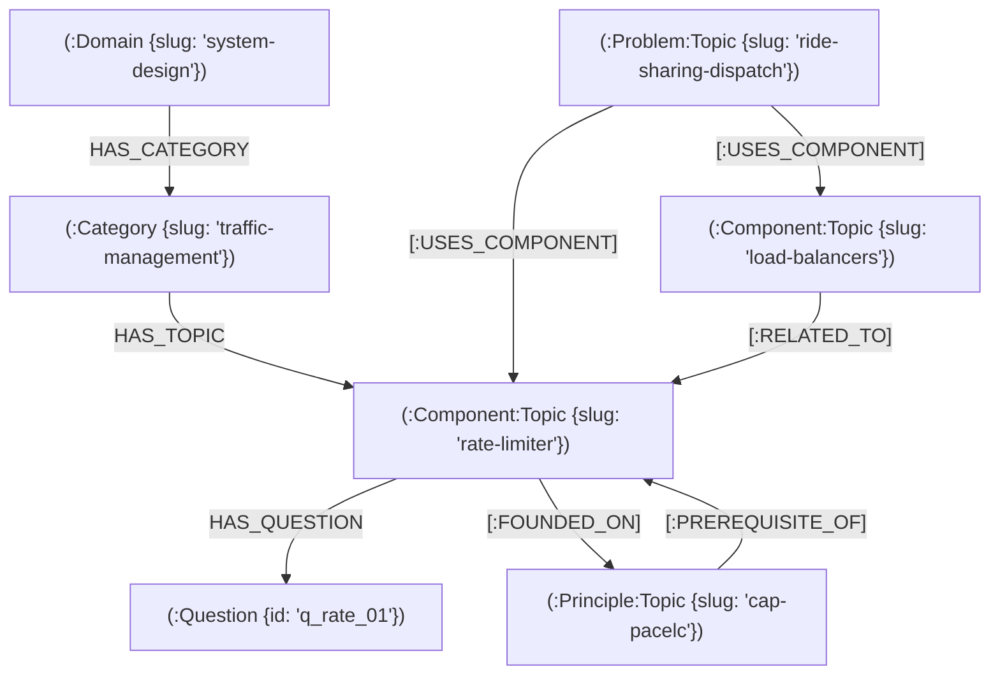
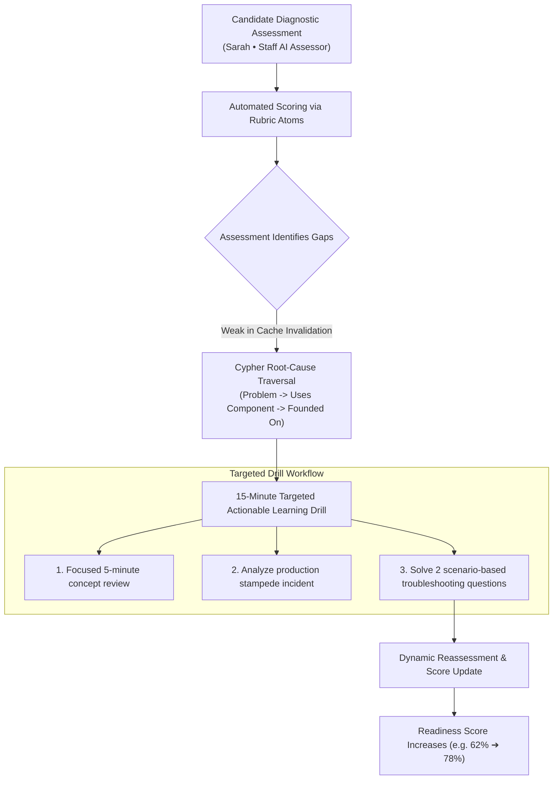

# System Design Curriculum Excellence Standard
**Version:** 1.0  
**Effective Date:** 5 November 2026  
**Target Platform:** PrepInMinutes Knowledge Graph & Adaptive Learning Engine  
**Status:** 🟢 **OFFICIAL CURRICULUM SPECIFICATION**

---

## 1. Vision & Core Philosophy

The goal of the PrepInMinutes System Design curriculum is to move beyond superficial question banks and build a curriculum that takes an engineer from **understanding fundamentals to independently designing, evaluating, and defending production-grade architectures**.

### The Six Dimensions of Excellence

1. **Curriculum Completeness**: All foundational distributed principles, reusable components, and real-world system case studies are covered without blind spots.
2. **Technical Depth**: Every topic moves beyond basic dictionary definitions into internal mechanics, algorithms, failure modes, and real engineering trade-offs.
3. **Learning Progression**: Concepts build logically from Fresher/Junior fundamentals to Staff/Principal global architectures.
4. **Practical Production Relevance**: Concepts are anchored to real capacity constraints, incident post-mortems, and live production bottlenecks.
5. **Interview Readiness**: Prepares candidates to structure conversations, estimate capacity, articulate trade-offs, and defend architectural choices under cross-examination.
6. **Knowledge Relationships**: Concepts are connected within an active graph network (`USES_COMPONENT`, `FOUNDED_ON`, `PREREQUISITE_OF`), enabling root-cause diagnostics and targeted adaptive drills.

---

## 2. The 10-Point Topic Quality Specification

Every topic in the curriculum—regardless of pillar—must satisfy this 10-point quality specification before it is marked `PUBLISHED`:

| Dimension | Mandatory Content Standard |
| :--- | :--- |
| **1. Concept Clarity** | Unambiguous definition, underlying terminology, core mental model, and architectural boundaries. |
| **2. Technical Depth** | Internal mechanics, data structures, execution flow, protocols, and underlying algorithms. |
| **3. Practical Relevance** | Real-world production examples, reference implementations (e.g., Redis, Kafka, Cassandra), and active use cases. |
| **4. Trade-Off Analysis** | Explicit benefits, architectural limitations, and concrete comparison with alternatives ("No free lunch"). |
| **5. Failure Scenarios** | Bottlenecks, cascading failures, network splits, hardware crashes, and automated recovery procedures. |
| **6. Scalability & Sizing** | Performance limits, horizontal scaling mechanisms, memory/storage footprints, and throughput bounds. |
| **7. Security & Isolation** | Attack vectors, authentication/authorization boundaries, encryption, and tenant isolation where applicable. |
| **8. Observability** | Key telemetry signals: golden metrics (latency, traffic, errors, saturation), distributed trace spans, and alerting thresholds. |
| **9. Interview Readiness** | Structured prompts, expected keywords, scoring rubrics, anti-pattern traps, and dynamic follow-up probes. |
| **10. Graph Prerequisites** | Explicit bidirectional links to foundational concepts the learner must master first. |

---

## 3. Pillar-Specific Teaching Objectives & Templates

The curriculum enforces different structural templates across its three pillars:

### Pillar 1: Fundamentals & Principles (Understanding *Why* Systems Behave As They Do)

Pillar 1 concepts must not be taught as static definitions. They must be taught as **fundamental laws that govern distributed systems**.

#### Mandatory Pillar 1 Structure:
1. **Definition & Purpose**: What problem does this principle describe or solve?
2. **Internal Working & Mechanics**: How it behaves under normal vs. degraded conditions.
3. **Algorithms & Protocols**: Mathematical basis (e.g., Lamport timestamps, quorum intersection $R + W > N$, consensus logs).
4. **Visual Diagram**: Step-by-step visual sequence of the phenomenon.
5. **Real-World Case Example**: How modern databases or runtimes implement the principle.
6. **Common Misconceptions**: Debunking junior myths (e.g., *"CAP means you can pick any 2 of CA, CP, or AP"* vs. *"Partitions are inevitable network realities; the choice is only between C and A during P"*).
7. **Practical Engineering Scenarios**: Concrete engineering decisions dictated by this principle.
8. **Interview Questions & Probes**: Diagnostic questions testing deep conceptual comprehension.

---

### Pillar 2: Components & Patterns (Understanding *How* to Construct Systems)

Every component must follow a uniform, production-grade engineering breakdown.

#### Mandatory Pillar 2 Engineering Blueprint (e.g., Distributed Caching):
- **Fundamentals**: Core purpose, caching topology, and read/write access patterns.
- **Internals & Memory**: In-memory data structures, eviction algorithms (LRU, LFU, ARC), and memory overhead.
- **Access Strategies**: Cache-Aside, Write-Through, Write-Behind, Refresh-Ahead trade-offs.
- **Clustering & Partitioning**: Consistent hashing, replication, Redis Cluster hash slots, and node rebalancing.
- **Consistency & Invalidation**: Invalidation strategies, stale-while-revalidate, dual-write race conditions.
- **Reliability & Failure Modes**: Cache stampede/thundering herd, cache penetration (Bloom filters), cache breakdown, and avalanche mitigation.
- **Security & Multi-Tenancy**: Auth, TLS, namespace isolation, and noisy neighbor prevention.
- **Operations & Telemetry**: Hit ratio monitoring, memory saturation alarms, and eviction rate tracking.
- **Technology Comparisons**: Redis vs. Memcached vs. Local in-memory caches.

---

### Pillar 3: System Design Problems (Designing & Defending End-to-End Systems)

Every case study adheres to a standardized **8-Step System Design Workflow**:

```mermaid
flowchart LR
    S1["1. Requirements & Scope"] --> S2["2. Capacity Estimation"]
    S2 --> S3["3. API & Data Modeling"]
    S3 --> S4["4. High-Level Architecture"]
    S4 --> S5["5. Deep Technical Design"]
    S5 --> S6["6. Reliability & Security"]
    S6 --> S7["7. Scalability & Optimization"]
    S7 --> S8["8. Trade-Offs & Evolution"]
```



1. **Requirements & Scope**: Functional requirements, explicit out-of-scope boundaries, non-functional requirements (SLOs: availability, p99 latency, durability).
2. **Capacity Estimation (Back-of-the-Envelope)**: DAU/MAU, Read/Write QPS, bandwidth consumption, storage growth over 5 years.
3. **API & Data Modeling**: REST/gRPC endpoints, database schema entities, primary/foreign keys, access patterns, and indexing strategy.
4. **High-Level Architecture**: Core services, message brokers, caching tiers, and end-to-end request/data flow diagrams.
5. **Deep Technical Design**: Component-level deep dives (e.g., driver matching algorithms, deduplication logic, consensus).
6. **Reliability & Security**: Failure modes, failover protocols, circuit breakers, idempotency keys, rate limiting, and auth boundaries.
7. **Scalability & Optimization**: Resolving bottlenecks, CDN caching, database sharding, connection pooling, and cost governance.
8. **Trade-Offs & Evolution**: Alternative architectures considered, trade-off defense, known limitations, and next-generation improvements.

---

## 4. Multi-Dimensional Progression Matrix

To prevent conflating experience with mastery, four distinct dimensions are tracked independently:

```text
Candidate Journey Dimensions:
├── 1. Career Level:        Fresher ➔ Junior ➔ Mid-Level ➔ Senior ➔ Staff ➔ Principal ➔ Architect
├── 2. Learning Level:      L1 (Fundamentals) ➔ L2 (Basic) ➔ L3 (Intermediate) ➔ L4 (Advanced) ➔ L5 (Super Advanced)
├── 3. Question Difficulty: Beginner ➔ Intermediate ➔ Advanced ➔ Expert
└── 4. Specialization:      Backend, Frontend, Full-Stack, Platform/Cloud, Staff/Architect
```

### Career-Level Evaluation Expectations

| Career Level | Expected Architectural Capability in Assessments |
| :--- | :--- |
| **Fresher** | Explain fundamental concepts, basic client-server protocols, and database ACID properties. |
| **Junior (SDE-1)** | Build and debug individual services, write correct database queries, and integrate caching layers. |
| **Mid-Level (SDE-2)** | Design small-to-medium systems with clean APIs, data models, read replicas, and basic queue decoupling. |
| **Senior (SDE-3 / Lead)** | Design high-scale, resilient architectures; handle failovers, sharding, p99 latency, and concurrent race conditions. |
| **Staff Engineer** | Solve cross-service boundaries, data consistency across business domains, and organizational blast radius. |
| **Principal / Architect** | Make platform-wide architectural decisions, technology selections, disaster recovery strategies, and global cost trade-offs. |

---

## 5. Question & Assessment Blueprint

Each topic features a balanced 20-question portfolio (or 15-question targeted set) drawn from **10 distinct question archetypes**:

| Question Archetype | What It Evaluates | Example Scenario |
| :--- | :--- | :--- |
| **1. Conceptual** | Core comprehension & terminology | *"Explain the difference between read committed and snapshot isolation."* |
| **2. Mechanism** | Internal execution flow & data structures | *"How does the AOF rewrite process work in Redis without blocking client reads?"* |
| **3. Implementation** | Practical engineering execution | *"Write the Lua script to atomically decrement seat inventory in Redis."* |
| **4. Comparison** | Technical judgment between alternatives | *"When would you choose LSM-Trees over B+ Trees, and what is the write penalty?"* |
| **5. Scenario-Based** | Applying principles to constraints | *"Design a deduplication strategy for a webhook pipeline receiving 10k events/sec."* |
| **6. Troubleshooting** | Root-cause problem-solving | *"Your database connection pool is exhausted but CPU is at 20%. Diagnose the cause."* |
| **7. Architecture** | End-to-end component construction | *"Design the ingest tier for an observability platform handling 1M metrics/sec."* |
| **8. Trade-Off** | Decision defense under constraints | *"Defend why you sacrificed immediate consistency for lower write latency in this feed."* |
| **9. Failure Analysis** | Reliability & chaos engineering | *"What happens when a network split isolates your primary Redis master from replicas?"* |
| **10. Follow-Up Probe** | Depth under cross-examination | *"What happens if your worker thread experiences a 15-second GC pause with that lock?"* |

---

## 6. Neo4j Knowledge Graph Architecture

PrepInMinutes utilizes an active semantic graph model rather than a passive hierarchy:



### The 4 Cross-Topic Relationships:
1. **`[:USES_COMPONENT]`**: Connects a high-level case study problem to the building-block components it requires.
2. **`[:FOUNDED_ON]`**: Connects a component or system to the foundational principles that govern its behavior.
3. **`[:PREREQUISITE_OF]`**: Directs the candidate learning order and enforces prerequisite validation.
4. **`[:RELATED_TO]`**: Links complementary or alternative technologies.

---

## 7. The 100-Point Topic Quality Audit Rubric

Every topic in the repository must be audited against this 100-point rubric:

```text
┌─────────────────────────────────────────────────────────────┬────────┐
│ Quality Dimension                                           │ Weight │
├─────────────────────────────────────────────────────────────┼────────┤
│ 1. Technical Correctness & Architectural Precision          │ 20 pts │
│ 2. Technical Depth & Internal Mechanics                     │ 15 pts │
│ 3. Trade-Offs, Alternatives & "No Free Lunch" Rationale     │ 15 pts │
│ 4. Production Failure Scenarios & Chaos Recovery            │ 15 pts │
│ 5. Practical Relevance, Real Capacity Sizing & Diagrams     │ 10 pts │
│ 6. Question Bank Quality, Follow-Ups & Anti-Pattern Traps   │ 10 pts │
│ 7. Career-Level Calibrated Rubrics (Fresher to Architect)   │ 10 pts │
│ 8. Graph Semantic Integrity & Clean Prerequisites           │  5 pts │
├─────────────────────────────────────────────────────────────┼────────┤
│ TOTAL QUALITY SCORE                                         │ 100 pts│
└─────────────────────────────────────────────────────────────┴────────┘
```

### Quality Publishing Gates:
- **$\ge 90$ Points**: 🟢 **Approved for Production** (Published to candidates).
- **$75 - 89$ Points**: 🟡 **Acceptable for Staging Review** (Needs minor depth polish).
- **$< 75$ Points**: 🔴 **Draft / Rejected** (Cannot be published or queried by candidates).

---

## 8. The Adaptive Diagnostic Learning Engine

In PrepInMinutes, the curriculum actively drives the candidate diagnostic loop:



This ensures PrepInMinutes functions as an **adaptive technical mentor**, rather than a static question repository.

