# PrepInMinutes — Master Task Execution Sequence & Dependency Graph

> **Status**: Living Operational Document • Phase-by-Phase Roadmap  
> **Last Synchronized**: November 2026  
> **Knowledge Graph Live State**: 10 Domains | 122 Categories | 371 Topics | 7,420 Questions (Neo4j AuraDB)  
> **Backend Architecture**: Cloudflare Workers / Hono Edge Gateway (`prepinminutes-backend`) + Neon PostgreSQL (`prisma/`)  
> **Frontend Architecture**: Next.js 14 App Router (`prep-in-minutes`)

---

## 1. Executive Status & Progress Matrix

|     Phase     | Functional Scope                                       | Total Tasks | Completed (`[x]`) | In Progress (`[-]`) | Pending (`[ ]`) |          Status          |
| :-----------: | :----------------------------------------------------- | :---------: | :---------------: | :-----------------: | :-------------: | :----------------------: |
|  **Phase 1**  | **Curriculum Knowledge Graph (Neo4j AuraDB)**          |     10      |        10         |          0          |        0        |  🟢 **100% COMPLETE**   |
| **Phase 1.5** | **Relational Schema & Curriculum Parity (PostgreSQL)** |      5      |         5         |          0          |        0        |  🟢 **100% COMPLETE**   |
|  **Phase 2**  | **Cross-Cutting Intelligence (L1–L4 Graph Nodes)**     |      5      |         5         |          0          |        0        |  🟢 **100% COMPLETE**   |
|  **Phase 3**  | **Unified Curriculum API & Edge Gateway**              |      3      |         3         |          0          |        0        |  🟢 **100% COMPLETE**   |
|  **Phase 4**  | **Dynamic Frontend Knowledge Graph Integration**       |      3      |         3         |          0          |        0        |  🟢 **100% COMPLETE**   |
|  **Phase 5**  | **Interactive Practice & Live Question Injection**     |      4      |         1         |          0          |        3        |  🟡 **25% IN PROGRESS**  |
|  **Phase 6**  | **Deterministic Evaluation, Scoring & Decay Engine**   |      3      |         0         |          0          |        3        |      ⚪ **PENDING**      |
|  **Phase 7**  | **Real-Time Voice AI Gateway & Media Streaming**       |      2      |         0         |          0          |        2        |      ⚪ **PENDING**      |
|  **Phase 8**  | **End-to-End Platform Verification & Polish**          |      3      |         0         |          0          |        3        |      ⚪ **PENDING**      |
|   **TOTAL**   | **Entire PrepInMinutes Platform**                      |   **38**    |      **27**       |        **0**        |     **11**      |    **71.1% OVERALL**     |

---

## 2. Phase-by-Phase Task Execution Graph

```mermaid
flowchart TD
  subgraph P1["Phase 1: Knowledge Graph Foundation (100% DONE)"]
    T101["P1-01: System Design (1240 Qs)"]
    T102["P1-02: AI System Design (560 Qs)"]
    T103["P1-03: Low-Level Design (700 Qs)"]
    T104["P1-04: DSA & Coding (800 Qs)"]
    T105["P1-05: Backend Engineering (580 Qs)"]
    T106["P1-06: Frontend Architecture (680 Qs)"]
    T107["P1-07: Cloud & DevOps (1000 Qs)"]
    T108["P1-08: Behavioral & Leadership (560 Qs)"]
    T109["P1-09: Data Engineering (600 Qs)"]
    T110["P1-10: Mobile Engineering (700 Qs)"]
  end

  subgraph P15["Phase 1.5: Relational Parity & Platform Seeds (100% DONE)"]
    T151["P1.5-01: Universal Prisma Schema Alignment (27 Models)"]
    T152["P1.5-02: Local PostgreSQL Push & Verification"]
    T153["P1.5-03: 10-Domain Curriculum Sync (371 Topics)"]
    T154["P1.5-04: Baseline Platform Seeds (Admin, Plans, Configs)"]
    T155["P1.5-05: Golden Demo Candidate Full-State Journey"]
  end

  subgraph P2["Phase 2: Cross-Cutting Intelligence (L1-L4) (100% DONE)"]
    T201["P2-01: 28 Roles & 7 Career Bands [DONE]"]
    T202["P2-02: 20 Companies, Stages & Formats [DONE]"]
    T203["P2-03: 5-Factor Roadmap Engine & Prereq Closure [DONE]"]
    T204["P2-04: Company Intelligence Refresh Cron (State Cursor) [DONE]"]
    T205["P2-05: Neon Cloud PostgreSQL Reset & Structure Sync [DONE]"]
  end

  subgraph P3["Phase 3: Unified Curriculum API"]
    T301["P3-01: Public Curriculum Gateway Routes"]
    T302["P3-02: Topic Detail & 20-Question Bundle API"]
    T303["P3-03: Edge Cache & Hierarchy Optimization"]
  end

  subgraph P4["Phase 4: Frontend Dynamic Integration"]
    T401["P4-01: Dynamic ChooseTopicWorkspace"]
    T402["P4-02: Domain & Category Filter UI (10 Domains)"]
    T403["P4-03: Topic Search & Company Tag Filtering"]
  end

  subgraph P5["Phase 5: Practice & Mock Session Execution"]
    T501["P5-01: Dynamic Question Loader in Practice"]
    T502["P5-02: Sarah AI Persona Rubric Atom Injection"]
    T503["P5-03: Multi-Domain Code & Whiteboard Binding"]
    T504["P5-04: Session Submission & Transcript Handling"]
  end

  subgraph P6["Phase 6: Evaluation & Spaced Repetition"]
    T601["P6-01: Rubric Scoring & Delta Calculation"]
    T602["P6-02: SuperMemo SM-2 Decay Synchronization"]
    T603["P6-03: Interactive Rapid Recall Flashcard Modal"]
  end

  subgraph P7["Phase 7: Real-Time Voice Streaming"]
    T701["P7-01: WebSocket Voice Gateway (Deepgram + TTS)"]
    T702["P7-02: Low-Latency Barge-In Interruption Handler"]
  end

  subgraph P8["Phase 8: End-to-End Verification"]
    T801["P8-01: Full-Flow Integration Test Suite"]
    T802["P8-02: Production Build & Asset Validation"]
    T803["P8-03: Performance, Quotas & Security Audit"]
  end

  P1 --> P15
  P15 --> P2
  P1 --> P2
  P1 --> P3
  P2 --> P3
  P3 --> P4
  P4 --> P5
  P5 --> P6
  P5 --> P7
  P6 --> P8
  P7 --> P8
```

---

## 3. Detailed Task Specifications & Dependencies

### Phase 1: Core Curriculum Knowledge Graph (Neo4j AuraDB) — COMPLETED

- [x] **TASK-P1-01: D01 System Design & HLD Knowledge Graph**
  - **Status**: Completed (November 7, 2026)
  - **Scale**: 17 Categories | 62 Topics (`FND001`–`FND021`, `CMP001`–`CMP017`, `SYS001`–`SYS024`) | 1,240 Questions | v5.1.0
  - **Artifacts**: `docs/domains/system-design.md`, `scripts/seed-data/system-design/`

- [x] **TASK-P1-02: D02 AI System Design & GenAI Infra Knowledge Graph**
  - **Status**: Completed (November 8, 2026)
  - **Scale**: 7 Categories | 28 Topics (`AIP001`–`AIP008`, `AIC001`–`AIC013`, `AIS001`–`AIS007`) | 560 Questions | v2.0.0
  - **Artifacts**: `docs/domains/ai-system-design.md`, `scripts/seed-data/ai-system-design/`

- [x] **TASK-P1-03: D03 Low-Level Design & Machine Coding Knowledge Graph**
  - **Status**: Completed (November 9, 2026)
  - **Scale**: 6 Categories | 35 Topics (`LLDP01`–`LLDP07`, `LLDC01`–`LLDC08`, `LLDS01`–`LLDS20`) | 700 Questions | v1.0.0
  - **Artifacts**: `docs/domains/low-level-design.md`, `scripts/seed-data/low-level-design/`

- [x] **TASK-P1-04: D04 Data Structures & Algorithms Knowledge Graph**
  - **Status**: Completed (November 9, 2026)
  - **Scale**: 12 Categories | 40 Topics (`DSA01`–`DSA40`) | 800 Questions | v1.0.0
  - **Artifacts**: `docs/domains/dsa.md`, `scripts/seed-data/dsa/`

- [x] **TASK-P1-05: D05 Backend & Runtime Engineering Knowledge Graph**
  - **Status**: Completed (November 10, 2026)
  - **Scale**: 11 Categories | 29 Topics (`BE01`–`BE29`) | 580 Questions | v1.0.0
  - **Artifacts**: `docs/domains/backend-engineering.md`, `scripts/seed-data/backend-engineering/`

- [x] **TASK-P1-06: D06 Frontend & Web Architecture Knowledge Graph**
  - **Status**: Completed (November 10, 2026)
  - **Scale**: 12 Categories | 34 Topics (`FE01`–`FE34`) | 680 Questions | v2.0.0
  - **Artifacts**: `docs/domains/frontend-engineering.md`, `scripts/seed-data/frontend-engineering/`

- [x] **TASK-P1-07: D07 Cloud, DevOps & Site Reliability Knowledge Graph**
  - **Status**: Completed (November 10, 2026)
  - **Scale**: 18 Categories | 50 Topics (`CLD01`–`CLD50`) | 1,000 Questions | v1.0.0
  - **Artifacts**: `docs/domains/cloud-devops.md`, `scripts/seed-data/cloud-devops/`

- [x] **TASK-P1-08: D08 Behavioral, Leadership & Management Knowledge Graph**
  - **Status**: Completed (November 10, 2026)
  - **Scale**: 10 Categories | 28 Topics (`BEH01`–`BEH28`) | 560 Questions | v1.0.0
  - **Artifacts**: `docs/domains/behavioral-leadership.md`, `scripts/seed-data/behavioral-leadership/`

- [x] **TASK-P1-09: D09 Data Engineering & Big Data Knowledge Graph**
  - **Status**: Completed (November 11, 2026)
  - **Scale**: 11 Categories | 30 Topics (`DAT01`–`DAT30`) | 600 Questions | v1.0.0
  - **Artifacts**: `docs/domains/data-engineering.md`, `scripts/seed-data/data-engineering/`

- [x] **TASK-P1-10: D10 Mobile Engineering (iOS, Android, Cross-Platform) Knowledge Graph**
  - **Status**: Completed (November 11, 2026)
  - **Scale**: 18 Categories | 35 Topics (`MOB01`–`MOB35`) | 700 Questions | v1.0.0
  - **Artifacts**: `docs/domains/mobile-engineering.md`, `scripts/seed-data/mobile-engineering/`

---

### Phase 1.5: Relational Schema & Full-Platform Data Parity (PostgreSQL)

> **Governing Specification**: [`docs/DATABASE_ARCHITECTURE_AND_PROGRESS_TRACKING_SPEC.md`](./DATABASE_ARCHITECTURE_AND_PROGRESS_TRACKING_SPEC.md) (v2.0.0)  
> **Priority Standard**: **P0 (Immediate Blocking Foundations) & P1 (Interactive Demo Journey)**  
> **Target Database**: Local PostgreSQL (`localhost:5432`) & Neon Cloud Mirror

- [x] **TASK-P1.5-01: Prisma Schema Evolution (Universal 27-Model Alignment)**
  - **Status**: Completed (November 13, 2026)
  - **Priority**: **P0 (Blocking)**
  - **Dependencies**: Phase 1
  - **Target Files**:
    - `prepinminutes-backend/prisma/schema.prisma`
    - `prep-in-minutes/prisma/schema.prisma`
  - **Scope**:
    - Unified schema across backend and frontend repositories with zero drift.
    - Added `CandidateTopicProficiency`, `SubscriptionPlan`, `PasswordResetToken`, `EmailVerificationToken`, `PlatformConfig`.
    - Added the 3 Company Intelligence Refresh models (`IntelligenceRefreshConfig`, `IntelligenceRefreshExecution`, `CompanyIntelligenceRefreshLog` with dynamic `changedAttributes Json?`).
    - Aligned all `CurriculumTopic` attributes (`topicId`, difficulty, priority).
  - **Acceptance Criteria**: `npx prisma validate` and `npx prisma generate` passed with 0 syntax or relational errors in both repos.

- [x] **TASK-P1.5-02: Local PostgreSQL Schema Push & Verification (`localhost:5432`)**
  - **Status**: Completed (November 13, 2026)
  - **Priority**: **P0 (Blocking)**
  - **Dependencies**: `TASK-P1.5-01`
  - **Target Files**:
    - `prepinminutes-backend/prisma/schema.prisma`
  - **Scope**:
    - Executed `npx prisma db push` against the local database (`localhost:5432`).
    - Verified all 27 relational tables exist and table constraints/indexes are active.
  - **Acceptance Criteria**: Database query confirmed all 27 tables exist in `information_schema.tables` on `localhost:5432`.

- [x] **TASK-P1.5-03: Relational 10-Domain Curriculum Sync Script (`371 Topics`)**
  - **Status**: Completed (November 14, 2026)
  - **Priority**: **P0 (Blocking)**
  - **Dependencies**: `TASK-P1.5-02`
  - **Target Files**:
    - `prepinminutes-backend/scripts/sync-curriculum-postgres.ts`
  - **Scope**:
    - Authored an idempotent synchronization script reading canonical domain seed data (from `scripts/seed-data/*`).
    - Upserted all **10 domains**, **122 categories**, and **371 topics** into PostgreSQL `curriculum_domains`, `curriculum_categories`, and `curriculum_topics`.
    - Pruned legacy obsolete domains and categories.
    - Established 100% slug, ID, difficulty, and rubric atoms parity with Neo4j.
  - **Acceptance Criteria**: Database query confirmed: 10 domains, 122 categories, 371 topics, and 5,718 questions live in PostgreSQL.

- [x] **TASK-P1.5-04: Baseline Platform Seeds (Admin, Plans, Configs & Cron)**
  - **Status**: Completed (November 14, 2026)
  - **Priority**: **P0 (Blocking)**
  - **Dependencies**: `TASK-P1.5-02`
  - **Target Files**:
    - `prepinminutes-backend/scripts/seed-platform-baseline.ts`
  - **Scope**:
    - Seeded default Head of Department (HOD) root admin (`imsauravsingh@gmail.com`) with `APPROVED` status and unlimited subscription.
    - Seeded 4 dynamic `SubscriptionPlan` catalog tiers (`FREE`, `PRO_MONTHLY`, `PRO_QUARTERLY`, `LIFETIME`).
    - Seeded `IntelligenceRefreshConfig` for twice-monthly company refresh (batch size 50, Asia/Kolkata).
    - Seeded 10 core `PlatformConfig` entries (Cartesia voice model, Gemini 1.5 Pro evaluator, maintenance flags).
    - Recorded `PLATFORM_INITIALIZATION` in `admin_audit_logs`.
  - **Acceptance Criteria**: Seed execution exited code 0; 4 plans, 10 configs, 1 refresh job verified in PostgreSQL.

- [x] **TASK-P1.5-05: Golden Demo Candidate Seed (Full-State Interactive Journey)**
  - **Status**: Completed (November 14, 2026)
  - **Priority**: **P1 (Core Demo Readiness)**
  - **Dependencies**: `TASK-P1.5-03`, `TASK-P1.5-04`
  - **Target Files**:
    - `prepinminutes-backend/scripts/seed-demo-candidate.ts`
    - `prepinminutes-backend/scripts/seed-data/platform-schema/demo-candidate.ts`
  - **Scope**:
    - Seeded candidate user `candidate@prepinminutes.com` (password: `Candidate@123`) with verified profile (Senior Backend Engineer, 68% readiness, 5-day streak).
    - Seeded active Preparation Plan with 4 weekly milestones and domain weights.
    - Seeded 4 daily checklist tasks linked directly via foreign keys to `curriculum_topics` (`distributed-key-value-store`, `distributed-caching-redis`, `kafka-event-streaming`, `leader-election-raft`).
    - Seeded completed practice session for Distributed Key-Value Store with diagram JSON and architecture whiteboard.
    - Seeded Sarah AI multimodal evaluation report (82/100, "Hire" verdict, +6% readiness delta) with 3 rubric dimension scores and missing atoms.
    - Seeded candidate topic mastery in `TRADE_OFFS` stage and SuperMemo SM-2 interval.
    - Seeded 2 SuperMemo SM-2 revision items (`leader-election-raft` and `distributed-locks-fencing`) with next review dates.
    - Seeded candidate topic proficiencies and weekly area snapshot.
  - **Acceptance Criteria**: Verified in PostgreSQL: candidate user, profile, subscription, plan, tasks, session, evaluation, rubric scores, mastery, and revisions exist and link with zero orphaned relations.

---

### Phase 2: Cross-Cutting Intelligence Layer (L1–L4 Graph Nodes)

> **Governing Specification**: [`docs/CROSS_CUTTING_INTELLIGENCE_SPEC.md`](./CROSS_CUTTING_INTELLIGENCE_SPEC.md) (v1.1.0)

- [x] **TASK-P2-01: Seed Standard Roles & Career Bands (including L1 Freshers & L2 Associates)**
  - **Status**: Completed (November 14, 2026)
  - **Dependencies**: `TASK-P1-01` through `TASK-P1-10`
  - **Target Files**:
    - `prepinminutes-backend/scripts/seed-data/roles/`
    - `prepinminutes-backend/scripts/seed-roles-incremental.ts`
  - **Scope**:
    - Created `(:Role)` nodes for 28 canonical roles across 7 standardized career bands (`STUDENT_FRESHER`, `ASSOCIATE`, `MID_LEVEL`, `SENIOR`, `STAFF`, `PRINCIPAL`, `MANAGEMENT`).
    - Stored decoupled `companyEquivalents` JSON and numeric bounds `minExperienceYears`/`maxExperienceYears`.
    - Merged 813 `(r:Role)-[:REQUIRES_TOPIC {isCore: boolean, priorityScore: int, targetLevel: string, minimumDifficulty: string}]->(t:Topic)` relationships across all 371 curriculum topics.
  - **Acceptance Criteria**: Verified in Neo4j AuraDB: 28 roles seeded, 813 relationships committed, 0 unmapped dangling topics.

- [x] **TASK-P2-02: Seed Companies with Evidence Provenance & Company-Specific Stage Loops**
  - **Status**: Completed (November 14, 2026)
  - **Dependencies**: `TASK-P2-01`
  - **Target Files**:
    - `prepinminutes-backend/scripts/seed-data/companies/`
    - `prepinminutes-backend/scripts/seed-companies-incremental.ts`
  - **Scope**:
    - Created `(:Company)` nodes for 20 Tier-1 tech employers (`google`, `meta`, `amazon`, `apple`, `netflix`, `microsoft`, `uber`, `stripe`, `airbnb`, `databricks`, `snowflake`, `doordash`, `block`, `bytedance`, `coinbase`, `spotify`, `linkedin`, `salesforce`, `atlassian`, `adobe`).
    - Created 9 `(:InterviewStage)` nodes and 6 `(:InterviewFormat)` nodes with tooling contracts.
    - Linked 14 `[:CONDUCTED_VIA]` stage-format mappings and 569 `[:TESTED_IN_STAGE]` domain alignments.
    - Seeded 93 company-specific hiring loop edges:
      - `(c:Company)-[:USES_STAGE {roundOrder: int, isEliminationRound: boolean, stageWeight: int}]->(s:InterviewStage)`
    - Seeded 53 evidence-backed statistical provenance relationships:
      - `(t:Topic)-[:FREQUENTLY_ASKED_AT {frequencyScore: int, confidenceScore: float, sampleSize: int, sourceType: string, lastVerifiedAt: datetime()}]->(c:Company)`
  - **Acceptance Criteria**: Verified in Neo4j AuraDB: 20 companies, 9 stages, 6 formats, 93 stage loop edges, 53 statistical provenance edges.

- [x] **TASK-P2-03: Implement 5-Factor Roadmap Engine with Prerequisite Dependency Closure**
  - **Status**: Completed (November 14, 2026)
  - **Dependencies**: `TASK-P2-01`, `TASK-P2-02`
  - **Target Files**:
    - `prepinminutes-backend/src/server/graph/roadmap-query.ts`
    - `prepinminutes-backend/scripts/test-roadmap-engine.ts`
  - **Scope**:
    - Built multi-dimensional scoring formula:
      $$P(t) = 0.30 R(t) + 0.20 C(t) + 0.10 M(t) + 0.25 \text{SkillGap}(t) + 0.15 S(t)$$
    - Traversed recursive transitive dependency closure via Neo4j Cypher:
      `MATCH (prereq:Topic)-[:PREREQUISITE_OF*1..6]->(target:Topic)`
    - Executed Kahn's topological sort with max-heap priority scheduling and DAG cycle detection guard.
    - Distributed ordered topics into weekly milestones matching `timelineWeeks` and `weeklyGoalHours`.
  - **Acceptance Criteria**: Verified dry-run test suite across 3 distinct candidate archetypes (Fresher at Google, Mid-Level Backend at Amazon, Senior Distributed Systems at Stripe) with 0 broken prerequisites and 0 cycles.

- [x] **TASK-P2-04: Periodic Company Intelligence Batch Refresh Worker with State Cursor**
  - **Status**: Completed (November 14, 2026)
  - **Priority**: **P1 (Core Intelligence Parity)**
  - **Dependencies**: `TASK-P2-02`
  - **Target Files**:
    - `prepinminutes-backend/src/server/workers/company-intelligence-worker.ts`
    - `prepinminutes-backend/scripts/refresh-company-intelligence-cron.ts`
  - **Scope**:
    - Implemented periodic batch refresh worker reading active configuration from PostgreSQL `IntelligenceRefreshConfig` (`0 2 1,15 * *`, `batchSize = 50`, `timezone = 'Asia/Kolkata'`).
    - Engineered round-robin state cursor querying Neo4j companies ordered by `CASE WHEN c.lastVerifiedAt IS NULL THEN 0 ELSE 1 END, c.lastVerifiedAt ASC, c.slug ASC`.
    - Integrated Concurrency Guard preventing concurrent overlapping worker runs while cleaning up stale runs (> 20 mins).
    - Enforced Evidence Quality Guardrail preserving previous scores when sample size $N < 5$.
    - Implemented Per-Company Fault Isolation so a failure on any individual company does not abort the remaining batch.
    - Atomically synchronized updated `frequencyScore`, `sampleSize`, and `confidenceScore` to Neo4j graph nodes while writing execution audit records and JSON attribute diffs to PostgreSQL `IntelligenceRefreshExecution`, `CompanyIntelligenceRefreshLog`, and `AdminAuditLog`.
  - **Acceptance Criteria**: Verified via `scripts/refresh-company-intelligence-cron.ts`: Run 1 updated 10 companies, Run 2 updated the remaining 10 companies with 100% disjoint sets (0% overlap/starvation), 20 audit logs and 2 execution ledgers committed, and all 20 Neo4j company nodes updated with recent verification timestamps.

- [x] **TASK-P2-05: Neon Cloud PostgreSQL Schema Reset & Structure Synchronization (Gated)**
  - **Status**: Completed (November 14, 2026)
  - **Priority**: **P0 (Cloud Database Parity)**
  - **Dependencies**: `TASK-P2-04`
  - **Target Files**:
    - `prepinminutes-backend/prisma/schema.prisma`
    - `prep-in-minutes/prisma/schema.prisma`
    - `prepinminutes-backend/src/server/db/client.ts`
  - **Scope**:
    - Secured explicit user approval to execute `prisma db push --force-reset` on remote Neon Cloud PostgreSQL (`ep-mute-water-b4tb9s29-pooler.c-6.us-east-2.aws.neon.tech/prepinminutes`).
    - Successfully reset remote database instance and re-created all **27 relational tables** from unified Prisma schema.
    - Updated `src/server/db/client.ts` to utilize robust `PrismaPg` connection pool in Node runtime for high-throughput batch operations.
    - Optimized `scripts/sync-curriculum-postgres.ts` with `createMany({ skipDuplicates: true })` multi-row inserts.
    - Synchronized platform baseline seeds: root HOD admin (`imsauravsingh@gmail.com`), 4 subscription tiers, 10 platform configurations, and company refresh config.
    - Synchronized full 10-domain curriculum: 10 domains, 122 categories, 371 topics, and 5,718 questions.
    - Seeded golden demo candidate (`candidate@prepinminutes.com`) with verified profile, 4 daily tasks, completed practice session, Sarah AI evaluation report, and SM-2 revision items.
  - **Acceptance Criteria**: Live Neon Cloud database audit confirmed exact 1:1 parity with local PostgreSQL: 27 tables, 10 domains, 122 categories, 371 topics, 5,718 questions, 4 plans, 10 configs, 1 refresh job, 2 users, 4 tasks, 1 session, 1 evaluation report.

---

### Phase 3: Unified Curriculum API & Edge Gateway

> **Governing Specification**: [`docs/CURRICULUM_API_AND_EDGE_GATEWAY_SPEC.md`](./CURRICULUM_API_AND_EDGE_GATEWAY_SPEC.md) (v1.0.0)

- [x] **TASK-P3-01: Expose Public Curriculum Hierarchy Endpoints in Edge Gateway**
  - **Status**: Completed (November 15, 2026)
  - **Priority**: **P0 (Blocking Core API)**
  - **Dependencies**: `TASK-P1-10`, `TASK-P1.5-05`, `TASK-P2-05`
  - **Target Files**:
    - `prepinminutes-backend/src/server/graph/types.ts`
    - `prepinminutes-backend/src/server/graph/curriculum-repository.ts`
    - `prepinminutes-backend/src/server/graph/repository.ts`
    - `prepinminutes-backend/src/routes/curriculum.ts`
    - `prepinminutes-backend/src/index.ts`
    - `prepinminutes-backend/scripts/test-curriculum-api.ts`
  - **Scope**:
    - Architected and implemented strict data access abstraction: `ICurriculumRepository`, `Neo4jCurriculumRepository`, `PostgresCurriculumRepository`, and `CurriculumRepositoryService`.
    - Corrected Cypher hierarchy aggregation using nested `reduce()` expressions and dynamic question counting (`[:HAS_QUESTION]` traversal).
    - Enforced 100% 1:1 schema equivalence between Neo4j AuraDB and PostgreSQL failover: identical category, topic, rubric atoms, and dynamic question fields.
    - Integrated circuit breaker with 2,500ms timeout guard (`Promise.race`) failing over seamlessly to PostgreSQL if Neo4j is partitioned or times out.
    - Implemented `GET /api/curriculum/domains` returning catalog of all 10 canonical domains, dynamic totals (122 categories, 371 topics, dynamic question counts), and metadata.
    - Implemented `GET /api/curriculum/hierarchy/:domainSlug` returning complete 3-tier hierarchy with topic summaries, rubric counts, and practice URLs.
    - Integrated L0 Edge Memory Cache with 60s TTL delivering sub-1ms warm latency.
    - Implemented standard cache headers: `Cache-Control: public, max-age=300, s-maxage=3600, stale-while-revalidate=86400, stale-if-error=86400`, `ETag: W/"v42-<hash>"`, and full HTTP 304 Not Modified validation on `If-None-Match`.
    - Implemented structured HTTP 404 taxonomy with `DOMAIN_NOT_FOUND`, list of all 10 valid domains, and request tracing metadata.
  - **Acceptance Criteria**: Automated test suite (`scripts/test-curriculum-api.ts`) passed 64/64 tests with exit code 0; warm responses clocked at an average of 0.10ms (min 0.06ms), far exceeding the sub-35ms target.

- [x] **TASK-P3-02: Expose Comprehensive Topic Detail & Question Bundle API**
  - **Status**: Completed (November 15, 2026)
  - **Priority**: **P0 (Blocking Core API)**
  - **Dependencies**: `TASK-P3-01`
  - **Target Files**:
    - `prepinminutes-backend/src/server/graph/types.ts`
    - `prepinminutes-backend/src/server/graph/curriculum-repository.ts`
    - `prepinminutes-backend/src/routes/curriculum.ts`
    - `prepinminutes-backend/src/index.ts`
    - `prepinminutes-backend/scripts/test-curriculum-api.ts`
  - **Scope**:
    - Extended `ICurriculumRepository` with `getTopicDetail(topicSlug)` and `getTopicQuestions(topicSlug, options)`.
    - Implemented `Neo4jCurriculumRepository` topic detail query fetching 8-layer metadata:
      - Domain & Category references (`slug`, `name`, `pillar`).
      - Topic attributes (`slug`, `topicId`, `title`, `pillar`, `priority`, `difficulty`, `durationMin`, `frequency`, `weight`, `trend`, `description`, `rubricAtoms`).
      - Graph relationships (`prerequisites`, `dependents`, `usedComponents`, `foundedOn`, `algorithmPatterns`).
      - Questions collection with 20 questions (`id`, `title`, `difficulty`, `learningLevel`, `archetype`, `prompt`, `rubricGuide`, `hints`, `followUpProbes`, `expectedKeywords`, `antiPatterns`).
    - Implemented `PostgresCurriculumRepository` topic detail and questions methods providing strict 1:1 schema parity.
    - Integrated circuit breaker with 2,500ms timeout guard, gracefully failing over to PostgreSQL on Neo4j partition.
    - Implemented `GET /api/curriculum/topic/:topicSlug` returning complete 8-layer metadata with ETag and Cache-Control headers.
    - Implemented `GET /api/curriculum/topic/:topicSlug/questions` supporting dynamic query filtering: `?targetLevel`, `?difficulty`, and `?limit`.
    - Integrated L0 Edge Memory Cache with 60s TTL delivering sub-1ms warm latency.
    - Implemented HTTP 304 `Not Modified` on `If-None-Match` for both endpoints.
    - Implemented structured HTTP 404 taxonomy with `TOPIC_NOT_FOUND` and request correlation tracking.
  - **Acceptance Criteria**: Automated test suite (`scripts/test-curriculum-api.ts`) passed 105/105 tests with exit code 0; warm responses clocked between 0.04ms and 0.05ms across all endpoints, far exceeding the sub-35ms target.

- [x] **TASK-P3-03: Upstash Redis Edge Caching for Knowledge Graph Queries**
  - **Status**: Completed (November 15, 2026)
  - **Priority**: **P0 (Blocking High-Throughput Edge Cache)**
  - **Dependencies**: `TASK-P3-01`, `TASK-P3-02`
  - **Target Files**:
    - `prepinminutes-backend/src/server/graph/cache.ts`
    - `prepinminutes-backend/src/routes/curriculum.ts`
    - `prepinminutes-backend/src/index.ts`
    - `prepinminutes-backend/scripts/test-redis-curriculum-cache.ts`
  - **Scope**:
    - Implemented multi-tier caching architecture: L0 In-Memory Edge Cache (< 1ms), L1 CDN Edge with ETag 304, and L2 Upstash Redis with 24-hour TTL (86,400s).
    - Designed versioned cache namespaces (`cache:curriculum:v{version}:*`) avoiding stale CDN or Redis cache data on updates.
    - Implemented `CurriculumCacheManager`:
      - `getCurriculumVersion()`: retrieves active version from Redis with 15s in-memory shield.
      - `incrementCurriculumVersion(publishedBy, reason)`: advances curriculum namespace (e.g. `v42` -> `v43`), clears edge L0 memory, and commits audit trail to PostgreSQL `admin_audit_logs`.
      - Fail-open resilience: gracefully falls back to origin on Redis partition without failing client requests.
    - Added admin release publishing endpoint: `POST /api/admin/curriculum/publish` (and `POST /api/admin/neo4j/publish`).
    - Instrumented response headers: `X-Cache: HIT_L0_MEMORY | HIT_L2_REDIS | MISS_ORIGIN`, `X-Curriculum-Version`, `X-Data-Source`, and `ETag`.
  - **Acceptance Criteria**: Automated test suite (`scripts/test-redis-curriculum-cache.ts`) passed 25/25 tests with exit code 0; P99 cached hierarchy response latency clocked at **0.18ms**, far beating the $< 15\text{ms}$ performance target.

---

### Phase 4: Frontend Dynamic Integration with Knowledge Graph

> **Governing Specification**: [`docs/FRONTEND_KNOWLEDGE_GRAPH_INTEGRATION_SPEC.md`](./FRONTEND_KNOWLEDGE_GRAPH_INTEGRATION_SPEC.md) (v1.1.0)

- [x] **TASK-P4-01: Connect ChooseTopicWorkspace to Live Curriculum API & Practice Router**
  - **Status**: Completed (November 15, 2026)
  - **Priority**: **P0 (Blocking Frontend Integration)**
  - **Dependencies**: `TASK-P3-01`, `TASK-P3-02`, `TASK-P3-03`
  - **Target Files**:
    - `prep-in-minutes/src/types/curriculum.ts`
    - `prep-in-minutes/src/lib/practice-router.ts`
    - `prep-in-minutes/src/lib/api-client.ts`
    - `prep-in-minutes/src/hooks/useCurriculum.ts`
    - `prep-in-minutes/scripts/test-frontend-curriculum-client.ts`
  - **Scope**:
    - Defined end-to-end TypeScript interfaces in `src/types/curriculum.ts` mirroring backend Edge and Neo4j contracts (`DomainCatalogItem`, `CurriculumHierarchyResponse`, `TopicDetailResponse`, etc.).
    - Implemented Practice Session Archetype Router in `src/lib/practice-router.ts` (`getPracticeSessionUrl`, `getDomainWorkspaceArchetype`) mapping all 10 canonical domains to the 4 established workspace shells without 404 errors.
    - Extended `backendApi` in `src/lib/api-client.ts` with typed curriculum client methods: `getCurriculumDomains`, `getCurriculumHierarchy`, `getCurriculumTopicDetail`, `getCurriculumTopicQuestions`, structured 404 handling (`DOMAIN_NOT_FOUND`, `TOPIC_NOT_FOUND`), and ETag 304 validation.
    - Authored custom Stale-While-Revalidate hooks in `src/hooks/useCurriculum.ts` (`useCurriculumDomains`, `useCurriculumHierarchy`, `useCurriculum`) with `localStorage` snapshot caching under `pim_curriculum_cache_v42_*` for instant 0ms startup, background revalidation with ETag 304, and client-side candidate readiness/starring overlays.
  - **Acceptance Criteria**: Automated test suite (`scripts/test-frontend-curriculum-client.ts`) passed 69/69 tests with exit code 0; full TypeScript check and Next.js production build succeeded with zero errors.

- [x] **TASK-P4-02: Expand Topic Picker UI to Support All 10 Canonical Domains**
  - **Status**: Completed (November 15, 2026)
  - **Priority**: **P0 (Core Candidate Navigation)**
  - **Dependencies**: `TASK-P4-01`
  - **Target Files**:
    - `prep-in-minutes/src/components/practice/ChooseTopicWorkspace.tsx`
    - `prep-in-minutes/scripts/test-domain-picker-10-domains.ts`
  - **Scope**:
    - Replaced the legacy 4-card grid with a responsive, horizontally scrollable 10-domain pill track (`overflow-x-auto scrollbar-none`) with left/right chevron scroll controls and smooth scroll centering.
    - Integrated `useCurriculum(selectedArea)` with live category and topic counts from the Edge API.
    - Implemented `DOMAIN_VISUAL_MAP` for all 10 canonical domains with Lucide icons, theme badge backgrounds, and active ring/border accents.
    - Added Active Domain Summary Banner displaying official domain description, version badge, category count, and topic count.
    - Integrated zero-CLS skeleton placeholder pills for loading states.
  - **Acceptance Criteria**: Automated test suite (`scripts/test-domain-picker-10-domains.ts`) passed 102/102 tests with exit code 0; TypeScript typecheck and Next.js production build (`next build`) passed with 0 errors.

- [x] **TASK-P4-03: Implement Category Grouping, Dynamic Topic Cards & Real-Time Search Engine**
  - **Dependencies**: `TASK-P4-02`
  - **Target Files**:
    - `prep-in-minutes/src/components/practice/ChooseTopicWorkspace.tsx`
    - `prep-in-minutes/scripts/test-category-grouping-search.ts`
    - `docs/TASK_P4_03_CATEGORY_GROUPING_AND_SEARCH_SPEC.md`
  - **Scope**:
    - Grouped all 371 topics under their respective canonical category headers with pillar badges, collapsible accordion toggles, and topic count pills.
    - Added dual-view toggle: "By Category" (`LayoutGrid`) for structured pedagogical browsing and "Flat List" (`ListFilter`) for paginated scanning (10 records/page).
    - Multi-dimensional search engine querying topic title, canonical topicId (e.g. `SYS018`, `FND001`), and description keywords.
    - Multi-criteria filter engine:
      - Status filter chips: All Topics, Needs Practice, In Progress, Not Practiced, Practiced, and `★ Starred`.
      - Secondary dropdowns: Difficulty (`BEGINNER`, `INTERMEDIATE`, `ADVANCED`, `EXPERT`), Priority (`P0 Core`, `P1 Advanced`), Time (`≤ 10 min`, `10-20 min`, `≥ 20 min`), and Reset Filters shortcut.
    - Upgraded topic cards rendering canonical Topic ID, Priority badge (`P0 Core` / `P1 Advanced`), Difficulty badge, Trend indicators (`Flame` Surging / `TrendingUp` Hot), Rubric Atom counts, Question counts, Duration, interactive Star toggle, Readiness progress bar, and Practice CTA routing to `/practice/session/{archetype}?topic={slug}&domain={area}`.
  - **Acceptance Criteria**: Automated test suite (`scripts/test-category-grouping-search.ts`) passed 20/20 tests with exit code 0; `scripts/test-domain-picker-10-domains.ts` passed 102/102 tests; TypeScript typecheck and Next.js production build (`next build`) passed with 0 errors across all 63 static pages.

---

### Phase 5: Interactive Practice & Live Question Injection

- [x] **TASK-P5-01: Dynamic Question Loader for Practice Workspaces**
  - **Dependencies**: `TASK-P3-02`, `TASK-P4-01`
  - **Target Files**:
    - `prep-in-minutes/src/hooks/useCurriculumTopic.ts`
    - `prep-in-minutes/src/components/practice/PracticeQuestionSelector.tsx`
    - `prep-in-minutes/src/components/practice/SystemDesignWorkspace.tsx`
    - `prep-in-minutes/src/components/practice/PracticeCodingWorkspace.tsx`
    - `prep-in-minutes/src/components/practice/CloudWorkspace.tsx`
    - `prep-in-minutes/src/components/practice/BehavioralWorkspace.tsx`
    - `prep-in-minutes/scripts/test-dynamic-question-loader.ts`
    - `docs/TASK_P5_01_DYNAMIC_QUESTION_LOADER_SPEC.md`
  - **Scope**:
    - Created `useCurriculumTopic` hook with SWR caching, URL search param synchronization (`?topic=slug&q=id`), circular bounds navigation, and resilient synthesized fallback.
    - Built reusable `PracticeQuestionSelector` supporting canonical topic ID pills, Question X of Y dropdown switcher, and Previous/Next buttons.
    - Integrated live topic and question prompts across all 4 practice workspace archetypes:
      - Architecture (`SystemDesignWorkspace.tsx`): AI persona message, question hints, dynamic rubric criteria, circular progress ring.
      - Coding (`PracticeCodingWorkspace.tsx`): Dynamic problem title, difficulty badge, learning level, rubric criteria, evaluation guide.
      - Cloud (`CloudWorkspace.tsx`): Infrastructure prompt, Terraform IaC starter template, rubric criteria.
      - Behavioral (`BehavioralWorkspace.tsx`): Question prompt, STAR methodology hints, evaluation rubric.
  - **Acceptance Criteria**: Automated test suite (`scripts/test-dynamic-question-loader.ts`) passed 18/18 tests with exit code 0; TypeScript typecheck and Next.js production build (`next build`) passed with 0 errors across all 63 static pages.

- [ ] **TASK-P5-02: Inject Rubric Atoms & Scale Anchors into Sarah AI Persona**
  - **Dependencies**: `TASK-P5-01`
  - **Target Files**:
    - `prepinminutes-backend/src/server/ai/gemini.ts`
    - `prepinminutes-backend/src/routes/ai-assessment.ts`
  - **Scope**:
    - Bind the question's `rubricAtoms`, `antiPatterns`, and `followUpProbes` into the LLM system prompt.
    - Sarah challenges candidate directly on specific missing atoms when candidate pauses.
  - **Acceptance Criteria**: Sarah asks targeted follow-ups matching the question's rubric criteria instead of generic banter.

- [ ] **TASK-P5-03: Multi-Domain Code Editor & Whiteboard Workspace Synchronization**
  - **Dependencies**: `TASK-P5-01`
  - **Target Files**:
    - `prep-in-minutes/src/components/practice/PracticeCodingWorkspace.tsx`
    - `prep-in-minutes/src/components/practice/WhiteboardModal.tsx`
  - **Scope**:
    - Support starter code templates for DSA (TypeScript, Python, Java, C++), LLD machine coding, and Frontend components.
    - Whiteboard state persistence per session with snapshot exports.
  - **Acceptance Criteria**: Candidate can switch languages, run test cases, and attach whiteboard diagrams to session submissions.

- [ ] **TASK-P5-04: Session Submission & Transcript Ingestion Pipeline**
  - **Dependencies**: `TASK-P5-03`
  - **Target Files**:
    - `prep-in-minutes/src/lib/api-client.ts`
    - `prepinminutes-backend/src/routes/practice-submit.ts`
    - `prepinminutes-backend/src/routes/mock-interview-end.ts`
  - **Scope**:
    - Send full interaction transcript, code submissions, whiteboard image URL, and elapsed duration to `/api/practice/session/submit`.
    - Enforce idempotency header (`${sessionId}:${attemptNumber}`) to prevent duplicate evaluations.
  - **Acceptance Criteria**: Submissions return HTTP 202 Accepted with immediate report URL (`/practice/session/[domain]/evaluation?id=...`).

---

### Phase 6: Deterministic Evaluation, Readiness & Spaced Repetition

- [ ] **TASK-P6-01: Mathematical Scoring & 6-Dimension Rubric Evaluation**
  - **Dependencies**: `TASK-P5-04`
  - **Target Files**:
    - `prepinminutes-backend/src/server/domain/scoring.ts`
    - `prepinminutes-backend/src/server/domain/readiness.ts`
    - `prepinminutes-backend/src/routes/evaluation-report.ts`
  - **Scope**:
    - Compute session score $S \in [0, 100]$ using weighted dimension formulas.
    - Compute Bayesian readiness update:
      $$R_{\text{new}} = \text{round}\Big( R_{\text{old}} \cdot (1 - \alpha) + S_{\text{session}} \cdot \alpha \cdot \beta_{\text{difficulty}} \Big)$$
    - Save evaluation report in Neon PostgreSQL with strengths, improvements, and missing rubric atoms.
  - **Acceptance Criteria**: Evaluation report renders accurately in frontend `/evaluation/[id]` with score ring, hire verdict, and readiness delta.

- [ ] **TASK-P6-02: SuperMemo SM-2 Spaced Repetition Decay Synchronization**
  - **Dependencies**: `TASK-P6-01`
  - **Target Files**:
    - `prepinminutes-backend/src/server/domain/spaced-repetition.ts`
    - `prepinminutes-backend/src/routes/revision-items.ts`
  - **Scope**:
    - When session score is $< 60\%$, automatically enqueue the topic into candidate's `RevisionItem` table.
    - Calculate new Easiness Factor ($EF \ge 1.3$) and scheduled `nextReviewDate`.
  - **Acceptance Criteria**: Weak topics immediately appear in the candidate's `/revision` queue.

- [ ] **TASK-P6-03: Interactive Rapid Recall Flashcard Modal in Revision Hub**
  - **Dependencies**: `TASK-P6-02`
  - **Target Files**:
    - `prep-in-minutes/src/components/revision/RecallDrillModal.tsx`
    - `prep-in-minutes/src/app/revision/page.tsx`
  - **Scope**:
    - Implement interactive micro-drill modal in `/revision` allowing candidate to review flashcards for due topics.
    - Submit recall rating $q \in [0, 5]$ to update SM-2 memory intervals.
  - **Acceptance Criteria**: Candidate completes a 2-minute drill, card flips, rating is submitted, and topic health score updates dynamically.

---

### Phase 7: Real-Time Voice AI Gateway & Media Streaming

- [ ] **TASK-P7-01: WebSocket Voice Gateway Service (Deepgram STT + Cartesia/ElevenLabs TTS)**
  - **Dependencies**: `TASK-P5-02`
  - **Target Files**:
    - `prepinminutes-backend/src/server/voice/gateway.ts`
    - `prepinminutes-backend/src/server/voice/stt.ts`
    - `prepinminutes-backend/src/server/voice/tts.ts`
  - **Scope**:
    - Establish low-latency WebSocket connection between browser audio dock and backend voice gateway.
    - Stream audio chunks to Deepgram Nova-2 for real-time transcription ($< 300\text{ms}$).
    - Stream LLM tokens to Cartesia Sonic TTS returning binary Opus audio frames.
  - **Acceptance Criteria**: Candidate speaks into microphone and hears AI voice response within $< 800\text{ms}$ total turnaround.

- [ ] **TASK-P7-02: Low-Latency Server-Side Barge-In & Interruption Handler**
  - **Dependencies**: `TASK-P7-01`
  - **Target Files**:
    - `prepinminutes-backend/src/server/voice/gateway.ts`
  - **Scope**:
    - Implement Voice Activity Detection (VAD) interrupt signal: when candidate speaks while AI is talking, immediately abort running TTS stream and flush audio buffer within $< 150\text{ms}$.
  - **Acceptance Criteria**: Candidate interrupting Sarah stops audio playback instantly without choppy audio echoes.

---

### Phase 8: End-to-End Platform Verification & Polish

- [ ] **TASK-P8-01: Automated Full-Flow Integration Test Suite**
  - **Dependencies**: `TASK-P6-03`, `TASK-P7-02`
  - **Target Files**:
    - `prepinminutes-backend/scripts/test-full-journey.ts`
  - **Scope**:
    - Automated test simulating complete candidate journey:
      1. Register candidate with credentials $\to$ verify email with OTP.
      2. Complete onboarding profile & upload sample resume $\to$ generate personalized preparation plan.
      3. Select topic from Neo4j curriculum $\to$ execute practice session $\to$ submit solution.
      4. Verify evaluation report generation & readiness score update.
      5. Verify scheduled revision item in memory decay queue.
  - **Acceptance Criteria**: Script runs end-to-end against live database and passes 100% assertions.

- [ ] **TASK-P8-02: Production Build & Asset Optimization**
  - **Dependencies**: `TASK-P8-01`
  - **Target Files**:
    - `prep-in-minutes/` (Next.js client)
    - `prepinminutes-backend/` (Edge gateway)
  - **Scope**:
    - Verify `npm run build` succeeds on both repositories with 0 TypeScript or lint errors.
    - Audit bundle sizes, optimize dynamic imports, and verify SEO meta tags.
  - **Acceptance Criteria**: Both repositories compile cleanly with zero errors.

- [ ] **TASK-P8-03: Security Hardening, Rate Limiting & Admin Auditing**
  - **Dependencies**: `TASK-P8-02`
  - **Target Files**:
    - `prepinminutes-backend/src/server/edge/rate-limiter.ts`
    - `prepinminutes-backend/src/routes/admin-team.ts`
  - **Scope**:
    - Verify Upstash Redis rate limiters enforce limits on AI evaluation endpoints (10 req/min).
    - Verify CORS policies, CSRF headers, and admin audit log tracking for all curriculum mutations.
  - **Acceptance Criteria**: Penetration testing script verifies unauthenticated or throttled requests receive appropriate HTTP 401/429 codes.

---

## 4. Execution Protocol & Status Tracking Rule

Whenever any task from this sequence is picked up, implemented, or tested:

1. **Mark In Progress**: Update the status to `[-] IN PROGRESS`.
2. **Execute & Test**: Implement the changes and run the associated test/build command.
3. **Mark Completed**: Change `- [ ]` to `- [x]` with completion date and commit hash.
4. **Preserve Sync**: Ensure `prep-in-minutes/docs/TASK_EXECUTION_SEQUENCE.md` and `prepinminutes-backend/docs/TASK_EXECUTION_SEQUENCE.md` remain identical.
