# PrepInMinutes — Master Task Execution Sequence & Dependency Graph

> **Status**: Living Operational Document • Phase-by-Phase Roadmap  
> **Last Synchronized**: November 2026  
> **Knowledge Graph Live State**: 10 Domains | 122 Categories | 371 Topics | 7,420 Questions (Neo4j AuraDB)  
> **Backend Architecture**: Cloudflare Workers / Hono Edge Gateway (`prepinminutes-backend`) + Neon PostgreSQL (`prisma/`)  
> **Frontend Architecture**: Next.js 14 App Router (`prep-in-minutes`)

---

## 1. Executive Status & Progress Matrix

| Phase | Functional Scope | Total Tasks | Completed (`[x]`) | In Progress (`[-]`) | Pending (`[ ]`) | Status |
| :---: | :--- | :---: | :---: | :---: | :---: | :---: |
| **Phase 1** | **Curriculum Knowledge Graph (Neo4j AuraDB)** | 10 | 10 | 0 | 0 | 🟢 **100% COMPLETE** |
| **Phase 2** | **Cross-Cutting Intelligence (L1–L4 Graph Nodes)** | 3 | 0 | 0 | 3 | ⚪ **READY TO START** |
| **Phase 3** | **Unified Curriculum API & Edge Gateway** | 3 | 0 | 0 | 3 | ⚪ **PENDING** |
| **Phase 4** | **Dynamic Frontend Knowledge Graph Integration** | 3 | 0 | 0 | 3 | ⚪ **PENDING** |
| **Phase 5** | **Interactive Practice & Live Question Injection** | 4 | 0 | 0 | 4 | ⚪ **PENDING** |
| **Phase 6** | **Deterministic Evaluation, Scoring & Decay Engine** | 3 | 0 | 0 | 3 | ⚪ **PENDING** |
| **Phase 7** | **Real-Time Voice AI Gateway & Media Streaming** | 2 | 0 | 0 | 2 | ⚪ **PENDING** |
| **Phase 8** | **End-to-End Platform Verification & Polish** | 3 | 0 | 0 | 3 | ⚪ **PENDING** |
| **TOTAL** | **Entire PrepInMinutes Platform** | **31** | **10** | **0** | **21** | **32.3% OVERALL** |

---

## 2. Phase-by-Phase Task Execution Graph

```mermaid
flowchart TD
  subgraph P1["Phase 1: Knowledge Graph Foundation (100% DONE)"]
    T101["P1-01: System Design (1240 Qs)"]
    T102["P1-02: AI System Design (560 Qs)"]
    T103["P1-03: Low-Level Design (700 Qs)"]
    T104["P1-04: DSA & Coding (800 Qs)"]
    T105["P1-05: Backend Engineering (580 Qs)"]
    T106["P1-06: Frontend Architecture (680 Qs)"]
    T107["P1-07: Cloud & DevOps (1000 Qs)"]
    T108["P1-08: Behavioral & Leadership (560 Qs)"]
    T109["P1-09: Data Engineering (600 Qs)"]
    T110["P1-10: Mobile Engineering (700 Qs)"]
  end

  subgraph P2["Phase 2: Cross-Cutting Intelligence (L1-L4)"]
    T201["P2-01: Roles & Career Levels (:Role)"]
    T202["P2-02: Companies & Interview Trends (:Company)"]
    T203["P2-03: Role-Company Roadmap Query Engine"]
  end

  subgraph P3["Phase 3: Unified Curriculum API"]
    T301["P3-01: Public Curriculum Gateway Routes"]
    T302["P3-02: Topic Detail & 20-Question Bundle API"]
    T303["P3-03: Edge Cache & Hierarchy Optimization"]
  end

  subgraph P4["Phase 4: Frontend Dynamic Integration"]
    T401["P4-01: Dynamic ChooseTopicWorkspace"]
    T402["P4-02: Domain & Category Filter UI (10 Domains)"]
    T403["P4-03: Topic Search & Company Tag Filtering"]
  end

  subgraph P5["Phase 5: Practice & Mock Session Execution"]
    T501["P5-01: Dynamic Question Loader in Practice"]
    T502["P5-02: Sarah AI Persona Rubric Atom Injection"]
    T503["P5-03: Multi-Domain Code & Whiteboard Binding"]
    T504["P5-04: Session Submission & Transcript Handling"]
  end

  subgraph P6["Phase 6: Evaluation & Spaced Repetition"]
    T601["P6-01: Rubric Scoring & Delta Calculation"]
    T602["P6-02: SuperMemo SM-2 Decay Synchronization"]
    T603["P6-03: Interactive Rapid Recall Flashcard Modal"]
  end

  subgraph P7["Phase 7: Real-Time Voice Streaming"]
    T701["P7-01: WebSocket Voice Gateway (Deepgram + TTS)"]
    T702["P7-02: Low-Latency Barge-In Interruption Handler"]
  end

  subgraph P8["Phase 8: End-to-End Verification"]
    T801["P8-01: Full-Flow Integration Test Suite"]
    T802["P8-02: Production Build & Asset Validation"]
    T803["P8-03: Performance, Quotas & Security Audit"]
  end

  P1 --> P2
  P1 --> P3
  P2 --> P3
  P3 --> P4
  P4 --> P5
  P5 --> P6
  P5 --> P7
  P6 --> P8
  P7 --> P8
```

---

## 3. Detailed Task Specifications & Dependencies

### Phase 1: Core Curriculum Knowledge Graph (Neo4j AuraDB) — COMPLETED

- [x] **TASK-P1-01: D01 System Design & HLD Knowledge Graph**
  - **Status**: Completed (November 7, 2026)
  - **Scale**: 17 Categories | 62 Topics (`FND001`–`FND021`, `CMP001`–`CMP017`, `SYS001`–`SYS024`) | 1,240 Questions | v5.1.0
  - **Artifacts**: `docs/domains/system-design.md`, `scripts/seed-data/system-design/`

- [x] **TASK-P1-02: D02 AI System Design & GenAI Infra Knowledge Graph**
  - **Status**: Completed (November 8, 2026)
  - **Scale**: 7 Categories | 28 Topics (`AIP001`–`AIP008`, `AIC001`–`AIC013`, `AIS001`–`AIS007`) | 560 Questions | v2.0.0
  - **Artifacts**: `docs/domains/ai-system-design.md`, `scripts/seed-data/ai-system-design/`

- [x] **TASK-P1-03: D03 Low-Level Design & Machine Coding Knowledge Graph**
  - **Status**: Completed (November 9, 2026)
  - **Scale**: 6 Categories | 35 Topics (`LLDP01`–`LLDP07`, `LLDC01`–`LLDC08`, `LLDS01`–`LLDS20`) | 700 Questions | v1.0.0
  - **Artifacts**: `docs/domains/low-level-design.md`, `scripts/seed-data/low-level-design/`

- [x] **TASK-P1-04: D04 Data Structures & Algorithms Knowledge Graph**
  - **Status**: Completed (November 9, 2026)
  - **Scale**: 12 Categories | 40 Topics (`DSA01`–`DSA40`) | 800 Questions | v1.0.0
  - **Artifacts**: `docs/domains/dsa.md`, `scripts/seed-data/dsa/`

- [x] **TASK-P1-05: D05 Backend & Runtime Engineering Knowledge Graph**
  - **Status**: Completed (November 10, 2026)
  - **Scale**: 11 Categories | 29 Topics (`BE01`–`BE29`) | 580 Questions | v1.0.0
  - **Artifacts**: `docs/domains/backend-engineering.md`, `scripts/seed-data/backend-engineering/`

- [x] **TASK-P1-06: D06 Frontend & Web Architecture Knowledge Graph**
  - **Status**: Completed (November 10, 2026)
  - **Scale**: 12 Categories | 34 Topics (`FE01`–`FE34`) | 680 Questions | v2.0.0
  - **Artifacts**: `docs/domains/frontend-engineering.md`, `scripts/seed-data/frontend-engineering/`

- [x] **TASK-P1-07: D07 Cloud, DevOps & Site Reliability Knowledge Graph**
  - **Status**: Completed (November 10, 2026)
  - **Scale**: 18 Categories | 50 Topics (`CLD01`–`CLD50`) | 1,000 Questions | v1.0.0
  - **Artifacts**: `docs/domains/cloud-devops.md`, `scripts/seed-data/cloud-devops/`

- [x] **TASK-P1-08: D08 Behavioral, Leadership & Management Knowledge Graph**
  - **Status**: Completed (November 10, 2026)
  - **Scale**: 10 Categories | 28 Topics (`BEH01`–`BEH28`) | 560 Questions | v1.0.0
  - **Artifacts**: `docs/domains/behavioral-leadership.md`, `scripts/seed-data/behavioral-leadership/`

- [x] **TASK-P1-09: D09 Data Engineering & Big Data Knowledge Graph**
  - **Status**: Completed (November 11, 2026)
  - **Scale**: 11 Categories | 30 Topics (`DAT01`–`DAT30`) | 600 Questions | v1.0.0
  - **Artifacts**: `docs/domains/data-engineering.md`, `scripts/seed-data/data-engineering/`

- [x] **TASK-P1-10: D10 Mobile Engineering (iOS, Android, Cross-Platform) Knowledge Graph**
  - **Status**: Completed (November 11, 2026)
  - **Scale**: 18 Categories | 35 Topics (`MOB01`–`MOB35`) | 700 Questions | v1.0.0
  - **Artifacts**: `docs/domains/mobile-engineering.md`, `scripts/seed-data/mobile-engineering/`

---

### Phase 2: Cross-Cutting Intelligence Layer (L1–L4 Graph Nodes)

> **Governing Specification**: [`docs/CROSS_CUTTING_INTELLIGENCE_SPEC.md`](./CROSS_CUTTING_INTELLIGENCE_SPEC.md)

- [ ] **TASK-P2-01: Seed Standard Roles & Career Levels (`:Role`)**
  - **Dependencies**: `TASK-P1-01` through `TASK-P1-10`
  - **Target Files**:
    - `prepinminutes-backend/scripts/seed-data/roles/`
    - `prepinminutes-backend/scripts/seed-roles-incremental.ts`
  - **Scope**:
    - Create `(:Role {slug, name, level, minProficiency})` nodes for canonical roles:
      - SDE-1 / Junior (`L3`), SDE-2 / Mid-Level (`L4`), Senior SDE (`L5`), Staff / Principal Architect (`L6+`), Engineering Manager / Director (`M1-M2`).
      - Specialized tracks: Frontend, Backend, Fullstack, Mobile (iOS/Android), AI/ML, DevOps/SRE, Data Engineering.
    - Connect `(r:Role)-[:REQUIRES_TOPIC {isCore: boolean, targetLevel: string}]->(t:Topic)`.
  - **Acceptance Criteria**: All 371 topics mapped to relevant career roles and seniority levels with 0 dangling edges.

- [ ] **TASK-P2-02: Seed Tier-1 Tech Companies & Frequency Weights (`:Company`)**
  - **Dependencies**: `TASK-P2-01`
  - **Target Files**:
    - `prepinminutes-backend/scripts/seed-data/companies/`
    - `prepinminutes-backend/scripts/seed-companies-incremental.ts`
  - **Scope**:
    - Create `(:Company {slug, name, tier, hiringBar})` nodes:
      - FAANG (Google, Meta, Apple, Amazon, Netflix), Tier-1 Unicorns (Uber, Stripe, Airbnb, Databricks, Snowflake, DoorDash, ByteDance, Coinbase), Enterprise (Microsoft, Salesforce).
    - Connect `(t:Topic)-[:FREQUENTLY_ASKED_AT {frequencyScore: int, lastTrend: string}]->(c:Company)`.
  - **Acceptance Criteria**: Cypher query `MATCH (c:Company {slug: "amazon"})<-[f:FREQUENTLY_ASKED_AT]-(t:Topic) RETURN t ORDER BY f.frequencyScore DESC` returns top curated topics.

- [ ] **TASK-P2-03: Implement Graph Query Engine for Tailored Preparation Roadmaps**
  - **Dependencies**: `TASK-P2-01`, `TASK-P2-02`
  - **Target Files**:
    - `prepinminutes-backend/src/server/graph/roadmap-query.ts`
  - **Scope**:
    - Build deterministic Cypher synthesis: given `(targetRole, targetSeniority, targetCompany, timelineWeeks)`, return an ordered DAG of topics:
      $$\text{Role Core Topics} \cup \text{Company High-Frequency Topics} \xrightarrow{\text{topological sort}} \text{Personalized Roadmap}$$
  - **Acceptance Criteria**: Dry-run tests generate valid 10–25 topic roadmaps across 12 role-company combinations with zero cycle deadlocks.

---

### Phase 3: Unified Curriculum API & Edge Gateway

- [ ] **TASK-P3-01: Expose Public Curriculum Hierarchy Endpoints in Edge Gateway**
  - **Dependencies**: `TASK-P1-10`
  - **Target Files**:
    - `prepinminutes-backend/src/routes/curriculum.ts`
    - `prepinminutes-backend/src/index.ts`
  - **Scope**:
    - `GET /api/curriculum/domains` — Returns summary list of all 10 live domains (slug, name, description, categoriesCount, topicsCount, questionsCount).
    - `GET /api/curriculum/hierarchy/:domainSlug` — Calls `KnowledgeGraphRepository.fetchDomainHierarchy(domainSlug)` returning categories and nested topics.
  - **Acceptance Criteria**: Responses cached with `Cache-Control: public, s-maxage=3600` and return within $< 35\text{ms}$.

- [ ] **TASK-P3-02: Expose Comprehensive Topic Detail & Question Bundle API**
  - **Dependencies**: `TASK-P3-01`
  - **Target Files**:
    - `prepinminutes-backend/src/routes/curriculum.ts`
  - **Scope**:
    - `GET /api/curriculum/topic/:topicSlug` — Calls `KnowledgeGraphRepository.fetchTopicDetail(topicSlug)` returning 8-layer metadata:
      - Topic basics, prerequisites, dependent topics, cross-domain component edges.
      - Full list of 20 questions with difficulty, learning levels, rubricAtoms, hints, follow-up probes, and expected keywords.
  - **Acceptance Criteria**: Validated for topics across all 10 domains; returns HTTP 404 for unknown topic slug with descriptive error JSON.

- [ ] **TASK-P3-03: Upstash Redis Edge Caching for Knowledge Graph Queries**
  - **Dependencies**: `TASK-P3-01`, `TASK-P3-02`
  - **Target Files**:
    - `prepinminutes-backend/src/server/graph/cache.ts`
  - **Scope**:
    - Cache Neo4j hierarchy responses in Redis (`cache:curriculum:hierarchy:${domain}`) with 24-hour TTL.
    - Implement cache invalidation hook triggered whenever admin publishes changes to a domain.
  - **Acceptance Criteria**: P99 response time for hierarchy requests drops to $< 15\text{ms}$.

---

### Phase 4: Frontend Dynamic Integration with Knowledge Graph

- [ ] **TASK-P4-01: Connect `ChooseTopicWorkspace` to Live Curriculum API**
  - **Dependencies**: `TASK-P3-01`
  - **Target Files**:
    - `prep-in-minutes/src/lib/api-client.ts`
    - `prep-in-minutes/src/components/practice/ChooseTopicWorkspace.tsx`
  - **Scope**:
    - Replace static `ALL_TOPICS` array in `ChooseTopicWorkspace.tsx` with dynamic fetching from `backendApi.getCurriculumHierarchy()`.
    - Provide fallback to local cached topics on network failure.
  - **Acceptance Criteria**: Navigating to `/practice/choose-topic` dynamically renders live topics loaded directly from the backend.

- [ ] **TASK-P4-02: Expand Topic Picker UI to Support All 10 Canonical Domains**
  - **Dependencies**: `TASK-P4-01`
  - **Target Files**:
    - `prep-in-minutes/src/components/practice/ChooseTopicWorkspace.tsx`
  - **Scope**:
    - Expand area tabs beyond 4 legacy items to all 10 canonical domains:
      - System Design, AI System Design, Low-Level Design, DSA, Backend, Frontend, Cloud/DevOps, Behavioral, Data Engineering, Mobile Engineering.
    - Add horizontal scrollable pills with active indicators and topic counts.
  - **Acceptance Criteria**: Candidate can switch between all 10 domains seamlessly with zero layout shift or hydration mismatch.

- [ ] **TASK-P4-03: Implement Advanced Search, Company Tags & Difficulty Filtering**
  - **Dependencies**: `TASK-P4-02`
  - **Target Files**:
    - `prep-in-minutes/src/components/practice/ChooseTopicWorkspace.tsx`
  - **Scope**:
    - Fast client-side search across topic titles, descriptions, and rubric atoms.
    - Multi-select filters for Priority (`P0`, `P1`), Difficulty (`Beginner`, `Intermediate`, `Advanced`, `Expert`), and Target Companies (Google, Amazon, Meta, etc.).
  - **Acceptance Criteria**: Search input instantly narrows the 371 topics with debounced responsiveness ($< 50\text{ms}$).

---

### Phase 5: Interactive Practice & Live Question Injection

- [ ] **TASK-P5-01: Dynamic Question Loader for Practice Workspaces**
  - **Dependencies**: `TASK-P3-02`, `TASK-P4-01`
  - **Target Files**:
    - `prep-in-minutes/src/components/practice/SystemDesignWorkspace.tsx`
    - `prep-in-minutes/src/components/practice/PracticeCodingWorkspace.tsx`
    - `prep-in-minutes/src/components/practice/CloudWorkspace.tsx`
    - `prep-in-minutes/src/components/practice/BehavioralWorkspace.tsx`
  - **Scope**:
    - Pass `?topic=slug&q=id` query parameters into practice session routes.
    - Fetch the specific question, prompt, hints, scaleAnchor, and expected keywords from `backendApi.getTopicDetail(topicSlug)`.
  - **Acceptance Criteria**: Opening `/practice/session/system-design?topic=distributed-cache-redis&q=q-cmp001-001` renders the specific prompt and rubric anchors.

- [ ] **TASK-P5-02: Inject Rubric Atoms & Scale Anchors into Sarah AI Persona**
  - **Dependencies**: `TASK-P5-01`
  - **Target Files**:
    - `prepinminutes-backend/src/server/ai/gemini.ts`
    - `prepinminutes-backend/src/routes/ai-assessment.ts`
  - **Scope**:
    - Bind the question's `rubricAtoms`, `antiPatterns`, and `followUpProbes` into the LLM system prompt.
    - Sarah challenges candidate directly on specific missing atoms when candidate pauses.
  - **Acceptance Criteria**: Sarah asks targeted follow-ups matching the question's rubric criteria instead of generic banter.

- [ ] **TASK-P5-03: Multi-Domain Code Editor & Whiteboard Workspace Synchronization**
  - **Dependencies**: `TASK-P5-01`
  - **Target Files**:
    - `prep-in-minutes/src/components/practice/PracticeCodingWorkspace.tsx`
    - `prep-in-minutes/src/components/practice/WhiteboardModal.tsx`
  - **Scope**:
    - Support starter code templates for DSA (TypeScript, Python, Java, C++), LLD machine coding, and Frontend components.
    - Whiteboard state persistence per session with snapshot exports.
  - **Acceptance Criteria**: Candidate can switch languages, run test cases, and attach whiteboard diagrams to session submissions.

- [ ] **TASK-P5-04: Session Submission & Transcript Ingestion Pipeline**
  - **Dependencies**: `TASK-P5-03`
  - **Target Files**:
    - `prep-in-minutes/src/lib/api-client.ts`
    - `prepinminutes-backend/src/routes/practice-submit.ts`
    - `prepinminutes-backend/src/routes/mock-interview-end.ts`
  - **Scope**:
    - Send full interaction transcript, code submissions, whiteboard image URL, and elapsed duration to `/api/practice/session/submit`.
    - Enforce idempotency header (`${sessionId}:${attemptNumber}`) to prevent duplicate evaluations.
  - **Acceptance Criteria**: Submissions return HTTP 202 Accepted with immediate report URL (`/practice/session/[domain]/evaluation?id=...`).

---

### Phase 6: Deterministic Evaluation, Readiness & Spaced Repetition

- [ ] **TASK-P6-01: Mathematical Scoring & 6-Dimension Rubric Evaluation**
  - **Dependencies**: `TASK-P5-04`
  - **Target Files**:
    - `prepinminutes-backend/src/server/domain/scoring.ts`
    - `prepinminutes-backend/src/server/domain/readiness.ts`
    - `prepinminutes-backend/src/routes/evaluation-report.ts`
  - **Scope**:
    - Compute session score $S \in [0, 100]$ using weighted dimension formulas.
    - Compute Bayesian readiness update:
      $$R_{\text{new}} = \text{round}\Big( R_{\text{old}} \cdot (1 - \alpha) + S_{\text{session}} \cdot \alpha \cdot \beta_{\text{difficulty}} \Big)$$
    - Save evaluation report in Neon PostgreSQL with strengths, improvements, and missing rubric atoms.
  - **Acceptance Criteria**: Evaluation report renders accurately in frontend `/evaluation/[id]` with score ring, hire verdict, and readiness delta.

- [ ] **TASK-P6-02: SuperMemo SM-2 Spaced Repetition Decay Synchronization**
  - **Dependencies**: `TASK-P6-01`
  - **Target Files**:
    - `prepinminutes-backend/src/server/domain/spaced-repetition.ts`
    - `prepinminutes-backend/src/routes/revision-items.ts`
  - **Scope**:
    - When session score is $< 60\%$, automatically enqueue the topic into candidate's `RevisionItem` table.
    - Calculate new Easiness Factor ($EF \ge 1.3$) and scheduled `nextReviewDate`.
  - **Acceptance Criteria**: Weak topics immediately appear in the candidate's `/revision` queue.

- [ ] **TASK-P6-03: Interactive Rapid Recall Flashcard Modal in Revision Hub**
  - **Dependencies**: `TASK-P6-02`
  - **Target Files**:
    - `prep-in-minutes/src/components/revision/RecallDrillModal.tsx`
    - `prep-in-minutes/src/app/revision/page.tsx`
  - **Scope**:
    - Implement interactive micro-drill modal in `/revision` allowing candidate to review flashcards for due topics.
    - Submit recall rating $q \in [0, 5]$ to update SM-2 memory intervals.
  - **Acceptance Criteria**: Candidate completes a 2-minute drill, card flips, rating is submitted, and topic health score updates dynamically.

---

### Phase 7: Real-Time Voice AI Gateway & Media Streaming

- [ ] **TASK-P7-01: WebSocket Voice Gateway Service (Deepgram STT + Cartesia/ElevenLabs TTS)**
  - **Dependencies**: `TASK-P5-02`
  - **Target Files**:
    - `prepinminutes-backend/src/server/voice/gateway.ts`
    - `prepinminutes-backend/src/server/voice/stt.ts`
    - `prepinminutes-backend/src/server/voice/tts.ts`
  - **Scope**:
    - Establish low-latency WebSocket connection between browser audio dock and backend voice gateway.
    - Stream audio chunks to Deepgram Nova-2 for real-time transcription ($< 300\text{ms}$).
    - Stream LLM tokens to Cartesia Sonic TTS returning binary Opus audio frames.
  - **Acceptance Criteria**: Candidate speaks into microphone and hears AI voice response within $< 800\text{ms}$ total turnaround.

- [ ] **TASK-P7-02: Low-Latency Server-Side Barge-In & Interruption Handler**
  - **Dependencies**: `TASK-P7-01`
  - **Target Files**:
    - `prepinminutes-backend/src/server/voice/gateway.ts`
  - **Scope**:
    - Implement Voice Activity Detection (VAD) interrupt signal: when candidate speaks while AI is talking, immediately abort running TTS stream and flush audio buffer within $< 150\text{ms}$.
  - **Acceptance Criteria**: Candidate interrupting Sarah stops audio playback instantly without choppy audio echoes.

---

### Phase 8: End-to-End Platform Verification & Polish

- [ ] **TASK-P8-01: Automated Full-Flow Integration Test Suite**
  - **Dependencies**: `TASK-P6-03`, `TASK-P7-02`
  - **Target Files**:
    - `prepinminutes-backend/scripts/test-full-journey.ts`
  - **Scope**:
    - Automated test simulating complete candidate journey:
      1. Register candidate with credentials $\to$ verify email with OTP.
      2. Complete onboarding profile & upload sample resume $\to$ generate personalized preparation plan.
      3. Select topic from Neo4j curriculum $\to$ execute practice session $\to$ submit solution.
      4. Verify evaluation report generation & readiness score update.
      5. Verify scheduled revision item in memory decay queue.
  - **Acceptance Criteria**: Script runs end-to-end against live database and passes 100% assertions.

- [ ] **TASK-P8-02: Production Build & Asset Optimization**
  - **Dependencies**: `TASK-P8-01`
  - **Target Files**:
    - `prep-in-minutes/` (Next.js client)
    - `prepinminutes-backend/` (Edge gateway)
  - **Scope**:
    - Verify `npm run build` succeeds on both repositories with 0 TypeScript or lint errors.
    - Audit bundle sizes, optimize dynamic imports, and verify SEO meta tags.
  - **Acceptance Criteria**: Both repositories compile cleanly with zero errors.

- [ ] **TASK-P8-03: Security Hardening, Rate Limiting & Admin Auditing**
  - **Dependencies**: `TASK-P8-02`
  - **Target Files**:
    - `prepinminutes-backend/src/server/edge/rate-limiter.ts`
    - `prepinminutes-backend/src/routes/admin-team.ts`
  - **Scope**:
    - Verify Upstash Redis rate limiters enforce limits on AI evaluation endpoints (10 req/min).
    - Verify CORS policies, CSRF headers, and admin audit log tracking for all curriculum mutations.
  - **Acceptance Criteria**: Penetration testing script verifies unauthenticated or throttled requests receive appropriate HTTP 401/429 codes.

---

## 4. Execution Protocol & Status Tracking Rule

Whenever any task from this sequence is picked up, implemented, or tested:
1. **Mark In Progress**: Update the status to `[-] IN PROGRESS`.
2. **Execute & Test**: Implement the changes and run the associated test/build command.
3. **Mark Completed**: Change `- [ ]` to `- [x]` with completion date and commit hash.
4. **Preserve Sync**: Ensure `prep-in-minutes/docs/TASK_EXECUTION_SEQUENCE.md` and `prepinminutes-backend/docs/TASK_EXECUTION_SEQUENCE.md` remain identical.

