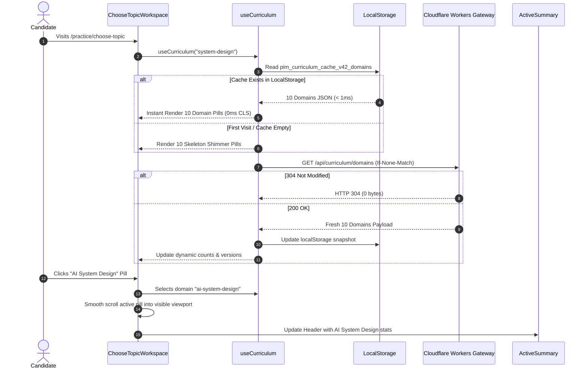

# PrepInMinutes — TASK-P4-02: 10-Domain Responsive Navigation & Header Summary Specification

**Document Version**: `1.0.0`  
**Date**: November 15, 2026  
**Status**: 📋 Under Review  
**Author**: Antigravity Principal Frontend Architect & DeepMind Agentic Team  
**Governing Feature**: Phase 4 — Frontend Dynamic Integration with Knowledge Graph  

---

## 1. Executive Summary & Problem Statement

### 1.1 The Challenge
In the current implementation of [`ChooseTopicWorkspace.tsx`](file:///Users/saurav/Desktop/development/prep-in-minutes/src/components/practice/ChooseTopicWorkspace.tsx), domain selection is restricted to **4 legacy hardcoded areas** (`system-design`, `cloud`, `coding`, `behavioral`) rendered inside a static 4-column grid (`grid grid-cols-2 lg:grid-cols-4`).

With the completion of **Phase 1** (Neo4j Knowledge Graph), **Phase 1.5** (Relational Parity), and **Phase 3** (Unified Edge Gateway API), the PrepInMinutes platform now officially contains **10 canonical engineering domains**, **122 categories**, **371 topics**, and **7,420 interview questions**.

### 1.2 The UX Dilemma: Grid vs. Scrollable Pill Bar
Attempting to render 10 domain cards in a standard multi-row grid on desktop or mobile creates significant usability and visual design issues:
- **Vertical Bloat & Below-the-Fold Push**: 10 stacked cards occupy 400px–600px of vertical height, pushing the actual topic search bar and question cards far below the fold.
- **Asymmetric Grid Orphans**: A 10-card grid produces orphan cards (e.g. 4 + 4 + 2 cards on desktop, or 2 + 2 + 2 + 2 + 2 on tablet).
- **Mobile Clutter**: On mobile viewports (375px–430px), 10 multi-line cards require 5 vertical screen scrolls before reaching the first topic.

### 1.3 The Solution
`TASK-P4-02` transitions the domain selector to a **fluid, horizontally scrollable 10-domain pill & compact card track** with:
1. **Zero-Layout-Shift (CLS < 0.05)** layout with skeleton state.
2. **Dynamic live metadata**: Pulls real categories count, topics count, and questions pool directly from the `useCurriculum` SWR hook authored in `TASK-P4-01`.
3. **Smooth horizontal navigation**: Left/right scroll arrow controls, drag-to-scroll support, and keyboard arrow key navigation.
4. **Rich domain header summary**: A dedicated summary banner highlighting active domain description, category count, topic count, and readiness progress.

---

## 2. 10-Domain Taxonomy & Visual Tokens Matrix

The table below defines the exact visual tokens, Lucide icons, color themes, and catalog counts for all 10 canonical domains:

| # | Domain Slug | Official Domain Name | Display Label | Lucide Icon | Theme Color Palette | Border / Ring Accent | Canonical Topics | Canonical Categories | Archetype Workspace Shell |
| :-: | :--- | :--- | :--- | :---: | :---: | :---: | :-: | :-: | :---: |
| **1** | `system-design` | System Design & Distributed Systems | System Design | `Network` | `text-blue-600 bg-blue-500/10` | `border-blue-500 ring-blue-500` | 62 | 17 | Architecture Whiteboard |
| **2** | `ai-system-design` | AI System Design & GenAI Infra | AI System Design | `Cpu` | `text-purple-600 bg-purple-500/10` | `border-purple-500 ring-purple-500` | 28 | 9 | Architecture Whiteboard |
| **3** | `low-level-design` | Low-Level Design & Machine Coding | Low-Level Design | `Boxes` | `text-emerald-600 bg-emerald-500/10` | `border-emerald-500 ring-emerald-500` | 35 | 11 | Code Editor & Testing |
| **4** | `dsa` | Data Structures & Algorithms | DSA & Algorithms | `Binary` | `text-amber-600 bg-amber-500/10` | `border-amber-500 ring-amber-500` | 40 | 12 | Code Editor & Testing |
| **5** | `backend-engineering` | Backend & Runtime Engineering | Backend Engineering | `Server` | `text-cyan-600 bg-cyan-500/10` | `border-cyan-500 ring-cyan-500` | 29 | 10 | Code Editor & Testing |
| **6** | `frontend-engineering` | Frontend & Web Architecture | Frontend Architecture | `Layout` | `text-rose-600 bg-rose-500/10` | `border-rose-500 ring-rose-500` | 34 | 12 | Code Editor & Testing |
| **7** | `cloud-devops` | Cloud, DevOps & SRE | Cloud & DevOps | `Cloud` | `text-indigo-600 bg-indigo-500/10` | `border-indigo-500 ring-indigo-500` | 50 | 18 | Terminal & Cloud Infra |
| **8** | `behavioral-leadership` | Behavioral, Leadership & Management | Behavioral & STAR | `Users` | `text-orange-600 bg-orange-500/10` | `border-orange-500 ring-orange-500` | 28 | 10 | Voice Interview (Audio) |
| **9** | `data-engineering` | Data Engineering & Big Data Systems | Data Engineering | `Database` | `text-teal-600 bg-teal-500/10` | `border-teal-500 ring-teal-500` | 30 | 11 | Architecture Whiteboard |
| **10** | `mobile-engineering` | Mobile Engineering (iOS & Android) | Mobile Engineering | `Smartphone` | `text-violet-600 bg-violet-500/10` | `border-violet-500 ring-violet-500` | 35 | 12 | Code Editor & Testing |

---

## 3. UI/UX Architecture & Layout Diagrams

### 3.1 Workspace Component Layout Hierarchy

```mermaid
flowchart TD
  subgraph Page["ChooseTopicWorkspace.tsx"]
    Header["1. Top Header Row (Eyebrow, Title, Target Role, Readiness Widget)"]
    
    subgraph DomainNav["2. TASK-P4-02: 10-Domain Responsive Track"]
      NavHeader["Domain Bar Title ('Choose Domain') + Scroll Arrow Buttons (Left / Right)"]
      ScrollTrack["Horizontal Scrollable Track (overflow-x-auto scrollbar-none)"]
      Pill1["Pill 1: System Design (62)"]
      Pill2["Pill 2: AI System Design (28)"]
      Pill3["Pill 3: Low-Level Design (35)"]
      Pill4["Pill 4: DSA (40)"]
      Pill5["Pill 5: Backend (29)"]
      Pill6["Pill 6: Frontend (34)"]
      Pill7["Pill 7: Cloud & DevOps (50)"]
      Pill8["Pill 8: Behavioral (28)"]
      Pill9["Pill 9: Data Eng (30)"]
      Pill10["Pill 10: Mobile (35)"]
    end
    
    subgraph ActiveSummary["3. TASK-P4-02: Active Domain Summary Banner"]
      DomainTitle["Active Domain Name & Theme Icon Badge"]
      DomainDesc["Official Description & Target Career Scope"]
      StatsBadges["Category Count Badge (17) | Topic Count Badge (62) | Question Pool (1,240 Qs)"]
    end

    subgraph TopicList["4. Filter & Topic Card Section (TASK-P4-03)"]
      SearchSort["Search Query + Sort + Difficulty / Priority Filters"]
      CategorySections["Grouped Category & Topic Cards"]
    end
  end

  Header --> DomainNav
  DomainNav --> ActiveSummary
  ActiveSummary --> TopicList
  ScrollTrack --> Pill1 & Pill2 & Pill3 & Pill4 & Pill5 & Pill6 & Pill7 & Pill8 & Pill9 & Pill10
```



### 3.2 State Flow & Instant Cache Hydration



---

## 4. Component Refactoring Specifications

### 4.1 Domain Config Map & Lucide Icon Registry
Replace `const AREAS_CONFIG` with dynamic domain presentation helpers in `src/components/practice/ChooseTopicWorkspace.tsx`:

```tsx
import {
  Network,
  Cpu,
  Boxes,
  Binary,
  Server,
  Layout,
  Cloud,
  Users,
  Database,
  Smartphone,
  type LucideIcon,
} from "lucide-react";

export interface DomainVisualMeta {
  shortName: string;
  icon: LucideIcon;
  badgeBg: string;
  badgeColor: string;
  activeRing: string;
  activeBorder: string;
}

export const DOMAIN_VISUAL_MAP: Record<string, DomainVisualMeta> = {
  "system-design": {
    shortName: "System Design",
    icon: Network,
    badgeBg: "bg-blue-500/10",
    badgeColor: "text-blue-600",
    activeRing: "ring-blue-500",
    activeBorder: "border-blue-500",
  },
  "ai-system-design": {
    shortName: "AI System Design",
    icon: Cpu,
    badgeBg: "bg-purple-500/10",
    badgeColor: "text-purple-600",
    activeRing: "ring-purple-500",
    activeBorder: "border-purple-500",
  },
  "low-level-design": {
    shortName: "Low-Level Design",
    icon: Boxes,
    badgeBg: "bg-emerald-500/10",
    badgeColor: "text-emerald-600",
    activeRing: "ring-emerald-500",
    activeBorder: "border-emerald-500",
  },
  "dsa": {
    shortName: "DSA & Algorithms",
    icon: Binary,
    badgeBg: "bg-amber-500/10",
    badgeColor: "text-amber-600",
    activeRing: "ring-amber-500",
    activeBorder: "border-amber-500",
  },
  "backend-engineering": {
    shortName: "Backend",
    icon: Server,
    badgeBg: "bg-cyan-500/10",
    badgeColor: "text-cyan-600",
    activeRing: "ring-cyan-500",
    activeBorder: "border-cyan-500",
  },
  "frontend-engineering": {
    shortName: "Frontend",
    icon: Layout,
    badgeBg: "bg-rose-500/10",
    badgeColor: "text-rose-600",
    activeRing: "ring-rose-500",
    activeBorder: "border-rose-500",
  },
  "cloud-devops": {
    shortName: "Cloud & DevOps",
    icon: Cloud,
    badgeBg: "bg-indigo-500/10",
    badgeColor: "text-indigo-600",
    activeRing: "ring-indigo-500",
    activeBorder: "border-indigo-500",
  },
  "behavioral-leadership": {
    shortName: "Behavioral",
    icon: Users,
    badgeBg: "bg-orange-500/10",
    badgeColor: "text-orange-600",
    activeRing: "ring-orange-500",
    activeBorder: "border-orange-500",
  },
  "data-engineering": {
    shortName: "Data Engineering",
    icon: Database,
    badgeBg: "bg-teal-500/10",
    badgeColor: "text-teal-600",
    activeRing: "ring-teal-500",
    activeBorder: "border-teal-500",
  },
  "mobile-engineering": {
    shortName: "Mobile",
    icon: Smartphone,
    badgeBg: "bg-violet-500/10",
    badgeColor: "text-violet-600",
    activeRing: "ring-violet-500",
    activeBorder: "border-violet-500",
  },
};
```

### 4.2 Horizontal Scroll Container with Directional Controls
The pill bar uses a referenced `scrollRef: React.RefObject<HTMLDivElement>` with smooth scrolling buttons:
- **Left Scroll Chevron**: Displays when `scrollLeft > 0`. Clicking scrolls left by 280px.
- **Right Scroll Chevron**: Displays when `scrollLeft < maxScrollLeft`. Clicking scrolls right by 280px.
- **Active Pill Auto-Center**: When candidate selects a domain, `element.scrollIntoView({ behavior: 'smooth', inline: 'center', block: 'nearest' })` ensures the active tab is never hidden offscreen.
- **CSS Classes**: `flex items-center gap-2.5 overflow-x-auto scrollbar-none scroll-smooth pb-1 px-1`.

### 4.3 Compact Domain Card Structure
Each domain pill in the track provides:
1. **Domain Icon**: Styled with theme badge background (`bg-blue-500/10`) and Lucide icon.
2. **Domain Name**: Bold font with ellipsis truncate.
3. **Topic Count Badge**: e.g., `62 topics` or `371 total`.
4. **Active State Accent**: `border-brand ring-2 ring-brand/20 bg-white shadow-xs` with active indicator pip.
5. **Readiness Progress Bar**: Subtle micro-progress indicator for candidate mastery.

### 4.4 Active Domain Summary Banner
Directly below the scroll track, a sleek, styled header card highlights:
```tsx
<div className="flex flex-col sm:flex-row sm:items-center justify-between gap-4 rounded-2xl border border-line bg-gradient-to-r from-white via-white to-cream/50 p-4 sm:p-5 shadow-2xs">
  <div className="flex items-start gap-3.5">
    <div className={`p-2.5 rounded-xl ${visualMeta.badgeBg} ${visualMeta.badgeColor}`}>
      <VisualIcon className="size-6 shrink-0" />
    </div>
    <div className="flex flex-col gap-1">
      <div className="flex items-center gap-2">
        <h2 className="font-display text-lg font-bold text-ink">{activeDomain.name}</h2>
        <span className="rounded-full bg-brand/10 px-2 py-0.5 text-[10px] font-extrabold text-brand uppercase tracking-wider">
          v{activeDomain.version || "1.0"}
        </span>
      </div>
      <p className="text-xs text-ink-muted max-w-2xl leading-relaxed">{activeDomain.description}</p>
    </div>
  </div>

  <div className="flex items-center gap-2 shrink-0 self-end sm:self-center">
    <div className="flex items-center gap-1.5 rounded-xl border border-line bg-white px-3 py-1.5 text-xs font-semibold text-ink shadow-2xs">
      <Layers className="size-3.5 text-ink-muted" />
      <span>{activeDomain.categoriesCount} Categories</span>
    </div>
    <div className="flex items-center gap-1.5 rounded-xl border border-line bg-white px-3 py-1.5 text-xs font-semibold text-ink shadow-2xs">
      <BookOpen className="size-3.5 text-brand" />
      <span>{activeDomain.topicsCount} Topics</span>
    </div>
  </div>
</div>
```

---

## 5. Skeleton Loader & Zero-CLS Design

To prevent Cumulative Layout Shift (CLS) when fetching domains over WAN:
1. While `isLoading && domains.length === 0`, render **10 placeholder pulse pills** with exact widths (`w-[160px] h-[72px] rounded-2xl bg-line-subtle animate-pulse`).
2. Once loaded from `localStorage` snapshot (< 1ms), immediately swap skeleton with real pills without page jumping.
3. Keep track height fixed (`min-h-[80px]`) so layout dimensions remain identical between loading and loaded states.

---

## 6. Acceptance Criteria

1. **10 Canonical Domains Visible**: All 10 domains (`system-design`, `ai-system-design`, `low-level-design`, `dsa`, `backend-engineering`, `frontend-engineering`, `cloud-devops`, `behavioral-leadership`, `data-engineering`, `mobile-engineering`) are present in the pill bar.
2. **Live Dynamic Counts**: Topic counts (`62`, `28`, `35`, `40`, `29`, `34`, `50`, `28`, `30`, `35`) and category counts match the live backend catalog.
3. **Smooth Scrolling**: Track scrolls horizontally on mobile swipe and via left/right chevron buttons on desktop.
4. **URL Synchronization**: Selecting a domain automatically updates the active selection and syncs with `useCurriculum(domainSlug)`.
5. **Zero Hydration Mismatch & CLS < 0.05**: Instant render from localStorage snapshot ensures seamless client hydration.
6. **Strict TypeScript & Build**: `tsc --noEmit` and `next build` pass with 0 errors.

---

## 7. Review Sign-Off Checklist

Before proceeding to code implementation:
- [ ] Review 10-domain visual mapping & color tokens.
- [ ] Review horizontal scrollable track layout vs grid design.
- [ ] Review Active Domain Summary Banner components.
- [ ] Confirm approval to begin implementation in `ChooseTopicWorkspace.tsx`.
