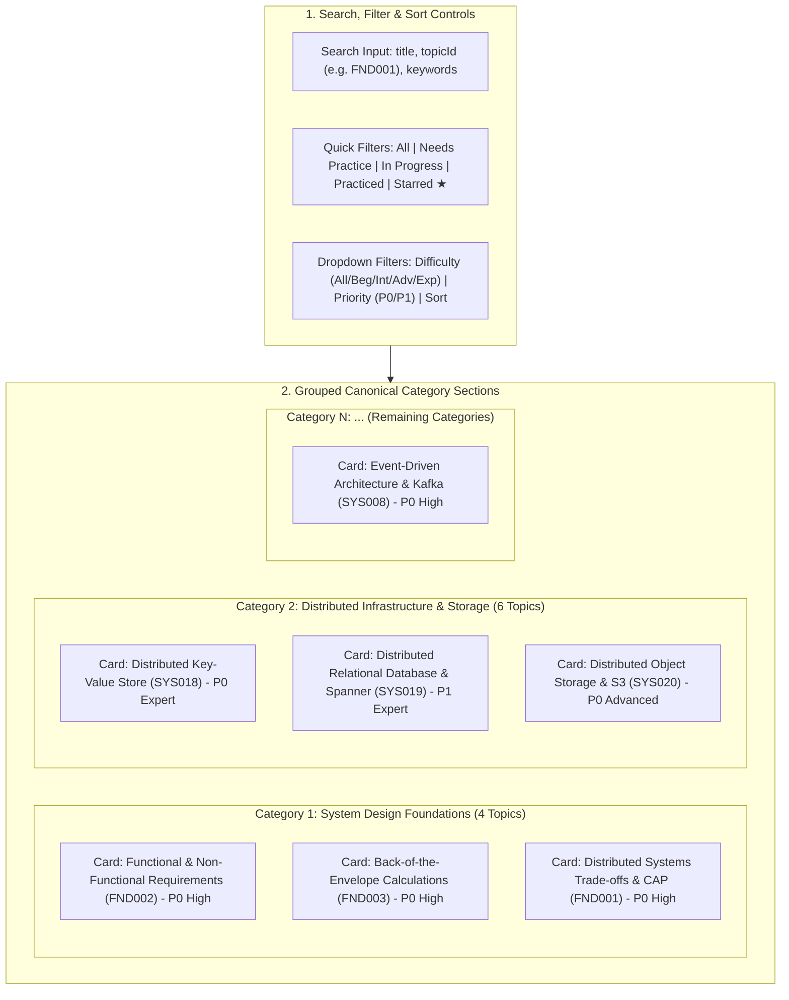

# PrepInMinutes — TASK-P4-03: Category Grouping, Dynamic Topic Cards & Real-Time Search Engine Specification

**Document Version**: `1.0.0`  
**Date**: November 15, 2026  
**Status**: 📋 Under Implementation  
**Author**: Principal Frontend Architect & DeepMind Agentic Team  
**Governing Feature**: Phase 4 — Frontend Dynamic Integration with Knowledge Graph  

---

## 1. Executive Summary & Problem Statement

### 1.1 The Challenge
In `TASK-P4-02`, we successfully connected the top-level navigation to all **10 canonical domains** via a horizontally scrollable pill track and domain summary banner.

However, once a candidate selects a domain (such as *System Design & Distributed Systems* with 62 topics, or *Cloud, DevOps & SRE* with 50 topics), rendering topics as a **flat unstructured list** presents severe cognitive overload:
1. **Loss of Pedagogical Context**: In System Design, topics like *Requirements Engineering* (Foundations), *Distributed Key-Value Store* (Storage Systems), *Kafka vs RabbitMQ* (Event Streaming), and *OAuth2 / Zero Trust* (Security) require category hierarchy to make sense.
2. **Infinite Flat Scrolling**: A single flat table of 62+ cards requires excessive scrolling without visual milestones or structure.
3. **Missing Knowledge Graph Metadata**: Flat cards hide rich graph intelligence (canonical `topicId`, `priority` P0/P1, `difficulty`, `trend` SURGING/HOT, rubric atom count, and verified question counts).

### 1.2 The Solution
`TASK-P4-03` implements the final presentation layer of Phase 4:
1. **Canonical Category Grouping**: Groups topics under their official category sections (e.g. *Foundations*, *Distributed Storage*, *Event Streaming*, *Microservices & Networking*, *Observability & Reliability*).
2. **Rich Knowledge Graph Topic Cards**: Displays canonical Topic ID (`FND001`, `SYS018`), Priority badge (`P0 Core` / `P1 Advanced`), Difficulty badge (`Beginner` to `Expert`), Duration, Trend indicator, Rubric count, verified Question count, and interactive Star toggle.
3. **Multi-Dimensional Search & Filtering Engine**: Instant debounced search across titles and rubric atoms, combined with Difficulty, Priority, and Status filters.
4. **Dynamic Practice CTA**: Directly routes to the interactive whiteboard, coding shell, terminal, or voice interview via `getPracticeSessionUrl(domain, topic.slug)`.

---

## 2. Visual Architecture & Category Layout



---

## 3. Dynamic Topic Card Design Tokens

Each topic card renders rich graph attributes:

```
┌────────────────────────────────────────────────────────────────────────┐
│ ★  [P0 Core] [Expert] [HOT 🔥]                     FND001 • 15 min    │
│                                                                        │
│ Design a Distributed Key-Value Store (Dynamo/Cassandra)                │
│ Scaling partitioned hash rings, vector clocks, and quorum consensus.   │
│                                                                        │
│ 🎯 8 Rubric Atoms   •   📚 20 Questions   •   Readiness: 45% (Needs Practice)
│ ────────────────────────────────────────────────────────────────────── │
│ [=======░░░░░░░░░░░░░░░░░░] 45%         [ Practice Now  ➜ ]            │
└────────────────────────────────────────────────────────────────────────┘
```

### Visual Token Details:
- **Priority Badge**:
  - `P0`: `bg-red-500/10 text-red-600 border-red-500/20 font-bold` (Core interview essential)
  - `P1`: `bg-amber-500/10 text-amber-600 border-amber-500/20` (Advanced interview topic)
- **Difficulty Badge**:
  - `BEGINNER`: `bg-emerald-500/10 text-emerald-600`
  - `INTERMEDIATE`: `bg-blue-500/10 text-blue-600`
  - `ADVANCED`: `bg-purple-500/10 text-purple-600`
  - `EXPERT`: `bg-rose-500/10 text-rose-600 font-extrabold`
- **Trend Indicator**:
  - `SURGING`: `Flame` icon with `text-orange-500`
  - `HOT`: `TrendingUp` icon with `text-red-500`
  - `STABLE`: `Check` icon with `text-emerald-500`
  - `COOLING`: `Clock` icon with `text-ink-muted`
- **Interactive Starring**:
  - Hollow star `Star` -> Yellow filled star `Star` (stored in `localStorage` via `toggleStar(slug)`).
- **Practice CTA**:
  - Routes directly to `/practice/session/:archetype?topic=${slug}&domain=${domain}` with 0ms transition.

---

## 4. Multi-Dimensional Search & Filtering Engine

The filtering engine evaluates 5 criteria with real-time responsiveness ($< 16\text{ms}$):

1. **Search Query (`searchQuery`)**:
   - Case-insensitive substring match on:
     - Topic `title` (e.g. "Distributed Key-Value Store")
     - Canonical `topicId` (e.g. "SYS018", "FND001")
     - Topic `description`
2. **Status Filter (`selectedStatus`)**:
   - `all` | `Needs Practice` | `Not Practiced` | `In Progress` | `Practiced` | `starred`.
3. **Difficulty Filter (`selectedDifficulty`)**:
   - `all` | `BEGINNER` | `INTERMEDIATE` | `ADVANCED` | `EXPERT`.
4. **Priority Filter (`selectedPriority`)**:
   - `all` | `P0` | `P1`.
5. **Sort Engine (`sortFilter`)**:
   - `recommended`: P0 topics first, then highest frequency, then lowest readiness.
   - `high-priority`: P0 topics strictly first.
   - `readiness-asc`: Lowest readiness first (targeting candidate gaps).
   - `readiness-desc`: Highest readiness first (mastered topics).
   - `questions-desc`: Most questions first.

---

## 5. Acceptance Criteria

1. **Category Grouping**: When categories exist, topics are visually grouped under category headers with category topic count badges.
2. **Rich Card Attributes**: Every card displays canonical Topic ID, priority, difficulty, trend, rubric atom count, and question count.
3. **Real-Time Filtering**: Search input, difficulty filter, priority filter, and status filter update the list immediately.
4. **Starring Persistence**: Clicking the star icon toggles and persists the topic across page refreshes via `localStorage`.
5. **Zero 404s on Practice CTA**: Clicking "Practice Now" navigates to the valid practice shell with `topic` and `domain` parameters.
6. **Strict Compilation**: `tsc --noEmit` and `next build` pass with 0 errors.
