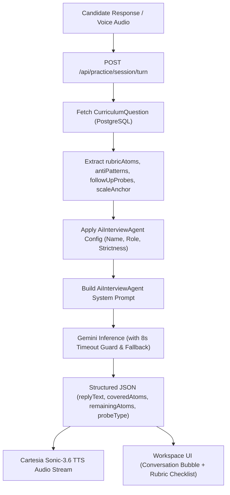

# Architecture Specification: TASK-P5-02 — Inject Rubric Atoms & Scale Anchors into AiInterviewAgent

> **Version**: 2.0.0  
> **Status**: APPROVED & ACTIVE  
> **Target Release**: Phase 5 (Interactive Practice & Live Question Injection)  
> **Dependencies**: `TASK-P5-01` (Dynamic Question Loader & Question Switcher)  
> **Target Files**:
> - `prepinminutes-backend/src/server/ai/ai-interview-agent.ts` (Core AI Interview Agent Engine)
> - `prepinminutes-backend/src/routes/practice-interviewer.ts` (Live Conversation Turn Route)
> - `prepinminutes-backend/src/index.ts` (Route Mounting)
> - `prepinminutes-backend/scripts/test-ai-interview-agent.ts` (Automated Test Suite)
> - `prep-in-minutes/src/lib/api-client.ts` (Frontend Client Method)
> - `prep-in-minutes/src/components/practice/SystemDesignWorkspace.tsx` (Live Turn Integration)

---

## 1. Executive Summary & Problem Rationale

In `TASK-P5-01`, we wired all 4 practice workspace shells to dynamically receive topics and questions (`?topic=slug&q=id`) from the 7,420-question Knowledge Graph. However, during the interactive practice session, the AI persona relied on static scripted replies or untethered conversational generation.

Standard AI interview bots often fail candidate preparation in two major ways:
1. **Generic Polite Banter**: Saying *"That sounds great! What else would you consider?"* without assessing whether the candidate actually covered the required architectural mechanisms.
2. **Hallucinated Standards**: Giving random feedback disconnected from the calibrated rubrics used by FAANG/Tier-1 hiring committees.
3. **Hardcoded Persona Coupling**: Binding the code and system instructions to a single rigid persona name (e.g., "Sarah") instead of a generic, scalable **`AiInterviewAgent`** that supports configurable names, roles, and strictness levels.

`TASK-P5-02` establishes the **`AiInterviewAgent`** as an **actively calibrated Staff Interview Agent**:
- We retrieve the question's verified **`rubricAtoms`** (e.g., *Cache Stampede Mutex*, *LRU Eviction*, *TTL Jitter*, *Read-Through vs Cache-Aside*).
- We inject **`antiPatterns`** (e.g., *Treating cache as persistent database*, *Ignoring cache warm-up on cluster reboot*).
- We bind **`followUpProbes`** and **`scaleAnchor`** (L1 Junior through L4 Staff criteria) directly into Gemini's system instructions.
- With each candidate turn, `AiInterviewAgent`:
  1. Checks off satisfied rubric atoms.
  2. Probes unaddressed rubric atoms using question-specific technical probes.
  3. Constructively challenges detected anti-patterns.
  4. Returns real-time atom coverage metadata so the UI progress bars and rubric checklists reflect live candidate performance.
  5. Dynamically assumes any requested interviewer persona (`agentName`, `roleTitle`, `companyContext`).

---

## 2. AiInterviewAgent System Architecture



---

## 3. Data Schema & Prompt Engineering Invariants

### 3.1 Turn Request & Response Schema

#### Request: `POST /api/practice/session/turn`
```typescript
export interface PracticeSessionTurnRequest {
  topicSlug: string;
  questionId: string;
  candidateMessage: string;
  transcriptHistory: Array<{
    sender: "ai" | "user";
    content: string;
  }>;
  candidateTargetLevel?: "L1" | "L2" | "L3" | "L4";
  agentConfig?: {
    agentName?: string;       // default: "AI Interviewer"
    roleTitle?: string;       // default: "Senior Staff Technical Interviewer"
    companyContext?: string;  // e.g. "Tier-1 / FAANG"
    strictness?: "lenient" | "standard" | "bar-raiser";
  };
}
```

#### Response:
```typescript
export interface PracticeSessionTurnResponse {
  success: boolean;
  replyText: string;
  coveredRubricAtoms: string[];
  remainingRubricAtoms: string[];
  detectedAntiPatterns: string[];
  currentMasteryScore: number; // 0 to 100
  interviewPhase: "scoping" | "high-level-design" | "deep-dive" | "failure-modes" | "wrap-up";
  nextSuggestedProbe?: string;
  agentInfo?: {
    name: string;
    role: string;
  };
}
```

### 3.2 Calibrated System Prompt Template

```markdown
You are {agentName}, a {roleTitle} at a tier-1 technology company.
You are conducting a live, realistic technical interview.

QUESTION UNDER EVALUATION:
Title: {question.title}
Prompt: {question.prompt}
Target Scale Anchor ({candidateTargetLevel}): {question.scaleAnchor}

OFFICIAL EVALUATION RUBRIC ATOMS:
{question.rubricAtoms.map("- [ ] " + atom).join("\n")}

DANGEROUS ANTI-PATTERNS TO CHALLENGE:
{question.antiPatterns.map("- " + ap).join("\n")}

CALIBRATED FOLLOW-UP PROBES:
{question.followUpProbes.map("- " + probe).join("\n")}

CANDIDATE TRANSCRIPT SO FAR:
{transcriptHistory}

CANDIDATE'S LATEST MESSAGE:
"{candidateMessage}"

INSTRUCTIONS FOR {agentName}:
1. Concisely acknowledge what the candidate did well (1 sentence max).
2. Determine which official Rubric Atoms the candidate just proved understanding of.
3. Identify which Rubric Atoms are STILL MISSING.
4. If the candidate fell into an Anti-Pattern, challenge them directly with a realistic failure scenario.
5. If no anti-pattern, pick the most critical MISSING Rubric Atom and challenge the candidate using one of the Calibrated Follow-Up Probes.
6. Tone: Professional, encouraging, highly rigorous, authentic to FAANG Staff interviews. Never offer full solutions; prompt the candidate to solve it.

Return output strictly as JSON.
```

---

## 4. Verification & Testing Criteria

1. **Automated Verification Script**: `prepinminutes-backend/scripts/test-ai-interview-agent.ts`
   - Verifies system prompt generation with real question nodes from PostgreSQL.
   - Verifies dynamic agent configuration (`agentName`, `roleTitle`).
   - Tests rubric atom detection and deduction.
   - Tests anti-pattern challenge response triggering.
   - Tests JSON output structure and fallback resilience.
2. **TypeScript Compilation**: `npx tsc --noEmit` across both `prep-in-minutes` and `prepinminutes-backend` with 0 errors.
3. **Next.js Production Build**: `npx next build` with 63/63 pages compiled.
4. **Git Lockstep Synchronization**: Commit and push to `feature/domain-info` in both repositories.
