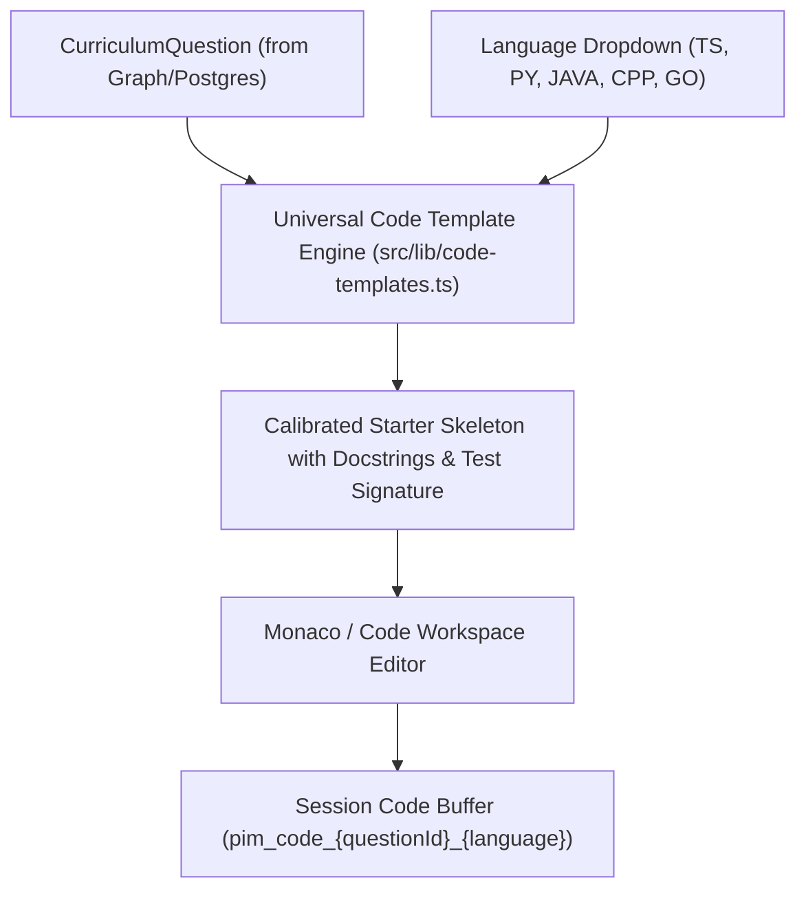
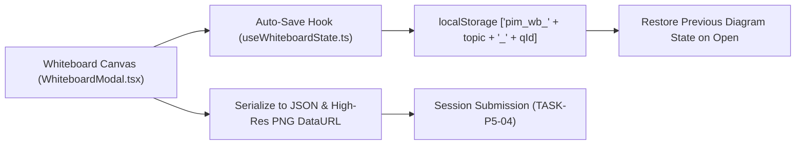

# Architecture Specification: TASK-P5-03 — Multi-Domain Code Editor & Whiteboard Workspace Synchronization

> **Version**: 1.0.0  
> **Status**: APPROVED FOR EXECUTION  
> **Target Release**: Phase 5 (Interactive Practice & Live Question Injection)  
> **Dependencies**: `TASK-P5-01` (Dynamic Question Loader), `TASK-P5-02` (Sarah AI Rubric Injection)  
> **Target Files**:
> - `prep-in-minutes/src/lib/code-templates.ts` (Universal Multi-Language Starter Code Generator)
> - `prep-in-minutes/src/hooks/useWhiteboardState.ts` (Session-Aware Whiteboard Persistence & Export Hook)
> - `prep-in-minutes/src/components/practice/PracticeCodingWorkspace.tsx` (Multi-Language Selector & Dynamic Template Switcher)
> - `prep-in-minutes/src/components/practice/WhiteboardModal.tsx` (Session Sync, Auto-Save & Diagram Serializer)
> - `prep-in-minutes/scripts/test-code-editor-whiteboard-sync.ts` (Automated Test Suite)

---

## 1. Executive Summary & Problem Rationale

### 1.1 The Problem
In modern technical hiring across FAANG and Tier-1 engineering organizations:
1. **Multi-Language DSA**: Candidates solve algorithmic challenges in their primary interview language (Python, TypeScript/JavaScript, Java, C++, Go). Forcing JavaScript or Python only alienates candidates preparing in Java or C++.
2. **Domain-Specific Starter Archetypes**:
   - In **DSA**, candidates need a clean function signature matching the problem inputs/outputs (e.g. `def maxSubArray(nums: List[int]) -> int:`).
   - In **Low-Level Design (LLD) / Machine Coding**, candidates need Object-Oriented design scaffolding (classes, interfaces, design pattern skeletons).
   - In **Frontend Architecture**, candidates need component skeletons with state/props interfaces.
3. **Whiteboard Volatility**: In system design and coding interviews, candidates draw architecture diagrams, state machines, and sequence sketches. Currently, if a candidate closes the modal, changes questions, or refreshes the page, their canvas nodes, sticky notes, and freehand strokes are lost.

### 1.2 The Solution
`TASK-P5-03` introduces:
- **Universal Multi-Language Code Engine**:
  - Languages: **TypeScript**, **Python**, **Java**, **C++**, **Go**.
  - Dynamic starter template generator derived from the active question's title, parameters, and difficulty.
  - Per-language code buffer caching in `sessionStorage` / `localStorage` (so switching from Python to Java and back retains the candidate's code in each language).
- **Session-Aware Whiteboard Persistence Engine**:
  - Unique storage key: `pim_whiteboard_${topicSlug}_${questionId}`.
  - Auto-saves nodes (architecture blocks, note boxes), sticky notes, and canvas drawing strokes on debounce (400ms).
  - Snapshot export capability (PNG / JSON) to be attached directly to the session submission payload in `TASK-P5-04`.

---

## 2. Multi-Language Starter Code Architecture



### 2.1 Supported Languages & Skeletons

| Language | Identifier | Target Domains | Template Pattern |
|---|---|---|---|
| **Python** | `python` | DSA, Data Engineering, AI Systems | Clean typed function or class with docstring |
| **TypeScript** | `typescript` | DSA, Frontend Architecture, Fullstack | Typed function signature with input/output interfaces |
| **Java** | `java` | DSA, Low-Level Design, Enterprise Backend | `public class Solution` with typed method |
| **C++** | `cpp` | DSA, High-Performance Systems | `#include <vector>`, `class Solution` with STL types |
| **Go** | `go` | DSA, Distributed Systems, Cloud Backend | `package main`, typed function signature |

---

## 3. Whiteboard Synchronization & Persistence Architecture



### 3.1 Serialized Whiteboard Schema
```typescript
export interface SerializedWhiteboardState {
  version: "1.0.0";
  topicSlug: string;
  questionId: string;
  updatedAt: string;
  nodes: BoardNode[];
  stickies: StickyItem[];
  strokes: Array<{
    tool: string;
    points: Array<{ x: number; y: number }>;
    color: string;
    width: number;
  }>;
  viewport: {
    zoom: number;
    panX: number;
    panY: number;
  };
}
```

---

## 4. Verification & Acceptance Criteria

1. **Multi-Language Selector**:
   - Candidate can seamlessly switch between TypeScript, Python, Java, C++, and Go.
   - Code written in one language is preserved in memory/storage when switching between languages.
2. **Template Synthesis**:
   - For every question loaded from the 7,420-question repository, a syntactically valid starter template is generated for each supported language.
3. **Whiteboard Auto-Save & Recovery**:
   - Closing and reopening `WhiteboardModal` preserves all added architecture nodes, sticky notes, and strokes.
   - Whiteboard provides an "Export Snapshot" / "Save to Session" action returning serialized JSON.
4. **TypeScript & Production Build**:
   - `npx tsc --noEmit` exits with 0 errors across both repos.
   - `npx next build` generates all static pages with 0 warnings or errors.
