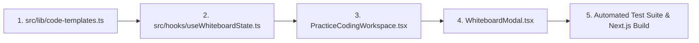

# PrepInMinutes — TASK-P5-03 Rationale & Architectural Explainer

**Document Version**: `1.0.0`  
**Date**: November 15, 2026  
**Status**: 📋 Strategic Architectural Rationale & Implementation Guide  
**Task**: `TASK-P5-03: Multi-Domain Code Editor & Whiteboard Workspace Synchronization`  
**Phase**: Phase 5 (Interactive Practice & Live Question Injection)  
**Target Repositories**: `prep-in-minutes` (Frontend) & `prepinminutes-backend` (Edge API & Schemas)  
**Author**: Principal System Architect & DeepMind Agentic Team  

---

## 1. Executive Summary: Why Does TASK-P5-03 Exist?

In `TASK-P5-01` and `TASK-P5-02`, we successfully unlocked the 7,420-question Knowledge Graph and introduced the **`AiInterviewAgent`** to evaluate technical turns against official rubric atoms. 

However, when a candidate enters a practice workspace to actually code or draw system architecture, two critical product flaws emerge:

1. **The Code Editor Monoculture & Static Stub Dilemma**:
   - The coding workspace only supports basic JavaScript and Python stubs.
   - Candidates preparing in **Java**, **C++**, or **Go** (the predominant languages for FAANG algorithms, low-level systems, and cloud infrastructure) are left without language support or syntactically valid starter templates.
   - Algorithmic questions (DSA) require input/output function signatures; Low-Level Design (LLD) questions require Object-Oriented class/interface scaffolding; Frontend questions require component signatures. A static `function solution() { ... }` stub fails across these distinct domains.

2. **The Whiteboard Volatility & Work Loss Vulnerability**:
   - Candidates in architecture and coding interviews construct complex state machines, data flow diagrams, and architectural block diagrams using the Whiteboard.
   - Currently, if a candidate closes the modal, switches between question tabs, or accidentally refreshes the browser, **their entire whiteboard canvas is erased**.
   - Furthermore, the whiteboard canvas is disconnected from the session submission pipeline—meaning the `AiInterviewAgent` cannot inspect the candidate's visual architecture when grading the session.

**`TASK-P5-03` exists to solve both problems simultaneously**:
- Equipping candidates with a **universal multi-language code editor** (TypeScript, Python, Java, C++, Go) with per-question dynamic starter templates and language buffer preservation.
- Equipping the platform with a **session-aware, persistent whiteboard engine** that automatically saves canvas states and exports high-fidelity snapshots for session grading.

---

## 2. Core Problem Analysis: Current State vs. Target State

| Dimension | Current Prototype State | Target State (After TASK-P5-03) |
| :--- | :--- | :--- |
| **Supported Languages** | JavaScript & Python only (`INITIAL_CODE_JS`, `INITIAL_CODE_PY`). | **TypeScript**, **Python**, **Java**, **C++**, and **Go**. |
| **Starter Code Skeletons** | Hardcoded generic stubs (`function solution() {}`). | **Dynamic Calibrated Skeletons** synthesized from the active question's domain, parameters, and difficulty. |
| **Language Switching** | Destructive: Switching languages overwrites user code. | **Isolated Language Buffers**: Code written in Java or Python is preserved when toggling between languages via `sessionStorage`. |
| **Domain Scaffolding** | Same stub for all domains. | Specialized archetypes: DSA function signatures, LLD OOP class/interface skeletons, and Frontend component skeletons. |
| **Whiteboard State Persistence** | Ephemeral in React state: Closing modal or refreshing destroys the diagram. | **Debounced Auto-Save** (`localStorage['pim_wb_${topic}_${qId}']`): Diagrams persist across modal toggles and page reloads. |
| **Whiteboard Exportability** | Manual download only. | **Serialized JSON & High-Res PNG DataURL** bound to session state for submission to the `AiInterviewAgent`. |

---

## 3. Architectural Design

```mermaid
flowchart TD
  subgraph CodeEngine["Multi-Domain Code Engine"]
    QNode["Active CurriculumQuestion (from Knowledge Graph)"] --> TemplateGenerator["Universal Code Template Engine (src/lib/code-templates.ts)"]
    LangChoice["Language Selector (TS, PY, JAVA, CPP, GO)"] --> TemplateGenerator
    TemplateGenerator --> StarterCode["Calibrated Starter Skeleton with Types & Docstring"]
    StarterCode --> Editor["Workspace Monaco / Code Editor"]
    Editor <--> CodeCache["Per-Language Buffer (localStorage/sessionStorage)"]
  end

  subgraph WhiteboardEngine["Persistent Whiteboard Engine"]
    Canvas["WhiteboardModal Canvas (Nodes, Stickies, Strokes)"] --> DebounceHook["useWhiteboardState (400ms Debounce)"]
    DebounceHook --> WBStorage["localStorage ['pim_wb_' + topic + '_' + qId]"]
    WBStorage --> CanvasRestore["Instant State Recovery on Open / Refresh"]
    Canvas --> SnapshotSerializer["Whiteboard Serializer (JSON + PNG DataURL)"]
    SnapshotSerializer --> SessionSubmission["Session Submission Payload (TASK-P5-04)"]
  end
```



---

## 4. Deep Dive: Code Template Architecture

### 4.1 Supported Languages & Syntactical Idioms

1. **Python (`python`)**:
   - Uses PEP 484 type hints (`List[int]`, `Dict[str, Any]`, `Optional[int]`).
   - Clean docstring including problem constraints and time/space complexity expectations.
2. **TypeScript (`typescript`)**:
   - Fully typed arguments and return types.
   - Clean interface scaffolding for multi-parameter inputs.
3. **Java (`java`)**:
   - Idiomatic `public class Solution { public ... }`.
   - Imports standard `java.util.*` collections.
4. **C++ (`cpp`)**:
   - Modern C++20 formatting (`#include <iostream>`, `#include <vector>`, `class Solution`).
   - Uses standard STL containers (`std::vector`, `std::unordered_map`).
5. **Go (`go`)**:
   - Idiomatic Go function naming with explicit error handling / return structs.

### 4.2 Domain-Specific Scaffolding Modes

- **Algorithm & DSA Mode**:
  Generates targeted entry-point function signatures derived from question title and parameters:
  ```python
  class Solution:
      def solve(self, nums: List[int], k: int) -> int:
          """
          Time Complexity: O(?)
          Space Complexity: O(?)
          """
          # Write your algorithmic solution here
          pass
  ```
- **Low-Level Design (LLD) Mode**:
  Generates Object-Oriented interface and class blueprints (e.g. Design Parking Lot, LRU Cache, Rate Limiter):
  ```java
  public interface RateLimiter {
      boolean allowRequest(String clientId);
  }

  public class TokenBucketRateLimiter implements RateLimiter {
      // Complete class implementation
  }
  ```
- **Frontend Architecture Mode**:
  Generates React / TypeScript functional component skeleton with props and state hooks:
  ```typescript
  interface ComponentProps {
    // Component props
  }

  export const DynamicComponent: React.FC<ComponentProps> = (props) => {
    // Component logic
  };
  ```

---

## 5. Deep Dive: Whiteboard Synchronization & Persistence

### 5.1 Storage Hierarchy & Partitioning
To prevent diagrams from colliding across different questions or topics, storage keys are strictly partitioned:
```typescript
const storageKey = `pim_whiteboard_${topicSlug}_${questionId}`;
```

### 5.2 Serialized Schema Invariants
The serialized state contains all information required to reconstruct the diagram perfectly:
```typescript
export interface SerializedWhiteboardState {
  version: "1.0.0";
  topicSlug: string;
  questionId: string;
  updatedAt: string;
  nodes: BoardNode[];           // Architecture boxes, microservices, databases
  stickies: StickyItem[];       // Annotated requirement cards, trade-off notes
  strokes: Array<{             // Freehand pen and highlighter paths
    tool: string;
    points: Array<{ x: number; y: number }>;
    color: string;
    width: number;
  }>;
  viewport: {
    zoom: number;
    panX: number;
    panY: number;
  };
}
```

### 5.3 Snapshot Serializer for Session Submission
When the candidate finishes their practice session:
1. `serializeWhiteboardState()` dumps the clean JSON payload.
2. `exportWhiteboardCanvasAsDataUrl()` renders the canvas off-screen to a high-resolution PNG DataURL.
3. Both the JSON and PNG are attached to the submission request in `TASK-P5-04` so the `AiInterviewAgent` can inspect the visual design alongside the audio/text transcript.

---

## 6. Detailed Step-by-Step Implementation Sequence



1. **Step 1: Auth Universal Code Template Engine** (`prep-in-minutes/src/lib/code-templates.ts`)
   - Pure, zero-dependency helper exporting `getStarterCodeForQuestion(language, question, domain)`.
   - Supports 5 languages: `typescript`, `python`, `java`, `cpp`, `go`.
   - Generates contextual starter code using question title, hints, and rubric expectations.
2. **Step 2: Auth Whiteboard Persistence Hook** (`prep-in-minutes/src/hooks/useWhiteboardState.ts`)
   - Manages auto-load, debounced auto-save (400ms), and storage invalidation.
   - Provides clear canvas action and export helpers.
3. **Step 3: Upgrade Coding Workspace** (`prep-in-minutes/src/components/practice/PracticeCodingWorkspace.tsx`)
   - Replace hardcoded `INITIAL_CODE_JS` with dynamic language dropdown selector.
   - Maintain per-language code cache so switching languages never loses user progress.
   - Add "Reset Starter Code" action with user confirmation.
4. **Step 4: Upgrade Whiteboard Modal** (`prep-in-minutes/src/components/practice/WhiteboardModal.tsx`)
   - Connect to `useWhiteboardState(topicSlug, questionId)`.
   - Add status pill: "Changes saved locally" (green check) vs "Saving..." indicator.
   - Add "Save Snapshot to Session" button.
5. **Step 5: Verification & Automated Test Suite** (`scripts/test-code-editor-whiteboard-sync.ts`)
   - Test template synthesis for all 5 languages across all 10 domain types.
   - Test whiteboard serialization, deserialization, and schema integrity.
   - Run full TypeScript compilation and Next.js production build (`63/63` pages).

---

## 7. Acceptance Criteria & Quality Gates

1. **Code Editor Multi-Language Verification**:
   - Candidates can select **TypeScript**, **Python**, **Java**, **C++**, and **Go**.
   - When switching languages, each language preserves its independent editor buffer in memory/session.
   - Starter code is dynamically customized for the active question.
2. **Whiteboard Auto-Save Verification**:
   - Adding nodes, drawing lines, or editing stickies automatically saves to `localStorage` within 400ms.
   - Closing the whiteboard modal and reopening it restores 100% of the canvas state with zero data loss.
   - Whiteboard provides an export helper returning valid JSON and PNG data.
3. **Build & Typecheck Integrity**:
   - `npx tsc --noEmit` exits with `0 errors`.
   - `npx next build` generates all static and dynamic pages with `0 errors`.
   - Both repositories committed and pushed to `feature/domain-info`.
