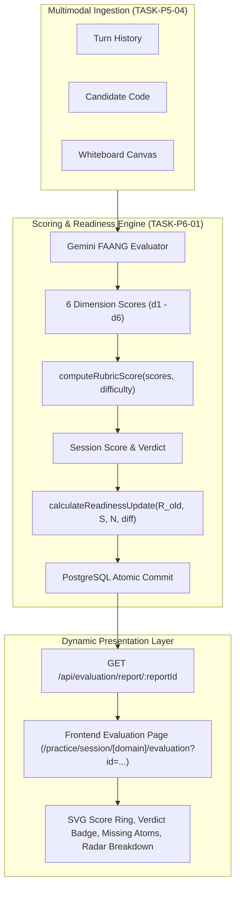

# Architecture & Mathematical Specification: TASK-P6-01 — Mathematical Scoring & 6-Dimension Rubric Evaluation

> **Version**: 1.0.0  
> **Status**: APPROVED FOR EXECUTION  
> **Phase**: Phase 6 (Deterministic Evaluation, Scoring & Decay Engine)  
> **Task**: `TASK-P6-01: Mathematical Scoring & 6-Dimension Rubric Evaluation`  
> **Dependencies**: `TASK-P5-04` (Session Submission Pipeline)  
> **Target Repositories**:
> 1. `prepinminutes-backend` (`src/server/domain/scoring.ts`, `src/server/domain/readiness.ts`, `src/routes/evaluation-report.ts`)
> 2. `prep-in-minutes` (`src/app/practice/session/[domain]/evaluation/page.tsx`, `src/lib/api-client.ts`)

---

## 1. Executive Summary: Why Does TASK-P6-01 Exist?

In Phase 5, we connected the dynamic 7,420-question Knowledge Graph, enabled real-time interview turns with `AiInterviewAgent`, supported 7 programming languages and persistent whiteboard diagrams, and implemented the multimodal session submission pipeline (`POST /api/practice/session/submit`).

However, scoring currently relies on an uncalibrated 5-dimension placeholder, and the candidate evaluation page (`/practice/session/[domain]/evaluation`) renders static hardcoded data rather than fetching the live evaluation report generated by the submission pipeline.

`TASK-P6-01` formalizes the **mathematical core of PrepInMinutes**:
1. **6-Dimension Rubric Scoring Engine**: Replaces arbitrary grading with a deterministic, weighted linear combination calibrated against FAANG Bar Raiser evaluation standards.
2. **Difficulty Normalization Multiplier ($\beta_{\text{difficulty}}$)**: Accurately rewards candidates tackling Advanced and Expert problems rather than penalizing difficulty.
3. **Adaptive Bayesian Readiness Convergence**: Updates candidate aggregate readiness score using an adaptive exponential moving average with sample-size confidence intervals.
4. **Dynamic Evaluation Report API & UI**: Exposes `GET /api/evaluation/report/:reportId` and binds the frontend evaluation page to render live scores, SVG progress rings, hire verdicts, strengths/improvements, and missing rubric atom badges.

---

## 2. Mathematical Formalization & Formulas

### 2.1 6-Dimension Rubric Vector

A candidate's submission is evaluated across six orthogonal technical dimensions, each scored on a continuous scale $d_i \in [1.0, 10.0]$:

| Dimension $i$ | Identifier | Weight $w_i$ | FAANG Calibration Standard |
| :---: | :--- | :---: | :--- |
| **$d_1$** | `technical_depth` | **$0.25$** (25%) | Low-level mechanical sympathy, protocol nuances, concurrency primitives, data structures. |
| **$d_2$** | `tradeoffs_reasoning` | **$0.20$** (20%) | Quantitative CAP theorem analysis, read vs. write amplification, latency vs. consistency. |
| **$d_3$** | `scalability_failure_modes` | **$0.20$** (20%) | Single-point-of-failure mitigation, split-brain recovery, cascading failure isolation, backpressure. |
| **$d_4$** | `communication_structure` | **$0.15$** (15%) | Top-down scoping, proactive assumption clarification, STAR structured framing. |
| **$d_5$** | `code_diagram_quality` | **$0.10$** (10%) | Clean architectural component boundaries, modularity, idiomatic coding patterns. |
| **$d_6$** | `edge_case_robustness` | **$0.10$** (10%) | Boundary condition handling, network timeout retry semantics, idempotency guarantees. |

$$\sum_{i=1}^{6} w_i = 0.25 + 0.20 + 0.20 + 0.15 + 0.10 + 0.10 = 1.00$$

---

### 2.2 Difficulty Calibration Multiplier ($\beta_{\text{difficulty}}$)

Solving an Expert-level distributed consensus question requires vastly higher cognitive rigor than an introductory array question. The raw weighted score is calibrated by the problem difficulty coefficient $\beta_{\text{diff}}$:

$$\beta_{\text{diff}} = \begin{cases} 
0.90 & \text{for } \text{BEGINNER} \\
1.00 & \text{for } \text{INTERMEDIATE} \\
1.10 & \text{for } \text{ADVANCED} \\
1.20 & \text{for } \text{EXPERT}
\end{cases}$$

### 2.3 Composite Session Score ($S_{\text{session}}$)

The raw weighted score $S_{\text{raw}}$ is calculated as:

$$S_{\text{raw}} = \sum_{i=1}^{6} \Big( w_i \cdot \max(1.0, \min(10.0, d_i)) \cdot 10 \Big)$$

The final normalized session score $S_{\text{session}} \in [0.0, 100.0]$ is bounded by:

$$S_{\text{session}} = \min\Big(100.0, \max\big(0.0, \text{round}(S_{\text{raw}} \cdot 10) / 10\big)\Big)$$

---

### 2.4 Verdict Determination

The hiring verdict is deterministically derived from $S_{\text{session}}$:

$$\text{Verdict}(S_{\text{session}}) = \begin{cases}
\text{"Strong Hire"} & \text{if } S_{\text{session}} \ge 85.0 \\
\text{"Hire"} & \text{if } 70.0 \le S_{\text{session}} < 85.0 \\
\text{"Leaning Hire"} & \text{if } 55.0 \le S_{\text{session}} < 70.0 \\
\text{"Needs Practice"} & \text{if } S_{\text{session}} < 55.0
\end{cases}$$

---

### 2.5 Bayesian Readiness Score Convergence Engine

The candidate's profile maintains an aggregate readiness score $R \in [0, 100]$. Each completed session updates $R$ using an adaptive exponential moving average (EMA) where the learning rate $\alpha$ decays as candidate sample size $N$ increases (Bayesian confidence accumulation):

$$R_{\text{new}} = \min\Big(100, \max\big(0, \text{round}\big((1 - \alpha_N) \cdot R_{\text{old}} + \alpha_N \cdot S_{\text{session}} \cdot \beta_{\text{diff}}\big)\big)\Big)$$

$$\Delta R = R_{\text{new}} - R_{\text{old}}$$

#### **Adaptive Learning Rate $\alpha_N$**:
$$\alpha_N = \begin{cases}
0.35 & \text{if } N \le 3 \quad \text{(Rapid initial baseline calibration)} \\
0.20 & \text{if } 3 < N \le 10 \quad \text{(Moderate transition adjustment)} \\
0.10 & \text{if } N > 10 \quad \text{(High-confidence asymptotic convergence)}
\end{cases}$$

---

## 3. Data Contracts & Architecture



### 3.1 Backend Data Structures

```typescript
export interface RawDimensionScores {
  technical_depth: number;          // 1.0 - 10.0
  tradeoffs_reasoning: number;      // 1.0 - 10.0
  scalability_failure_modes: number;// 1.0 - 10.0
  communication_structure: number;  // 1.0 - 10.0
  code_diagram_quality: number;     // 1.0 - 10.0
  edge_case_robustness: number;     // 1.0 - 10.0
}

export interface ComputedEvaluation {
  overallScore: number;
  verdict: "Strong Hire" | "Hire" | "Leaning Hire" | "Needs Practice";
  normalizedDimensions: Record<string, number>;
  difficultyMultiplier: number;
}
```

---

## 4. Implementation Steps & Target Files

1. **`src/server/domain/scoring.ts`**:
   - Upgrade `RawDimensionScores` to all 6 dimensions.
   - Implement `computeRubricScore(scores, difficulty)`.
2. **`src/server/domain/readiness.ts`**:
   - Upgrade `calculateReadinessUpdate` to implement 3-tier adaptive $\alpha_N$ and $\beta_{\text{diff}}$ multiplier.
3. **`src/routes/evaluation-report.ts`**:
   - Upgrade `handleGetEvaluationReport` to fetch live report by ID including `practiceSession`, `rubricScores`, and `curriculumTopic` missing atoms.
4. **`prep-in-minutes/src/lib/api-client.ts`**:
   - Add `getEvaluationReport(reportId)` client method.
5. **`prep-in-minutes/src/app/practice/session/[domain]/evaluation/page.tsx`**:
   - Connect live report loader from search param `?id=...` with SVG score ring, verdict badge, readiness delta, strengths, improvements, and missing rubric atom badges.
6. **Automated Verification**:
   - Author and run `prepinminutes-backend/scripts/test-mathematical-scoring.ts`.
