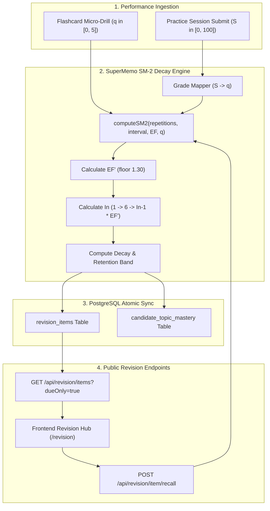

# Architecture & Mathematical Specification: TASK-P6-02 — SuperMemo SM-2 Spaced Repetition Decay Synchronization

> **Version**: 1.0.0  
> **Status**: APPROVED FOR EXECUTION  
> **Phase**: Phase 6 (Deterministic Evaluation, Scoring & Decay Engine)  
> **Task**: `TASK-P6-02: SuperMemo SM-2 Spaced Repetition Decay Synchronization`  
> **Dependencies**: `TASK-P6-01` (Mathematical Scoring & Bayesian Convergence)  
> **Target Repositories**:
> 1. `prepinminutes-backend` (`src/server/domain/spaced-repetition.ts`, `src/routes/revision-items.ts`, `scripts/test-sm2-decay.ts`)
> 2. `prep-in-minutes` (`src/lib/api-client.ts`, `src/components/revision/`)

---

## 1. Executive Summary & Problem Statement

In technical interview preparation, candidates suffer from the **Ebbinghaus Forgetting Curve**: within 48 hours of practicing a complex distributed system or algorithm, active retention drops by up to 60% unless reinforced at mathematically optimal intervals.

While Phase 5 successfully logs completed practice sessions into PostgreSQL, the spaced repetition engine was rudimentary:
1. It lacked direct quality grade ($q \in [0, 5]$) input from interactive micro-drills and flashcards.
2. It lacked dynamic exponential decay tracking ($\text{RecallStrength}(t)$ as days elapse).
3. It lacked retention band taxonomy (`CRITICAL`, `NEEDS_REINFORCEMENT`, `STABLE`, `MASTERED`) to organize candidate review queues.

`TASK-P6-02` formalizes and deploys the **SuperMemo SM-2 Spaced Repetition & Decay Synchronization Engine**:
- **Bidirectional Scoring**: Supports both session score mapping ($S \in [0, 100]$) and direct flashcard recall grading ($q \in [0, 5]$).
- **Asymmetric Easiness Factor Scaling**: Prevents ease deflation with an immutable floor $EF \ge 1.30$.
- **Time-Decayed Recall Strength Metric**: Dynamically calculates memory retention decay $R(t) = 100 \cdot e^{-0.5 \cdot \frac{t}{I \cdot EF}}$ as days pass between reviews.
- **Due Revision Items API**: `GET /api/revision/items` with retention band aggregation and domain filtering.
- **Recall Rating Mutation API**: `POST /api/revision/item/recall` advancing review intervals atomically in PostgreSQL.

---

## 2. Mathematical Formalization & SM-2 Engine

### 2.1 Quality Grade Mapping ($q \in [0, 5]$)

Candidates can submit recall difficulty directly via flashcards ($q \in [0, 5]$) or have it derived from full practice session scores ($S \in [0, 100]$):

| Grade $q$ | Evaluation Performance | Human Assessment Standard | Interval Action |
| :---: | :---: | :--- | :--- |
| **$5$** | $S \ge 85\%$ | **Perfect Recall**: Immediate recall of rubric atoms with no hesitation. | Advance interval with maximum EF bonus ($+0.10$). |
| **$4$** | $70\% \le S < 85\%$ | **Good Recall**: Correct answer after brief reflection; all core trade-offs recalled. | Advance interval with moderate EF bonus ($+0.00$). |
| **$3$** | $55\% \le S < 70\%$ | **Pass with Difficulty**: Recalled core mechanism but missed edge cases. | Advance interval with slight EF penalty ($-0.14$). |
| **$2$** | $40\% \le S < 55\%$ | **Hard Failure**: Recalled topic name and keywords, but failed structural reasoning. | Reset repetitions ($n = 0$), schedule 1-day drill. |
| **$1$** | $20\% \le S < 40\%$ | **Incorrect Recall**: Remembered incorrect components or reversed trade-offs. | Reset repetitions ($n = 0$), schedule 1-day drill. |
| **$0$** | $S < 20\%$ | **Complete Blackout**: No memory of topic architecture or rubric atoms. | Reset repetitions ($n = 0$), schedule 1-day drill. |

---

### 2.2 Easiness Factor Update ($EF'$)

The Easiness Factor represents a topic's intrinsic cognitive complexity for a specific candidate. Starting baseline is $EF_0 = 2.50$:

$$EF' = \max\Big(1.30, \text{round}\Big(\big(EF + (0.1 - (5 - q) \cdot (0.08 + (5 - q) \cdot 0.02))\big) \cdot 100\Big) / 100\Big)$$

- If $q = 5 \implies EF' = EF + 0.10$
- If $q = 4 \implies EF' = EF + 0.00$
- If $q = 3 \implies EF' = EF - 0.14$
- If $q = 2 \implies EF' = EF - 0.32$
- If $q = 1 \implies EF' = EF - 0.54$
- If $q = 0 \implies EF' = EF - 0.80$
- Minimum bound: $EF' \ge 1.30$ (immutable floor).

---

### 2.3 Interval Progression Formula ($I_n$)

The consecutive interval (in days) before the topic must be reviewed again:

$$I_n = \begin{cases}
1 & \text{if } q < 3 \quad \text{(Failed recall: reset interval to 1 day)} \\
1 & \text{if } q \ge 3 \text{ and } n = 0 \quad \text{(First successful recall)} \\
6 & \text{if } q \ge 3 \text{ and } n = 1 \quad \text{(Second successful recall)} \\
\text{round}(I_{n-1} \cdot EF') & \text{if } q \ge 3 \text{ and } n \ge 2 \quad \text{(Subsequent exponential expansion)}
\end{cases}$$

$$\text{nextReviewDate} = \text{Date.now()} + I_n \times 86,400,000\text{ ms}$$

---

### 2.4 Ebbinghaus Decay & Dynamic Recall Strength

As days elapse without review ($t = \text{days elapsed since } \text{lastReviewedAt}$), the topic's active recall strength decays exponentially:

$$\text{RecallStrength}(t, I, EF) = \max\Big(10, \min\big(100, \text{round}\big(100 \cdot e^{-0.5 \cdot \frac{t}{\max(1, I) \cdot EF}}\big)\big)\Big)$$

#### **Retention Band Taxonomy**:
$$\text{RetentionBand} = \begin{cases}
\text{"CRITICAL"} & \text{if } \text{RecallStrength} < 40\% \text{ or } q < 3 \\
\text{"NEEDS\_REINFORCEMENT"} & \text{if } 40\% \le \text{RecallStrength} < 70\% \\
\text{"STABLE"} & \text{if } 70\% \le \text{RecallStrength} < 85\% \\
\text{"MASTERED"} & \text{if } \text{RecallStrength} \ge 85\% \text{ and } n \ge 3
\end{cases}$$

---

## 3. Data Contracts & Architecture



---

## 4. API Endpoint Specifications

### 4.1 `GET /api/revision/items`
- **Query Params**:
  - `dueOnly`: boolean (default `true`)
  - `domain`: string (optional filter)
- **Response**:
  ```json
  {
    "success": true,
    "totalDue": 4,
    "stats": {
      "totalDue": 4,
      "criticalCount": 1,
      "needsReinforcementCount": 2,
      "stableCount": 1,
      "masteredCount": 0
    },
    "items": [
      {
        "id": "rev_cm3...",
        "topicId": "top_cm3...",
        "topicTitle": "Distributed Caching (Redis)",
        "domain": "system-design",
        "recallStrength": 48,
        "retentionBand": "NEEDS_REINFORCEMENT",
        "intervalDays": 6,
        "easeFactor": 2.5,
        "repetitions": 1,
        "nextReviewDate": "2026-11-16T12:00:00.000Z",
        "isDue": true
      }
    ]
  }
  ```

### 4.2 `POST /api/revision/item/recall`
- **Request**:
  ```json
  {
    "revisionItemId": "rev_cm3...",
    "qualityGrade": 4
  }
  ```
- **Response**:
  ```json
  {
    "success": true,
    "updatedItem": { ... },
    "sm2Output": {
      "repetitions": 2,
      "intervalDays": 15,
      "easeFactor": 2.50,
      "nextReviewDate": "2026-12-01T12:00:00.000Z"
    }
  }
  ```
