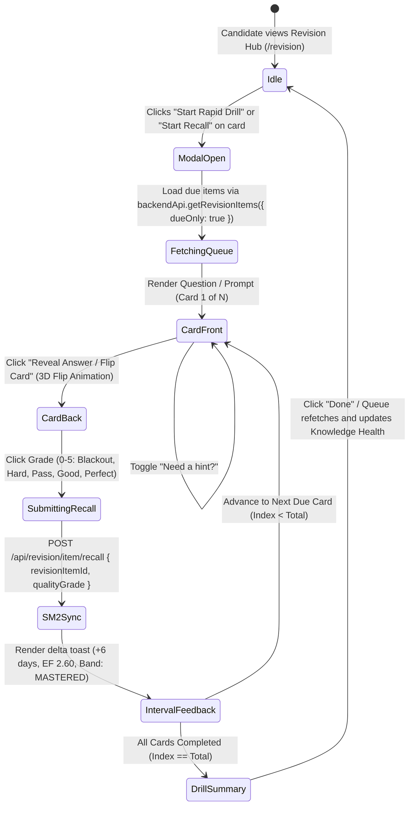

# TASK-P6-03: Interactive Rapid Recall Flashcard Modal in Revision Hub — Architectural Specification

> **Task ID**: `TASK-P6-03`  
> **Phase**: Phase 6 — Deterministic Evaluation, Scoring & Decay Engine  
> **Target Subsystems**:
> - `prep-in-minutes` (Next.js 14 App Router, Tailwind CSS, Lucide icons, Framer Motion / CSS 3D Transforms)
> - `prepinminutes-backend` (Cloudflare Workers, Hono, SuperMemo SM-2 Engine)  
> **Dependencies**: `TASK-P6-01`, `TASK-P6-02`  
> **Document Status**: Approved Architecture Specification  

---

## 1. Executive Summary & Purpose

In **TASK-P6-02**, we implemented and verified the backend SuperMemo SM-2 spaced repetition decay engine (`prepinminutes-backend/src/server/domain/spaced-repetition.ts`) with dynamic Ebbinghaus decay, asymmetric Easiness Factor scaling ($EF \ge 1.30$), and progressive intervals ($1\text{d} \to 6\text{d} \to I_{n-1} \cdot EF$).

**TASK-P6-03** introduces the user-facing micro-learning experience: the **Interactive Rapid Recall Flashcard Modal** (`RecallDrillModal.tsx`) in the Revision Hub (`/revision`). This component empowers candidates to execute 2-minute rapid-fire active recall drills directly inside their dashboard without having to launch a full 30-minute mock session.

---

## 2. Interactive UX & Behavioral Flow



---

## 3. SuperMemo 6-Point Grading Taxonomy

When the candidate flips the card to reveal the answer and key architectural rubric anchors, they grade their active recall on the standard SuperMemo 6-point scale ($q \in [0, 5]$):

| Grade | Label | Description | Effect on Repetitions | Effect on Interval | Retention Band |
| :---: | :---: | :--- | :---: | :---: | :---: |
| **0** | **Blackout** | Complete blackout; could not recall any concept | Reset to $0$ | Reset to $1\text{ day}$ | `CRITICAL` |
| **1** | **Incorrect** | Incorrect recall; familiar once revealed | Reset to $0$ | Reset to $1\text{ day}$ | `CRITICAL` |
| **2** | **Hesitant** | Severe hesitation; remembered with struggle | Reset to $0$ | Reset to $1\text{ day}$ | `CRITICAL` |
| **3** | **Pass** | Passed with significant cognitive effort | Streak $+1$ | $I_1=1\text{d}, I_2=6\text{d}, I_n=\text{round}(I_{n-1} \cdot EF)$ | `NEEDS_REINFORCEMENT` |
| **4** | **Good** | Good recall with minor hesitation | Streak $+1$ | Expands by $EF$ | `STABLE` |
| **5** | **Perfect** | Immediate, flawless recall with trade-offs | Streak $+1$ | Expands by $EF + 0.10$ | `MASTERED` |

---

## 4. Component Architecture & Props Interface

### `RecallDrillModal.tsx`
Located in `prep-in-minutes/src/components/revision/RecallDrillModal.tsx`.

```typescript
export interface RecallCardItem {
  id: string; // revisionItem ID
  topicId: string;
  topicTitle: string;
  topicSlug: string;
  domain: string;
  difficulty: string;
  questionPrompt: string;
  answerSummary: string;
  keyRubricAtoms: string[];
  tradeoffsAnchor: string;
  hints?: string[];
  currentRecallStrength: number;
  currentIntervalDays: number;
  currentEaseFactor: number;
  repetitions: number;
}

export interface RecallDrillModalProps {
  isOpen: boolean;
  onClose: () => void;
  onDrillComplete?: () => void;
  initialTopicSlug?: string;
  initialRevisionItemId?: string;
}
```

---

## 5. Visual Design & Animation System

1. **Card 3D Flip Transition**:
   - Preserves 3D perspective (`perspective: 1000px`, `transform-style: preserve-3d`).
   - Smooth 400ms cubic-bezier transition flipping $180^\circ$ along the Y-axis.
   - Front and back faces utilize `backface-visibility: hidden` to prevent clipping or flickering.
2. **Keyboard Accessibility**:
   - `Space` or `Enter`: Flip card to reveal answer.
   - `1` through `5` or `0`: Quick-grade when card is flipped.
   - `Escape`: Close modal with confirmation if mid-drill.
3. **Drill Completion Metrics Screen**:
   - Displays number of cards mastered vs needing reinforcement.
   - Computes estimated knowledge health gain (e.g. $+8\%$ Health).
   - Confetti particle celebration or SVG checkmark ring animation.

---

## 6. Integration Points in Revision Hub

1. **`TodayRevisionCards.tsx`**:
   - "Start Recall" button triggers `onStartDrill(topic.id)` instead of a passive page link.
2. **`RevisionQueueTable.tsx`**:
   - Each row's "Review" action button triggers `RecallDrillModal` targeted at that specific topic.
3. **`KnowledgeHealthCard.tsx` & `RevisionHeader.tsx`**:
   - Adds a prominent primary CTA: `"Launch Daily Recall Drill ({dueCount} Due)"`.
4. **State Refresh Hook**:
   - Triggers `mutate()` on the active revision queue query to reflect immediate improvements in knowledge health and interval dates.

---

## 7. Verification & Acceptance Criteria

1. **Modal Presentation**: Opens cleanly over `/revision` with dimmed backdrop, responsive from mobile ($360\text{px}$) to desktop ($1440\text{px}$).
2. **Card Flip**: Smooth 3D animation reveals key rubric atoms and architectural trade-offs.
3. **API Integration**: Selecting a grade ($0\text{–}5$) dispatches `backendApi.submitRevisionRecall()` and renders immediate SM-2 interval delta feedback.
4. **Completion Flow**: Completing all due items shows summary and closes gracefully, updating the Revision Hub queue.
5. **Quality**: Passes TypeScript typecheck (`npx tsc --noEmit`) with 0 errors.
