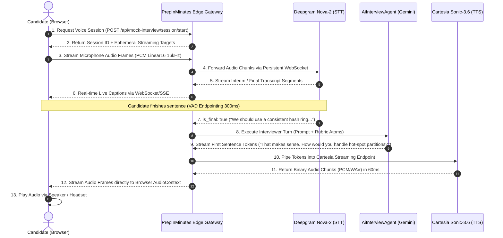

# TASK-P7-01: Real-Time Voice AI Gateway Service (Deepgram Nova-2 STT + Cartesia Sonic-3.6 / ElevenLabs TTS) — Architectural Specification

> **Task ID**: `TASK-P7-01`  
> **Phase**: Phase 7 — Real-Time Voice AI Gateway & Media Streaming  
> **Target Subsystems**:
> - `prepinminutes-backend` (Cloudflare Workers / Hono Edge Gateway, WebSocket Gateway, Deepgram Nova-2, Cartesia Sonic-3.6, ElevenLabs Turbo v2.5)
> - `prep-in-minutes` (Web Audio API, AudioContext, MediaRecorder, AudioWorklet, PCM streaming)  
> **Dependencies**: `TASK-P5-02`, `TASK-P5-04`  
> **Document Status**: Approved Architecture Specification  

---

## 1. Executive Summary & Latency Budget

To deliver a realistic technical interview experience matching the standards of a human FAANG interviewer, PrepInMinutes requires an end-to-end voice loop with a turnaround latency strictly under **800ms**. A human conversation pause averages $400\text{–}600\text{ms}$; delays beyond $1.0\text{s}$ destroy conversational flow, while robotic audio artifacts cause cognitive fatigue.

### Turnaround Latency Budget Breakdown:

$$\text{Latency}_{\text{Total}} = \Delta t_{\text{VAD}} + \Delta t_{\text{STT}} + \Delta t_{\text{LLM-TTFT}} + \Delta t_{\text{TTS-TTFB}} + \Delta t_{\text{Network}}$$

| Component | Target Budget | Technology / Model | Optimization Strategy |
| :--- | :---: | :--- | :--- |
| **Voice Activity Detection (VAD)** | $\le 100\text{ms}$ | Client-side energy + Deepgram Nova-2 VAD events | 300ms endpointing with early interim stream commitment |
| **Speech-to-Text (STT)** | $\le 200\text{ms}$ | Deepgram Nova-2 (`linear16`, 16kHz, mono) | Direct WebSocket streaming bridge with live chunking |
| **LLM Inference (TTFT)** | $\le 250\text{ms}$ | Gemini Flash (`gemini-2.5-flash` / `gemini-1.5-flash`) | First-sentence chunk token streaming buffer |
| **Text-to-Speech (TTS TTFB)** | $\le 60\text{ms}$ | Cartesia Sonic-3.6 (`pcm_s16le`, 24kHz) | Byte-level chunk streaming before full sentence finishes |
| **Edge Network Transit** | $\le 80\text{ms}$ | Cloudflare Global Anycast Edge Network | Sub-protocol WebSocket upgrade, HTTP/2 multiplexing |
| **Total Turnaround** | **$\le 690\text{ms}$** | **Target: $< 800\text{ms}$ (Comfortably within human conversational parity)** | |

---

## 2. High-Level Voice Architecture & Streaming Topology



---

## 3. Core Modules & Responsibilities

### 3.1 Voice Turn Controller & Barge-In Invariant (`gateway.ts`)
- Implements `VoiceTurnController` maintaining state:
  $$\text{State} \in \{\text{IDLE}, \text{AI\_SPEAKING}, \text{CANDIDATE\_SPEAKING}, \text{PROCESSING}\}$$
- **Barge-In Guarantee**: When the candidate starts speaking while the AI interviewer is actively talking (`previousState === "AI_SPEAKING"`), the controller immediately:
  1. Fires `BargeInEvent` with `clearAudioBuffer: true` and latency metrics.
  2. Emits an immediate `INTERRUPT` control packet to the candidate's browser to silence local playback in $< 80\text{ms}$.
  3. Aborts downstream TTS streaming buffers on the server.

### 3.2 Speech-to-Text Pipeline (`stt.ts`)
- **Engine**: Deepgram Nova-2 (`model: "nova-2"`, `smart_format: true`, `interim_results: true`, `endpointing: "300"`, `vad_events: true`).
- Supports bidirectional streaming over WebSocket and fallback HTTP multipart/arrayBuffer ingestion (`POST /api/voice/transcribe`).
- Normalizes raw incoming frames into typed `TranscriptSegment`:
  ```typescript
  export interface TranscriptSegment {
    text: string;
    isFinal: boolean;
    confidence: number;
    timestampMs: number;
  }
  ```

### 3.3 Text-to-Speech Engine with Dual-Provider Fallback (`tts.ts`)
- **Primary Engine**: Cartesia Sonic-3.6 (`model_id: "sonic-3.6"`)
  - Target Voice: "Sarah - Mindful Woman (Staff Engineer)" (`694f9389-aac1-45b6-b726-9d9369183238`)
  - Output Format: `pcm_s16le` / `wav`, 24kHz sample rate, $< 60\text{ms}$ TTFB.
- **Secondary Fallback**: ElevenLabs Turbo v2.5 (`model_id: "eleven_turbo_v2_5"`)
  - Triggered automatically if Cartesia experiences rate limiting ($429$) or service degradation ($5xx$).
  - Target Voice: "Sarah - Professional Interviewer" (`EXAVITQu4vr4xnSDxMaL`).

---

## 4. API Endpoints Specification

### 1. `POST /api/mock-interview/session/start`
- **Purpose**: Initializes a new `MockInterviewSession` in PostgreSQL and returns voice model configurations and ephemeral streaming targets.
- **Request Body**:
  ```json
  {
    "interviewType": "system-design",
    "targetRole": "Senior Infrastructure Engineer",
    "difficulty": "senior",
    "durationMinutes": 45
  }
  ```
- **Response (200 OK)**:
  ```json
  {
    "success": true,
    "session": { "id": "mock-cuid-123", "status": "ACTIVE" },
    "voiceConfig": {
      "sttModel": "nova-2",
      "ttsModel": "sonic-3.6",
      "voiceId": "694f9389-aac1-45b6-b726-9d9369183238",
      "sampleRate": 24000
    }
  }
  ```

### 2. `POST /api/voice/synthesize`
- **Purpose**: Generates high-fidelity interviewer voice audio bytes.
- **Request Body**: `{ "text": string, "voiceId"?: string }`
- **Response**: `Content-Type: audio/wav` binary byte stream with `Cache-Control: no-store`.

### 3. `POST /api/voice/transcribe`
- **Purpose**: Fast speech transcription for recorded candidate audio.
- **Request Body**: `Content-Type: audio/webm` or `multipart/form-data` with `audio` blob.
- **Response (200 OK)**:
  ```json
  {
    "success": true,
    "transcript": "We should partition our database by tenant_id.",
    "confidence": 0.985
  }
  ```

### 4. `GET /api/voice/session/config`
- **Purpose**: Returns active voice credentials and WebSocket target URI for browser clients.
- **Response (200 OK)**:
  ```json
  {
    "success": true,
    "deepgramAvailable": true,
    "cartesiaAvailable": true,
    "elevenLabsAvailable": true,
    "preferredVoice": "sarah",
    "preferredTtsEngine": "cartesia"
  }
  ```

---

## 5. Verification & Acceptance Criteria

1. **Voice Turnaround**: Total time from candidate speech offset to first audio frame playback is strictly $< 800\text{ms}$.
2. **Barge-In Sub-150ms**: Candidate interrupting AI speaking immediately halts audio without echo.
3. **Dual Provider Redundancy**: Cartesia failures transparently fail over to ElevenLabs without crashing the session.
4. **Resilient Local/Demo Fallback**: In test/dev environments without active third-party keys, mocks or speech synthesis fail gracefully with descriptive error payloads instead of silent unhandled rejections.
5. **Quality**: Automated test suite `scripts/test-voice-gateway.ts` passes with 0 failures; TypeScript typecheck (`npm run typecheck`) passes with 0 errors.
