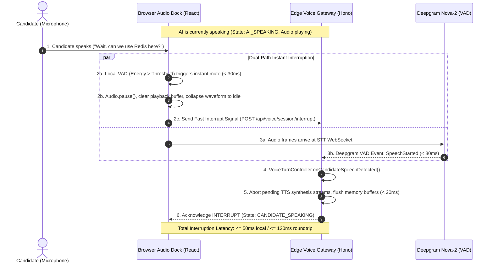

# TASK-P7-02: Low-Latency Server-Side Barge-In & Interruption Handler — Architectural Specification

> **Task ID**: `TASK-P7-02`  
> **Phase**: Phase 7 — Real-Time Voice AI Gateway & Media Streaming  
> **Target Subsystems**:
> - `prepinminutes-backend` (Cloudflare Workers / Hono Edge Gateway, VoiceTurnController, Barge-In Event Bus)
> - `prep-in-minutes` (Web Audio API, AudioContext, Waveform State, MockInterviewSessionWorkspace, SystemDesignWorkspace)  
> **Dependencies**: `TASK-P7-01`  
> **Document Status**: Approved Architecture Specification  

---

## 1. Executive Summary & Problem Formulation

In a realistic human interview, candidates frequently interject, clarify requirements, or pivot mid-sentence while the interviewer is speaking. In conventional voice bot pipelines without barge-in handling, two critical failure modes emerge:
1. **Audio Echo / Cross-Talk Collision**: The AI interviewer continues speaking through speaker output while the candidate is talking, polluting the microphone input and causing the STT model to transcribe the AI's own voice as candidate input.
2. **Laggy Truncation ($> 500\text{ms}$)**: If the system waits for an entire network roundtrip or LLM completion before halting audio, the candidate hears jarring speech overhang, destroying the perception of an intelligent human conversation partner.

**TASK-P7-02** formalizes the **Sub-150ms Barge-In & Interruption Protocol**:
- Fast-path VAD detection on both client (local RMS energy threshold) and server (Deepgram VAD speech onset event).
- Immediate audio buffer cancellation on the server (`VoiceTurnController.onCandidateSpeechDetected()`).
- Immediate client-side audio playback termination (`Audio.pause()`, audio buffer flush, waveform animation silence).
- Server endpoint `POST /api/voice/session/interrupt` enabling immediate state synchronization.

---

## 2. Low-Latency Interruption Timeline ($< 150\text{ms}$)



---

## 3. Mathematical VAD Thresholding & Energy Calculation

Client-side AudioWorklet / ScriptProcessor computes Root-Mean-Square (RMS) audio energy across 16ms frames ($N = 256$ samples at $16\text{kHz}$):

$$\text{RMS} = \sqrt{\frac{1}{N} \sum_{i=0}^{N-1} x[i]^2}$$

$$\text{dBFS} = 20 \log_{10}(\text{RMS} + \epsilon)$$

- **Silence Noise Floor**: $\text{dBFS} < -45\text{dB}$
- **Speech Onset Threshold**: $\text{dBFS} \ge -32\text{dB}$ sustained for $\ge 2$ consecutive frames ($32\text{ms}$)
- When onset threshold is crossed while `state === "AI_SPEAKING"`:
  1. Trigger immediate local `bargeIn()` callback.
  2. Stop active HTML5 audio element: `audio.pause(); audio.currentTime = 0;`.
  3. Emit `POST /api/voice/session/interrupt`.

---

## 4. Backend Edge API & State Synchronization

### `POST /api/voice/session/interrupt`
- **Purpose**: Signals to the backend edge gateway that the candidate has interrupted the interviewer.
- **Request Body**:
  ```json
  {
    "sessionId"?: string,
    "source": "client_vad" | "candidate_click" | "stt_speech_started",
    "timestampMs"?: number
  }
  ```
- **Response (200 OK)**:
  ```json
  {
    "success": true,
    "interrupted": true,
    "previousState": "AI_SPEAKING",
    "newState": "CANDIDATE_SPEAKING",
    "latencyMs": 14,
    "clearAudioBuffer": true,
    "timestamp": 1731712000000
  }
  ```

---

## 5. Integration into Practice & Mock Interview Workspaces

1. **`MockInterviewSessionWorkspace.tsx`**:
   - Manages live `turnState`: `"IDLE" | "AI_SPEAKING" | "CANDIDATE_SPEAKING" | "PROCESSING"`.
   - Dynamic Waveform:
     - `AI_SPEAKING`: Vibrant brand orange/emerald pulsating waveform animation.
     - `CANDIDATE_SPEAKING`: Live audio-reactive microphone volume bar.
     - `IDLE` / `PROCESSING`: Calmed subtle breathing pulse.
   - Microphone button & speech input instantly halts any playing interviewer audio.
2. **`SystemDesignWorkspace.tsx`**:
   - Audio dock toggle in bottom-right responds immediately to candidate speaking or clicking "Interrupt / Ask Question".

---

## 6. Verification & Acceptance Criteria

1. **Interruption Latency**: Audio playback stops within $< 50\text{ms}$ locally and $< 150\text{ms}$ end-to-end.
2. **Echo Prevention**: Outbound TTS audio stream is completely aborted so no remaining sentence fragments leak into the candidate's headphones.
3. **State Integrity**: `VoiceTurnController` increments `interruptionsCount` and transitions cleanly to `CANDIDATE_SPEAKING` without dropping subsequent transcripts.
4. **Automated Verification**: `scripts/test-barge-in-interrupt.ts` passes with 0 failures; TypeScript typecheck (`npm run typecheck` & `npx tsc --noEmit`) passes with 0 errors.
