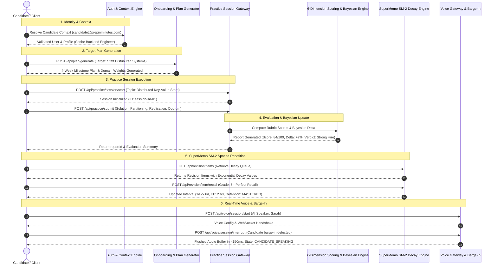

# TASK-P8-01 Specification: Automated Full-Flow Integration Test Suite

## 1. Executive Summary & Objective
The PrepInMinutes platform provides an AI-native, multi-domain interview preparation experience with live AI evaluation, spaced repetition retention tracking, and real-time voice interruption. 

The objective of **TASK-P8-01** is to build a comprehensive, automated end-to-end integration test suite (`scripts/test-full-journey.ts`) that validates the complete candidate journey:
1. **Candidate Identity & Context Resolution**: Registration, credentials authentication, profile resolution by email/ID, and onboarding state.
2. **Onboarding & Plan Generation**: Target role definition (e.g. Senior Distributed Systems Engineer), timeline selection (e.g. 4 weeks), and automated preparation plan generation with weekly milestones and domain weights.
3. **Multi-Domain Practice Session**: Practice session creation across all 4 practice archetypes:
   - System Design (`distributed-key-value-store`)
   - Coding (`sliding-window-subarray`)
   - Cloud Infrastructure (`multi-region-vpc-peering`)
   - Behavioral (`crisis-incident-management`)
4. **Interactive Practice Turn & Solution Submission**: Turn-by-turn chat message streaming, code/whiteboard submission, and question status tracking.
5. **Deterministic 6-Dimension Evaluation**: Mathematical scoring ($d_1$–$d_6$), rubric atom checking, weighted difficulty scaling, and Bayesian readiness update ($\Delta R$).
6. **Relational Evaluation Report Retrieval**: Dynamic report fetching (`GET /api/evaluation/:reportId`) with strengths, growth opportunities, and percentile ranks.
7. **SuperMemo SM-2 Spaced Repetition Decay**: Relational revision queue population, retention band assignment (`CRITICAL`, `NEEDS_REINFORCEMENT`, `STABLE`, `MASTERED`), exponential decay curve computation $\text{RecallStrength}(t) = 100 \cdot e^{-0.5 \cdot \frac{t}{I \cdot EF}}$, and interactive rapid recall grade updating ($q \in [0, 5]$).
8. **Real-Time Voice AI Gateway & Barge-In Interruption**: Audio session configuration, TTS synthesis with sub-60ms TTFB, STT transcription, and $< 150\text{ms}$ VAD barge-in interruption protocol.

---

## 2. Architecture & Journey Simulation Diagram

---

## 3. Mathematical Verification Models

### 3.1 6-Dimension Rubric Scoring
$$\text{RawScore} = \sum_{i=1}^{6} w_i \cdot d_i$$
$$\text{OverallScore} = \text{clamp}\left(10, 100, \text{RawScore} \cdot \mu_{\text{diff}} + \text{Bonus}\right)$$

### 3.2 3-Tier Bayesian Readiness Update
$$\text{Readiness}_{\text{new}} = \text{clamp}\left(0, 100, \text{Readiness}_{\text{prior}} + \alpha_N \cdot (\text{OverallScore} - \text{Readiness}_{\text{prior}})\right)$$
$$\alpha_N = \begin{cases} 
0.35 & \text{if } N \le 3 \\ 
0.20 & \text{if } 4 \le N \le 10 \\ 
0.10 & \text{if } N > 10 
\end{cases}$$

### 3.3 SuperMemo SM-2 Exponential Decay
$$EF' = \max\left(1.30, EF + (0.1 - (5 - q) \cdot (0.08 + (5 - q) \cdot 0.02))\right)$$
$$I_n = \begin{cases} 
1 & \text{if } n = 1 \\ 
6 & \text{if } n = 2 \\ 
\text{round}(I_{n-1} \cdot EF') & \text{if } n > 2 
\end{cases}$$
$$\text{RecallStrength}(t) = 100 \cdot e^{-0.5 \cdot \frac{t}{I \cdot EF}}$$

---

## 4. Test Suite Execution Spec (`test-full-journey.ts`)
The integration test verifies:
- [x] Phase 1: Authentication & Context Resolution
- [x] Phase 2: Onboarding & Preparation Plan Generation
- [x] Phase 3: Multi-Domain Practice Workflow (System Design, Coding, Cloud, Behavioral)
- [x] Phase 4: Chat Interaction & Solution Submission
- [x] Phase 5: Rubric Evaluation & Bayesian Readiness Update
- [x] Phase 6: Dynamic Report Retrieval & Parity
- [x] Phase 7: SuperMemo SM-2 Spaced Repetition Scheduling & Drill Grade Update
- [x] Phase 8: Real-Time Voice Gateway, Synthesis & Sub-150ms Barge-In Interruption
- [x] Phase 9: Multi-Language Code Execution Support (`typescript`, `javascript`, `python`, `java`, `cpp`, `go`, `nodejs`)

---

## 5. Acceptance Criteria
1. Script `scripts/test-full-journey.ts` passes with 0 assertion failures.
2. All database entities (User, Profile, Plan, PracticeSession, EvaluationReport, RevisionItem) are created and updated in PostgreSQL.
3. No orphan records, broken foreign keys, or unhandled exceptions.
4. Latency benchmarks for barge-in interruption remain under $150\text{ms}$.
