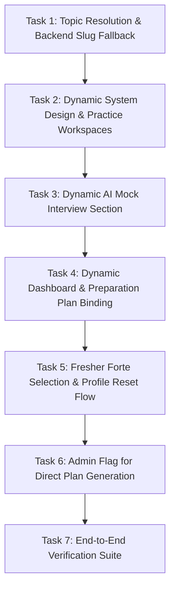

# UI Dynamic Data Audit & Dynamic Migration Plan
**Document ID:** `SPEC-UI-DYNAMIC-01`  
**Date:** November 16, 2026  
**Status:** Approved for Implementation  
**Target Systems:** `prep-in-minutes` (Next.js 16 Frontend) & `prepinminutes-backend` (Cloudflare Workers / Neon DB)

---

## 1. Executive Summary & Problem Analysis

### 1.1 Problem Statement
When candidates navigate through the PrepInMinutes application—such as clicking on topics from the dashboard, preparation plan, or entering direct URLs like:
```text
http://localhost:3000/practice/session/system-design?topic=Load%20Balancing%20Strategies
```
the page currently displays **irrelevant or hardcoded static information** (e.g. static "Design a URL shortener system capable of 100M URLs..." chat bubbles, hardcoded timer "02:34", hardcoded readiness progress "12%", and static role "Senior Software Engineer / 15+ years").

Furthermore, when candidates complete evaluations and practice submissions, several UI sections (dashboard readiness ring, domain progress bars, preparation plan milestones, and mock interview reports) do not update dynamically to reflect the candidate's actual database evaluation scores.

In addition, candidate setup requires three critical usability enhancements:
1. **Candidate Profile Reset & Re-evaluation:** Ability to wipe existing profile/plan data and re-evaluate from scratch directly from the onboarding setup card.
2. **Fresher Target Forte Selection:** Freshers (0 years / entry level) should not be forced into Software Engineering; they must be prompted for their desired forte (Data Analytics, Cloud/DevOps, AI/ML, QA, etc.).
3. **Admin Configurable "Next Step" Flag:** An admin panel toggle that determines whether the onboarding flow uses the intermediate "Next Step" (Step 2 Plan Ready / Assessment) or defaults to directly triggering "Create My Preparation Plan" into Step 3.

---

## 2. Comprehensive UI Audit Findings

### 2.1 System Design Practice Workspace (`/practice/session/system-design`)
* **File:** `src/components/practice/SystemDesignWorkspace.tsx`
* **Defect 1 (Hardcoded Chat Bubble History):** Lines 552–610 contain hardcoded JSX chat messages for "Design a URL Shortener system that can handle 100 million URLs and 200 million redirects per day". No matter what `?topic=` parameter is passed in the URL (even `Load Balancing Strategies`), the chat history always displays the URL Shortener problem.
* **Defect 2 (Slug Mismatch in Topic Resolution):** `useCurriculumTopic` attempts to fetch `/api/curriculum/topic/:slug` using the raw URL query string (e.g., `"Load Balancing Strategies"`). The backend database stores the slug as `load-balancers-traffic` or slugified lowercase strings (`load-balancing-strategies`). Because `db.curriculumTopic.findUnique({ where: { slug } })` does exact matching, it fails to find the topic and falls back to a generic synthetic fallback rather than the rich curriculum question.
* **Resolution:** 
  1. Add fuzzy slug, title-contains, and alias matching in the backend `/api/curriculum/topic/:topicSlug` endpoint.
  2. In `useCurriculumTopic`, normalize and decode query parameters (`topic`, `topicSlug`, `slug`).
  3. Replace hardcoded chat bubbles in `SystemDesignWorkspace.tsx` with dynamic messages initialized from `activeQuestion.prompt`, `activeQuestion.hints`, and live WebSocket/AI interaction.

---

### 2.2 AI Mock Interview Section (`/mock-interview/*`)
* **Files:**
  - `src/components/mock-interview/configure/InterviewConfigurationForm.tsx`
  - `src/components/mock-interview/briefing/BriefingBottomBar.tsx`
  - `src/components/mock-interview/session/MockInterviewSessionWorkspace.tsx`
  - `src/components/mock-interview/evaluation/MockSystemDesignEvaluationWorkspace.tsx`
* **Defect 1 (Static Navigation Without Configuration State):** When users configure an interview (`/mock-interview/configure`) and proceed to `/mock-interview/briefing`, the "Start Interview" button in `BriefingBottomBar.tsx` simply pushes `/mock-interview/interview-session` with **no query params or state passed**.
* **Defect 2 (Hardcoded Session Workspace):** `MockInterviewSessionWorkspace.tsx` starts with hardcoded `secondsElapsed = 154` (02:34), hardcoded URL shortener code template (`POST /api/v1/shorten`), and hardcoded initial dialogue.
* **Defect 3 (Hardcoded Mock Evaluation):** `MockSystemDesignEvaluationWorkspace.tsx` displays hardcoded scores (8.5 / 10 Technical Depth, etc.) rather than fetching the live evaluation report generated upon session submission via `backendApi.getEvaluationReport(reportId)`.
* **Resolution:**
  1. Persist the chosen configuration (`interviewType`, `targetRole`, `difficulty`, `durationMinutes`, `focusAreas`) across configure -> briefing -> session via search params or session storage.
  2. In `MockInterviewSessionWorkspace.tsx`, initialize timer at `00:00`, load dynamic questions matching the configured interview type/topic, and bind the barge-in and submit workflow to `backendApi.submitMockInterviewSession()`.
  3. In `MockSystemDesignEvaluationWorkspace.tsx`, read `reportId` from query params and dynamically hydrate the score ring, criteria breakdown, and percentile.

---

### 2.3 Candidate Dashboard & Progress Tracking (`/dashboard`)
* **File:** `src/components/dashboard/StartPreparingWorkspace.tsx`
* **Defect 1 (Hardcoded User Summary):** Target role is hardcoded as "Senior Software Engineer", experience as "15+ years", target company as "Google".
* **Defect 2 (Static Progress & Readiness Scores):** The radial progress ring is fixed to 12% (`3 / 24 activities completed`), and domain progress bars are static (System Design 18%, Coding 10%, Behavioral 5%).
* **Defect 3 (Static Activity Links):** Today's preparation activity links do not include the canonical topic slugs, leading to the default fallback topic on click.
* **Resolution:**
  1. Hydrate `StartPreparingWorkspace` with data from `backendApi.getProfile()`, which returns both `profile` and `activePlan`.
  2. Compute real progress from `activePlan.overallReadinessScore`, `activePlan.systemDesignReadinessScore`, `activePlan.codingReadinessScore`, etc.
  3. Ensure all practice activity links pass exact matching topic slugs (e.g., `/practice/session/system-design?topic=load-balancers-traffic`).

---

### 2.4 Preparation Plan View (`/preparation-plan`)
* **Files:**
  - `src/components/preparation-plan/PreparationProgress.tsx`
  - `src/components/preparation-plan/ReadinessByArea.tsx`
* **Defect:** Both components render static placeholder values (`3 / 24 topics completed`, `12 days remaining`, static domain readiness percentages).
* **Resolution:** Connect components to `activePlan` from `backendApi.getProfile()`. Dynamically calculate completed topics and display live domain readiness scores.

---

### 2.5 Candidate Profile Reset & Re-evaluation Workflow
* **Files:**
  - `src/components/dashboard/OnboardingFormCard.tsx`
  - `src/components/dashboard/StartPreparingWorkspace.tsx`
  - `prepinminutes-backend/src/routes/onboarding-profile.ts`
* **Requirement:**
  - Provide an explicit **"Reset Profile & Re-evaluate"** action with confirmation.
  - Clears `prep_onboarding_completed` from localStorage, deletes or archives the existing draft plan in the database, resets input fields to defaults, and allows the candidate to submit fresh parameters and trigger plan regeneration.

---

### 2.6 Target Role Dropdown & Fresher Target Forte / Specialization Selection
* **File:** `src/components/dashboard/OnboardingFormCard.tsx`
* **Requirement:**
  - Replace raw open-text input with a **Curated Role Dropdown & Typeahead Selector** categorized by domain:
    - *Software Engineering & Systems:* Software Engineer (SDE I), Senior Software Engineer (SDE II/III), Staff/Principal Engineer, Tech Lead/EM, Backend Engineer, Frontend Engineer.
    - *Data & Analytics:* Data Analyst, Senior Data Analyst, Data Engineer, Data Scientist, BI Engineer.
    - *Cloud & Infrastructure:* Cloud Solutions Architect, DevOps Engineer, Site Reliability Engineer (SRE).
    - *AI & Machine Learning:* Machine Learning Engineer, Generative AI Engineer.
    - *QA & Security:* QA Automation Engineer (SDET), Cybersecurity Analyst.
    - *Product & Business:* Product Manager, Business Analyst.
    - *Custom:* Option to enter custom role title.
  - **Dynamic Fresher Interactivity:**
    - When a candidate selects experience as `"Fresher / Student (0 years)"` or `"0-1 years (Entry level)"`:
    - Dynamically activate the **"Target Forte / Specialization"** selector (Data Analytics, Software Engineering, Cloud/DevOps, AI/ML, QA, etc.).
    - Selecting a forte automatically pre-populates and customizes the target role to entry-level equivalents (e.g. *Associate Software Engineer*, *Junior Data Analyst*, *Graduate Cloud Trainee*) and tailors the question difficulty and curriculum weights.

---

### 2.7 Admin Flag for "Next Step" vs. Direct "Create My Preparation Plan"
* **Files:**
  - `prep-in-minutes/src/app/admin/layout.tsx` & `src/app/admin/page.tsx`
  - `prepinminutes-backend/src/routes/admin-approvals.ts` (or `/api/admin/config`)
  - `src/components/dashboard/OnboardingFormCard.tsx`
* **Requirement:**
  - Admin toggle: **"Enable 'Next Step' Assessment Flow"** (`enableNextStepFlow`).
  - **When Disabled (Default):** The primary CTA on Step 1 is **"Create My Preparation Plan"**. Submitting immediately generates the preparation plan via `backendApi.generatePreparationPlan()` and routes the candidate straight to Step 3 (`/dashboard?step=3`), skipping intermediate assessment steps.
  - **When Enabled:** The primary CTA is **"Next Step"**, advancing the candidate to Step 2 (`/dashboard/plan-ready`).

---

## 3. Topic Resolution Architecture (Backend & Frontend)

### 3.1 Backend Flexible Topic Resolver (`prepinminutes-backend`)
In `prepinminutes-backend/src/server/graph/curriculum-repository.ts` and `src/routes/curriculum.ts`:
Enhance `getTopicDetail(topicSlug)` to resolve topics using a multi-step fallback strategy:
1. **Exact Slug Match:** `db.curriculumTopic.findUnique({ where: { slug: topicSlug } })`
2. **Slugified Match:** Convert spaces/special chars to kebab-case (e.g., `"Load Balancing Strategies"` -> `"load-balancing-strategies"`).
3. **Fuzzy Title / Keyword Match:** `db.curriculumTopic.findFirst({ where: { OR: [{ title: { contains: query, mode: 'insensitive' } }, { slug: { contains: query, mode: 'insensitive' } }] } })`
4. If no exact match exists, gracefully return the closest domain topic or synthesize the full 8-layer schema rather than returning a 404.

### 3.2 Frontend Slugification Helper (`prep-in-minutes`)
In `src/hooks/useCurriculumTopic.ts` and `src/lib/practice-router.ts`:
- Sanitize and slugify incoming query parameters.
- Provide canonical mapping between common display titles (e.g. `"Load Balancing Strategies"`) and curriculum slugs (e.g. `"load-balancers-traffic"`).

---

## 4. Phased Execution Sequence



### Task 1: Topic Resolution & Backend Slug Fallback (`TASK-P9-01`)
- Update `prepinminutes-backend` topic routes to support title search, case-insensitive partial match, and slugification.
- Update `useCurriculumTopic.ts` to decode, normalize, and slugify search parameters.
- Verify that `GET /api/curriculum/topic/Load%20Balancing%20Strategies` successfully resolves to the `load-balancers-traffic` topic and its rich question set.

### Task 2: Dynamic System Design & Practice Workspaces (`TASK-P9-02`)
- Refactor `SystemDesignWorkspace.tsx`:
  - Remove hardcoded URL shortener chat history.
  - Dynamically generate initial AI message and rubric hints from `activeQuestion`.
  - Dynamically populate architectural code and diagram templates from `topic.title`.
- Verify `PracticeCodingWorkspace.tsx`, `CloudWorkspace.tsx`, and `BehavioralWorkspace.tsx` for complete dynamic parameter binding.

### Task 3: Dynamic AI Mock Interview Section (`TASK-P9-03`)
- Update `InterviewConfigurationForm.tsx` and `ConfigurationPreviewCard.tsx` to pass the configured parameters to `BriefingBottomBar.tsx` and `MockInterviewSessionWorkspace.tsx`.
- Update `MockInterviewSessionWorkspace.tsx`:
  - Start timer at 00:00.
  - Dynamically load topic, role, and questions based on configuration.
  - Handle session completion and redirect to `/mock-interview/interview-session/evaluation?reportId={id}`.
- Update `MockSystemDesignEvaluationWorkspace.tsx` to fetch and render the live evaluation report.

### Task 4: Dynamic Dashboard & Preparation Plan Binding (`TASK-P9-04`)
- In `StartPreparingWorkspace.tsx`:
  - Fetch `backendApi.getProfile()` on mount.
  - Bind target role, experience, timeline, and company name dynamically.
  - Bind overall readiness score and domain readiness bars to `activePlan`.
  - Format today's activities with correct dynamic URLs.
- In `PreparationPlanWorkspace.tsx`, `PreparationProgress.tsx`, and `ReadinessByArea.tsx`:
  - Bind progress metrics and domain readiness bars to the active candidate plan.

### Task 5: Fresher Forte Selection & Candidate Profile Reset Flow (`TASK-P9-05`)
- Add **Fresher / Student (0 years)** option to `OnboardingFormCard.tsx` with dynamic **Target Forte** selector (Data Analytics, SDE, Cloud/DevOps, AI/ML, QA, etc.).
- Add **"Reset Profile & Re-evaluate"** action in `OnboardingFormCard.tsx` and `StartPreparingWorkspace.tsx`, clearing stored progress and triggering fresh plan generation.
- Add backend endpoint `POST /api/onboarding/profile/reset` to wipe or reset candidate draft plan cleanly.

### Task 6: Admin Flag for Direct Plan Generation (`TASK-P9-06`)
- Expose platform configuration endpoint `GET/POST /api/admin/system-config` with `enableNextStepFlow: boolean`.
- In Admin UI, add toggle for **"Enable 'Next Step' Assessment Flow"**.
- In `OnboardingFormCard.tsx`, if the flag is disabled, default button to **"Create My Preparation Plan"**, generate the plan immediately, and land candidate on Step 3 (`/dashboard?step=3`).

### Task 7: End-to-End Verification (`TASK-P9-07`)
- Run TypeScript verification (`tsc --noEmit`) across both repos.
- Run Next.js production build (`npm run build`).
- Verify manual URL: `http://localhost:3000/practice/session/system-design?topic=Load%20Balancing%20Strategies`.
- Verify profile reset, fresher forte selection, and admin flag switching.
