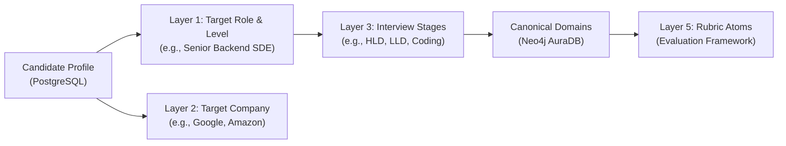

# PrepInMinutes — Master Knowledge Domains & Curriculum Registry

**Governing Standard:** [`docs/GENERIC_KNOWLEDGE_GRAPH_SCHEMA_SPEC.md`](../GENERIC_KNOWLEDGE_GRAPH_SCHEMA_SPEC.md)  
**Target Graph Engine:** Neo4j AuraDB (Cypher 5.x) & PostgreSQL (Neon DB Relational State)  
**Last Updated:** November 2026  
**Status:** 🟢 **CANONICAL REGISTRY**

---

## 1. Executive Overview

PrepInMinutes organizes technical interview preparation across **streamlined, role-oriented knowledge domains**. Rather than fragmenting computer science into dozens of academic subjects, every domain maps directly to **specific interview rounds** conducted at top tech companies (FAANG, Tier-1 Unicorns, High-Growth Startups).

All domains share the universal **4-tier canonical spine** defined in [`docs/GENERIC_KNOWLEDGE_GRAPH_SCHEMA_SPEC.md`](../GENERIC_KNOWLEDGE_GRAPH_SCHEMA_SPEC.md):
$$\text{Domain} \xrightarrow{\text{CONTAINS}} \text{Category} \xrightarrow{\text{HAS\_TOPIC}} \text{Topic} \xrightarrow{\text{HAS\_QUESTION}} \text{Question}$$

---

## 2. Master Domain Status & Inventory Matrix

| ID | Domain Name | Slug | Priority | Status | Categories | Topics | Questions | Spec File | Seed / Code Path |
| :---: | :--- | :--- | :---: | :---: | :---: | :---: | :---: | :--- | :--- |
| **D01** | **System Design (HLD & Distributed Systems)** | `system-design` | **P0** | 🟢 **LIVE IN NEO4J** | **17** | **62** | **1,240** | [`system-design.md`](./system-design.md) | `scripts/seed-data/system-design/` |
| **D02** | **AI System Design & GenAI Infra** | `ai-system-design` | **P0** | 🟢 **LIVE IN NEO4J** | **7** | **28** | **560** | [`ai-system-design.md`](./ai-system-design.md) | `scripts/seed-data/ai-system-design/` |
| **D03** | **Low-Level Design & Machine Coding** | `low-level-design` | **P0** | 🟢 **LIVE IN NEO4J** | **6** | **35** | **700** | [`low-level-design.md`](./low-level-design.md) | `scripts/seed-data/low-level-design/` |
| **D04** | **Data Structures & Algorithms** | `dsa` | **P0** | 🟢 **LIVE IN NEO4J** | **12** | **40** | **800** | [`dsa.md`](./dsa.md) | `scripts/seed-data/dsa/` |
| **D05** | **Backend & Runtime Engineering** | `backend-engineering` | **P0** | 🟢 **LIVE IN NEO4J** | **11** | **29** | **580** | [`backend-engineering.md`](./backend-engineering.md) | `scripts/seed-data/backend-engineering/` |
| **D06** | **Frontend & Web Architecture** | `frontend-engineering` | **P0** | 🟢 **LIVE IN NEO4J** | **12** | **34** | **680** | [`frontend-engineering.md`](./frontend-engineering.md) | `scripts/seed-data/frontend-engineering/` |
| **D07** | **Cloud, DevOps & Site Reliability** | `cloud-devops` | **P0** | 🟢 **LIVE IN NEO4J** | **18** | **50** | **1,000** | [`cloud-devops.md`](./cloud-devops.md) | `scripts/seed-data/cloud-devops/` |
| **D08** | **Behavioral, Leadership & Management** | `behavioral-leadership`| **P0** | 🟢 **LIVE IN NEO4J** | **10** | **28** | **560** | [`behavioral-leadership.md`](./behavioral-leadership.md) | `scripts/seed-data/behavioral-leadership/` |
| **D09** | **Data Engineering & Big Data** | `data-engineering` | **P0** | 🟢 **LIVE IN NEO4J** | **11** | **30** | **600** | [`data-engineering.md`](./data-engineering.md) | `scripts/seed-data/data-engineering/` |
| **D10** | **Mobile Engineering (iOS / Android)** | `mobile-engineering` | **P2** | ⚪ *PLANNED* | *4* | *16* | *320* | Roadmap | Specification pending |

---

## 3. Detailed Domain Profiles & Implementation Artifacts

### D01: System Design (HLD & Distributed Systems)
* **Domain Slug:** `system-design`
* **Status:** 🟢 **LIVE IN NEO4J AURADB** (Verified: Version `5.1.0`)
* **Target Interview Round:** High-Level Design (HLD), System Architecture & Scalability Round.
* **Target Audience:** SDE-2, Senior SDE, Staff Engineer, Principal Architect.
* **Graph Breakdown:**
  * **17 Categories**: Foundations, Networking, Databases, Scalability, Distributed Principles, Security, Traffic Management, Storage Components, Messaging, Coordination, Reliability, and 6 Real-World Problem Domains.
  * **62 Topics**: 21 Principles (`FND001`–`FND021`), 17 Components (`CMP001`–`CMP017`), 24 Case Studies (`SYS001`–`SYS024`).
  * **1,240 Master Questions**: Exactly 20 questions/topic (4 Beginner, 6 Intermediate, 6 Advanced, 4 Expert).
  * **Priority Ladder**: **P0 (24 Must-Master)**, **P1 (24 Senior Breadth)**, **P2 (14 Staff+ Deep Dives)**.
  * **Graph Edges**: 98 `[:PREREQUISITE_OF]` (DAG verified, 0 cycles), 81 `[:USES_COMPONENT]`, 72 `[:FOUNDED_ON]`.
* **Specification & Documentation**:
  * Catalog Specification: [`docs/domains/system-design.md`](./system-design.md)
  * Excellence Standard (8-Layer Depth): [`docs/SYSTEM_DESIGN_CURRICULUM_EXCELLENCE_STANDARD.md`](../SYSTEM_DESIGN_CURRICULUM_EXCELLENCE_STANDARD.md)
  * Taxonomy Spec: [`docs/SYSTEM_DESIGN_CURRICULUM_AND_QUESTION_TAXONOMY_SPEC.md`](../SYSTEM_DESIGN_CURRICULUM_AND_QUESTION_TAXONOMY_SPEC.md)
* **Code & Seeder Artifacts**:
  * Category Seeder: [`prepinminutes-backend/scripts/seed-data/system-design/categories.ts`](file:///Users/saurav/Desktop/development/prepinminutes-backend/scripts/seed-data/system-design/categories.ts)
  * Pillar 1 Fundamentals: [`prepinminutes-backend/scripts/seed-data/system-design/pillar-1-fundamentals.ts`](file:///Users/saurav/Desktop/development/prepinminutes-backend/scripts/seed-data/system-design/pillar-1-fundamentals.ts)
  * Pillar 2 Components: [`prepinminutes-backend/scripts/seed-data/system-design/pillar-2-components.ts`](file:///Users/saurav/Desktop/development/prepinminutes-backend/scripts/seed-data/system-design/pillar-2-components.ts)
  * Pillar 3 Case Studies: [`prepinminutes-backend/scripts/seed-data/system-design/pillar-3-case-studies.ts`](file:///Users/saurav/Desktop/development/prepinminutes-backend/scripts/seed-data/system-design/pillar-3-case-studies.ts)
  * Incremental Seeder Script: [`prepinminutes-backend/scripts/seed-system-design-v5-incremental.ts`](file:///Users/saurav/Desktop/development/prepinminutes-backend/scripts/seed-system-design-v5-incremental.ts)

---

### D02: AI System Design & GenAI Infrastructure
* **Domain Slug:** `ai-system-design`
* **Status:** 🟢 **LIVE IN NEO4J AURADB** (Verified: Version `2.0.0`)
* **Target Interview Round:** AI Systems Engineer, Applied AI Lead, LLM Infrastructure Round.
* **Target Audience:** AI Engineers, GenAI Tech Leads, ML Infrastructure Architects.
* **Graph Breakdown:**
  * **3 Pillars across 7 Categories**:
    * *Pillar 1: Principles & Fundamentals* (2 Categories: GenAI Foundations, Indexing & Alignment — 8 Topics | 160 Qs)
    * *Pillar 2: Components & Patterns* (4 Categories: Vector Storage, LLM Serving, Gateways/Evals, Agent Execution — 13 Topics | 260 Qs)
    * *Pillar 3: Case Studies* (1 Category: Production AI Case Studies — 7 Topics | 140 Qs)
  * **28 Topics**: 8 Principles (`AIP001`–`AIP008`), 13 Components (`AIC001`–`AIC013`), 7 Case Studies (`AIS001`–`AIS007`).
  * **560 Master Questions**: Exactly 20 questions/topic (4 Beginner, 6 Intermediate, 6 Advanced, 4 Expert).
  * **Priority Ladder**: **P0 (12 Core Must-Master)**, **P1 (12 High-Frequency Senior)**, **P2 (4 Staff+ Deep Dives)**.
  * **Graph Edges**: 38 `[:PREREQUISITE_OF]` (DAG verified, 0 cycles), 19 `[:USES_COMPONENT]`, 14 `[:FOUNDED_ON]`.
* **Specification File**: [`docs/domains/ai-system-design.md`](./ai-system-design.md)
* **Code & Seeder Artifacts**:
  * Category Seeder: [`prepinminutes-backend/scripts/seed-data/ai-system-design/categories.ts`](file:///Users/saurav/Desktop/development/prepinminutes-backend/scripts/seed-data/ai-system-design/categories.ts)
  * Pillar 1 Principles: [`prepinminutes-backend/scripts/seed-data/ai-system-design/pillar-1-principles.ts`](file:///Users/saurav/Desktop/development/prepinminutes-backend/scripts/seed-data/ai-system-design/pillar-1-principles.ts)
  * Pillar 2 Components: [`prepinminutes-backend/scripts/seed-data/ai-system-design/pillar-2-components.ts`](file:///Users/saurav/Desktop/development/prepinminutes-backend/scripts/seed-data/ai-system-design/pillar-2-components.ts)
  * Pillar 3 Case Studies: [`prepinminutes-backend/scripts/seed-data/ai-system-design/pillar-3-case-studies.ts`](file:///Users/saurav/Desktop/development/prepinminutes-backend/scripts/seed-data/ai-system-design/pillar-3-case-studies.ts)
  * Question Generator: [`prepinminutes-backend/scripts/seed-data/ai-system-design/question-generator.ts`](file:///Users/saurav/Desktop/development/prepinminutes-backend/scripts/seed-data/ai-system-design/question-generator.ts)
  * Incremental Seeder Script: [`prepinminutes-backend/scripts/seed-ai-system-design-incremental.ts`](file:///Users/saurav/Desktop/development/prepinminutes-backend/scripts/seed-ai-system-design-incremental.ts)

---

### D03: Low-Level Design & Machine Coding
* **Domain Slug:** `low-level-design`
* **Status:** 🟢 **LIVE IN NEO4J AURADB** (Verified: Version `1.0.0`)
* **Target Interview Round:** Low-Level Design (LLD), Object-Oriented Design (OOD), 90-Minute Machine Coding.
* **Target Audience:** SDE-1, SDE-2, Senior SDE (Mandatory round at Amazon, Uber, Atlassian, Google, Microsoft, Flipkart, Swiggy).
* **Graph Breakdown:**
  * **3 Pillars across 6 Categories**:
    * *Pillar 1: Principles & Concurrency Foundations* (Category 1: OOP Principles, Clean Code & Concurrency — 7 Topics | 140 Qs)
    * *Pillar 2: Patterns & In-Memory Components* (Categories 2 & 3: GoF Patterns & In-Memory Utilities — 8 Topics | 160 Qs)
    * *Pillar 3: Iconic Machine Coding Case Studies* (Categories 4, 5 & 6: Hardware/Games, Booking/Financial, Enterprise Apps — 20 Topics | 400 Qs)
  * **35 Topics**: 7 Principles (`LLDP01`–`LLDP07`), 8 Patterns/Components (`LLDC01`–`LLDC08`), 20 Case Studies (`LLDS01`–`LLDS20`).
  * **700 Master Questions**: Exactly 20 questions/topic (4 Beginner, 6 Intermediate, 6 Advanced, 4 Expert).
  * **Priority Ladder**: **P0 (19 Core Must-Master)**, **P1 (12 High-Frequency Senior)**, **P2 (4 Specialized/Staff+)**.
  * **Graph Edges**: 60 `[:PREREQUISITE_OF]` (DAG verified, 0 cycles), 30 `[:USES_COMPONENT]`, 34 `[:FOUNDED_ON]`.
* **Specification File**: [`docs/domains/low-level-design.md`](./low-level-design.md)
* **Code & Seeder Artifacts**:
  * Category Seeder: [`prepinminutes-backend/scripts/seed-data/low-level-design/categories.ts`](file:///Users/saurav/Desktop/development/prepinminutes-backend/scripts/seed-data/low-level-design/categories.ts)
  * Pillar 1 Principles: [`prepinminutes-backend/scripts/seed-data/low-level-design/pillar-1-principles.ts`](file:///Users/saurav/Desktop/development/prepinminutes-backend/scripts/seed-data/low-level-design/pillar-1-principles.ts)
  * Pillar 2 Components: [`prepinminutes-backend/scripts/seed-data/low-level-design/pillar-2-patterns-components.ts`](file:///Users/saurav/Desktop/development/prepinminutes-backend/scripts/seed-data/low-level-design/pillar-2-patterns-components.ts)
  * Pillar 3 Case Studies: [`prepinminutes-backend/scripts/seed-data/low-level-design/pillar-3-case-studies.ts`](file:///Users/saurav/Desktop/development/prepinminutes-backend/scripts/seed-data/low-level-design/pillar-3-case-studies.ts)
  * Question Generator: [`prepinminutes-backend/scripts/seed-data/low-level-design/question-generator.ts`](file:///Users/saurav/Desktop/development/prepinminutes-backend/scripts/seed-data/low-level-design/question-generator.ts)
  * Incremental Seeder Script: [`prepinminutes-backend/scripts/seed-low-level-design-incremental.ts`](file:///Users/saurav/Desktop/development/prepinminutes-backend/scripts/seed-low-level-design-incremental.ts)

---

### D04: Data Structures & Algorithms (Coding Round)
* **Domain Slug:** `dsa`
* **Status:** 🟢 **LIVE IN NEO4J AURADB** (Verified: Version `1.0.0`)
* **Target Interview Round:** Technical Problem Solving / Live Coding Round (LeetCode-style 45–60 min).
* **Target Audience:** All Software Engineering Candidates (SDE-1 through Senior SDE at FAANG/Tier-1).
* **Graph Breakdown:**
  * **12 Thematic Categories**: Arrays & Two Pointers, Strings, Binary Search, Linked Lists, Stacks & Queues, Binary Trees, BSTs, Heaps & Greedy, Tries, Graphs, Dynamic Programming, Backtracking & Bits.
  * **40 Pattern Topics**: Covering all 14 universal algorithmic patterns + all 178 canonical SDE Sheet problems.
  * **800 Master Questions**: Exactly 20 questions/topic (4 Beginner, 6 Intermediate, 6 Advanced, 4 Expert).
  * **Priority Ladder**: **P0 (30 Core Must-Master)**, **P1 (10 High-Frequency Senior)**, **P2 (0)**.
  * **Curated Subsets**: **Top 150 Track (`isTop150`)**, **Blind 75 Sprint (`isBlind75`)**, **Dynamic Popularity (`frequencyScore`)**, and **Company Tags**.
  * **Graph Edges**: 42 `[:PREREQUISITE_OF]` (DAG verified, 0 cycles).
* **Specification File**: [`docs/domains/dsa.md`](./dsa.md)
* **Code & Seeder Artifacts**:
  * Category Seeder: [`prepinminutes-backend/scripts/seed-data/dsa/categories.ts`](file:///Users/saurav/Desktop/development/prepinminutes-backend/scripts/seed-data/dsa/categories.ts)
  * Topics Seeder: [`prepinminutes-backend/scripts/seed-data/dsa/topics.ts`](file:///Users/saurav/Desktop/development/prepinminutes-backend/scripts/seed-data/dsa/topics.ts)
  * Question Generator: [`prepinminutes-backend/scripts/seed-data/dsa/question-generator.ts`](file:///Users/saurav/Desktop/development/prepinminutes-backend/scripts/seed-data/dsa/question-generator.ts)
  * Incremental Seeder Script: [`prepinminutes-backend/scripts/seed-dsa-incremental.ts`](file:///Users/saurav/Desktop/development/prepinminutes-backend/scripts/seed-dsa-incremental.ts)

---

### D05: Backend & Runtime Engineering
* **Domain Slug:** `backend-engineering`
* **Status:** 🟢 **LIVE IN NEO4J AURADB** (Verified: Version `1.0.0`)
* **Target Interview Round:** Backend Architecture, Language Runtime Internals & Concurrency Round.
* **Target Audience:** All Backend & Fullstack Candidates (SDE-1 through Principal Engineer).
* **Graph Breakdown:**
  * **11 Categories**: 6 Universal Core (APIs, Databases, Caching, Concurrency/OS, Security, Observability) + 5 Language Ecosystems (Java, Node.js, Go, Python, PHP).
  * **29 Topics**: 14 Universal Core + 15 Language Runtime Topics (3 per language across Fundamentals $\rightarrow$ Intermediate $\rightarrow$ Advanced).
  * **580 Master Questions**: Exactly 20 questions/topic (4 Beginner, 6 Intermediate, 6 Advanced, 4 Expert).
  * **Priority Ladder**: **P0 (21 Core Must-Master)**, **P1 (8 High-Frequency Senior)**, **P2 (0)**.
  * **Extensibility**: Open-string language slug (`lang: "universal"` | `"java"` | `"nodejs"` | `"go"` | `"python"` | `"php"` | future languages like `"rust"`, `"csharp"`, `"kotlin"`).
  * **Candidate Sizing**: Candidates prepare on **17 Topics (340 Questions)** = 14 Universal Core + 3 Tailored Language Topics.
  * **Graph Edges**: 26 `[:PREREQUISITE_OF]` (DAG verified, 0 cycles).
* **Specification File**: [`docs/domains/backend-engineering.md`](./backend-engineering.md)
* **Code & Seeder Artifacts**:
  * Category Seeder: [`prepinminutes-backend/scripts/seed-data/backend-engineering/categories.ts`](file:///Users/saurav/Desktop/development/prepinminutes-backend/scripts/seed-data/backend-engineering/categories.ts)
  * Topics Seeder: [`prepinminutes-backend/scripts/seed-data/backend-engineering/topics.ts`](file:///Users/saurav/Desktop/development/prepinminutes-backend/scripts/seed-data/backend-engineering/topics.ts)
  * Question Generator: [`prepinminutes-backend/scripts/seed-data/backend-engineering/question-generator.ts`](file:///Users/saurav/Desktop/development/prepinminutes-backend/scripts/seed-data/backend-engineering/question-generator.ts)
  * Incremental Seeder Script: [`prepinminutes-backend/scripts/seed-backend-engineering-incremental.ts`](file:///Users/saurav/Desktop/development/prepinminutes-backend/scripts/seed-backend-engineering-incremental.ts)

---

### D06: Frontend & Web Architecture
* **Domain Slug:** `frontend-engineering`
* **Status:** 🟢 **LIVE IN NEO4J AURADB** (Verified: Version `2.0.0`)
* **Target Interview Round:** Frontend Architecture, UI System Design, Web Vitals Performance & UI Machine Coding Round.
* **Target Audience:** All Frontend & Fullstack Candidates (SDE-1 through Principal UI Architect).
* **Graph Breakdown:**
  * **12 Categories**: 6 Universal Web Platform Categories (Browser Rendering, HTML/CSS, Web Vitals, Security, UI Machine Coding, Forms/Testing) + 6 Dedicated 3-Tier Technology Stacks (JavaScript, TypeScript, React, Next.js, Modern Angular, Vue.js/Nuxt).
  * **34 Topics**: 16 Universal Core Topics + 18 Technology Stack Topics (3 Tiers each: Beginner $\rightarrow$ Intermediate $\rightarrow$ Advanced).
  * **680 Master Questions**: Exactly 20 questions/topic (4 Beginner, 6 Intermediate, 6 Advanced, 4 Expert).
  * **Priority Ladder**: **P0 (25 Core Must-Master)**, **P1 (9 High-Frequency Senior)**, **P2 (0)**.
  * **Candidate Sizing**: Candidates prepare on tailored tracks (e.g. React+Next+TS: 28 Topics / 560 Qs; Angular+TS: 25 Topics / 500 Qs; Vanilla JS: 19 Topics / 380 Qs).
* **Specification File:** [`docs/domains/frontend-engineering.md`](./frontend-engineering.md)
* **Code & Seed Assets:**
  * Categories: [`prepinminutes-backend/scripts/seed-data/frontend-engineering/categories.ts`](file:///Users/saurav/Desktop/development/prepinminutes-backend/scripts/seed-data/frontend-engineering/categories.ts)
  * Topics & Prerequisites: [`prepinminutes-backend/scripts/seed-data/frontend-engineering/topics.ts`](file:///Users/saurav/Desktop/development/prepinminutes-backend/scripts/seed-data/frontend-engineering/topics.ts)
  * Question Generator: [`prepinminutes-backend/scripts/seed-data/frontend-engineering/question-generator.ts`](file:///Users/saurav/Desktop/development/prepinminutes-backend/scripts/seed-data/frontend-engineering/question-generator.ts)
  * Incremental Seeder Script: [`prepinminutes-backend/scripts/seed-frontend-engineering-incremental.ts`](file:///Users/saurav/Desktop/development/prepinminutes-backend/scripts/seed-frontend-engineering-incremental.ts)

---

### D07: Cloud, DevOps & Site Reliability (SRE)
* **Domain Slug:** `cloud-devops`
* **Status:** 🟢 **LIVE IN NEO4J AURADB** (Verified: Version `1.0.0`)
* **Target Interview Round:** Linux & Networking Internals, Kubernetes Platform Architecture, IaC & GitOps, Production SRE & Incident Command, Cloud Architecture (AWS/GCP/Azure).
* **Target Audience:** Junior DevOps / Cloud Engineers up to Staff / Principal SRE & Cloud Infrastructure Architects.
* **Graph Breakdown:**
  * **18 Categories**: 15 Universal Platform & SRE Categories (Linux Internals, Systems Networking, Containers & Runtimes, K8s Control Plane, K8s Networking/Mesh, K8s Storage/Operators, IaC/Terraform, GitOps/ArgoCD, CI/CD, Supply Chain Security, Observability/PromQL, SRE Incident Ops, Chaos/DR, Cloud Identity/Zero Trust, Platform Engineering/FinOps) + 3 Dedicated Cloud Provider Stacks (AWS, GCP, Azure).
  * **50 Topics**: 35 Universal Platform/SRE Topics (`OPS01`–`OPS35`) + 15 Cloud Provider Topics (`OPS36`–`OPS50`).
  * **1,000 Master Questions**: Exactly 20 questions/topic (4 Beginner, 6 Intermediate, 6 Advanced, 4 Expert).
  * **Priority Ladder**: **P0 (30 Core Must-Master)**, **P1 (20 High-Frequency Specialization)**, **P2 (0)**.
  * **Candidate Sizing**: Tailored tracks (e.g. SRE: 22 Topics / 440 Qs; K8s Platform: 18 Topics / 360 Qs; AWS Architect: 27 Topics / 540 Qs; Cloud Security: 18 Topics / 360 Qs).
* **Specification File:** [`docs/domains/cloud-devops.md`](./cloud-devops.md)
* **Code & Seed Assets:**
  * Categories: [`prepinminutes-backend/scripts/seed-data/cloud-devops/categories.ts`](file:///Users/saurav/Desktop/development/prepinminutes-backend/scripts/seed-data/cloud-devops/categories.ts)
  * Topics & Prerequisites: [`prepinminutes-backend/scripts/seed-data/cloud-devops/topics.ts`](file:///Users/saurav/Desktop/development/prepinminutes-backend/scripts/seed-data/cloud-devops/topics.ts)
  * Question Generator: [`prepinminutes-backend/scripts/seed-data/cloud-devops/question-generator.ts`](file:///Users/saurav/Desktop/development/prepinminutes-backend/scripts/seed-data/cloud-devops/question-generator.ts)
  * Incremental Seeder Script: [`prepinminutes-backend/scripts/seed-cloud-devops-incremental.ts`](file:///Users/saurav/Desktop/development/prepinminutes-backend/scripts/seed-cloud-devops-incremental.ts)

---

### D08: Behavioral, Leadership & Engineering Management
* **Domain Slug:** `behavioral-leadership`
* **Status:** 🟢 **LIVE IN NEO4J AURADB** (Verified: Version `1.0.0`)
* **Target Interview Round:** Behavioral, Leadership Principles, Culture Fit, Bar Raiser, Cross-Functional Influence, Staff+ Architectural Strategy, Engineering Management & People Leadership.
* **Target Audience:** SDE-1 through SDE-2, Senior Engineer (L5), Staff / Principal Architect (L6+), and Engineering Manager (EM) through Director.
* **Graph Breakdown:**
  * **10 Categories**: Behavioral Storytelling, Ownership & Execution, Conflict/Collaboration/Ethics, Failure & Outages, Customer Obsession & Value, Company Behavioral Frameworks, Staff+ Strategy/Transformation, Mentorship & Culture, Team Health & Hiring, Performance/PIPs & Executive Communication.
  * **28 Topics**: `BEH01` through `BEH28` with pure DAG topological prerequisites.
  * **560 Master Questions**: Exactly 20 questions/topic (4 Beginner, 6 Intermediate, 6 Advanced, 4 Expert).
  * **Priority Ladder**: **P0 (21 Core Must-Master)**, **P1 (7 High-Impact Specialization)**, **P2 (0)**.
  * **Candidate Sizing**: Tailored tracks (Junior SDE-1: 10 Topics / 200 Qs; Mid SDE-2: 14 Topics / 280 Qs; Senior L5: 18 Topics / 360 Qs; Staff+ IC: 20 Topics / 400 Qs; EM/Director: 22 Topics / 440 Qs).
* **Specification File:** [`docs/domains/behavioral-leadership.md`](./behavioral-leadership.md)
* **Code & Seed Assets:**
  * Categories: [`prepinminutes-backend/scripts/seed-data/behavioral-leadership/categories.ts`](file:///Users/saurav/Desktop/development/prepinminutes-backend/scripts/seed-data/behavioral-leadership/categories.ts)
  * Topics & Prerequisites: [`prepinminutes-backend/scripts/seed-data/behavioral-leadership/topics.ts`](file:///Users/saurav/Desktop/development/prepinminutes-backend/scripts/seed-data/behavioral-leadership/topics.ts)
  * Question Generator: [`prepinminutes-backend/scripts/seed-data/behavioral-leadership/question-generator.ts`](file:///Users/saurav/Desktop/development/prepinminutes-backend/scripts/seed-data/behavioral-leadership/question-generator.ts)
  * Incremental Seeder Script: [`prepinminutes-backend/scripts/seed-behavioral-leadership-incremental.ts`](file:///Users/saurav/Desktop/development/prepinminutes-backend/scripts/seed-behavioral-leadership-incremental.ts)

---

### D09: Data Engineering & Big Data Systems
* **Domain Slug:** `data-engineering`
* **Status:** 🟢 **LIVE IN NEO4J AURADB** (Verified: Version `1.0.0`)
* **Target Interview Round:** SQL & Python Data Processing, Distributed Compute & Spark Internals, Real-Time Streaming & Kafka/Flink, Lakehouse Architecture, Data Modeling & Warehousing, Data Platform Architecture & FinOps.
* **Target Audience:** Data Engineer, Analytics Engineer, Streaming / Real-Time Data Engineer, Data Platform Engineer, Enterprise Data Architect, and Principal Big Data Platform Engineer.
* **Graph Breakdown:**
  * **11 Categories**: Columnar Storage & Object Stores, Open Lakehouse Formats (Iceberg & Delta), Spark Architecture & Optimization, Kafka Distributed Logs, Stream Processing with Flink, Dimensional Modeling & Cloud Warehouses, Distributed Query Engines (Trino & DuckDB), Orchestration/Ingestion/dbt, Contracts/Quality/Observability/Security, Lakehouse Architecture/FinOps/Data Mesh, SQL & Python Programming.
  * **30 Topics**: `DAT01` through `DAT30` with pure DAG topological prerequisites.
  * **600 Master Questions**: Exactly 20 questions/topic (4 Beginner, 6 Intermediate, 6 Advanced, 4 Expert).
  * **Priority Ladder**: **P0 (22 Core Must-Master)**, **P1 (8 High-Impact Specialization)**, **P2 (0)**.
  * **Candidate Sizing**: Deterministic role tracks (Generalist Data Engineer: 17 Topics / 340 Qs; Analytics Engineer: 14 Topics / 280 Qs; Streaming Engineer: 14 Topics / 280 Qs; Data Platform Engineer: 21 Topics / 420 Qs; Data Architect: 20 Topics / 400 Qs; Principal: 30 Topics / 600 Qs).
* **Specification File:** [`docs/domains/data-engineering.md`](./data-engineering.md)
* **Code & Seed Assets:**
  * Categories: [`prepinminutes-backend/scripts/seed-data/data-engineering/categories.ts`](file:///Users/saurav/Desktop/development/prepinminutes-backend/scripts/seed-data/data-engineering/categories.ts)
  * Topics & Prerequisites: [`prepinminutes-backend/scripts/seed-data/data-engineering/topics.ts`](file:///Users/saurav/Desktop/development/prepinminutes-backend/scripts/seed-data/data-engineering/topics.ts)
  * Question Generator: [`prepinminutes-backend/scripts/seed-data/data-engineering/question-generator.ts`](file:///Users/saurav/Desktop/development/prepinminutes-backend/scripts/seed-data/data-engineering/question-generator.ts)
  * Incremental Seeder Script: [`prepinminutes-backend/scripts/seed-data-engineering-incremental.ts`](file:///Users/saurav/Desktop/development/prepinminutes-backend/scripts/seed-data-engineering-incremental.ts)

---

### D10: Mobile Engineering (Android / iOS / Cross-Platform)
* **Domain Slug:** `mobile-engineering`
* **Status:** ⚪ **PLANNED**
* **Target Interview Round:** iOS / Android Mobile Architecture.
* **Scope:** Android Jetpack/Compose, iOS SwiftUI/UIKit, Memory management (ARC vs GC), Offline-first SQLite sync, Background execution limits, Mobile security (Keystore/Keychain), Battery & Network profiling.
* **Target Scale:** 16 Topics | **320 Questions**.

---

## 4. The 9 Cross-Cutting Supporting Intelligence Layers

As specified in the PrepInMinutes Architecture, these 9 intelligence layers are **not standalone technical domains**. They exist as **cross-cutting graph entities, properties, and relationships** that bind candidate profiles to curriculum topics:



| Layer | Intelligence Entity | Graph / Relational Representation | Purpose in PrepInMinutes |
| :---: | :--- | :--- | :--- |
| **L1** | **Roles & Career Levels** | `(:Role {slug: "senior-backend-sde", level: "L5"})` | Maps required topics and target difficulty thresholds (`BEGINNER` $\rightarrow$ `EXPERT`). |
| **L2** | **Companies** | `(:Company {slug: "amazon"})` | Links topics to high-frequency company interview trends (`[:FREQUENTLY_ASKED_AT]`). |
| **L3** | **Interview Stages** | Metadata on practice modes | Maps user practice directly to specific rounds: Coding, HLD, LLD, Behavioral. |
| **L4** | **Interview Formats** | Filter property | Calibrates timebox: Online Assessment (OA: 60m), Tech Screen (45m), Onsite (60m). |
| **L5** | **Assessment Frameworks** | `Question.rubricAtoms`, `Question.rubricGuide` | Standardized 6-dimension grading criteria used by Sarah (Staff AI Assessor). |
| **L6** | **Learning Resources** | Referenced in question hints | High-signal book chapters (DDIA, Grokking, Clean Architecture) and RFCs. |
| **L7** | **Question Intelligence** | `Question.archetype`, `scaleAnchor`, `hints` | Prevents question repetition and drives dynamic follow-up probes. |
| **L8** | **Candidate Intelligence** | `CandidateProfile` & `document_embeddings` | Resume parsing, tech stack detection, confirmed strengths, and blind spots. |
| **L9** | **Preparation Intelligence** | `PreparationPlan`, `CandidateTopicMastery` | Time-budgeted weekly milestones, daily tasks, and readiness scoring delta. |

---

## 5. Live Neo4j Telemetry & Graph Verification

To verify the live state of all seeded domains at any time:

```bash
cd prepinminutes-backend
npx tsx -e '
import { KnowledgeGraphRepository } from "./src/server/graph/repository";
async function check() {
  const h = await KnowledgeGraphRepository.fetchDomainHierarchy("system-design");
  console.log("Domain:", h?.domainName, "| Topics:", h?.totalTopics, "| Version:", h?.version);
}
check();
'
```

