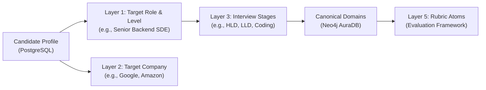

# PrepInMinutes — Master Knowledge Domains & Curriculum Registry

**Governing Standard:** [`docs/GENERIC_KNOWLEDGE_GRAPH_SCHEMA_SPEC.md`](../GENERIC_KNOWLEDGE_GRAPH_SCHEMA_SPEC.md)  
**Target Graph Engine:** Neo4j AuraDB (Cypher 5.x) & PostgreSQL (Neon DB Relational State)  
**Last Updated:** November 2026  
**Status:** 🟢 **CANONICAL REGISTRY**

---

## 1. Executive Overview

PrepInMinutes organizes technical interview preparation across **streamlined, role-oriented knowledge domains**. Rather than fragmenting computer science into dozens of academic subjects, every domain maps directly to **specific interview rounds** conducted at top tech companies (FAANG, Tier-1 Unicorns, High-Growth Startups).

All domains share the universal **4-tier canonical spine** defined in [`docs/GENERIC_KNOWLEDGE_GRAPH_SCHEMA_SPEC.md`](../GENERIC_KNOWLEDGE_GRAPH_SCHEMA_SPEC.md):
$$\text{Domain} \xrightarrow{\text{CONTAINS}} \text{Category} \xrightarrow{\text{HAS\_TOPIC}} \text{Topic} \xrightarrow{\text{HAS\_QUESTION}} \text{Question}$$

---

## 2. Master Domain Status & Inventory Matrix

| ID | Domain Name | Slug | Priority | Status | Categories | Topics | Questions | Spec File | Seed / Code Path |
| :---: | :--- | :--- | :---: | :---: | :---: | :---: | :---: | :--- | :--- |
| **D01** | **System Design (HLD & Distributed Systems)** | `system-design` | **P0** | 🟢 **LIVE IN NEO4J** | **17** | **62** | **1,240** | [`system-design.md`](./system-design.md) | `scripts/seed-data/system-design/` |
| **D02** | **AI System Design & GenAI Infra** | `ai-system-design` | **P0** | 🟢 **LIVE IN NEO4J** | **7** | **28** | **560** | [`ai-system-design.md`](./ai-system-design.md) | `scripts/seed-data/ai-system-design/` |
| **D03** | **Low-Level Design & Machine Coding** | `low-level-design` | **P0** | ⚪ *PLANNED* | *6* | *25* | *500* | Roadmap | Specification pending |
| **D04** | **Data Structures & Algorithms** | `dsa` | **P0** | ⚪ *PLANNED* | *8* | *40* | *800* | Roadmap | Specification pending |
| **D05** | **Backend & Runtime Engineering** | `backend-engineering` | **P1** | ⚪ *PLANNED* | *6* | *24* | *480* | Roadmap | Specification pending |
| **D06** | **Frontend & Web Architecture** | `frontend-engineering` | **P1** | ⚪ *PLANNED* | *5* | *20* | *400* | Roadmap | Specification pending |
| **D07** | **Cloud, DevOps & Site Reliability** | `cloud-devops` | **P1** | ⚪ *PLANNED* | *5* | *20* | *400* | Roadmap | Specification pending |
| **D08** | **Behavioral, Leadership & Management** | `behavioral-leadership`| **P0** | ⚪ *PLANNED* | *4* | *16* | *320* | Roadmap | Specification pending |
| **D09** | **Data Engineering & Big Data** | `data-engineering` | **P2** | ⚪ *PLANNED* | *5* | *20* | *400* | Roadmap | Specification pending |
| **D10** | **Mobile Engineering (iOS / Android)** | `mobile-engineering` | **P2** | ⚪ *PLANNED* | *4* | *16* | *320* | Roadmap | Specification pending |

---

## 3. Detailed Domain Profiles & Implementation Artifacts

### D01: System Design (HLD & Distributed Systems)
* **Domain Slug:** `system-design`
* **Status:** 🟢 **LIVE IN NEO4J AURADB** (Verified: Version `5.1.0`)
* **Target Interview Round:** High-Level Design (HLD), System Architecture & Scalability Round.
* **Target Audience:** SDE-2, Senior SDE, Staff Engineer, Principal Architect.
* **Graph Breakdown:**
  * **17 Categories**: Foundations, Networking, Databases, Scalability, Distributed Principles, Security, Traffic Management, Storage Components, Messaging, Coordination, Reliability, and 6 Real-World Problem Domains.
  * **62 Topics**: 21 Principles (`FND001`–`FND021`), 17 Components (`CMP001`–`CMP017`), 24 Case Studies (`SYS001`–`SYS024`).
  * **1,240 Master Questions**: Exactly 20 questions/topic (4 Beginner, 6 Intermediate, 6 Advanced, 4 Expert).
  * **Priority Ladder**: **P0 (24 Must-Master)**, **P1 (24 Senior Breadth)**, **P2 (14 Staff+ Deep Dives)**.
  * **Graph Edges**: 98 `[:PREREQUISITE_OF]` (DAG verified, 0 cycles), 81 `[:USES_COMPONENT]`, 72 `[:FOUNDED_ON]`.
* **Specification & Documentation**:
  * Catalog Specification: [`docs/domains/system-design.md`](./system-design.md)
  * Excellence Standard (8-Layer Depth): [`docs/SYSTEM_DESIGN_CURRICULUM_EXCELLENCE_STANDARD.md`](../SYSTEM_DESIGN_CURRICULUM_EXCELLENCE_STANDARD.md)
  * Taxonomy Spec: [`docs/SYSTEM_DESIGN_CURRICULUM_AND_QUESTION_TAXONOMY_SPEC.md`](../SYSTEM_DESIGN_CURRICULUM_AND_QUESTION_TAXONOMY_SPEC.md)
* **Code & Seeder Artifacts**:
  * Category Seeder: [`prepinminutes-backend/scripts/seed-data/system-design/categories.ts`](file:///Users/saurav/Desktop/development/prepinminutes-backend/scripts/seed-data/system-design/categories.ts)
  * Pillar 1 Fundamentals: [`prepinminutes-backend/scripts/seed-data/system-design/pillar-1-fundamentals.ts`](file:///Users/saurav/Desktop/development/prepinminutes-backend/scripts/seed-data/system-design/pillar-1-fundamentals.ts)
  * Pillar 2 Components: [`prepinminutes-backend/scripts/seed-data/system-design/pillar-2-components.ts`](file:///Users/saurav/Desktop/development/prepinminutes-backend/scripts/seed-data/system-design/pillar-2-components.ts)
  * Pillar 3 Case Studies: [`prepinminutes-backend/scripts/seed-data/system-design/pillar-3-case-studies.ts`](file:///Users/saurav/Desktop/development/prepinminutes-backend/scripts/seed-data/system-design/pillar-3-case-studies.ts)
  * Incremental Seeder Script: [`prepinminutes-backend/scripts/seed-system-design-v5-incremental.ts`](file:///Users/saurav/Desktop/development/prepinminutes-backend/scripts/seed-system-design-v5-incremental.ts)

---

### D02: AI System Design & GenAI Infrastructure
* **Domain Slug:** `ai-system-design`
* **Status:** 🟢 **LIVE IN NEO4J AURADB** (Verified: Version `2.0.0`)
* **Target Interview Round:** AI Systems Engineer, Applied AI Lead, LLM Infrastructure Round.
* **Target Audience:** AI Engineers, GenAI Tech Leads, ML Infrastructure Architects.
* **Graph Breakdown:**
  * **3 Pillars across 7 Categories**:
    * *Pillar 1: Principles & Fundamentals* (2 Categories: GenAI Foundations, Indexing & Alignment — 8 Topics | 160 Qs)
    * *Pillar 2: Components & Patterns* (4 Categories: Vector Storage, LLM Serving, Gateways/Evals, Agent Execution — 13 Topics | 260 Qs)
    * *Pillar 3: Case Studies* (1 Category: Production AI Case Studies — 7 Topics | 140 Qs)
  * **28 Topics**: 8 Principles (`AIP001`–`AIP008`), 13 Components (`AIC001`–`AIC013`), 7 Case Studies (`AIS001`–`AIS007`).
  * **560 Master Questions**: Exactly 20 questions/topic (4 Beginner, 6 Intermediate, 6 Advanced, 4 Expert).
  * **Priority Ladder**: **P0 (12 Core Must-Master)**, **P1 (12 High-Frequency Senior)**, **P2 (4 Staff+ Deep Dives)**.
  * **Graph Edges**: 38 `[:PREREQUISITE_OF]` (DAG verified, 0 cycles), 19 `[:USES_COMPONENT]`, 14 `[:FOUNDED_ON]`.
* **Specification File**: [`docs/domains/ai-system-design.md`](./ai-system-design.md)
* **Code & Seeder Artifacts**:
  * Category Seeder: [`prepinminutes-backend/scripts/seed-data/ai-system-design/categories.ts`](file:///Users/saurav/Desktop/development/prepinminutes-backend/scripts/seed-data/ai-system-design/categories.ts)
  * Pillar 1 Principles: [`prepinminutes-backend/scripts/seed-data/ai-system-design/pillar-1-principles.ts`](file:///Users/saurav/Desktop/development/prepinminutes-backend/scripts/seed-data/ai-system-design/pillar-1-principles.ts)
  * Pillar 2 Components: [`prepinminutes-backend/scripts/seed-data/ai-system-design/pillar-2-components.ts`](file:///Users/saurav/Desktop/development/prepinminutes-backend/scripts/seed-data/ai-system-design/pillar-2-components.ts)
  * Pillar 3 Case Studies: [`prepinminutes-backend/scripts/seed-data/ai-system-design/pillar-3-case-studies.ts`](file:///Users/saurav/Desktop/development/prepinminutes-backend/scripts/seed-data/ai-system-design/pillar-3-case-studies.ts)
  * Question Generator: [`prepinminutes-backend/scripts/seed-data/ai-system-design/question-generator.ts`](file:///Users/saurav/Desktop/development/prepinminutes-backend/scripts/seed-data/ai-system-design/question-generator.ts)
  * Incremental Seeder Script: [`prepinminutes-backend/scripts/seed-ai-system-design-incremental.ts`](file:///Users/saurav/Desktop/development/prepinminutes-backend/scripts/seed-ai-system-design-incremental.ts)

---

### D03: Low-Level Design & Machine Coding
* **Domain Slug:** `low-level-design`
* **Status:** ⚪ **PLANNED — SPECIFICATION IN PROGRESS**
* **Target Interview Round:** Low-Level Design (LLD), Object-Oriented Design (OOD), Machine Coding.
* **Target Audience:** SDE-1, SDE-2 (Mandatory round at Amazon, Uber, Atlassian, Flipkart, Swiggy).
* **Scope & Pillars**:
  1. *SOLID Principles & Clean Code Architecture*
  2. *Creational Patterns* (Factory, Builder, Singleton, Prototype)
  3. *Structural Patterns* (Adapter, Decorator, Facade, Composite, Proxy)
  4. *Behavioral Patterns* (Strategy, Observer, Command, State, Chain of Responsibility)
  5. *In-Process Concurrency & Thread Safety* (Locks, Condition variables, Deadlock prevention, Producer-Consumer)
  6. *Iconic Machine Coding Problems* (Parking Lot, Elevator/Lift System, Splitwise, In-Memory LRU Cache, Movie Ticket Booking, Chess/Snake-Ladder, Rate Limiter Class, Vending Machine).
* **Target Scale:** 25 Topics | **500 Questions**.

---

### D04: Data Structures & Algorithms (Coding Round)
* **Domain Slug:** `dsa`
* **Status:** ⚪ **PLANNED — SPECIFICATION IN PROGRESS**
* **Target Interview Round:** Technical Problem Solving / Coding Round (LeetCode-style).
* **Target Audience:** All Software Engineering Candidates (SDE-1 through Senior SDE).
* **Scope & Pattern Taxonomy**:
  1. *Two Pointers & Sliding Window*
  2. *Arrays, Hashing & String Manipulation*
  3. *Linked Lists, Stacks & Monotonic Deques*
  4. *Binary Search & Interval Scheduling*
  5. *Trees, Binary Search Trees & Tries*
  6. *Graphs & Topological Sorting* (BFS, DFS, Dijkstra, Union-Find)
  7. *Dynamic Programming & Greedy* (1D DP, 2D Grid DP, Knapsack, Bitmask)
  8. *Backtracking & Heaps / Priority Queues*
* **Target Scale:** 40 Pattern Topics | **800 Questions**.

---

### D05: Backend & Runtime Engineering
* **Domain Slug:** `backend-engineering`
* **Status:** ⚪ **PLANNED**
* **Target Interview Round:** Language Internals, Concurrency & Backend Fundamentals.
* **Scope:** Language runtime models (Java JVM garbage collection/virtual threads, Go goroutines/scheduler, Node.js event loop/libuv, Python GIL/asyncio), API design (REST/gRPC/GraphQL), OS concurrency primitives, and query tuning.
* **Target Scale:** 24 Topics | **480 Questions**.

---

### D06: Frontend & Web Architecture
* **Domain Slug:** `frontend-engineering`
* **Status:** ⚪ **PLANNED**
* **Target Interview Round:** Frontend Architecture, UI Machine Coding, Web Performance.
* **Scope:** React/Next.js internals (Fiber, Reconciliation, RSC, Hydration), Browser rendering lifecycle (Reflow, Repaint, Compositing), State management, Micro-frontends, Web Vitals optimization, and Offline PWA architecture.
* **Target Scale:** 20 Topics | **400 Questions**.

---

### D07: Cloud, DevOps & Site Reliability (SRE)
* **Domain Slug:** `cloud-devops`
* **Status:** ⚪ **PLANNED**
* **Target Interview Round:** Platform Engineering, SRE, Cloud Infrastructure.
* **Scope:** Linux cgroups/namespaces, Docker image layers, Kubernetes control plane/CNI/CSI/HPA, Terraform GitOps (ArgoCD), CI/CD pipelines, Prometheus/OpenTelemetry, Error budgets & SLOs, Chaos engineering.
* **Target Scale:** 20 Topics | **400 Questions**.

---

### D08: Behavioral, Leadership & Engineering Management
* **Domain Slug:** `behavioral-leadership`
* **Status:** ⚪ **PLANNED**
* **Target Interview Round:** Behavioral, Leadership Principles, Engineering Management & Staff+ Strategy.
* **Scope:** STAR response framework, Amazon 16 Leadership Principles, Cross-functional conflict resolution, Production outage post-mortems (blameless RCAs), Mentorship, Engineering metrics, and Architectural governance.
* **Target Scale:** 16 Topics | **320 Questions**.

---

### D09: Data Engineering & Big Data Systems
* **Domain Slug:** `data-engineering`
* **Status:** ⚪ **PLANNED**
* **Target Interview Round:** Data Platform Engineer, Big Data Architect.
* **Scope:** Kafka distributed log pipelines, Apache Spark transformations, Delta Lake / Iceberg table formats, Data warehouse dimensional modeling (Snowflake, BigQuery), Data orchestration (Airflow, Dagster).
* **Target Scale:** 20 Topics | **400 Questions**.

---

### D10: Mobile Engineering (Android / iOS / Cross-Platform)
* **Domain Slug:** `mobile-engineering`
* **Status:** ⚪ **PLANNED**
* **Target Interview Round:** iOS / Android Mobile Architecture.
* **Scope:** Android Jetpack/Compose, iOS SwiftUI/UIKit, Memory management (ARC vs GC), Offline-first SQLite sync, Background execution limits, Mobile security (Keystore/Keychain), Battery & Network profiling.
* **Target Scale:** 16 Topics | **320 Questions**.

---

## 4. The 9 Cross-Cutting Supporting Intelligence Layers

As specified in the PrepInMinutes Architecture, these 9 intelligence layers are **not standalone technical domains**. They exist as **cross-cutting graph entities, properties, and relationships** that bind candidate profiles to curriculum topics:



| Layer | Intelligence Entity | Graph / Relational Representation | Purpose in PrepInMinutes |
| :---: | :--- | :--- | :--- |
| **L1** | **Roles & Career Levels** | `(:Role {slug: "senior-backend-sde", level: "L5"})` | Maps required topics and target difficulty thresholds (`BEGINNER` $\rightarrow$ `EXPERT`). |
| **L2** | **Companies** | `(:Company {slug: "amazon"})` | Links topics to high-frequency company interview trends (`[:FREQUENTLY_ASKED_AT]`). |
| **L3** | **Interview Stages** | Metadata on practice modes | Maps user practice directly to specific rounds: Coding, HLD, LLD, Behavioral. |
| **L4** | **Interview Formats** | Filter property | Calibrates timebox: Online Assessment (OA: 60m), Tech Screen (45m), Onsite (60m). |
| **L5** | **Assessment Frameworks** | `Question.rubricAtoms`, `Question.rubricGuide` | Standardized 6-dimension grading criteria used by Sarah (Staff AI Assessor). |
| **L6** | **Learning Resources** | Referenced in question hints | High-signal book chapters (DDIA, Grokking, Clean Architecture) and RFCs. |
| **L7** | **Question Intelligence** | `Question.archetype`, `scaleAnchor`, `hints` | Prevents question repetition and drives dynamic follow-up probes. |
| **L8** | **Candidate Intelligence** | `CandidateProfile` & `document_embeddings` | Resume parsing, tech stack detection, confirmed strengths, and blind spots. |
| **L9** | **Preparation Intelligence** | `PreparationPlan`, `CandidateTopicMastery` | Time-budgeted weekly milestones, daily tasks, and readiness scoring delta. |

---

## 5. Live Neo4j Telemetry & Graph Verification

To verify the live state of all seeded domains at any time:

```bash
cd prepinminutes-backend
npx tsx -e '
import { KnowledgeGraphRepository } from "./src/server/graph/repository";
async function check() {
  const h = await KnowledgeGraphRepository.fetchDomainHierarchy("system-design");
  console.log("Domain:", h?.domainName, "| Topics:", h?.totalTopics, "| Version:", h?.version);
}
check();
'
```

