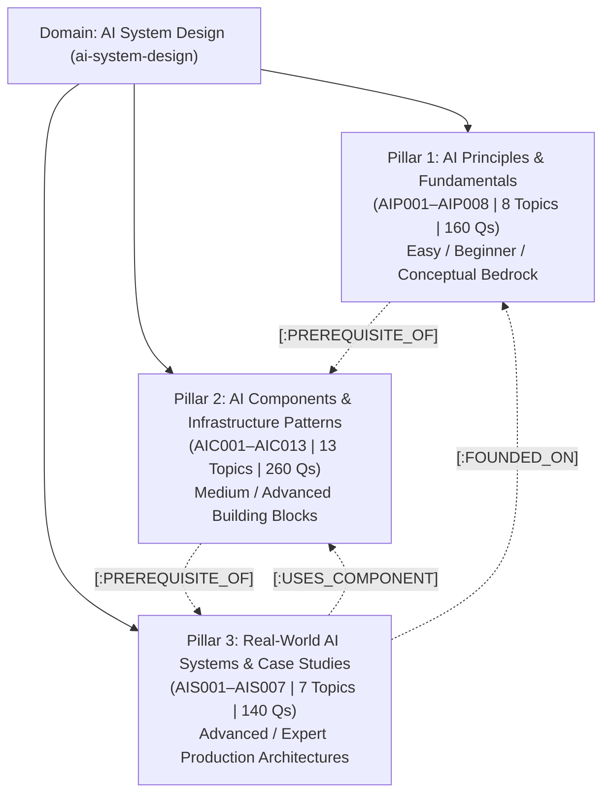

# AI System Design Domain Curriculum & Taxonomy Specification
## Generative AI Infrastructure & Autonomous Systems (28 Topics, 3 Pillars, 560 Questions)

**Domain Slug:** `ai-system-design`  
**Domain Name:** `AI System Design & Generative Infrastructure`  
**Version:** 2.0.0 (3-Pillar Master Architecture)  
**Target Database:** Neo4j AuraDB Knowledge Graph  
**Structure:** 3 Learning Pillars (Principles, Components, Case Studies)  
**Total Thematic Categories:** 6  
**Total Topics:** 28  
**Priority Distribution:** **P0: 12 Core Must-Master | P1: 12 High-Frequency/Senior | P2: 4 Specialized/Staff+**  
**Questions per Topic:** 20 (4 Beginner, 6 Intermediate, 6 Advanced, 4 Expert)  
**Total Master Question Inventory:** **560 Questions**  
**Governing Standard:** [`docs/GENERIC_KNOWLEDGE_GRAPH_SCHEMA_SPEC.md`](../GENERIC_KNOWLEDGE_GRAPH_SCHEMA_SPEC.md)  
**Status:** 🟢 **CURRICULUM SPECIFICATION FROZEN — v2.0 ARCHITECTURAL RELEASE**

---

## 1. High-Level Architecture Overview

This domain addresses technical interviews for **AI Systems Engineers**, **LLM Infrastructure Leads**, and **Applied AI Architects** across OpenAI, Anthropic, Meta GenAI, Google DeepMind, Databricks, and leading AI enterprises.

It mirrors the canonical **3-Pillar Architectural Standard** established in System Design:
1. **Pillar 1: AI Principles & Fundamentals** (`AIP001`–`AIP008`): Conceptual bedrock, mathematical metrics, token economics, and basic prompting/chunking.
2. **Pillar 2: AI Components & Infrastructure Patterns** (`AIC001`–`AIC013`): High-throughput serving, KV-caches, vector databases, GraphRAG, MCP, and AI gateways.
3. **Pillar 3: Real-World AI Systems & Case Studies** (`AIS001`–`AIS007`): End-to-end production designs connecting to components via `[:USES_COMPONENT]` and principles via `[:FOUNDED_ON]`.



---

## 2. Five Progression Levels (Candidate Experience Metadata)

Every topic adheres to the **20-Question Depth Standard** structured by difficulty:

| Level | Level Name | Question Count | Target Candidate Level | Candidate Outcome |
| :---: | :--- | :---: | :--- | :--- |
| **L1** | **Fundamentals (Easy)** | **4 Qs** | Junior AI / Data Engineer | Explain tokens, cosine similarity, embeddings, prompt structures, and API rate limits without hesitation. |
| **L2–L3** | **Intermediate (Medium)** | **6 Qs** | Mid-Level AI Engineer | Build hybrid RAG (BM25 + Dense), implement continuous batching, configure cross-encoders, and tune vector indexes. |
| **L3–L4** | **Advanced (Hard)** | **6 Qs** | Senior Applied AI Engineer | Design PagedAttention KV-caches, GraphRAG community extraction, MCP tool sandboxes, and durable agent execution. |
| **L5** | **Super Advanced (Expert)** | **4 Qs** | Staff & Principal Architect | Architect multi-tenant GPU clusters, FP8 quantization trade-offs, NCCL tensor parallelism, and adversarial jailbreak defense. |
| **Total** | **Per Topic** | **20 Qs** | **Junior to Principal** | **Complete Interview Mastery Ladder** |

---

## 3. Master Category & Topic Catalog (28 Topics | 560 Questions)

---

### Pillar 1: AI Principles & Fundamentals (8 Topics | 160 Questions)

#### Category 1.1: Generative AI & Model Foundations (`genai-foundations`)
| Topic ID | Topic Title | Slug | Priority | Prerequisites | Core Coverage & Focus |
| :---: | :--- | :--- | :---: | :--- | :--- |
| `AIP001` | **Foundations of Generative AI & LLMs** | `genai-llm-foundations` | **P0** | None | Tokens, BPE encoding, context windows, temperature, top-$p$, greedy vs sampling, prompt structures, TTFT vs TPOT basics |
| `AIP002` | **Vector Embeddings & Distance Metrics** | `vector-embeddings-distance-metrics` | **P0** | None | High-dimensional vector space, Cosine similarity, Dot product, Euclidean L2, curse of dimensionality, embedding drift |
| `AIP003` | **The Attention Mechanism & Transformers** | `attention-mechanism-transformers` | **P1** | `genai-llm-foundations` | Self-attention matrix math, Multi-Head Attention (MHA) vs GQA vs MQA, Rotary Positional Embeddings (RoPE), quadratic scaling |
| `AIP004` | **Document Ingestion, Chunking & Parsing** | `document-ingestion-chunking` | **P0** | `vector-embeddings-distance-metrics` | Token-aware chunking, recursive splitters, layout analysis, PDF/markdown extraction, contextual retrieval, late chunking |
| `AIP005` | **Prompt Engineering & Reasoning Patterns** | `prompt-engineering-reasoning` | **P0** | `genai-llm-foundations` | Zero-shot vs Few-shot, Chain-of-Thought (CoT), System instructions, structured JSON schema output enforcement, system prompts |

#### Category 1.2: Indexing & Alignment Principles (`indexing-alignment-principles`)
| Topic ID | Topic Title | Slug | Priority | Prerequisites | Core Coverage & Focus |
| :---: | :--- | :--- | :---: | :--- | :--- |
| `AIP006` | **Vector Indexing Fundamentals: IVF & HNSW** | `vector-indexing-ivf-hnsw` | **P0** | `vector-embeddings-distance-metrics` | Voronoi centroids, IVF clustering, Hierarchical Navigable Small World (HNSW) graph layers, $M$ and $efSearch$ parameters |
| `AIP007` | **The Scaling Decision: Prompt vs RAG vs Fine-Tune** | `prompting-rag-finetuning-tradeoffs` | **P0** | `genai-llm-foundations`, `document-ingestion-chunking` | Architectural decision matrix: when to retrieve, when to fine-tune (PEFT/LoRA), when to prompt; latency, cost, and knowledge bounds |
| `AIP008` | **AI Safety Foundations & Content Moderation** | `ai-safety-content-moderation` | **P1** | `genai-llm-foundations` | Toxicity classification, prompt injection 101, PII detection, regex sanitization, output moderation filters, ethical guardrails |

---

### Pillar 2: AI Components & Infrastructure Patterns (13 Topics | 260 Questions)

#### Category 2.1: Vector Storage & Retrieval Infrastructure (`vector-storage-retrieval`)
| Topic ID | Topic Title | Slug | Priority | Prerequisites | Core Coverage & Focus |
| :---: | :--- | :--- | :---: | :--- | :--- |
| `AIC001` | **Distributed Vector Databases & Partitioning** | `distributed-vector-databases` | **P0** | `vector-indexing-ivf-hnsw` | Multi-node vector sharding, replication quorums, DiskANN memory-mapped search, single-stage filtered search (ACORN) |
| `AIC002` | **Production Hybrid Retrieval & Re-Ranking** | `hybrid-retrieval-reranking` | **P0** | `document-ingestion-chunking`, `vector-indexing-ivf-hnsw` | Dense vector + Sparse lexical (BM25) fusion, Reciprocal Rank Fusion (RRF), Cohere/BGE cross-encoders, Lost-in-the-Middle compression |
| `AIC003` | **GraphRAG & Knowledge Graph-Augmented RAG** | `graphrag-knowledge-graphs` | **P1** | `hybrid-retrieval-reranking` | Entity-relationship extraction, Leiden community clustering, hierarchical graph summarization, hybrid graph-vector querying |

#### Category 2.2: LLM Serving & Compute Infrastructure (`llm-serving-compute`)
| Topic ID | Topic Title | Slug | Priority | Prerequisites | Core Coverage & Focus |
| :---: | :--- | :--- | :---: | :--- | :--- |
| `AIC004` | **High-Throughput Serving & Continuous Batching** | `llm-serving-vllm` | **P0** | `genai-llm-foundations`, `attention-mechanism-transformers` | Continuous batching, iteration-level scheduling, compute-bound prefill vs memory-bandwidth-bound decode, TensorRT-LLM |
| `AIC005` | **KV-Cache Optimization & PagedAttention** | `kv-cache-pagedattention` | **P0** | `llm-serving-vllm` | Attention KV memory allocation, PagedAttention virtual memory, Radix prefix caching, chunked prefill, prompt cache eviction |
| `AIC006` | **Quantization (FP8/AWQ) & Speculative Decoding** | `quantization-speculative-decoding` | **P1** | `llm-serving-vllm` | Weight-only vs activation quantization (AWQ, GPTQ, FP8, INT4), draft-model speculative verification, FlashAttention-2/3 kernels |
| `AIC007` | **Distributed Multi-GPU Parallelism (TP/PP/MoE)** | `distributed-multi-gpu-parallelism` | **P2** | `llm-serving-vllm` | Tensor parallelism (Megatron-LM), Pipeline parallelism, Mixture of Experts (MoE), NCCL all-reduce, NVLink/InfiniBand saturation |
| `AIC008` | **Multi-LoRA Dynamic Serving & Adapter Swapping** | `multi-lora-serving` | **P1** | `llm-serving-vllm`, `prompting-rag-finetuning-tradeoffs` | S-LoRA, Punica unified batching, dynamic adapter loading without base model duplication, parameter-efficient fine-tuning serving |

#### Category 2.3: Gateways, Observability & Evaluation (`gateways-observability-evals`)
| Topic ID | Topic Title | Slug | Priority | Prerequisites | Core Coverage & Focus |
| :---: | :--- | :--- | :---: | :--- | :--- |
| `AIC009` | **Unified AI Gateways, Routing & Semantic Caching** | `unified-ai-gateways` | **P0** | `genai-llm-foundations` | LiteLLM, Portkey, provider fallback chains, circuit breaking, GPTCache semantic similarity, token cost attribution |
| `AIC010` | **GPU Cluster Sizing & Capacity Planning** | `gpu-sizing-capacity-planning` | **P0** | `llm-serving-vllm`, `kv-cache-pagedattention` | VRAM parameter calculations, KV-cache sizing equations, Model FLOPs Utilization (MFU), spot instance management, token economics |
| `AIC011` | **Automated LLM Evaluation Pipelines & Evals** | `automated-llm-evals` | **P0** | `prompt-engineering-reasoning` | RAG Triad (Context Relevance, Groundedness, Answer Relevance), LLM-as-a-Judge calibration, regression testing, ELO benchmarks |
| `AIC012` | **LLM Observability, Tracing & Latency Telemetry** | `llm-observability-tracing` | **P1** | `unified-ai-gateways` | OpenTelemetry GenAI spans, prompt/completion token tracking, TTFT/TPOT latency waterfalls (LangSmith/Phoenix) |

#### Category 2.4: Agent Execution & Security Infrastructure (`agent-execution-security`)
| Topic ID | Topic Title | Slug | Priority | Prerequisites | Core Coverage & Focus |
| :---: | :--- | :--- | :---: | :--- | :--- |
| `AIC013` | **Agentic Control Loops, MCP & Secure Sandboxing** | `agentic-control-loops-mcp` | **P0** | `prompt-engineering-reasoning` | ReAct loop, Model Context Protocol (Anthropic MCP), stdio/SSE transports, Firecracker microVM sandboxing, tool idempotency |

---

### Pillar 3: Real-World Systems & Case Studies (7 Topics | 140 Questions)

#### Category 3.1: Production AI Case Studies (`ai-product-case-studies`)
| Topic ID | Problem Title | Slug | Priority | Used Components | Founded On Principles |
| :---: | :--- | :--- | :---: | :--- | :--- |
| `AIS001` | **Design an AI Code Assistant (Copilot / Cursor)** | `ai-code-assistant` | **P0** | `llm-serving-vllm`, `kv-cache-pagedattention`, `quantization-speculative-decoding` | `genai-llm-foundations`, `attention-mechanism-transformers` |
| `AIS002` | **Design a Real-Time Voice AI Agent (Gemini Live)** | `voice-ai-agent` | **P0** | `llm-serving-vllm`, `kv-cache-pagedattention`, `unified-ai-gateways` | `genai-llm-foundations`, `attention-mechanism-transformers` |
| `AIS003` | **Design an Enterprise Multi-Tenant Knowledge Assistant** | `enterprise-knowledge-assistant` | **P0** | `distributed-vector-databases`, `hybrid-retrieval-reranking`, `unified-ai-gateways` | `document-ingestion-chunking`, `vector-indexing-ivf-hnsw` |
| `AIS004` | **Design an Autonomous Web Research Engine (Perplexity)** | `autonomous-research-engine` | **P1** | `hybrid-retrieval-reranking`, `agentic-control-loops-mcp`, `automated-llm-evals` | `prompt-engineering-reasoning`, `prompting-rag-finetuning-tradeoffs` |
| `AIS005` | **Design an Autonomous Customer Support Agent with Tools** | `autonomous-customer-support-agent` | **P1** | `unified-ai-gateways`, `agentic-control-loops-mcp`, `llm-observability-tracing` | `prompt-engineering-reasoning`, `ai-safety-content-moderation` |
| `AIS006` | **Design a Multimodal Document & Vision Understanding Engine** | `multimodal-document-engine` | **P1** | `hybrid-retrieval-reranking`, `llm-serving-vllm` | `document-ingestion-chunking`, `vector-embeddings-distance-metrics` |
| `AIS007` | **Design a Large-Scale Vector Recommendation System** | `vector-recommendation-system` | **P2** | `distributed-vector-databases`, `hybrid-retrieval-reranking` | `vector-embeddings-distance-metrics`, `vector-indexing-ivf-hnsw` |

---

## 4. The 20-Question Distribution Matrix (28 Topics | 560 Questions)

Each topic contains exactly **20 questions** (4 Beginner, 6 Intermediate, 6 Advanced, 4 Expert):

| Pillar | Category | Topics | Beginner Qs | Intermediate Qs | Advanced Qs | Expert Qs | Total Questions |
| :--- | :--- | :---: | :---: | :---: | :---: | :---: | :---: |
| **Pillar 1: Principles** | 1.1 GenAI & Model Foundations | 5 | 20 | 30 | 30 | 20 | **100** |
| | 1.2 Indexing & Alignment Principles | 3 | 12 | 18 | 18 | 12 | **60** |
| **Pillar 2: Components** | 2.1 Vector Storage & Retrieval | 3 | 12 | 18 | 18 | 12 | **60** |
| | 2.2 LLM Serving & Compute | 5 | 20 | 30 | 30 | 20 | **100** |
| | 2.3 Gateways, Observability & Evals | 4 | 16 | 24 | 24 | 16 | **80** |
| | 2.4 Agent Execution & Security | 1 | 4 | 6 | 6 | 4 | **20** |
| **Pillar 3: Case Studies** | 3.1 Production AI Case Studies | 7 | 28 | 42 | 42 | 28 | **140** |
| **TOTAL** | **6 Categories** | **28 Topics** | **112** | **168** | **168** | **112** | **560 Questions** |

---

## 5. Priority Roadmap Breakdown

The 28 topics follow a structured three-tier priority model (**P0: 12 Core Must-Master, P1: 12 High-Frequency & Senior Breadth, P2: 4 Specialized & Staff+ Deep Dives**):

```text
Priority Distribution Matrix:
├── P0 (Core Must-Master — 12 Topics | 240 Questions)
│   ├── Fast-Track Strategy: Non-negotiable foundations, core serving, and flagship case studies (2-3 weeks prep)
│   ├── Pillar 1 (Principles): 5 Topics (AIP001, AIP002, AIP004, AIP005, AIP006, AIP007)
│   ├── Pillar 2 (Components): 4 Topics (AIC001, AIC002, AIC004, AIC005, AIC009, AIC010, AIC011, AIC013)
│   └── Pillar 3 (Problems): 3 Topics (AIS001, AIS002, AIS003)
│
├── P1 (High-Frequency & Senior Breadth — 12 Topics | 240 Questions)
│   ├── Full Preparation: Standard enterprise & mid-to-senior AI design loops (4-6 weeks prep)
│   ├── Pillar 1 (Principles): 2 Topics (AIP003, AIP008)
│   ├── Pillar 2 (Components): 4 Topics (AIC003, AIC006, AIC008, AIC012)
│   └── Pillar 3 (Problems): 3 Topics (AIS004, AIS005, AIS006)
│
└── P2 (Specialized & Staff/Principal Mastery — 4 Topics | 80 Questions)
    ├── Principal Deep Dives: Multi-GPU interconnects, custom kernels, and large-scale recommendation
    ├── Pillar 2 (Components): 1 Topic (AIC007 - Distributed Multi-GPU Parallelism)
    └── Pillar 3 (Problems): 1 Topic (AIS007 - Vector Recommendation System)

Total: 28 Topics = 560 Questions
```

---

## 6. Graph Synchronization & Data Contracts

All 28 topics conform strictly to the universal TypeScript contracts in [`src/server/graph/types.ts`](file:///Users/saurav/Desktop/development/prepinminutes-backend/src/server/graph/types.ts):

```typescript
export interface AISystemDesignTopic {
  slug: string;
  topicId: string;                 // "AIP001", "AIC001", "AIS001"
  title: string;
  pillar: 'principles' | 'components' | 'case-studies';
  categorySlug: string;
  priority: 'P0' | 'P1' | 'P2';
  difficulty: 'BEGINNER' | 'INTERMEDIATE' | 'ADVANCED' | 'EXPERT';
  durationMin: number;
  frequency: number;
  weight: number;
  trend: 'SURGING' | 'RISING' | 'STABLE';
  description: string;
  rubricAtoms: string[];
  prerequisites: string[];
  usedComponents?: string[];       // Slugs of component topics used (for Case Studies)
  foundedOn?: string[];            // Slugs of fundamental principles founded on
  questions: AISystemDesignQuestion[]; // Exactly 20 questions
}
```
