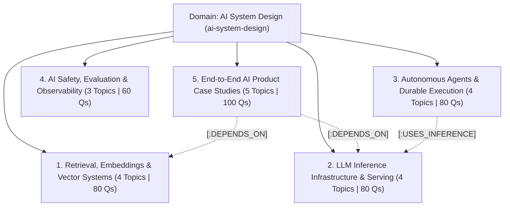

# AI System Design Domain Curriculum & Taxonomy Specification
## Generative AI Infrastructure & Autonomous Systems (20 Topics, 5 Categories, 400 Questions)

**Domain Slug:** `ai-system-design`  
**Domain Name:** `AI System Design & Generative Infrastructure`  
**Version:** 1.0 (Dedicated AI Systems Catalog)  
**Target Database:** Neo4j AuraDB Knowledge Graph  
**Structure:** 5 Specialized Categories  
**Total Topics:** 20  
**Questions per Topic:** 20 (4 Beginner, 6 Intermediate, 6 Advanced, 4 Expert)  
**Total Master Question Inventory:** **400 Questions**  
**Status:** 🟢 **CURRICULUM FROZEN — READY FOR BACKUP & SEEDING**

---

## 1. High-Level Architecture Overview

This dedicated domain addresses the surge in **AI Systems Engineer**, **LLM Infrastructure Lead**, and **Applied AI Architect** technical interviews across OpenAI, Anthropic, Meta GenAI, Google DeepMind, Databricks, and modern AI startups.



---

## 2. Five Progression Levels (Candidate Experience Metadata)

| Level | Level Name | Target Candidate Level | Candidate Outcome |
| :---: | :--- | :--- | :--- |
| **L1** | **Fundamentals** | Junior AI / Data Engineer | Explain embeddings, cosine similarity, basic prompt engineering, and API rate limits. |
| **L2** | **Basic** | Mid-Level AI Engineer | Build standard RAG pipelines with vector DBs, basic chunking, and streaming LLM responses. |
| **L3** | **Intermediate** | Senior Applied AI Engineer | Implement hybrid search (BM25 + Dense), cross-encoder re-ranking, and multi-model fallbacks. |
| **L4** | **Advanced** | Staff AI Systems Engineer | Design continuous batching (vLLM), PagedAttention KV-caches, speculative decoding, and durable agent execution. |
| **L5** | **Super Advanced** | Principal AI Architect | Architect multi-tenant GPU inference clusters, FP8 quantization trade-offs, and custom eval pipelines. |

---

## 3. Master Category & Topic Catalog (20 Topics)

---

### Category 1: Retrieval, Embeddings & Vector Systems (`vector-retrieval-systems`)
**Description:** High-dimensional vector indexing, hybrid sparse-dense retrieval, document chunking, and semantic memory.

| Topic ID | Topic Title | Slug | Priority | Core Coverage |
| :---: | :--- | :--- | :---: | :--- |
| `AI001` | **Vector Databases & High-Dimensional Indexing** | `vector-databases-indexing` | **P1** | HNSW graph navigation, IVF-Flat, Product Quantization (PQ), Cosine vs Dot Product |
| `AI002` | **Production RAG Pipeline Architecture** | `production-rag-architecture` | **P1** | Hybrid dense/sparse retrieval (BM25 + Vector), semantic chunking, metadata filtering |
| `AI003` | **Document Ingestion, Parsing & Multimodal Embeddings** | `document-ingestion-embeddings` | **P1** | OCR extraction, layout analysis, embedding drift, token window sizing, batching |
| `AI004` | **Cross-Encoder Re-Ranking & Context Compression** | `cross-encoders-context-compression` | **P1** | Two-stage retrieval, Cohere/BGE re-rankers, Long-Context Lost-in-the-Middle mitigation |

---

### Category 2: LLM Inference Infrastructure & Model Serving (`llm-inference-serving`)
**Description:** GPU cluster scheduling, KV cache optimization, continuous batching, and high-throughput model gateways.

| Topic ID | Topic Title | Slug | Priority | Core Coverage |
| :---: | :--- | :--- | :---: | :--- |
| `AI005` | **High-Throughput LLM Serving Engines (vLLM)** | `llm-serving-vllm-continuous-batching` | **P1** | Continuous batching, PagedAttention, TensorRT-LLM, GPU compute/memory bound phases |
| `AI006` | **KV Cache Optimization & Prefix Caching** | `kv-cache-prefix-caching` | **P1** | Attention KV memory footprint, multi-query/grouped-query attention (MQA/GQA), Radix Trees |
| `AI007` | **Model Routing, Semantic Caching & Rate Limiting** | `llm-gateway-semantic-caching` | **P1** | Token-bucket quotas, GPTCache semantic similarity, model fallback chains, cost tracking |
| `AI008` | **Quantization, Speculative Decoding & Latency** | `quantization-speculative-decoding` | **P2** | FP8 vs INT4 vs AWQ, draft-model speculative decoding, time-to-first-token (TTFT) tuning |

---

### Category 3: Autonomous AI Agents & Execution Platforms (`autonomous-ai-agents`)
**Description:** Long-running agent state machines, tool-calling execution sandboxes, and durable workflow replay.

| Topic ID | Topic Title | Slug | Priority | Core Coverage |
| :---: | :--- | :--- | :---: | :--- |
| `AI009` | **Multi-Agent Orchestration & Workflow Engines** | `multi-agent-orchestration-langgraph` | **P1** | LangGraph, AutoGen, state graphs, agent-to-agent communication, delegation protocols |
| `AI010` | **Tool Calling, Function Execution & Code Sandboxing** | `tool-calling-code-sandboxing` | **P1** | OpenAPI function schemas, gVisor / Firecracker microVM sandboxing, stdout streaming |
| `AI011` | **Agent State Memory, Checkpointing & Durable Replay** | `agent-memory-durable-execution` | **P1** | Short-term working context vs long-term vector memory, Temporal event-sourcing replay |
| `AI012` | **Human-in-the-Loop Workflows & Agent Recovery** | `human-in-the-loop-agent-recovery` | **P2** | Interactive confirmation gates, timeout escalation, loop detection, self-correction |

---

### Category 4: AI Safety, Evaluation & Observability (`ai-safety-observability-evals`)
**Description:** Production telemetry, automated benchmarking, hallucination tracking, and prompt attack guardrails.

| Topic ID | Topic Title | Slug | Priority | Core Coverage |
| :---: | :--- | :--- | :---: | :--- |
| `AI013` | **LLM Observability, Tracing & Cost Telemetry** | `llm-observability-tracing` | **P1** | OpenTelemetry AI attributes, LangSmith / Phoenix spans, token latency breakdown |
| `AI014` | **Automated LLM Evaluation Pipelines (Evals)** | `automated-llm-evals` | **P1** | LLM-as-a-Judge, RAGAS metrics (Faithfulness, Answer Relevance), golden datasets |
| `AI015` | **Prompt Injection Defense, PII Masking & Guardrails** | `prompt-injection-ai-guardrails` | **P1** | Direct & indirect prompt injection, NeMo Guardrails, regex/NER PII scrubbing, toxicity |

---

### Category 5: End-to-End AI Product Case Studies (`ai-product-case-studies`)
**Description:** Complete production architectures for market-defining generative AI platforms and services.

| Topic ID | Problem Title | Slug | Priority | Main Design Focus |
| :---: | :--- | :--- | :---: | :--- |
| `AI016` | **Design an AI Code Assistant (GitHub Copilot / Cursor)** | `ai-code-assistant` | **P1** | AST file indexing, local prefix/suffix context packing, sub-200ms completion latency |
| `AI017` | **Design a Real-Time Voice AI Agent (Gemini Live)** | `voice-ai-conversational-agent` | **P1** | WebSockets audio streaming, low-latency STT (Deepgram), fast LLM, streaming TTS (Cartesia) |
| `AI018` | **Design an Enterprise Multi-Tenant Knowledge Assistant** | `enterprise-knowledge-assistant` | **P1** | Per-tenant RBAC vector isolation, Google Drive/Notion/Slack ingestion connectors |
| `AI019` | **Design an Autonomous Web Research Agent (Perplexity)** | `autonomous-research-agent` | **P2** | Dynamic query fanout, parallel scraping, citation synthesizing, hallucination checking |
| `AI020` | **Design a Multimodal Document Understanding Engine** | `multimodal-document-engine` | **P2** | Vision-LLM batch processing, table/chart tokenization, structured JSON schema extraction |

---

## 4. Total Question Distribution Matrix (20 Topics | 400 Questions)

Each topic contains exactly **20 questions** (4 Beginner, 6 Intermediate, 6 Advanced, 4 Expert):

| Category | Topics | Beginner Qs | Intermediate Qs | Advanced Qs | Expert Qs | Total Questions |
| :--- | :---: | :---: | :---: | :---: | :---: | :---: |
| **1. Vector & Retrieval Systems** | 4 | 16 | 24 | 24 | 16 | **80** |
| **2. LLM Inference & Serving** | 4 | 16 | 24 | 24 | 16 | **80** |
| **3. Autonomous AI Agents** | 4 | 16 | 24 | 24 | 16 | **80** |
| **4. AI Safety & Observability** | 3 | 12 | 18 | 18 | 12 | **60** |
| **5. AI Product Case Studies** | 5 | 20 | 30 | 30 | 20 | **100** |
| **TOTAL** | **20 Topics** | **80** | **120** | **120** | **80** | **400 Questions** |

---

## 5. Phased Production Roadmap

```text
Phase 1: Core P1 Topics (High-Yield Launch Baseline)
├── 4 Vector & Retrieval Topics (80 Qs)
├── 3 LLM Serving Topics (60 Qs)
├── 3 Autonomous Agent Topics (60 Qs)
├── 3 AI Safety & Eval Topics (60 Qs)
└── 3 Flagship Case Studies (Copilot, Voice AI, Enterprise RAG - 60 Qs)
Total Phase 1: 16 Topics = 320 Questions

Phase 2: Strong P2 Topics (Advanced Research & Multimodality)
├── 1 Quantization Topic (20 Qs)
├── 1 Human-in-the-Loop Recovery Topic (20 Qs)
└── 2 Specialized Case Studies (Perplexity Agent, Multimodal Engine - 40 Qs)
Total Phase 2: 4 Topics = 80 Questions
```

