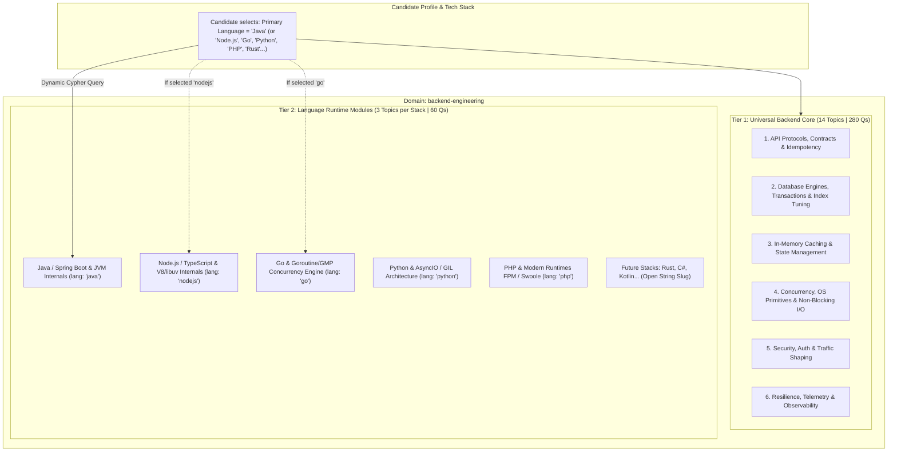
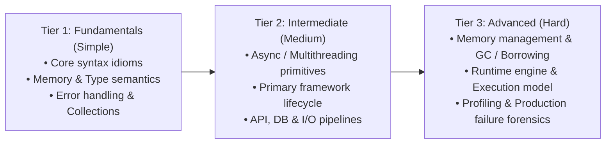

# Backend & Runtime Engineering Curriculum Specification
## Universal Production Architecture & Plug-and-Play Language Ecosystems (29 Topics, 11 Categories, 580 Questions)

**Domain Slug:** `backend-engineering`  
**Domain Name:** `Backend & Runtime Engineering`  
**Version:** 1.0.0 (Dynamic Language & Runtime Architecture)  
**Target Database:** Neo4j AuraDB Knowledge Graph  
**Structure:** 2-Tier Modular Architecture (Universal Distributed Core + Plug-and-Play Language Tiers)  
**Total Canonical Categories:** 11 Categories (6 Universal Core + 5 Initial Language Ecosystems)  
**Total Topics:** 29 Topics (14 Universal Core + 15 Language Runtime Topics across 5 initial stacks)  
**Priority Distribution:** **P0: 17 Core Must-Master | P1: 12 High-Frequency/Senior | P2: 0**  
**Questions per Topic:** 20 (4 Beginner, 6 Intermediate, 6 Advanced, 4 Expert)  
**Total Master Question Inventory:** **580 Questions**  
**Extensibility:** Open String Language Slug (`lang: "universal"` | `"java"` | `"nodejs"` | `"go"` | `"python"` | `"php"` | future languages e.g., `"rust"`, `"csharp"`, `"kotlin"`)  
**Governing Standard:** [`docs/GENERIC_KNOWLEDGE_GRAPH_SCHEMA_SPEC.md`](../GENERIC_KNOWLEDGE_GRAPH_SCHEMA_SPEC.md)  
**Status:** 🟢 **CURRICULUM SPECIFICATION FROZEN — v1.0 ARCHITECTURAL RELEASE**

---

## 1. High-Level Architecture Overview

This domain addresses technical interviews for **Backend Engineering**, **Server-Side Architecture**, **Language Runtime Internals**, and **Production Debugging Rounds** conducted at top tech firms (Uber, Stripe, Amazon, Google, Netflix, Swiggy, Razorpay, Datadog).

Rather than duplicating database, caching, and networking concepts across language-specific domains, PrepInMinutes structures Backend Engineering into a **2-Tier Modular Architecture**:

1. **Tier 1: Universal Backend Core (~65% Weight)**: Language-agnostic foundational mechanics that every backend engineer must master regardless of stack: Database indexing, ACID isolation levels, connection pooling, cache stampedes, OS concurrency, network multiplexing, and distributed tracing.
2. **Tier 2: Language Runtime Specialization (~35% Weight)**: Deep, runtime-specific technical grilling tailored to the candidate's chosen language: Memory layout, garbage collection pause tuning, event loop phases, concurrency schedulers, framework lifecycles, and heap profiling.



---

## 2. Dynamic Extensibility: Open-Ended Plug-and-Play Language Standard

To prevent brittle hardcoded enums and avoid database schema migrations, `lang` is an **open string identifier** (`lang: string`). Any language added now or in the future adheres to the standardized **3-Tier Progression Template**:



### Future Stacks Plug-and-Play Examples
* **Rust**: `rust-fundamentals` (Ownership/Borrowing) $\rightarrow$ `rust-concurrency-tokio` (Tokio/Channels) $\rightarrow$ `rust-memory-unsafe` (Unsafe/FFI/Pin).
* **C# / .NET**: `csharp-fundamentals` (Types/LINQ) $\rightarrow$ `csharp-concurrency-aspnet` (TPL/ASP.NET Core) $\rightarrow$ `csharp-clr-gc` (CLR/Generations/Span).
* **Kotlin**: `kotlin-fundamentals` (Null-safety/Coroutines basics) $\rightarrow$ `kotlin-ktor-spring` (Ktor/Structured Concurrency) $\rightarrow$ `kotlin-bytecode-jvm` (Bytecode/Inline classes/JMM).

---

## 3. The 11 Canonical Categories

```
┌──────────────────────────────────────────────────────────────────────────────────────────────────────────────────┐
│                                 BACKEND & RUNTIME ENGINEERING TAXONOMY (29 Topics)                              │
├──────────────────────────────────────┬──────────────────────────────────────┬────────────────────────────────────┤
│ UNIVERSAL CORE (14 Topics)           │ UNIVERSAL CORE (Cont.)               │ LANGUAGE RUNTIMES (15 Topics)      │
├──────────────────────────────────────┼──────────────────────────────────────┼────────────────────────────────────┤
│ Cat 1: API Protocols & Contracts     │ Cat 4: OS Concurrency & I/O          │ Cat 7: Java & JVM Ecosystem        │
│ • BE01: REST, gRPC & Protobuf        │ • BE08: Processes, Threads & Atomics │ • BE15: Java Core & Collections    │
│ • BE02: Idempotency & Webhooks       │ • BE09: Non-Blocking I/O & epoll     │ • BE16: Multithreading & Spring    │
│                                      │ • BE10: Connection Pools & Sizing    │ • BE17: JVM Memory, JMM & GC       │
│ Cat 2: Database Engines & Txns       │                                      ├────────────────────────────────────┤
│ • BE03: B-Trees, LSM & Index Tuning  │ Cat 5: Security & Traffic Shaping    │ Cat 8: Node.js Server Runtime      │
│ • BE04: ACID Isolation & Locking     │ • BE11: JWT, Sessions & OAuth2/OIDC  │ • BE18: JS Scopes & Node Core      │
│ • BE05: ORM Pitfalls & N+1 Queries   │ • BE12: Rate Limiting & Token Bucket │ • BE19: Async, Streams & Web       │
│                                      │                                      │ • BE20: Libuv, V8 Heap & Workers   │
│ Cat 3: In-Memory Caching & State     │ Cat 6: Resilience & Observability    ├────────────────────────────────────┤
│ • BE06: Cache Strategies & Stampedes │ • BE13: Circuit Breakers & Retries   │ Cat 9: Go (Golang) Ecosystem       │
│ • BE07: Distributed Locks & Leasing  │ • BE14: OpenTelemetry & Tracing      │ • BE21: Slices, Receivers & Types  │
│                                      │                                      │ • BE22: Channels & Concurrency     │
│                                      │                                      │ • BE23: GMP Scheduler & Escape GC  │
│                                      │                                      ├────────────────────────────────────┤
│                                      │                                      │ Cat 10: Python Ecosystem           │
│                                      │                                      │ • BE24: Data Model & Dunder Idioms │
│                                      │                                      │ • BE25: AsyncIO & Modern Frameworks│
│                                      │                                      │ • BE26: CPython GIL & Memory GC    │
│                                      │                                      ├────────────────────────────────────┤
│                                      │                                      │ Cat 11: Modern PHP Ecosystem       │
│                                      │                                      │ • BE27: Strict Types & OOP 8+      │
│                                      │                                      │ • BE28: PHP-FPM & Laravel IoC      │
│                                      │                                      │ • BE29: Swoole, RoadRunner & Fibers│
└──────────────────────────────────────┴──────────────────────────────────────┴────────────────────────────────────┘
```

---

## 4. Master 29-Topic Taxonomy Matrix

### Section 4.1: Universal Backend Core (`lang: "universal"`, 14 Topics)

| Topic ID | Slug | Title | Category Slug | Priority | Difficulty | Dur | Freq | Target Companies | Key Rubric Atoms |
| :---: | :--- | :--- | :--- | :---: | :---: | :---: | :---: | :--- | :--- |
| **BE01** | `rest-grpc-protocols` | REST, gRPC & Protocol Buffers | `be-api-protocols` | **P0** | INTERMEDIATE | 40m | 97 | Google, Netflix, Uber, Stripe | HTTP/2 Multiplexing, Binary Framing, Protobuf Schema Evolution, Streaming RPCs |
| **BE02** | `api-idempotency-webhooks` | API Idempotency & Webhook Delivery | `be-api-protocols` | **P0** | INTERMEDIATE | 35m | 96 | Stripe, Razorpay, PayPal, Airbnb | Idempotency Keys, Exactly-Once Semantics, Exponential Backoff, Webhook Signature Verification |
| **BE03** | `db-indexing-query-tuning` | B-Trees, LSM-Trees & Index Tuning | `be-databases-transactions` | **P0** | INTERMEDIATE | 45m | 98 | Amazon, Uber, Meta, Microsoft | B-Tree Fanout, Compound Index Leftmost Rule, Covering Index, Write Amplification |
| **BE04** | `acid-isolation-locking` | ACID Isolation Levels & Concurrency Control | `be-databases-transactions` | **P0** | ADVANCED | 45m | 99 | Stripe, Goldman Sachs, Amazon, Salesforce | Dirty/Non-Repeatable/Phantom Reads, MVCC Mechanics, Optimistic vs Pessimistic Locks, Deadlock Detection |
| **BE05** | `orm-pitfalls-nplusone` | ORM Internals & The N+1 Query Problem | `be-databases-transactions` | **P0** | INTERMEDIATE | 35m | 95 | Swiggy, Flipkart, DoorDash, Shopify | Lazy vs Eager Loading, Query Batching, Join Fetching, Connection Leaks |
| **BE06** | `cache-strategies-stampede` | Cache Invalidation & Stampede Defense | `be-caching-state` | **P0** | INTERMEDIATE | 40m | 96 | Twitter, Meta, Reddit, Pinterest | Cache-Aside, Write-Through/Behind, Dogpiling / XFetch Probabilistic Expiration, Bloom Filter Defense |
| **BE07** | `distributed-locks-leasing` | Distributed Locks & Fencing Tokens | `be-caching-state` | **P1** | ADVANCED | 40m | 92 | Uber, Airbnb, Google, AWS | Redlock Algorithm Caveats, GC Pause Clock Drift, Fencing Tokens, Lease Renewals |
| **BE08** | `os-threads-concurrency` | OS Processes, Threads & Memory Atomics | `be-os-concurrency` | **P0** | INTERMEDIATE | 40m | 95 | Microsoft, Google, Apple, Amazon | Preemptive Scheduling, Context Switch Costs, Mutex vs Spinlock, Atomic CAS Primitives |
| **BE09** | `nonblocking-io-multiplexing` | Non-Blocking I/O & Network Multiplexing | `be-os-concurrency` | **P1** | ADVANCED | 45m | 94 | Cloudflare, Datadog, Nginx, Netflix | `select` vs `poll` vs `epoll` / `kqueue`, Edge vs Level Triggering, Reactor Pattern |
| **BE10** | `db-connection-pool-sizing` | Connection Pooling & Thread Starvation | `be-os-concurrency` | **P0** | INTERMEDIATE | 35m | 93 | Amazon, Netflix, Uber, Salesforce | HikariCP Formula ($T \times (C - 1) + 1$), Queue Saturation, Epoll Descriptors, OS Socket States |
| **BE11** | `auth-jwt-oauth-security` | Stateless JWTs, Sessions & OAuth2.0 | `be-security-traffic` | **P0** | INTERMEDIATE | 40m | 97 | Auth0, Okta, Stripe, Google | JWT Expiry & Refresh Token Rotation, Stateful Revocation, OAuth2 PKCE Flow, CSRF/CORS Defense |
| **BE12** | `rate-limiting-traffic-shaping` | Rate Limiting & Traffic Shaping | `be-security-traffic` | **P0** | INTERMEDIATE | 40m | 98 | Stripe, Cloudflare, GitHub, Twitter | Token Bucket, Leaky Bucket, Sliding Window Log, Redis Lua Atomic Evaluation |
| **BE13** | `circuit-breakers-resilience` | Circuit Breakers, Bulkheads & Retries | `be-resilience-telemetry` | **P0** | INTERMEDIATE | 35m | 96 | Netflix, Amazon, Uber, Microsoft | Half-Open State Transitions, Exponential Backoff with Full Jitter, Bulkhead Thread Isolation |
| **BE14** | `distributed-tracing-opentelemetry` | OpenTelemetry, Tracing & Structured Logs | `be-resilience-telemetry` | **P1** | INTERMEDIATE | 35m | 92 | Datadog, Splunk, Uber, Google | W3C TraceContext Propagation (TraceId/SpanId), Sampling Strategies, Context Baggage |

---

### Section 4.2: Language Runtime Ecosystems (15 Topics across 5 Stacks)

| Topic ID | Slug | Title | Category Slug | `lang` | `tier` | Priority | Diff | Freq | Target Companies | Key Rubric Atoms |
| :---: | :--- | :--- | :--- | :---: | :---: | :---: | :---: | :---: | :--- | :--- |
| **BE15** | `java-fundamentals-core` | Java Core, Collections & Generics | `be-lang-java` | `java` | FUNDAMENTALS | **P0** | BEG | 96 | Amazon, Goldman, Walmart, Oracle | `equals`/`hashCode` Contract, HashMap Treeification, Generics Type Erasure, Checked vs Unchecked Exceptions |
| **BE16** | `java-concurrency-spring` | Multithreading & Spring Boot Lifecycle | `be-lang-java` | `java` | INTERMEDIATE | **P0** | INT | 98 | Amazon, Netflix, Apple, Uber | ThreadPoolExecutor Sizing, `@Transactional` Self-Invocation, Spring AOP Proxies, Bean Scopes |
| **BE17** | `java-jvm-jmm-gc` | JVM Memory, JMM & Garbage Collection | `be-lang-java` | `java` | ADVANCED | **P1** | ADV | 97 | LinkedIn, Google, Amazon, Citadel | Metaspace vs Heap, G1GC vs ZGC Concurrent Marking, `volatile` Memory Barriers, Virtual Thread Pinning |
| **BE18** | `node-fundamentals-core` | JS Core Scopes & Node.js Architecture | `be-lang-nodejs` | `nodejs` | FUNDAMENTALS | **P0** | BEG | 96 | Uber, Netflix, Stripe, PayPal | Lexical Scoping, Closures, Prototype Inheritance, `this` Binding, CommonJS vs ESM, EventEmitter, Unhandled Rejections |
| **BE19** | `node-async-streams` | Async Flows, Streams & Web Architecture | `be-lang-nodejs` | `nodejs` | INTERMEDIATE | **P0** | INT | 97 | Netflix, PayPal, Swiggy, Dunzo | `Promise.allSettled` vs `all`, Stream Backpressure (`drain` event), Express/NestJS Middleware Pipeline |
| **BE20** | `node-v8-libuv-workers` | Libuv Event Loop, V8 Heap & Workers | `be-lang-nodejs` | `nodejs` | ADVANCED | **P1** | ADV | 98 | Uber, Netflix, Datadog, Atlassian | Libuv 6 Phases, `process.nextTick` Priority, V8 Scavenge vs Mark-Sweep, Heap Dumps, Worker Threads |
| **BE21** | `go-fundamentals-core` | Go Slices, Structs, Pointers & Receivers | `be-lang-go` | `go` | FUNDAMENTALS | **P0** | BEG | 96 | Google, Uber, Cloudflare, Grab | Slice Header Internals, Value vs Pointer Receivers, Interface Duck Typing, Error Wrapping (`%w`) |
| **BE22** | `go-concurrency-channels` | Goroutines, Channels & Context Pipelines | `be-lang-go` | `go` | INTERMEDIATE | **P0** | INT | 99 | Uber, Twitch, Docker, Kubernetes | Buffered vs Unbuffered Channels, Channel Closure Semantics, `sync.Mutex` vs `RWMutex`, `context.Context` |
| **BE23** | `go-gmp-escape-gc` | GMP Scheduler, Escape Analysis & Tri-Color GC | `be-lang-go` | `go` | ADVANCED | **P1** | ADV | 97 | Google, Cloudflare, CockroachDB, Meta | GMP Work-Stealing, Compiler Escape Analysis, Tri-Color Concurrent Mark-Sweep, `pprof` Memory Profiling |
| **BE24** | `python-fundamentals-core` | Python Mechanics, Data Model & Dunder Idioms | `be-lang-python` | `python` | FUNDAMENTALS | **P0** | BEG | 94 | Meta, Instagram, Netflix, Pinterest | Mutable vs Immutable Defaults, Dict Hash Map Internals, Generators/Yield, Decorator Closures, Dunder Protocols |
| **BE25** | `python-asyncio-frameworks` | AsyncIO, Coroutines & Frameworks (FastAPI) | `be-lang-python` | `python` | INTERMEDIATE | **P0** | INT | 97 | OpenAI, Stripe, Scale AI, DoorDash | `async/await` TaskGroup, Offloading to ThreadPool (`run_in_executor`), FastAPI Depends DI, SQLAlchemy N+1 |
| **BE26** | `python-gil-memory-gc` | CPython GIL, Multiprocessing & Memory GC | `be-lang-python` | `python` | ADVANCED | **P1** | ADV | 96 | Instagram, Uber, Dropbox, Google | GIL Thread Preemption, Reference Counting & Generational Cyclic GC, `__slots__` Memory Tuning, IPC Queues |
| **BE27** | `php-fundamentals-core` | Modern PHP 8+ Types, Collections & OOP | `be-lang-php` | `php` | FUNDAMENTALS | **P0** | BEG | 92 | Meta, Slack, Automattic, Wikipedia | `declare(strict_types=1)`, Constructor Property Promotion, Enums, Match Expressions, Copy-on-Write Arrays |
| **BE28** | `php-fpm-laravel` | PHP-FPM Worker Model & Laravel IoC | `be-lang-php` | `php` | INTERMEDIATE | **P0** | INT | 95 | GitLab, Vimeo, Canva, Razorpay | Shared-Nothing Architecture, `pm.max_children` Sizing, Laravel IoC Container, Eloquent Query Batching |
| **BE29** | `php-async-swoole-fibers` | Persistent Memory (Swoole) & Fibers | `be-lang-php` | `php` | ADVANCED | **P1** | ADV | 93 | Tencent, Alibaba, Bilibili, Baidu | Persistent Memory State Leaks, Swoole Coroutine Sockets, PHP 8.1+ Fibers for Cooperative Scheduling |

---

## 5. Candidate Experience: Dynamic Prep Track Formulation

When a candidate uses PrepInMinutes, the curriculum is synthesized dynamically based on their selected stack and target seniority:

$$\begin{aligned}
\text{Total Universal Core} &= 14 \text{ Topics} \times 20 \text{ Qs} = \mathbf{280 \text{ Questions}} \\
\text{Selected Language Stack} &= 3 \text{ Topics} \times 20 \text{ Qs} = \mathbf{60 \text{ Questions}} \\
\hline
\mathbf{\text{Tailored Candidate Curriculum}} &= \mathbf{17 \text{ Topics}} \times 20 \text{ Qs} = \mathbf{340 \text{ Questions}}
\end{aligned}$$

### Seniority-Based Fast Paths
* **Junior (SDE-1)**: Focuses on **Tier 1 (Fundamentals)** topics + Universal API/DB basics.
* **Mid-Level (SDE-2)**: Focuses on **Tier 1 & Tier 2 (Intermediate)** topics + Universal Core.
* **Senior / Staff (SDE-3 / Lead)**: Fast-tracks directly to **Tier 2 & Tier 3 (Advanced)** topics + High-Concurrency/Low-Latency Core.

---

## 6. Question Schema & Depth Standard

```typescript
export interface BackendQuestionSeed {
  id: string;                         // e.g. "BE-JAVA-001"
  title: string;
  lang: string;                       // "universal" | "java" | "nodejs" | "go" | "python" | "php"
  tier: "FUNDAMENTALS" | "INTERMEDIATE" | "ADVANCED" | "CORE";
  difficulty: "BEGINNER" | "INTERMEDIATE" | "ADVANCED" | "EXPERT";
  learningLevel: "L1" | "L2" | "L3" | "L4" | "L5"; // L1=Syntax, L2=Idiom, L3=Concurrency, L4=Internals, L5=Forensics
  archetype: 
    | "mechanism"            // Internal runtime / engine mechanics
    | "trade-off"            // Architectural or algorithm trade-offs
    | "troubleshooting"      // Diagnosing memory leaks, locks, latency spikes
    | "failure-analysis"     // Production crash root cause analysis
    | "implementation";      // Writing robust, idiomatic, thread-safe code
  
  frequencyScore: number;     // 0 to 100 (Real interview frequency score)
  companies: string[];        // ["Amazon", "Uber", "Netflix", "Google", "Stripe"]
  
  prompt: string;
  rubricGuide: string;
  rubricAtoms: string[];
  hints: string[];
  followUpProbes: string[];
  expectedKeywords: string[];
  antiPatterns: string[];
}
```

---

## 7. Knowledge Graph Edge Rules (Neo4j AuraDB)

1. **Category Containment**:
   ```cypher
   (d:Domain {slug: "backend-engineering"})-[:CONTAINS]->(c:Category)
   (c:Category)-[:HAS_TOPIC]->(t:Topic)
   (t:Topic)-[:HAS_QUESTION]->(q:Question)
   ```
2. **Prerequisites DAG (`[:PREREQUISITE_OF]`)**:
   * Fundamentals topics are prerequisites of Intermediate topics (`BE15` $\rightarrow$ `BE16`, `BE18` $\rightarrow$ `BE19`, etc.).
   * Intermediate topics are prerequisites of Advanced topics (`BE16` $\rightarrow$ `BE17`, `BE19` $\rightarrow$ `BE20`, etc.).
   * Database Indexing is a prerequisite of ORM Pitfalls (`BE03` $\rightarrow$ `BE05`).
   * OS Concurrency is a prerequisite of Non-Blocking I/O (`BE08` $\rightarrow$ `BE09`).
   * **Strict DAG Enforcement**: 0 circular dependencies permitted.
3. **Dynamic Filtering Cypher Query**:
   ```cypher
   MATCH (d:Domain {slug: "backend-engineering"})-[:CONTAINS]->(c:Category)-[:HAS_TOPIC]->(t:Topic)
   WHERE t.lang = "universal" OR t.lang = $selectedLanguage
   RETURN c.name AS category, t.title AS topic, t.tier AS tier, t.difficulty AS difficulty
   ORDER BY t.tier, t.frequency DESC
   ```

---

## 8. Master Specification Approval & Next Actions

This specification freezes the curriculum for **Backend & Runtime Engineering (`backend-engineering`)**.

* [x] Universal Core identified (14 Topics, 280 Questions)
* [x] Dynamic open-ended `lang` architecture validated
* [x] Initial 5 languages scaffolded into 3 Tiers (Fundamentals $\rightarrow$ Intermediate $\rightarrow$ Advanced)
* [x] Removed redundant LeetCode tags (`isTop150`/`isBlind75`) in favor of `frequencyScore` & depth levels
* [x] Ready for seed data scaffolding and incremental Neo4j ingestion

