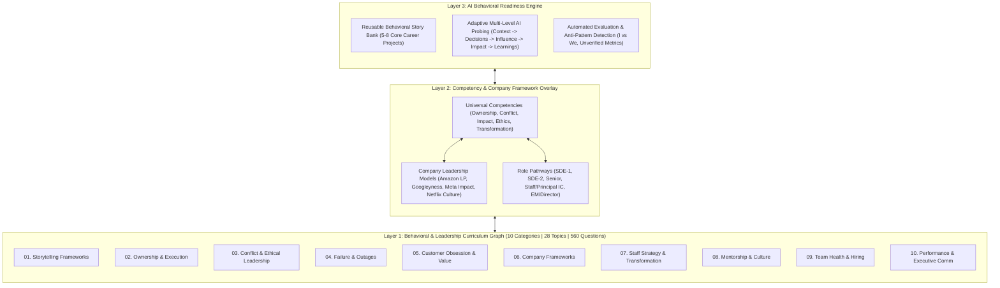
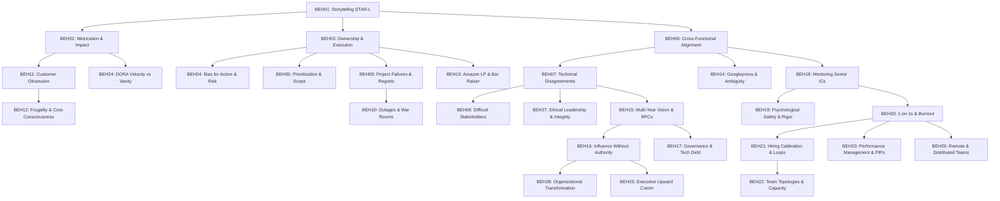

# Behavioral, Leadership & Management Specification (`behavioral-leadership`)

## 1. Domain Overview & Metadata

| Property | Value |
| :--- | :--- |
| **Domain Slug** | `behavioral-leadership` |
| **Domain Name** | Behavioral, Leadership & Management |
| **Domain Version** | `1.0.0` |
| **Total Categories** | **10 Categories** (Foundations, Execution, Ethics, Failure, Impact, Frameworks, Staff+ Strategy, Mentorship, Team Health, Performance & Executive Communication) |
| **Total Topics** | **28 Topics** (`BEH01` to `BEH28`) |
| **Total Master Questions** | **560 Questions** (Strictly 20 per topic: 4 Beginner, 6 Intermediate, 6 Advanced, 4 Expert) |
| **Topic Priority Breakdown** | **P0 (20 Essential Core Topics)**, **P1 (8 High-Impact Specialization Topics)**, **P2 (0)** |
| **Target Audience** | SDE-1 through SDE-2, Senior Engineer (L5), Staff / Principal Architect (L6+), and Engineering Manager (EM) through Director |
| **Target Interview Rounds** | Behavioral, Leadership Principles, Culture Fit, Bar Raiser, Cross-Functional Influence, Staff+ Architectural Strategy, Engineering Management & People Leadership |

---

## 2. Core Architectural Philosophy: The 3-Layer Behavioral Readiness Engine

Unlike technical coding domains that evaluate algorithmic correctness, behavioral and leadership rounds evaluate **authentic career experiences, leadership maturity, judgment under ambiguity, and communication under pressure**.

### The Three Operational Layers:
1. **Layer 1: Behavioral & Leadership Curriculum**:
   * A structured DAG of 28 competency topics spanning from foundational STAR-L storytelling to multi-year organizational transformation.
2. **Layer 2: Competency & Company Framework Overlay**:
   * Universal competencies map to company-specific values (Amazon 16 LPs, Googleyness, Meta Impact, Netflix Keeper Test, Stripe operating principles). Company principles are modeled as dynamic overlays rather than rigid silod categories.
3. **Layer 3: AI Behavioral Readiness Engine (The Story Bank)**:
   * Candidates input 5–8 genuine career stories. The engine maps those experiences across the 28 topics, coaches candidates on adapting their narratives, and executes multi-level deep probing during simulated interviews.

---

## 3. Curriculum Categories & Topics Master Registry

### Category 01: Behavioral Storytelling & Structured Frameworks (`lead-storytelling-frameworks`)
* **Focus**: Structuring authentic responses, hook-first communication, and quantifying engineering impact.
* **Topics**:
  * `BEH01` (P0) – **The STAR-L, CAR & SOAR Storytelling Frameworks**: Structuring Situation, Task, Action, Result, and Learning; avoiding the passive "We" trap; executive summary framing; and timing responses under 3 minutes.
  * `BEH02` (P0) – **Metrication & Quantifying Engineering Business Impact**: Formulating compelling metrics (P99 latency reduction, AWS cost savings, developer velocity, MTTR, revenue enablement); answering counterfactual baseline probes.

### Category 02: Ownership, Execution & Bias for Action (`lead-ownership-execution`)
* **Focus**: Driving initiatives end-to-end, unblocking dependencies, calculated risk-taking, and scope negotiation.
* **Topics**:
  * `BEH03` (P0) – **End-to-End Ownership & Unblocking Dependencies**: Proactively identifying organizational blockers; taking ownership outside immediate team boundaries; following through to production release.
  * `BEH04` (P0) – **Bias for Action vs. Calculated Risk (One-Way vs. Two-Way Doors)**: Deciding under incomplete information; irreversible vs reversible decisions; preventing analysis paralysis while managing blast radius.
  * `BEH05` (P0) – **Prioritization, Trade-offs & Scope Negotiation Under Deadlines**: Defending engineering quality against unrealistic product deadlines; managing tech debt vs feature delivery; ruthless MVP scoping.

### Category 03: Collaboration, Conflict & Ethical Leadership (`lead-conflict-collaboration-ethics`)
* **Focus**: Cross-functional alignment, productive technical disagreements, and principled decision-making.
* **Topics**:
  * `BEH06` (P0) – **Cross-Functional Collaboration (Product, Design, Sales & Data)**: Working effectively with non-engineering stakeholders; translating business goals into technical architectures; managing conflicting roadmaps.
  * `BEH07` (P0) – **Technical Disagreements, Data Defense & "Disagree and Commit"**: Resolving architectural debates using objective data and benchmarks; committing 100% once a decision is finalized despite personal reservations.
  * `BEH08` (P1) – **Managing Difficult Stakeholders & Leadership Escalation Protocols**: Identifying when to escalate without burning relationships; de-escalation tactics; constructive conflict resolution in high-stakes projects.
  * `BEH27` (P0) – **Ethical Leadership, Integrity & Responsible Decision-Making**: Pushing back on unethical pressure to compromise security/privacy; handling conflicts of interest; AI ethics and responsible technology governance.

### Category 04: Failure, Production Outages & Learning (`lead-failure-adversity`)
* **Focus**: Navigating catastrophic failures, transparent accountability, and crisis engineering leadership.
* **Topics**:
  * `BEH09` (P0) – **Navigating Major Project Failures & Architectural Regrets**: Transparently owning failures and mistakes; dissecting what went wrong without blaming team members; institutionalizing systemic learnings.
  * `BEH10` (P0) – **Production Outages, War Rooms & Post-Mortem Leadership**: Crisis leadership during SEV0/SEV1 outages; maintaining composure under executive panic; driving blameless post-mortems and root-cause prevention.

### Category 05: Customer Obsession & Business Value (`lead-customer-business-impact`)
* **Focus**: Working backwards from customer pain points, empathy, and cost-conscious engineering.
* **Topics**:
  * `BEH11` (P0) – **Customer Obsession & Working Backwards from Customer Pain**: Prioritizing long-term customer trust over short-term vanity metrics; gathering user telemetry; championing UX quality.
  * `BEH12` (P1) – **Frugality, Operational Efficiency & Cost-Conscious Engineering**: Doing more with less; optimizing infrastructure and third-party vendor spend; eliminating architectural over-engineering.

### Category 06: Company-Specific Behavioral Frameworks (`lead-company-behavioral-frameworks`)
* **Focus**: Understanding how top tech companies translate core leadership values into interview evaluation bars.
* **Topics**:
  * `BEH13` (P0) – **Amazon Leadership Principles & Bar Raiser Probing Mastery**: Deep mapping across Customer Obsession, Ownership, Dive Deep, Earn Trust, Invent and Simplify, and Are Right A Lot.
  * `BEH14` (P0) – **Googleyness, Navigating Ambiguity & Intellectual Humility**: Demonstrating intellectual humility, collaborative consensus-building, thriving in ambiguous problem spaces, and doing the right thing.

### Category 07: Technical Strategy, Governance & Transformation (`lead-staff-principal-strategy`)
* **Focus**: Staff/Principal IC leadership, architectural decision records, influence without authority, and organizational transformations.
* **Topics**:
  * `BEH15` (P0) – **Setting Multi-Year Technical Vision & Architecture Roadmaps (RFCs/ADRs)**: Authoring compelling RFCs and Architectural Decision Records; driving cross-organization consensus on multi-year technology shifts.
  * `BEH16` (P0) – **Influence Without Authority Across Multi-Team Organizations**: Leading cross-functional initiatives across 5+ independent teams without direct reporting authority; building political and technical capital.
  * `BEH17` (P1) – **Architectural Governance, Legacy Migration & Tech Debt Management**: Managing enterprise technical debt; legacy deprecation strategies; establishing organizational architectural review boards.
  * `BEH28` (P0) – **Organizational Change & Transformation Leadership**: Leading engineering transformations (e.g. monolith to services, cloud migration, platform adoption); managing engineer resistance to change; measuring transformation success.

### Category 08: Mentorship, Sponsoring & Engineering Culture (`lead-mentorship-culture`)
* **Focus**: Leveling up team capability, psychological safety, and setting high technical standards.
* **Topics**:
  * `BEH18` (P0) – **Mentoring, Coaching & Accelerating Senior IC Growth**: Leveling up mid-level engineers to senior and staff; sponsoring engineers for high-visibility projects; coaching through career plateaus.
  * `BEH19` (P1) – **Fostering Psychological Safety & High Code Review Rigor**: Building a blameless, high-trust engineering culture; setting high standards in code reviews without gatekeeping; driving inclusive hiring.

### Category 09: Team Health, 1-on-1s & Talent Acquisition (`lead-management-team-health`)
* **Focus**: Engineering management fundamentals, 1-on-1 coaching, hiring calibration, and team topologies.
* **Topics**:
  * `BEH20` (P0) – **Effective 1-on-1s, Career Pathing & Proactive Burnout Prevention**: Structuring high-leverage 1-on-1 agendas; detecting early signals of burnout; building personalized career progression frameworks.
  * `BEH21` (P0) – **Hiring Bar Calibration, Structured Interview Loops & Onboarding**: Designing rigorous, unbiased interview loops; calibrating hiring decisions; building high-velocity 30-60-90 day onboarding ramps.
  * `BEH22` (P1) – **Team Topologies, Re-organizations & Engineering Capacity Planning**: Designing team boundaries (Stream-aligned, Platform, Enabling, Complicated-subsystem); managing reorganizations; headcount planning.

### Category 10: Performance Management, Delivery & Executive Communication (`lead-management-performance-delivery`)
* **Focus**: Managing underperformance, engineering productivity metrics, executive upward communication, and distributed teams.
* **Topics**:
  * `BEH23` (P0) – **Performance Management, Constructive Feedback & PIP Navigation**: Delivering timely, direct corrective feedback; managing Performance Improvement Plans (PIPs) with empathy; compassionate offboarding.
  * `BEH24` (P0) – **Measuring Engineering Velocity (DORA / SPACE) vs. Vanity Metrics**: Tracking DORA metrics (Deployment Frequency, Lead Time, Change Failure Rate, MTTR); avoiding toxic metrics like lines of code or PR counts.
  * `BEH25` (P1) – **Executive Communication, Managing Up & Securing C-Suite Buy-in**: Framing engineering risks and investments in business terminology; managing upward expectations; securing executive budget and headcount.
  * `BEH26` (P1) – **Remote, Hybrid & Geographically Distributed Team Leadership**: Leading asynchronous engineering teams across time zones; building cohesive team rituals in remote settings; combating proximity bias.

---

## 4. Five Distinct Role-Based Pathways

| Candidate Pathway | Target Seniority | Recommended Focus Topics | Total Scope |
| :--- | :--- | :--- | :---: |
| **Junior / SDE-1** | L3 / Entry-Level | Storytelling, Teamwork, Learning, Ownership, Feedback (`BEH01`–`BEH06`, `BEH09`, `BEH11`, `BEH14`, `BEH19`) | **10 Topics / 200 Qs** |
| **Mid-Level / SDE-2** | L4 / Intermediate | Ownership, Delivery, Conflict, Customer Impact, Failure (`BEH01`–`BEH12`, `BEH14`, `BEH18`) | **14 Topics / 280 Qs** |
| **Senior Engineer** | L5 / Senior | Ambiguity, Technical Decisions, Mentoring, Business Impact (`BEH01`–`BEH14`, `BEH18`–`BEH19`, `BEH27`) | **18 Topics / 360 Qs** |
| **Staff / Principal Engineer**| L6+ / Staff+ | Multi-Year Strategy, Influence Without Authority, Org Transformation, Governance (`BEH01`–`BEH19`, `BEH27`–`BEH28`) | **20 Topics / 400 Qs** |
| **Engineering Manager / Director**| M1 / M2 / Director | Hiring, 1-on-1s, PIPs, DORA Velocity, Org Topologies, Executive Communication (`BEH01`–`BEH14`, `BEH20`–`BEH28`) | **22 Topics / 440 Qs** |

---

## 5. Question Difficulty & Learning Level Standards

Every single one of the 28 topics contains **exactly 20 questions** distributed across the standard 4-Tier Difficulty Model:

| Difficulty | Count per Topic | Total Across Domain | Evaluation Standard |
| :--- | :---: | :---: | :--- |
| **Beginner** | **4** | **112 Questions** | Foundational behavioral definitions, single-team scenarios, and clear-cut workplace situations. |
| **Intermediate** | **6** | **168 Questions** | Individual ownership, cross-functional delivery, technical disagreements, and concrete trade-offs. |
| **Advanced** | **6** | **168 Questions** | Cross-team alignment, managing ambiguity, failure post-mortems, and measurable business impact. |
| **Expert** | **4** | **112 Questions** | Multi-organization strategy, crisis leadership, transformation resistance, and Staff+/Director decisions. |
| **Total** | **20** | **560 Questions** | **100% Balanced Question Bank** |

### Multi-Level AI Probing & Evaluation Rubric:
When candidates respond to questions in simulated practice, the AI evaluator examines 6 dimensions:
1. **Situation & Context Clarity (10%)**: Did the candidate set the business problem without excessive unneeded backstory?
2. **Personal Contribution & Ownership (20%)**: Did they clearly delineate their personal actions from the team ("I" vs "We")?
3. **Decision-Making & Reasoning (20%)**: What alternatives and trade-offs were evaluated before acting?
4. **Concrete Execution & Action (15%)**: What specific engineering or leadership actions were taken?
5. **Measurable Business Impact (20%)**: Are results quantified with baseline and post-launch metrics?
6. **Self-Reflection & Systemic Learning (15%)**: What would they do differently? What systemic guardrails were instituted?

---

## 6. Prerequisite Topological DAG

---

## 7. Neo4j Graph Schema & Uniqueness Guarantees

All entities are created using deterministic keys with database engine uniqueness constraints:
1. `(:Domain {slug: "behavioral-leadership"})`
2. `(:Category {slug: string})`
3. `(:Topic {slug: string, topicId: string})`
4. `(:Question {id: string})`
5. Relationships:
   * `(Domain)-[:CONTAINS]->(Category)`
   * `(Category)-[:HAS_TOPIC]->(Topic)`
   * `(Topic)-[:HAS_QUESTION]->(Question)`
   * `(Topic)-[:PREREQUISITE_OF]->(Topic)`
