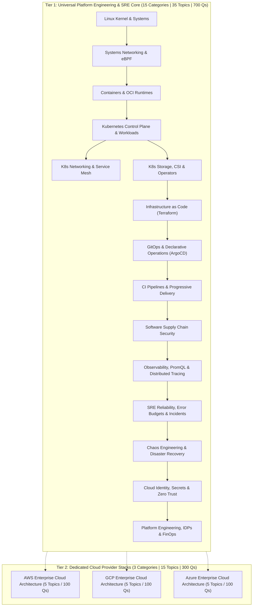

# Cloud, DevOps & Site Reliability Engineering (SRE) Specification (`cloud-devops`)

## 1. Domain Overview & Metadata

| Property | Value |
| :--- | :--- |
| **Domain Slug** | `cloud-devops` |
| **Domain Name** | Cloud, DevOps & Site Reliability Engineering |
| **Domain Version** | `1.0.0` |
| **Total Categories** | **18 Categories** (15 Universal Platform & SRE + 3 Dedicated Cloud Providers) |
| **Total Topics** | **50 Topics** (`OPS01` to `OPS50`) |
| **Total Master Questions** | **1,000 Questions** (Strictly 20 per topic) |
| **Topic Priority Breakdown** | **P0 (32 Essential Core)**, **P1 (18 High-Frequency Specialization)**, **P2 (0)** |
| **Target Audience** | Junior DevOps / Cloud Engineers up to Staff / Principal SRE & Cloud Infrastructure Architects |
| **Target Interview Rounds** | Linux & Networking Internals, Kubernetes Platform Architecture, IaC & GitOps, Production SRE & Incident Command, Cloud Architecture (AWS/GCP/Azure) |

---

## 2. Core Architectural Philosophy: The Decoupled 2-Tier Model

In modern enterprise infrastructure engineering, interviews test deep conceptual mechanics, distributed failure modes, and architectural trade-offs rather than superficial CLI trivia.

1. **Tier 1: Universal Platform Engineering & SRE Core (35 Topics / 700 Questions)**:
   * Covers foundational Linux systems, networking, container runtimes, Kubernetes, IaC, GitOps, CI/CD, supply chain security, observability, SRE reliability mathematics, incident operations, chaos engineering, and zero-trust security.
   * Transferable across any cloud or on-prem environment.
2. **Tier 2: Dedicated Cloud Provider Stacks (15 Topics / 300 Questions)**:
   * Symmetrical 5-topic tracks for **AWS**, **GCP**, and **Azure** (Foundations $\rightarrow$ Managed Workloads $\rightarrow$ Enterprise Multi-Account Architecture $\rightarrow$ Managed Data/Event Services $\rightarrow$ Security, DR & FinOps).

---

## 3. Curriculum Categories & Topics Master Registry

### Category 01: Linux Kernel, Systems & Process Internals (`devops-linux-internals`)
* **Focus**: Kernel architecture, execution contexts, process scheduling, memory virtualization, and cgroups resource isolation.
* **Topics**:
  * `OPS01` (P0) – **Linux Kernel Architecture, System Calls, Namespaces & cgroups v2**: User space vs kernel space transitions, fork/execve lifecycle, IPC mechanisms, PID/mount/net namespaces, CFS scheduler, and cgroups v2 resource controllers.
  * `OPS02` (P0) – **Process Management, Threads, Signals, systemd & System Profiling**: Init/systemd service units, signals (SIGTERM vs SIGKILL), zombie and orphan process reclamation, memory pressure (VIRT, RES, SHR, OOM killer), and kernel profiling with `strace`, `perf`, and `vmstat`.

### Category 02: Systems & Cloud Networking Architecture (`devops-networking-stack`)
* **Focus**: Deep TCP/UDP socket lifecycle, packet inspection, kernel packet filtering, and DNS resolution paths.
* **Topics**:
  * `OPS03` (P0) – **TCP/UDP Socket Lifecycle, Congestion Control, MTU & Handshakes**: 3-way handshake, SYN cookies, TCP states (TIME_WAIT, CLOSE_WAIT), socket buffer tuning, BBR/CUBIC congestion control, MTU/MSS fragmentation, and keep-alives.
  * `OPS04` (P0) – **Linux Packet Flow, Netfilter, iptables, eBPF & DNS Resolution**: Linux network stack traversal, netfilter hooks, iptables connection tracking (`conntrack`), eBPF socket filtering, DNS resolution order (`resolv.conf`, nsswitch, glibc getaddrinfo), and network diagnostics with `tcpdump` and `ss`.

### Category 03: Containerization, OCI Runtimes & Image Security (`devops-containers-runtimes`)
* **Focus**: Open Container Initiative (OCI) runtime engine, union filesystems, image optimization, and secure execution.
* **Topics**:
  * `OPS05` (P0) – **Container Runtime Architecture: OCI, containerd, runc & OverlayFS**: OCI image/runtime specs, containerd architecture, runc execution flow, Linux union mounts (OverlayFS lowerdir/upperdir/merged), and rootless container engines (Podman).
  * `OPS06` (P0) – **Dockerfile Engineering, Multi-stage Builds, Non-root Execution & Image Hardening**: BuildKit cache mounts, multi-stage builds, minimal base images (distroless, alpine), non-root UID/GID execution, capabilities dropping (`cap-drop`), and image CVE scanning.

### Category 04: Kubernetes Architecture & Control Plane Internals (`devops-k8s-control-plane`)
* **Focus**: Distributed consensus in etcd, API Server reconciliation, scheduler decision trees, and workload autoscaling.
* **Topics**:
  * `OPS07` (P0) – **Kubernetes Control Plane Architecture: API Server, etcd Consistency & Controllers**: API Server request lifecycle (authentication, authorization, admission webhooks), etcd Raft consensus, compaction/defrag, controller reconciliation loops, and control-plane HA topology.
  * `OPS08` (P0) – **Pod Lifecycle Internals: Probes, Eviction & Resource QoS Classes**: Pod phase progression, liveness/readiness/startup probe mechanics, graceful termination (`preStop`, terminationGracePeriodSeconds), Guaranteed/Burstable/BestEffort QoS classes, and kubelet eviction thresholds.
  * `OPS09` (P0) – **Workload Scheduling & Dynamic Autoscaling: HPA, VPA, KEDA & Karpenter**: Scheduler filtering and scoring plugins, node affinity/tolerations, pod topology spread constraints, Horizontal Pod Autoscaler (metrics server vs custom Prometheus metrics via KEDA), and Karpenter fast node provisioning vs Cluster Autoscaler.

### Category 05: Kubernetes Networking, CNI & Service Meshes (`devops-k8s-networking-mesh`)
* **Focus**: Packet encapsulation, pod-to-pod routing, eBPF routing, and service mesh traffic control.
* **Topics**:
  * `OPS10` (P0) – **Kubernetes Service Networking, kube-proxy & CNI Architecture**: ClusterIP, NodePort, LoadBalancer service mechanics, iptables vs IPVS vs eBPF kube-proxy modes, CNI specification, Calico IPAM/VXLAN encapsulation, and Cilium eBPF packet routing.
  * `OPS11` (P1) – **Ingress Controllers, Gateway API & Service Meshes (Istio/Envoy)**: Ingress-NGINX vs Kubernetes Gateway API, Envoy sidecar injection, mTLS certificate rotation, traffic splitting/canary routing, circuit breaking, and distributed request tracing headers.

### Category 06: Kubernetes Storage, CSI, Operators & CRDs (`devops-k8s-storage-operators`)
* **Focus**: Stateful data durability, CSI volume lifecycle, and extending Kubernetes via custom controllers.
* **Topics**:
  * `OPS12` (P0) – **Stateful Workloads & Storage: Deployments vs StatefulSets & CSI Drivers**: StatefulSet stable network IDs and ordered rollouts, PersistentVolumes, PersistentVolumeClaims, StorageClasses, dynamic provisioning, and Container Storage Interface (CSI) node/controller plugins.
  * `OPS13` (P1) – **Volume Snapshots, Stateful Durability & Kubernetes Operators / CRDs**: CSI volume snapshots, backup/restore with Velero, Custom Resource Definitions (CRDs), Operator pattern with Kubebuilder/Operator SDK, and reconciling complex distributed databases.

### Category 07: Infrastructure as Code & State Management (`devops-iac-terraform`)
* **Focus**: Declarative infrastructure, directed acyclic graphs in Terraform, remote locking, and modular platform patterns.
* **Topics**:
  * `OPS14` (P0) – **Terraform & OpenTofu Core Architecture: HCL, Dependency Graphs & Remote State**: HCL parsing, resource graph dependency resolution, state file schema, remote backends (S3, GCS, Azure Blob), and state locking with DynamoDB/consul.
  * `OPS15` (P0) – **State Operations: State Migration, Imports, Drift Detection & Taint Cycles**: `terraform state mv`, state manipulation, `terraform import` vs declarative import blocks, configuration drift detection, taint/replace mechanics, and handling corrupt states.
  * `OPS16` (P0) – **Reusable IaC Architecture: Modular Terraform, Terragrunt & Secret Injection**: Reusable enterprise modules, Terragrunt DRY patterns, multi-environment workspaces, dynamic provider configuration, and runtime secret injection (Vault / AWS Secrets Manager).

### Category 08: Declarative GitOps & Cluster Delivery (`devops-gitops-operations`)
* **Focus**: Git as the single source of truth, automated cluster reconciliation, and continuous deployment workflows.
* **Topics**:
  * `OPS17` (P0) – **GitOps Core Architecture: ArgoCD, Flux v2 & Declarative Reconciliation**: Push vs pull deployment models, ArgoCD application controller, repository server, cluster cache, Flux v2 source/kustomize controllers, and reconciliation sync loops.
  * `OPS18` (P1) – **Advanced GitOps Operations: ApplicationSets, Multi-Cluster Management & Drift Rollback**: Multi-tenant repository strategies, ApplicationSet generators, cluster matrix deployments, self-healing, sync waves, automated drift correction, and disaster recovery cluster hydration.

### Category 09: CI Pipelines & Progressive Delivery (`devops-cicd-delivery`)
* **Focus**: High-throughput automated verification, testing parallelization, and zero-downtime progressive deployment patterns.
* **Topics**:
  * `OPS19` (P0) – **Modern CI Pipeline Engineering: GitHub Actions, Parallelization & Caching**: Workflow triggers, self-hosted runner architecture, dependency caching layers, matrix builds, test sharding, artifact provenance, and build optimization.
  * `OPS20` (P0) – **Progressive Delivery: Canary Deployments, Blue-Green, Argo Rollouts & Flagger**: Blue-green routing, canary traffic shifting, automated metric analysis (success rate, latency thresholds), Argo Rollouts analysis runs, Flagger integration, and feature flags.

### Category 10: Software Supply Chain Security (`devops-supply-chain-security`)
* **Focus**: Protecting build pipelines from tampering, cryptographically signing artifacts, and automated policy enforcement.
* **Topics**:
  * `OPS21` (P1) – **Supply Chain Security: SBOM, Cosign/Sigstore & SLSA Framework**: Software Bill of Materials (SBOM generation with Syft/Trivy), container image cryptographic signing with Cosign, Rekor public transparency log, keyless signing, and SLSA Level 1-3 requirements.
  * `OPS22` (P1) – **Admission Controllers & Policy-as-Code: OPA/Gatekeeper & Kyverno**: Kubernetes Validating and Mutating Webhooks, Open Policy Agent (OPA) Rego policies, Kyverno declarative YAML policies, enforcing non-root pods, and blocking unsigned images.

### Category 11: Observability, Metrics & Distributed Tracing (`devops-observability-telemetry`)
* **Focus**: Telemetry instrumentation, time-series querying, distributed transaction tracing, and log aggregation.
* **Topics**:
  * `OPS23` (P0) – **Prometheus Architecture & PromQL: Metric Types, Scraping & Recording Rules**: Pull-based scraping, PromQL aggregations, rate/irate calculations, histogram quantiles (P95/P99), alert manager rules, and Thanos/Cortex horizontal scaling.
  * `OPS24` (P0) – **Distributed Tracing & OpenTelemetry (OTel): Spans, Collectors & Context Propagation**: OpenTelemetry API vs SDK, W3C Trace Context propagation headers, span events, OTel Collector pipelines (receivers, processors, exporters), and Jaeger/Tempo backends.
  * `OPS25` (P1) – **Centralized Logging, High Cardinality & Telemetry Cost Optimization**: Structured logging, Loki chunk indexing vs Elasticsearch inverted index, LogQL, log sampling, cardinality explosion mitigation, and telemetry storage tiering.

### Category 12: SRE Reliability, Error Budgets & Incidents (`devops-sre-incident-ops`)
* **Focus**: Quantitative reliability targets, alerting math, incident command protocols, and blameless post-mortem culture.
* **Topics**:
  * `OPS26` (P0) – **SRE Reliability Mathematics: SLIs, SLOs, SLAs, Error Budgets & Burn-Rate Alerting**: Selecting SLIs (availability, latency), setting SLO targets, error budget consumption, multi-window multi-burn-rate alerting algorithms (preventing alert fatigue), and freeze policies.
  * `OPS27` (P0) – **Incident Management & War Rooms: SEV Triage, Incident Commander & On-Call Playbooks**: Severity level definitions (SEV0–SEV3), Incident Commander role, communications lead, war room coordination, blast radius mitigation, runbook execution, and paging escalation.
  * `OPS28` (P0) – **Blameless Post-Mortems, Root Cause Analysis (5 Whys) & Reliability Metrics**: Psychological safety in failure, timeline reconstruction, contributing factors, 5 Whys analysis, preventive action item tracking, MTTD, MTTR, MTBF, and recurring failure governance.

### Category 13: Chaos Engineering, Resilience & Disaster Recovery (`devops-resilience-chaos`)
* **Focus**: Proactive failure injection, verifying recovery mechanisms, and multi-region business continuity.
* **Topics**:
  * `OPS29` (P1) – **Chaos Engineering: Fault Injection, ChaosMesh, Litmus & Game Day Testing**: Principles of chaos engineering, blast radius limitation, simulating network partition/latency, killing random pods/nodes, disk I/O saturation, and designing organizational Game Days.
  * `OPS30` (P1) – **Disaster Recovery Architecture: RPO, RTO, Multi-Region Failover & Split-Brain Recovery**: Recovery Point Objective (RPO), Recovery Time Objective (RTO), active-passive vs active-active multi-region failover, DNS routing failover (Route 53 / Traffic Manager), and split-brain resolution.

### Category 14: Cloud Identity, Secrets & Zero Trust Architecture (`devops-cloud-security`)
* **Focus**: Enterprise authentication boundaries, dynamic credential issuance, cryptographic protection, and workload isolation.
* **Topics**:
  * `OPS31` (P0) – **Cloud Identity & Access Management (IAM): RBAC, ABAC & Least Privilege**: IAM users, groups, roles, policy evaluation logic (explicit deny, allow), attribute-based access control, cross-account assume-role delegation, and permission boundaries.
  * `OPS32` (P0) – **Secrets Management & Cryptography: HashiCorp Vault, Cloud KMS & Secret Auto-Rotation**: Static secrets anti-pattern, HashiCorp Vault token/secret engines, dynamic database credentials, Cloud KMS envelope encryption, and automated secret rotation pipelines.
  * `OPS33` (P1) – **Workload Identity, Zero Trust & Cloud Security Posture Management**: Workload Identity Federation (IAM Roles for Service Accounts - IRSA), eliminating static cloud keys, mTLS east-west traffic encryption, and CIS benchmark scanning.

### Category 15: Platform Engineering, IDPs & FinOps Optimization (`devops-platform-developer-exp`)
* **Focus**: Internal developer platforms, golden path templates, automated provisioning, and cloud cost governance.
* **Topics**:
  * `OPS34` (P1) – **Platform Engineering & Internal Developer Platforms (IDPs): Backstage & Golden Paths**: The Platform Team mindset, Spotify Backstage architecture, software catalog, template scaffolding, Golden Paths, self-service infrastructure APIs, and developer experience metrics.
  * `OPS35` (P1) – **Cloud FinOps, Unit Economics & Infrastructure Cost Optimization**: FinOps lifecycle (Inform, Optimize, Operate), resource rightsizing, Spot instances, Savings Plans/Reserved Instances, Kubernetes pod resource requests optimization, and data egress cost elimination.

---

### Tier 2: Dedicated Cloud Provider Specializations (15 Topics / 300 Qs)

### Category 16: AWS Enterprise Cloud Architecture (`devops-cloud-aws`)
* **Topics**:
  * `OPS36` (P0 - Beginner) – **AWS Networking & Identity: VPC, Subnets, Gateways, Security Groups & IAM**: VPC CIDR sizing, public/private subnets, Route Tables, Internet Gateway, NAT Gateway, Security Groups vs NACLs, and IAM policies/roles.
  * `OPS37` (P0 - Intermediate) – **AWS Managed Compute & Kubernetes: EKS Architecture, Node Groups & Karpenter**: EKS control plane, managed node groups, self-managed instances, AWS VPC CNI, IRSA, Fargate serverless containers, and Karpenter autoscaling on AWS.
  * `OPS38` (P1 - Advanced) – **AWS Enterprise Architecture: Organizations, Control Tower, SCPs & Transit Gateway**: Multi-account strategy, AWS Organizations, Service Control Policies (SCPs), Transit Gateway routing, AWS Network Firewall, and Direct Connect / VPN peering.
  * `OPS39` (P1 - Intermediate) – **AWS Managed Data & Event Services: RDS Aurora, S3 Storage Tiers, DynamoDB & EventBridge**: Aurora global databases, read replicas, automated failover, S3 storage classes (Glacier/Intelligent Tiering), DynamoDB on-demand vs provisioned, SQS/SNS, and EventBridge buses.
  * `OPS40` (P1 - Advanced) – **AWS Security Governance, Disaster Recovery & Multi-Region Resilience**: AWS KMS key hierarchies, GuardDuty threat detection, Security Hub, AWS Cost Explorer & FinOps, and designing multi-region active-active disaster recovery architectures.

### Category 17: GCP Enterprise Cloud Architecture (`devops-cloud-gcp`)
* **Topics**:
  * `OPS41` (P0 - Beginner) – **GCP Resource Hierarchy, IAM Policies, VPC Networks & Firewall Rules**: Organization, folders, projects, resource hierarchy, IAM predefined/custom roles, VPC global networks, subnetworks, and VPC firewall rules.
  * `OPS42` (P0 - Intermediate) – **Google Kubernetes Engine (GKE): Autopilot vs Standard & GKE Networking**: GKE control plane, Autopilot mode, node auto-provisioning, VPC-native clusters (Alias IPs), Private Clusters, and GKE Multi-Cluster Ingress.
  * `OPS43` (P1 - Advanced) – **GCP Enterprise Networking: Shared VPC, VPC Service Controls & Cloud Armor**: Shared VPC host and service projects, VPC Service Controls (security perimeters), Cloud Interconnect, Cloud NAT, and Cloud Armor DDoS/WAF protection.
  * `OPS44` (P1 - Intermediate) – **GCP Managed Data, Messaging & Serverless: Cloud Spanner, Cloud SQL, Pub/Sub & Cloud Run**: Cloud Spanner distributed transactions, Cloud SQL HA, Pub/Sub at-least-once messaging, Cloud Run containerized serverless, and Cloud KMS.
  * `OPS45` (P1 - Advanced) – **GCP Fleet Management, Security Command Center & Multi-Region SRE**: Anthos / GKE Fleets, Policy Controller, Security Command Center (SCC), BigQuery FinOps cost export, and multi-region disaster recovery on GCP.

### Category 18: Azure Enterprise Cloud Architecture (`devops-cloud-azure`)
* **Topics**:
  * `OPS46` (P0 - Beginner) – **Azure Subscriptions, Entra ID, Virtual Networks (VNets) & NSGs**: Management groups, subscriptions, resource groups, Microsoft Entra ID (Azure AD), VNets, subnets, Network Security Groups (NSGs), and User Defined Routes (UDR).
  * `OPS47` (P0 - Intermediate) – **Azure Kubernetes Service (AKS): Architecture, Azure CNI & Managed Identities**: AKS control plane, system vs user node pools, Azure CNI vs Kubenet, Azure Workload Identity, AKS cluster autoscaler, and Virtual Nodes.
  * `OPS48` (P1 - Advanced) – **Azure Enterprise Landing Zones, Hub-Spoke Peering & Azure Front Door**: Enterprise-scale Landing Zones, Hub-and-Spoke VNet peering, Azure Firewall, Azure Private Link, and Azure Front Door global load balancing.
  * `OPS49` (P1 - Intermediate) – **Azure Managed Data, Integration & Serverless: Cosmos DB, Key Vault, Service Bus & Functions**: Cosmos DB multi-region consistency models, Azure SQL failover groups, Key Vault managed keys, Azure Service Bus queues/topics, and Azure Functions.
  * `OPS50` (P1 - Advanced) – **Azure Governance, Policy, Microsoft Defender & Multi-Region Resilience**: Azure Policy initiatives, Blueprints, Microsoft Defender for Cloud, Azure Cost Management FinOps, and multi-region active-active disaster recovery on Azure.

---

## 4. Question Difficulty & Learning Level Standards

Every single one of the 50 topics strictly adheres to the PrepInMinutes **4-Tier Difficulty Distribution**:

| Difficulty | Count per Topic | Total Across Domain | Focus |
| :--- | :---: | :---: | :--- |
| **Beginner** | **4** | **200 Questions** | Core mechanics, definitions, fundamental architecture, and basic commands. |
| **Intermediate** | **6** | **300 Questions** | Practical configurations, troubleshooting common failures, and tool usage. |
| **Advanced** | **6** | **300 Questions** | Deep internals, complex failure diagnostics, distributed edge cases, and trade-offs. |
| **Expert** | **4** | **200 Questions** | Systemic multi-failure scenarios, multi-region architecture, and Staff/Principal decisions. |
| **Total** | **20** | **1,000 Questions** | **100% Balanced Question Bank** |

### Five Separate Learning Levels (L1–L5)
* **L1 (Remember)**: Vocabulary, command flags, protocol numbers, and standard ports.
* **L2 (Understand)**: Explaining how a mechanism functions (e.g. how CFS throttling works).
* **L3 (Apply)**: Writing a Dockerfile, HCL configuration, or troubleshooting a CrashLoopBackOff.
* **L4 (Analyze & Evaluate)**: Comparing Calico vs Cilium, diagnosing etcd split-brain, or calculating burn rates.
* **L5 (Create & Architect)**: Designing a zero-trust multi-region active-active platform across failure domains.

---

## 5. Tailored Role-Based Learning Paths

The Knowledge Graph enables instant candidate personalization without forcing candidates to learn irrelevant technologies:

| Target Engineering Role | Curriculum Pathway Focus | Topics | Questions |
| :--- | :--- | :---: | :---: |
| **Site Reliability Engineer (SRE)** | Linux, Networking, Containers, K8s Control Plane, Observability, SRE Incident Ops, Chaos Engineering, Disaster Recovery | **22 Topics** | **440 Qs** |
| **Kubernetes Platform Engineer** | Linux, Containers, K8s Control Plane, K8s Networking/Mesh, K8s Storage, GitOps, IDPs/Backstage | **18 Topics** | **360 Qs** |
| **DevOps / CI/CD Engineer** | Linux, Containers, K8s Workloads, Terraform IaC, GitOps, CI/CD, Supply Chain Security, Observability | **20 Topics** | **400 Qs** |
| **AWS Cloud Infrastructure Architect** | Universal Platform Core (Selected) + Complete AWS Provider Track (`OPS36`–`OPS40`) + FinOps | **27 Topics** | **540 Qs** |
| **GCP Cloud Platform Engineer** | Universal Platform Core (Selected) + Complete GCP Provider Track (`OPS41`–`OPS45`) | **27 Topics** | **540 Qs** |
| **Azure Platform / SRE Engineer** | Universal Platform Core (Selected) + Complete Azure Provider Track (`OPS46`–`OPS50`) | **27 Topics** | **540 Qs** |
| **Cloud Security & DevSecOps Engineer**| Linux, Containers, K8s Security, Supply Chain Security, Cloud IAM, Secrets/Vault, Zero Trust | **18 Topics** | **360 Qs** |

---

## 6. Prerequisite Topological DAG

```mermaid
graph TD
  OPS01["OPS01: Linux Kernel & cgroups"] --> OPS02["OPS02: Process Mgmt & systemd"]
  OPS01 --> OPS05["OPS05: OCI & Container Runtimes"]
  OPS03["OPS03: TCP/UDP Sockets"] --> OPS04["OPS04: Packet Flow, iptables & DNS"]
  OPS05 --> OPS06["OPS06: Dockerfile Engineering"]
  OPS05 --> OPS07["OPS07: K8s Control Plane & etcd"]
  OPS07 --> OPS08["OPS08: Pod Lifecycle & Probes"]
  OPS08 --> OPS09["OPS09: K8s Scheduling & Autoscaling"]
  OPS04 --> OPS10["OPS10: K8s Service Networking & CNI"]
  OPS10 --> OPS11["OPS11: Ingress & Service Mesh"]
  OPS07 --> OPS12["OPS12: StatefulSets & CSI"]
  OPS12 --> OPS13["OPS13: Volume Snapshots & Operators"]
  OPS01 --> OPS14["OPS14: Terraform Core & Remote State"]
  OPS14 --> OPS15["OPS15: State Ops, Drift & Imports"]
  OPS15 --> OPS16["OPS16: Modular IaC & Terragrunt"]
  OPS07 --> OPS17["OPS17: GitOps & ArgoCD"]
  OPS17 --> OPS18["OPS18: ApplicationSets & Multi-Cluster"]
  OPS06 --> OPS19["OPS19: CI Pipelines & Caching"]
  OPS19 --> OPS20["OPS20: Progressive Delivery & Canary"]
  OPS06 --> OPS21["OPS21: Supply Chain & SBOM/Cosign"]
  OPS21 --> OPS22["OPS22: OPA/Gatekeeper & Kyverno"]
  OPS02 --> OPS23["OPS23: Prometheus & PromQL"]
  OPS23 --> OPS24["OPS24: Distributed Tracing & OTel"]
  OPS24 --> OPS25["OPS25: Centralized Logging & Loki"]
  OPS23 --> OPS26["OPS26: SRE SLI/SLO & Burn Alerts"]
  OPS26 --> OPS27["OPS27: Incident Command & War Rooms"]
  OPS27 --> OPS28["OPS28: Blameless Post-Mortems"]
  OPS27 --> OPS29["OPS29: Chaos Engineering"]
  OPS29 --> OPS30["OPS30: Disaster Recovery & Failover"]
  OPS14 --> OPS31["OPS31: Cloud IAM & Least Privilege"]
  OPS31 --> OPS32["OPS32: Secrets & HashiCorp Vault"]
  OPS32 --> OPS33["OPS33: Workload Identity & Zero Trust"]
  OPS17 --> OPS34["OPS34: IDPs & Backstage"]
  OPS26 --> OPS35["OPS35: Cloud FinOps & Unit Economics"]

  %% AWS Track
  OPS31 --> OPS36["OPS36: AWS Networking & IAM"]
  OPS36 --> OPS37["OPS37: EKS & Karpenter"]
  OPS36 --> OPS38["OPS38: AWS Organizations & Transit GW"]
  OPS37 --> OPS39["OPS39: AWS Aurora, S3 & EventBridge"]
  OPS38 --> OPS40["OPS40: AWS Multi-Region Resilience"]

  %% GCP Track
  OPS31 --> OPS41["OPS41: GCP Hierarchy, IAM & VPC"]
  OPS41 --> OPS42["OPS42: GKE Autopilot & Networking"]
  OPS41 --> OPS43["OPS43: GCP Shared VPC & Cloud Armor"]
  OPS42 --> OPS44["OPS44: Cloud Spanner, Pub/Sub & Run"]
  OPS43 --> OPS45["OPS45: GCP Fleets & Multi-Region SRE"]

  %% Azure Track
  OPS31 --> OPS46["OPS46: Azure Entra ID, VNets & NSG"]
  OPS46 --> OPS47["OPS47: AKS & Workload Identity"]
  OPS46 --> OPS48["OPS48: Azure Landing Zones & Front Door"]
  OPS47 --> OPS49["OPS49: Cosmos DB & Service Bus"]
  OPS48 --> OPS50["OPS50: Azure Governance & Active-Active DR"]
```

---

## 7. Neo4j Graph Schema & Uniqueness Guarantees

All entities are mapped to Neo4j with strict uniqueness constraints:
1. `(:Domain {slug: "cloud-devops"})`
2. `(:Category {slug: string})`
3. `(:Topic {slug: string, topicId: string})`
4. `(:Question {id: string})`
5. Relationships:
   * `(Domain)-[:CONTAINS]->(Category)`
   * `(Category)-[:HAS_TOPIC]->(Topic)`
   * `(Topic)-[:HAS_QUESTION]->(Question)`
   * `(Topic)-[:PREREQUISITE_OF]->(Topic)`
