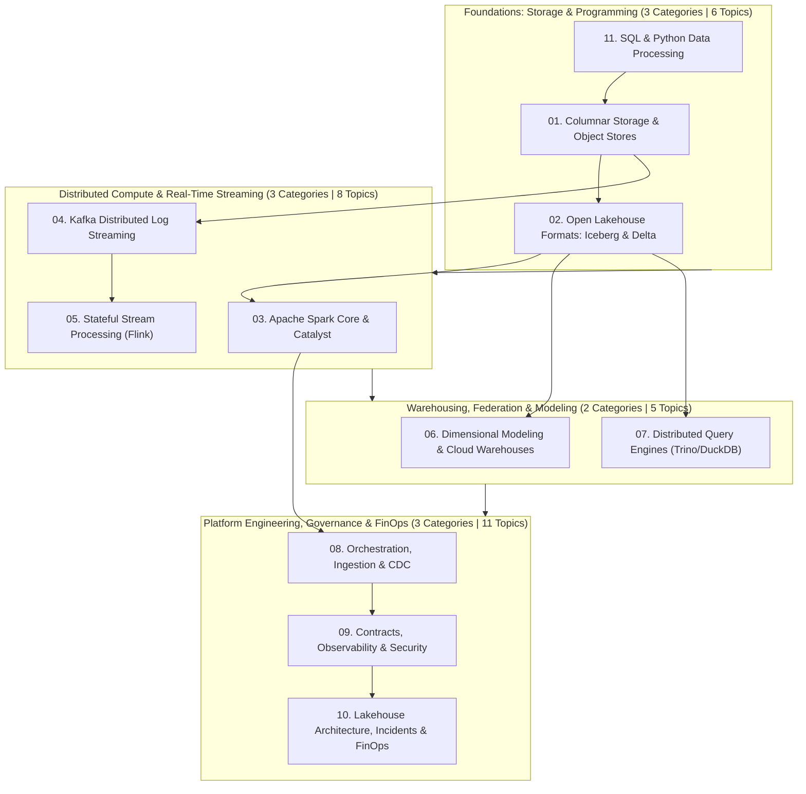
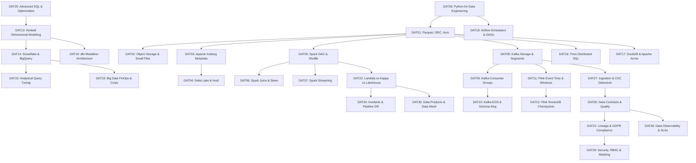

# Data Engineering & Big Data Systems Specification (`data-engineering`)

## 1. Domain Overview & Metadata

| Property | Value |
| :--- | :--- |
| **Domain Slug** | `data-engineering` |
| **Domain Name** | Data Engineering & Big Data Systems |
| **Domain Version** | `1.0.0` |
| **Total Categories** | **11 Categories** (Storage/Parquet, Lakehouse/Iceberg, Spark, Kafka, Flink, Warehousing, Query Engines, Orchestration/CDC, Governance/Observability, Platform Architecture/FinOps, SQL/Python) |
| **Total Topics** | **30 Topics** (`DAT01` to `DAT30`) |
| **Total Master Questions** | **600 Questions** (Strictly 20 per topic: 4 Beginner, 6 Intermediate, 6 Advanced, 4 Expert) |
| **Topic Priority Breakdown** | **P0 (22 Essential Core Topics)**, **P1 (8 High-Impact Specialization Topics)**, **P2 (0)** |
| **Target Audience** | Data Engineer, Analytics Engineer, Streaming / Real-Time Data Engineer, Data Platform Engineer, Enterprise Data Architect, and Principal Big Data Platform Engineer |
| **Target Interview Rounds** | SQL & Python Data Processing, Distributed Compute & Spark Internals, Real-Time Streaming & Kafka/Flink, Lakehouse Architecture, Data Modeling & Warehousing, Data Platform Architecture & FinOps |

---

## 2. Core Architectural Philosophy: The Modern Lakehouse & Data Platform

Modern data engineering evaluations at Tier-1 tech companies (Databricks, Snowflake, Uber, Netflix, Stripe, Meta, Amazon) focus on **low-level distributed mechanics, out-of-core memory management, stateful stream processing, and architectural trade-offs**:

---

## 3. Curriculum Categories & Topics Master Registry

### Category 01: Columnar Storage, Serialization & Object Stores (`data-storage-file-formats`)
* **Focus**: File format internals, columnar projection, compression codecs, and cloud object store throughput.
* **Topics**:
  * `DAT01` (P0) – **Columnar Storage Formats: Apache Parquet, ORC, Avro & Compression**: Row groups, columnar projection, predicate pushdown, dictionary encoding, bit-packing, compression algorithms (Snappy, ZSTD, Gzip), and schema evolution.
  * `DAT02` (P0) – **Object Storage Performance, S3/GCS Throughput & The Small File Problem**: S3/GCS prefix partitioning and throttling, multipart parallel uploads, byte-range requests, compaction strategies to eliminate the small file metadata bottleneck.

### Category 02: Open Lakehouse Table Formats (Iceberg & Delta Lake) (`data-lakehouse-table-formats`)
* **Focus**: ACID transactions on object storage, metadata hierarchies, time travel, and partition evolution.
* **Topics**:
  * `DAT03` (P0) – **Apache Iceberg Architecture: Metadata Trees, ACID & Partition Evolution**: Iceberg catalogs, metadata file trees, manifest lists, manifest files, snapshot isolation, hidden partitioning, and in-place partition evolution without table rewrites.
  * `DAT04` (P0) – **Delta Lake & Apache Hudi: Transaction Logs, Compaction & Time Travel**: Delta ACID transaction log (`_delta_log`), optimistic concurrency, `OPTIMIZE` bin-packing, `VACUUM` retention, and Hudi Copy-on-Write (CoW) vs Merge-on-Read (MoR).

### Category 03: Apache Spark Engine Architecture & Optimization (`data-spark-distributed-compute`)
* **Focus**: Distributed query planning, Catalyst optimizer, Tungsten execution, shuffle mechanics, and skew handling.
* **Topics**:
  * `DAT05` (P0) – **Spark Core Architecture: DAG Execution, Stages, Tasks & Shuffle Mechanics**: Catalyst logical and physical query optimization, Tungsten whole-stage code generation, RDD vs DataFrame, shuffle write/read boundaries, and spill-to-disk penalties.
  * `DAT06` (P0) – **Spark Optimization: Join Strategies, Data Skew & Memory Management**: Broadcast Hash Join vs Sort-Merge Join vs Shuffle Hash Join; mitigating severe key skew (salting, Adaptive Query Execution - AQE); Unified Memory Manager (Execution vs Storage memory).
  * `DAT07` (P1) – **Spark Structured Streaming: Micro-Batching, State Stores & Triggers**: Streaming DataFrames, micro-batch engine vs continuous processing, RocksDB state store, watermark late-data handling, and exactly-once output sinks.

### Category 04: Apache Kafka & Distributed Log Streaming (`data-streaming-kafka-distributed-logs`)
* **Focus**: Append-only commit logs, zero-copy kernel transfers, consumer group rebalances, and transactional delivery.
* **Topics**:
  * `DAT08` (P0) – **Apache Kafka Storage Internals: Commit Log, Partitions & Zero-Copy I/O**: Segment files, active segment rolling, index/timeindex files, zero-copy `sendfile()` kernel transfer, partition leader election, and ISR (In-Sync Replicas) with KRaft consensus.
  * `DAT09` (P0) – **Consumer Groups, Partition Assignment & Rebalance Protocols**: Consumer group coordinator, partition assignment strategies (Range, RoundRobin, Sticky, CooperativeSticky), avoiding stop-the-world rebalance storms, and committing offsets.
  * `DAT10` (P0) – **Kafka Delivery Guarantees: Exactly-Once Semantics (EOS) & Schema Registry**: At-most-once vs at-least-once, idempotent producers (`enable.idempotence`), transactional consumer-producer loops (`sendOffsetsToTransaction`), and Schema Registry compatibility modes (Backward, Forward, Full).

### Category 05: Stateful Stream Processing with Apache Flink (`data-stream-processing-flink`)
* **Focus**: Continuous event-driven streaming, out-of-order event time, watermarks, and distributed checkpointing.
* **Topics**:
  * `DAT11` (P0) – **Event Time, Watermarks, Windowing & Out-of-Order Streams**: Event time vs ingestion time vs processing time, punctuated vs bounded-out-of-orderness watermarks, tumbling/sliding/session windows, and handling late-arriving records.
  * `DAT12` (P1) – **Flink State Management, RocksDB & Asynchronous Barrier Checkpointing**: Keyed state vs operator state, RocksDB embedded state backend, Chandy-Lamport asynchronous barrier snapshotting, savepoints, and recovery from catastrophic node loss.

### Category 06: Dimensional Modeling & Cloud Data Warehouses (`data-warehousing-dimensional-modeling`)
* **Focus**: Analytical data modeling, Kimball methodology, cloud warehouse storage micro-partitions, and query tuning.
* **Topics**:
  * `DAT13` (P0) – **Kimball Dimensional Modeling: Star Schemas, Conformed Dimensions & SCDs**: Fact tables (Transactional, Periodic Snapshot, Accumulating Snapshot), Star vs Snowflake schemas, Factless Fact tables, and Slowly Changing Dimensions (SCD Type 1, 2, 3, 4, 6).
  * `DAT14` (P0) – **Cloud Data Warehouses: Snowflake Micro-Partitioning & BigQuery Architecture**: Snowflake architecture (Storage, Virtual Warehouses, Cloud Services), clustering keys, search optimization; BigQuery Capacitor columnar storage, Dremel slots, and partition pruning.
  * `DAT15` (P1) – **Large-Scale Analytical Query Tuning & Physical Schema Optimization**: Data clustering, sorting keys, partition elimination, materialized views, avoiding broadcast explosion, and cost-effective analytical SQL optimization.

### Category 07: Distributed Query Engines & Federation (`data-query-engines-federation`)
* **Focus**: Interactive federated SQL, MPP architectures, vectorized memory execution, and embedded analytical engines.
* **Topics**:
  * `DAT16` (P1) – **Distributed SQL Query Execution: Trino (Presto) Architecture & Connectors**: Coordinator-worker architecture, MPP distributed execution, pushdown optimization to object storage/catalogs, and federated queries across disparate data sources.
  * `DAT17` (P1) – **Vectorized In-Memory Execution: DuckDB & Apache Arrow**: Arrow columnar memory format, zero-copy inter-process exchange (IPC), DuckDB vectorized query execution, and high-performance serverless/edge analytical processing.

### Category 08: Modern Orchestration, Ingestion & Transformations (`data-orchestration-transformations`)
* **Focus**: Workflow scheduling, declarative data transformations, Medallion layering, and Change Data Capture.
* **Topics**:
  * `DAT18` (P0) – **Apache Airflow Architecture: Schedulers, Executors & Idempotent DAGs**: Airflow scheduler heartbeat, Celery vs Kubernetes executors, designing deterministic and idempotent DAGs, backfilling historical data, and dependency sensors.
  * `DAT19` (P0) – **Data Transformations with dbt: Medallion Architecture & Testing**: Bronze $\rightarrow$ Silver $\rightarrow$ Gold data layering (Medallion architecture), dbt incremental models (merge, append, delete+insert), schema testing, and semantic layer metrics.
  * `DAT27` (P0) – **Batch Data Ingestion, APIs, Connectors & Incremental Loading (CDC)**: Change Data Capture (CDC with Debezium / Kafka Connect), database WAL replication, API rate-limiting/pagination, full vs incremental loading, and handling late-arriving records.

### Category 09: Data Contracts, Quality, Observability & Security (`data-contracts-quality-observability`)
* **Focus**: Data quality validation, automated contracts, real-time observability, and enterprise access control.
* **Topics**:
  * `DAT20` (P0) – **Data Contracts, Schema Enforcement & Automated Quality Testing**: Upstream API schema enforcement, Data Contracts between Software and Data Engineering, Great Expectations / Soda quality checks, and CI/CD data pipeline validation.
  * `DAT21` (P1) – **Data Lineage, Metadata Catalogs & Compliance (GDPR / CCPA)**: OpenLineage metadata propagation, Amundsen/DataHub catalogs, column-level data lineage, Right to Be Forgotten (erasing PII across lakehouse tables), and role-based data access (RBAC/ABAC).
  * `DAT28` (P0) – **Data Observability, Freshness & Pipeline SLAs**: Continuous data monitoring (freshness, completeness, volume anomalies), pipeline SLA tracking, silent schema drift alerts, Monte Carlo / Elementary integration, and incident triage.
  * `DAT29` (P0) – **Data Security, Privacy & Access Control (RBAC/ABAC & Masking)**: Column-level and row-level security, dynamic data masking, tokenization, Apache Ranger / Unity Catalog policy enforcement, and audit trail logging.

### Category 10: Lakehouse Architecture, Operations, FinOps & Data Products (`data-lakehouse-architecture-finops`)
* **Focus**: Enterprise data platforms, cost governance, production pipeline incident recovery, and Data Mesh design.
* **Topics**:
  * `DAT22` (P0) – **Modern Big Data Architecture: Lambda vs. Kappa vs. Unified Lakehouse**: Trade-offs between Lambda (dual batch/speed layers), Kappa (single log/streaming layer), and Modern Unified Lakehouses; selecting the right architecture for streaming analytics.
  * `DAT23` (P1) – **Data Platform Cloud FinOps, Compute Rightsizing & Cost Optimization**: Controlling Snowflake/BigQuery query billing, Spot instance compute clusters for batch workloads, data egress cost elimination, and unit-cost per analytical query modeling.
  * `DAT24` (P0) – **Data Platform Production Incidents, Pipeline Debugging & Disaster Recovery**: Troubleshooting corrupt pipeline state, data duplication, dead-letter queues, backpressure propagation, and disaster recovery replication for petabyte-scale data lakes.
  * `DAT30` (P1) – **Data Products, Data Mesh & Data Platform Architecture**: Domain-oriented decentralized data ownership, Data as a Product, self-service data platform infrastructure, federated governance, and multi-tenant data platform design.

### Category 11: SQL & Data Engineering Programming (`data-sql-python-programming`)
* **Focus**: Advanced analytical SQL queries, window functions, and high-performance Python data engineering.
* **Topics**:
  * `DAT25` (P0) – **Advanced SQL, Query Execution & Optimization**: Complex window functions (LEAD, LAG, NTILE, DENSE_RANK), recursive CTEs, query execution plan analysis, index/partition pruning, and transaction isolation levels.
  * `DAT26` (P0) – **Python for Data Engineering & Data Processing**: Memory-efficient out-of-core file processing, generators/iterators, PyArrow vs Pandas, multiprocessing/multithreading for I/O pipelines, and building robust data connectors.

---

## 4. Deterministic Role-Based Preparation Pathways

Every candidate role maps to an **explicit, deterministic list of Topic IDs**:

| Target Role | Exact Topic IDs | Count | Questions |
| :--- | :--- | :---: | :---: |
| **Data Engineer (Generalist)** | `DAT01`, `DAT02`, `DAT03`, `DAT05`, `DAT06`, `DAT08`, `DAT13`, `DAT14`, `DAT18`, `DAT19`, `DAT20`, `DAT24`, `DAT25`, `DAT26`, `DAT27`, `DAT28`, `DAT29` | **17 Topics** | **340 Qs** |
| **Analytics / Warehouse Engineer**| `DAT01`, `DAT02`, `DAT03`, `DAT04`, `DAT13`, `DAT14`, `DAT15`, `DAT17`, `DAT18`, `DAT19`, `DAT20`, `DAT25`, `DAT26`, `DAT28` | **14 Topics** | **280 Qs** |
| **Streaming / Real-Time Data Engineer**| `DAT01`, `DAT03`, `DAT07`, `DAT08`, `DAT09`, `DAT10`, `DAT11`, `DAT12`, `DAT22`, `DAT24`, `DAT25`, `DAT26`, `DAT27`, `DAT28` | **14 Topics** | **280 Qs** |
| **Data Platform Engineer** | `DAT01`, `DAT02`, `DAT03`, `DAT04`, `DAT05`, `DAT06`, `DAT07`, `DAT08`, `DAT09`, `DAT10`, `DAT12`, `DAT16`, `DAT17`, `DAT18`, `DAT22`, `DAT23`, `DAT24`, `DAT26`, `DAT27`, `DAT28`, `DAT29` | **21 Topics** | **420 Qs** |
| **Enterprise Data Architect** | `DAT01`, `DAT03`, `DAT04`, `DAT05`, `DAT08`, `DAT10`, `DAT13`, `DAT14`, `DAT18`, `DAT19`, `DAT20`, `DAT21`, `DAT22`, `DAT23`, `DAT24`, `DAT25`, `DAT27`, `DAT28`, `DAT29`, `DAT30` | **20 Topics** | **400 Qs** |
| **Principal Big Data Platform Engineer**| Complete 30-Topic Curriculum (`DAT01` through `DAT30`) | **30 Topics** | **600 Qs** |

---

## 5. Question Difficulty & Learning Level Standards

Every single topic strictly contains **exactly 20 questions** adhering to the standard distribution:

| Difficulty | Count per Topic | Total Across Domain | Evaluation Standard |
| :--- | :---: | :---: | :--- |
| **Beginner** | **4** | **120 Questions** | Fundamentals, terminology, core data structures, and simple SQL/Python operations. |
| **Intermediate** | **6** | **180 Questions** | Practical configurations, transformations, partition management, and common debugging. |
| **Advanced** | **6** | **180 Questions** | Distributed execution internals, skew mitigation, memory tuning, and complex failure recovery. |
| **Expert** | **4** | **120 Questions** | Petabyte-scale architecture, multi-region stream recovery, FinOps modeling, and platform strategy. |
| **Total** | **20** | **600 Questions** | **100% Balanced Question Bank** |

---

## 6. Prerequisite Topological DAG

---

## 7. Neo4j Graph Schema & Uniqueness Guarantees

All entities are created using deterministic keys with database engine uniqueness constraints:
1. `(:Domain {slug: "data-engineering"})`
2. `(:Category {slug: string})`
3. `(:Topic {slug: string, topicId: string})`
4. `(:Question {id: string})`
5. Relationships:
   * `(Domain)-[:CONTAINS]->(Category)`
   * `(Category)-[:HAS_TOPIC]->(Topic)`
   * `(Topic)-[:HAS_QUESTION]->(Question)`
   * `(Topic)-[:PREREQUISITE_OF]->(Topic)`
