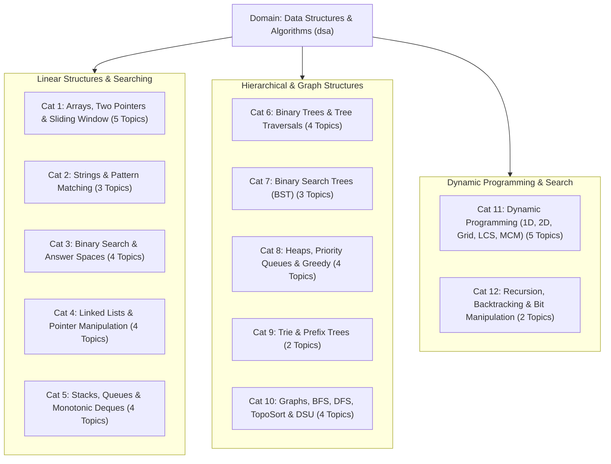

# Data Structures & Algorithms Curriculum Specification
## Algorithmic Patterns, Complexity Analysis & Company-Tagged Problem Taxonomy (40 Topics, 12 Categories, 800 Questions)

**Domain Slug:** `dsa`  
**Domain Name:** `Data Structures & Algorithms`  
**Version:** 1.0.0 (Pattern-Based Master Architecture)  
**Target Database:** Neo4j AuraDB Knowledge Graph  
**Structure:** 12 Thematic Categories across 40 Pattern Topics  
**Total Topics:** 40  
**Priority Distribution:** **P0: 20 Core Must-Master | P1: 15 High-Frequency/Senior | P2: 5 Specialized/Hard**  
**Questions per Topic:** 20 (4 Beginner, 6 Intermediate, 6 Advanced, 4 Expert)  
**Total Master Question Inventory:** **800 Questions**  
**Curated Subsets:** **Top 150 Track (`isTop150`)**, **Blind 75 Sprint (`isBlind75`)**  
**Governing Standard:** [`docs/GENERIC_KNOWLEDGE_GRAPH_SCHEMA_SPEC.md`](../GENERIC_KNOWLEDGE_GRAPH_SCHEMA_SPEC.md)  
**Status:** 🟢 **CURRICULUM SPECIFICATION FROZEN — v1.0 ARCHITECTURAL RELEASE**

---

## 1. High-Level Architecture Overview

This domain addresses technical interviews for **Data Structures & Algorithms (DSA)**, **Live Coding**, and **Algorithmic Problem Solving Rounds** conducted at Google, Meta, Amazon, Apple, Microsoft, Netflix, Uber, Atlassian, Bloomberg, and top unicorns.

Unlike academic computer science courses that focus on algorithm proofs, technical interview coding evaluates:
1. **Algorithmic Pattern Recognition**: Mapping an ambiguous problem to proven paradigms (Two Pointers, Sliding Window, Monotonic Stack, Binary Search on Answer Space, DFS/BFS, Topological Sort, DP).
2. **Time and Space Complexity Rigor**: Accurately deriving Big-$O$ time complexity and auxiliary space limits ($O(1)$ space optimization, avoiding stack overflow in recursion).
3. **Corner Case Resiliency**: Flawlessly handling empty arrays, single elements, integer overflow, cycle traps, and off-by-one errors.
4. **Execution Under Time Constraints**: Delivering clean, working, bug-free implementations within 20–35 minutes.



---

## 2. Dynamic Popularity & Curated Sprints Schema

Every question node in the graph stores real-time popularity and sprint metadata:

```json
{
  "id": "q_arrays_two_sum",
  "title": "Two Sum (Hash Map Lookup)",
  "difficulty": "BEGINNER",
  "learningLevel": "L1",
  "archetype": "implementation",
  
  // Dynamic Popularity & Market Signals
  "frequencyScore": 99,
  "trend": "HOT",
  
  // Curated Sprint Tracks
  "isTop150": true,
  "isBlind75": true,
  
  // Real Company Sighting Tags
  "companies": ["Google", "Amazon", "Meta", "Apple", "Microsoft", "Uber", "Goldman Sachs"]
}
```

### The 3 Preparation Modes:
1. **⚡ Blind 75 Sprint (`isBlind75 = true`)**: Exactly 75 foundational pattern anchors for emergency 1–2 week preparation.
2. **🎯 Top 150 Core (`isTop150 = true`)**: The curated 150-question industry benchmark covering 95% of interview variations (3–4 weeks).
3. **🏆 Full Mastery (800 Questions)**: Complete multi-tier curriculum from Junior SDE to Staff-level optimizations.

---

## 3. The 12 Canonical Categories

```
┌──────────────────────────────────────────────────────────────────────────────────────────────────┐
│                             DATA STRUCTURES & ALGORITHMS (40 Topics)                             │
├────────────────────────────────┬────────────────────────────────┬───────────────────────────────┤
│ Cat 1: Arrays & Two Pointers   │ Cat 2: Strings & Matching      │ Cat 3: Binary Search          │
│ • DSA01: Two Pointers          │ • DSA06: Palindromes & String  │ • DSA09: Classic Binary Search│
│ • DSA02: Sliding Window        │ • DSA07: Anagrams & Frequency  │ • DSA10: Rotated Binary Search│
│ • DSA03: Prefix Sums & Hashing │ • DSA08: KMP & Rabin-Karp      │ • DSA11: Answer Space Minimax │
│ • DSA04: Kadane & Inversions   │                                │ • DSA12: Median of Sorted Arr │
│ • DSA05: 2D Matrix Traversal   │                                │                               │
├────────────────────────────────┼────────────────────────────────┼───────────────────────────────┤
│ Cat 4: Linked Lists            │ Cat 5: Stacks & Queues         │ Cat 6: Binary Trees           │
│ • DSA13: Reversals & Cycles    │ • DSA17: Stack Foundations     │ • DSA21: DFS & Traversals     │
│ • DSA14: Multi-List & Math     │ • DSA18: Monotonic Next Greater│ • DSA22: Symmetry & Views     │
│ • DSA15: Pointer Manipulation  │ • DSA19: Histogram & Rainwater │ • DSA23: LCA & Path Sums      │
│ • DSA16: LRU Cache Composite   │ • DSA20: Deque Sliding Window  │ • DSA24: Tree Construction    │
├────────────────────────────────┼────────────────────────────────┼───────────────────────────────┤
│ Cat 7: Binary Search Trees     │ Cat 8: Heaps & Greedy          │ Cat 9: Trie & Prefix Trees    │
│ • DSA25: BST Ordering & LCA    │ • DSA28: Top-K & Heap Sort     │ • DSA32: Trie Implementations │
│ • DSA26: BST Transformations   │ • DSA29: Two Heaps Streaming   │ • DSA33: Word Search with Trie│
│ • DSA27: Advanced BST & Serial │ • DSA30: Interval Scheduling   │                               │
│                                │ • DSA31: Greedy Job Sequencing │                               │
├────────────────────────────────┼────────────────────────────────┼───────────────────────────────┤
│ Cat 10: Graphs & Networks      │ Cat 11: Dynamic Programming    │ Cat 12: Backtracking & Bits   │
│ • DSA34: Traversals & Islands  │ • DSA38: 1D DP & Array State   │ • DSA39: Backtracking Solvers │
│ • DSA35: Cycle & Bipartite     │ • DSA39: Subsequences & LIS    │ • DSA40: Bitwise & Bitmasks   │
│ • DSA36: Topological Sort      │ • DSA40: Knapsack & Subsets    │                               │
│ • DSA37: Shortest Path & DSU   │ • DSA41: 2D Grid DP            │                               │
│                                │ • DSA42: String DP & MCM       │                               │
└────────────────────────────────┴────────────────────────────────┴───────────────────────────────┘
```

---

## 4. Master Topic Inventory & Catalog Breakdown

### Linear Structures & Searching (Topics 1–12)

| Topic ID | Slug | Topic Name | Category | Priority | Difficulty | Core Pattern & Key Problems |
| :---: | :--- | :--- | :--- | :---: | :---: | :--- |
| `DSA01` | `arrays-two-pointers` | Two Pointers & In-Place Operations | `dsa-arrays-two-pointers` | **P0** | BEGINNER | Converging pointers, 3Sum, 4Sum, Container with Most Water, Sort 0s/1s/2s (Dutch Flag), Remove Duplicates. |
| `DSA02` | `sliding-window-fixed-dynamic` | Sliding Window (Fixed & Dynamic) | `dsa-arrays-two-pointers` | **P0** | INTERMEDIATE | Longest Substring Without Repeating, Minimum Window Substring, Permutation in String, Max Consecutive Ones III. |
| `DSA03` | `prefix-sums-hash-tables` | Prefix Sums & Subarray Hash Maps | `dsa-arrays-two-pointers` | **P0** | INTERMEDIATE | Subarray Sum Equals K, Continuous Subarray Sum, Product of Array Except Self, Range Sum Query 2D. |
| `DSA04` | `kadane-inversions-math` | Kadane's Algorithm & Inversions | `dsa-arrays-two-pointers` | **P0** | INTERMEDIATE | Maximum Subarray (Kadane), Max Product Subarray, Majority Element, Stock Buy & Sell I & II, Count Inversions. |
| `DSA05` | `matrix-traversal-manipulation` | 2D Matrix Traversal & Manipulation | `dsa-arrays-two-pointers` | **P1** | INTERMEDIATE | Set Matrix Zeroes, Rotate Image 90° in-place, Spiral Matrix, Search a 2D Matrix I & II. |
| `DSA06` | `strings-palindromes-parsing` | String Parsing & Palindromes | `dsa-strings-matching` | **P0** | BEGINNER | Valid Palindrome, Reverse Words in String, Longest Common Prefix, String Compression. |
| `DSA07` | `strings-anagrams-grouping` | Anagrams & Frequency Counting | `dsa-strings-matching` | **P0** | BEGINNER | Valid Anagram, Group Anagrams, Remove All Occurrences of Substring. |
| `DSA08` | `string-matching-kmp-rabin-karp` | Pattern Matching: KMP & Rabin-Karp | `dsa-strings-matching` | **P1** | ADVANCED | Knuth-Morris-Pratt (LPS array, $O(N+M)$), Rabin-Karp polynomial rolling hash, Repeated String Match. |
| `DSA09` | `binary-search-boundaries` | Classic Binary Search & Boundaries | `dsa-binary-search` | **P0** | BEGINNER | Lower/Upper bounds, Peak Index in Mountain Array, Single Element in Sorted Array, First/Last Occurrence. |
| `DSA10` | `binary-search-rotated-arrays` | Search in Rotated & Modified Arrays | `dsa-binary-search` | **P0** | INTERMEDIATE | Search in Rotated Sorted Array I & II, Find Minimum in Rotated Sorted Array. |
| `DSA11` | `binary-search-answer-space` | Binary Search on Answer Space | `dsa-binary-search` | **P0** | INTERMEDIATE | Allocate Minimum Pages (Book Allocation), Painter's Partition, Aggressive Cows, Capacity to Ship Packages. |
| `DSA12` | `binary-search-median-two-arrays`| Median & K-th Element in Two Arrays | `dsa-binary-search` | **P1** | ADVANCED | Median of Two Sorted Arrays ($O(\log(\min(N, M)))$ binary partition), Kth Element of Two Sorted Arrays. |

---

### Linked Data Structures, Stacks & Queues (Topics 13–20)

| Topic ID | Slug | Topic Name | Category | Priority | Difficulty | Core Pattern & Key Problems |
| :---: | :--- | :--- | :--- | :---: | :---: | :--- |
| `DSA13` | `linked-list-reversals-cycles` | Reversals, Cycles & Fast/Slow Pointers | `dsa-linked-lists` | **P0** | BEGINNER | Reverse a LL, Middle of LL (Floyd's Cycle), Detect Cycle, Remove Cycle, Palindrome LL check. |
| `DSA14` | `linked-list-multi-merge-math` | Multi-List Merging & Arithmetic | `dsa-linked-lists` | **P0** | INTERMEDIATE | Merge Two Sorted Lists, Add Two Numbers, Reverse Nodes in K-Groups, Rotate a LL. |
| `DSA15` | `linked-list-complex-pointers` | Complex Pointer Manipulation | `dsa-linked-lists` | **P1** | INTERMEDIATE | Clone LL with Random Pointers, Flatten Multilevel Linked List, Reverse Linked List II (sub-range). |
| `DSA16` | `lru-cache-composite-structure` | LRU Cache Composite Class | `dsa-linked-lists` | **P0** | ADVANCED | Doubly Linked List + Hash Map, $O(1)$ get/put, node eviction and head-splice ordering. |
| `DSA17` | `stack-queue-foundations` | Stack Foundations & Expression Parsing | `dsa-stacks-queues` | **P0** | BEGINNER | Valid Parentheses, Implement Stack using Queue, Implement Queue using Stack, Min Stack ($O(1)$ getMin). |
| `DSA18` | `monotonic-stack-next-greater` | Monotonic Stack: Next Greater Elements | `dsa-stacks-queues` | **P0** | INTERMEDIATE | Next Greater Element I & II, Previous Smaller Element, Stock Span, Daily Temperatures ($O(N)$ invariant). |
| `DSA19` | `monotonic-stack-histograms` | Monotonic Stack: Histograms & Water | `dsa-stacks-queues` | **P0** | ADVANCED | Largest Rectangle in Histogram, Maximal Rectangle in 2D Matrix, Trapping Rain Water. |
| `DSA20` | `monotonic-deque-sliding-window` | Monotonic Deques & Circular Queues | `dsa-stacks-queues` | **P1** | ADVANCED | Sliding Window Maximum (Monotonic Deque), First Non-Repeating in Stream, Circular Tour (Gas Station), Rotten Oranges. |

---

### Trees, BSTs & Heaps (Topics 21–31)

| Topic ID | Slug | Topic Name | Category | Priority | Difficulty | Core Pattern & Key Problems |
| :---: | :--- | :--- | :--- | :---: | :---: | :--- |
| `DSA21` | `binary-tree-dfs-traversals` | Tree DFS Traversals & Depth | `dsa-binary-trees` | **P0** | BEGINNER | Inorder, Preorder, Postorder (Recursive & Iterative), Morris Traversal ($O(1)$ space), Max Depth, Diameter, Height Balanced. |
| `DSA22` | `binary-tree-symmetry-views` | Tree Symmetry, BFS & Boundary Views | `dsa-binary-trees` | **P0** | INTERMEDIATE | Symmetric Tree, Mirror check, Level Order Traversal, Zig-Zag BFS, Top View, Bottom View, Max Width. |
| `DSA23` | `binary-tree-lca-paths` | Lowest Common Ancestor & Path Sums | `dsa-binary-trees` | **P0** | ADVANCED | Lowest Common Ancestor (LCA) in Binary Tree, Maximum Path Sum, Kth Ancestor, Minimum Distance between Nodes. |
| `DSA24` | `binary-tree-construction` | Tree Construction & Flattening | `dsa-binary-trees` | **P1** | INTERMEDIATE | Construct BT from Inorder + Preorder, Construct BT from Inorder + Postorder, Flatten BT to Linked List, Transform to Sum Tree. |
| `DSA25` | `bst-validation-ordering` | BST Validation & Ordering Invariants | `dsa-binary-search-trees` | **P0** | INTERMEDIATE | Validate BST ($-\infty < x < \infty$), Kth Smallest in BST, Kth Largest in BST, LCA in BST, Inorder Successor & Predecessor. |
| `DSA26` | `bst-conversions-iterators` | BST Conversions & Custom Iterators | `dsa-binary-search-trees` | **P1** | INTERMEDIATE | Sorted Array to Balanced BST, Construct BST from Preorder, Recover BST (swapped nodes), BST Iterator, Flatten BST to Sorted List. |
| `DSA27` | `bst-advanced-serialization` | Advanced BST: Largest BST & Serialize | `dsa-binary-search-trees` | **P1** | ADVANCED | Largest BST Subtree in Binary Tree, Serialize & Deserialize BST, Merge Two BSTs. |
| `DSA28` | `heaps-top-k-elements` | Heaps, Priority Queues & Top-K | `dsa-heaps-greedy` | **P0** | INTERMEDIATE | Kth Largest / Smallest Element, Top K Frequent Elements, Heap Sort, Merge K Sorted Arrays. |
| `DSA29` | `heaps-two-heaps-streaming` | Two Heaps & Streaming Medians | `dsa-heaps-greedy` | **P0** | ADVANCED | Find Median from Data Stream (Min-Heap / Max-Heap balancing), Smallest Range in K Sorted Lists, Merge K Sorted Lists. |
| `DSA30` | `greedy-intervals-scheduling` | Greedy Interval Scheduling | `dsa-heaps-greedy` | **P0** | INTERMEDIATE | Merge Overlapping Intervals, Insert Interval, Non-overlapping Intervals, Activity Selection, Minimum Meeting Rooms. |
| `DSA31` | `greedy-optimization-sequencing` | Greedy Optimization & Sequencing | `dsa-heaps-greedy` | **P1** | INTERMEDIATE | Job Sequencing with Deadlines, Assign Cookies, Fractional Knapsack, Jump Game I & II, Maximum Length of Pair Chain. |

---

### Tries, Graphs & Search (Topics 32–37)

| Topic ID | Slug | Topic Name | Category | Priority | Difficulty | Core Pattern & Key Problems |
| :---: | :--- | :--- | :--- | :---: | :---: | :--- |
| `DSA32` | `trie-prefix-tree-foundations` | Trie (Prefix Tree) Foundations | `dsa-tries` | **P0** | INTERMEDIATE | Implement a Trie (insert, search, startsWith), Longest Common Prefix with Trie, Implement a Phone Directory. |
| `DSA33` | `trie-advanced-word-search` | Advanced Trie & 2D Backtracking | `dsa-tries` | **P1** | ADVANCED | Word Break Problem with Trie, Word Search II (Trie + 2D Grid Backtracking), Maximum XOR Pair. |
| `DSA34` | `graph-traversals-islands` | Graph Traversals & Island Grids | `dsa-graphs` | **P0** | INTERMEDIATE | BFS, DFS, Number of Islands, Flood Fill, 01 Matrix, Rotten Oranges, Number of Provinces, Clone Graph. |
| `DSA35` | `graph-cycles-bipartite` | Cycle Detection & Bipartite Graphs | `dsa-graphs` | **P0** | INTERMEDIATE | Cycle Detection in Undirected Graph (BFS/DFS), Cycle Detection in Directed Graph (DFS recursion stack / Kahn), Check Bipartite (2-coloring). |
| `DSA36` | `graph-topological-sort` | Topological Sorting & Dependency DAGs | `dsa-graphs` | **P0** | ADVANCED | Topological Sort (DFS post-order), Topological Sort (Kahn's BFS Indegree Queue), Course Schedule I & II, Alien Dictionary. |
| `DSA37` | `graph-shortest-paths-dsu` | Shortest Paths & Disjoint Set Union | `dsa-graphs` | **P0** | ADVANCED | Dijkstra's Algorithm (Priority Queue), Bellman-Ford, Floyd-Warshall, DSU with Path Compression & Rank, Kruskal's MST, Cheapest Flights. |

---

### Dynamic Programming, Backtracking & Bits (Topics 38–40)

| Topic ID | Slug | Topic Name | Category | Priority | Difficulty | Core Pattern & Key Problems |
| :---: | :--- | :--- | :--- | :---: | :---: | :--- |
| `DSA38` | `dp-1d-arrays-subsequences` | 1D Dynamic Programming & LIS | `dsa-dynamic-programming` | **P0** | INTERMEDIATE | Climbing Stairs, House Robber, Coin Change I & II, Decode Ways, Longest Increasing Subsequence ($O(N \log N)$), Longest Bitonic Subsequence. |
| `DSA39` | `dp-knapsack-grid-strings-mcm` | Knapsack, 2D Grid, String DP & MCM | `dsa-dynamic-programming` | **P0** | ADVANCED | 0/1 Knapsack, Unbounded Knapsack, Subset Sum Equals Target, Unique Paths I & II, LCS, Edit Distance, Palindrome Partitioning, Matrix Chain Multiplication (MCM), Egg Dropping. |
| `DSA40` | `backtracking-bits-combinatorics`| Backtracking, Permutations & Bitmasks | `dsa-backtracking-bits` | **P0** | ADVANCED | Subsets I & II, Combination Sum I & II, N-Queens, Sudoku Solver, Rat in a Maze, Single Number I & II, Counting Bits, Bitmask DP. |

---

## 5. Question Taxonomy & 20-Slot Archetype Architecture

Every single topic in the DSA domain contains exactly **20 master questions**, structured across 5 career levels and 4 canonical focus areas:

```
Slot 01–04 [BEGINNER]:     Foundational Concept, Base Brute-Force, Complexity Derivation & Direct Warm-up
Slot 05–10 [INTERMEDIATE]: Core Pattern Implementation, State Transitions, Invariant Preservation & Key Variants
Slot 11–16 [ADVANCED]:     Hard Problem Variations, Corner Case Handling, Multi-Pointer/Cycle Coordination
Slot 17–20 [EXPERT]:       Space Optimization to O(1), Streaming Inputs, Bitwise Hacks & Staff-Level Probes
```

### The 20 Question Slots per Topic:

1. **Slot 1 (Beginner)**: Foundational Pattern Concept & Brute Force Baseline.
2. **Slot 2 (Beginner)**: Standard Easy Warm-Up Problem.
3. **Slot 3 (Beginner)**: Time & Space Complexity Derivation.
4. **Slot 4 (Beginner)**: Common Off-By-One & Edge Case Traps.
5. **Slot 5 (Intermediate)**: Primary Classic Medium Problem (e.g. 3Sum, Course Schedule, Coin Change).
6. **Slot 6 (Intermediate)**: Invariant Maintenance & Two-Pointer / Window State.
7. **Slot 7 (Intermediate)**: Second Classic Medium Problem Variant.
8. **Slot 8 (Intermediate)**: Transition from $O(N^2)$ to $O(N)$ or $O(N \log N)$ Optimization.
9. **Slot 9 (Intermediate)**: Third Classic Medium Problem Variant.
10. **Slot 10 (Intermediate)**: Recursion Tree & Subproblem Memoization Recurrence.
11. **Slot 11 (Advanced)**: Primary Hard Problem (e.g. Trapping Rain Water, Alien Dictionary).
12. **Slot 12 (Advanced)**: Cycle Detection & Infinite Loop Safeguards.
13. **Slot 13 (Advanced)**: Multi-Data Structure Coordination (e.g. Heap + HashMap, DLL + HashMap).
14. **Slot 14 (Advanced)**: Second Hard Problem Variant (e.g. Sliding Window Maximum).
15. **Slot 15 (Advanced)**: Corner Cases: Integer Overflow, Negative Weights, Empty Inputs.
16. **Slot 16 (Advanced)**: Unit Testing & Deterministic Test Case Generation.
17. **Slot 17 (Expert)**: Space Complexity Reduction to $O(1)$ Auxiliary Space (In-Place Bitwise/Pointers).
18. **Slot 18 (Expert)**: Infinite Streaming Data & Unbounded Window Adaptation.
19. **Slot 19 (Expert)**: Cache Locality, False Sharing & CPU Memory Prefetch Optimization.
20. **Slot 20 (Expert)**: Staff-Level Code Review Critique & Production Refactoring.

---

## 6. Graph Relationships Standard (Neo4j AuraDB)

The Data Structures & Algorithms domain uses strict DAG relationships:

1. **`[:PREREQUISITE_OF]` (DAG, strictly 0 cycles)**:
   - `arrays-two-pointers` $\rightarrow$ `sliding-window-fixed-dynamic`
   - `arrays-two-pointers` $\rightarrow$ `binary-search-boundaries`
   - `stack-queue-foundations` $\rightarrow$ `monotonic-stack-next-greater`
   - `binary-tree-dfs-traversals` $\rightarrow$ `bst-validation-ordering`
   - `binary-tree-dfs-traversals` $\rightarrow$ `graph-traversals-islands`
   - `graph-traversals-islands` $\rightarrow$ `graph-topological-sort`
   - `dp-1d-arrays-subsequences` $\rightarrow$ `dp-knapsack-grid-strings-mcm`

2. **`[:USES_PATTERN]`**:
   - Case studies and complex problems link to pattern components.

---

## 7. Compliance, Copyright & Originality Verification

- **100% Original IP**: All problem prompts, rubrics, hints, and expected keywords are written in PrepInMinutes' proprietary engineering taxonomy.
- **Universal Standard**: Reusable across LeetCode, HackerRank, Codeforces, and real FAANG interview loops.

