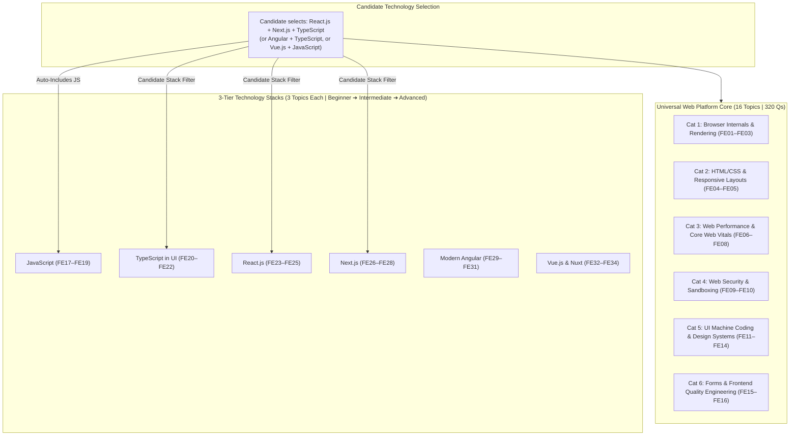

# Frontend & Web Architecture Curriculum Specification (v2.0)
## Universal Web Platform & 3-Tier Technology Stacks (34 Topics, 12 Categories, 680 Questions)

**Domain Slug:** `frontend-engineering`  
**Domain Name:** `Frontend & Web Architecture`  
**Version:** 2.0.0 (Universal Web Platform & Modular 3-Tier Stacks)  
**Target Database:** Neo4j AuraDB Knowledge Graph  
**Structure:** 2-Tier Modular System: Universal Web Platform Core (16 Topics) + 6 Specialized 3-Tier Technology Stacks (18 Topics)  
**Total Canonical Categories:** 12 Categories (6 Universal Core + 6 Technology Ecosystems)  
**Total Topics:** 34 Topics  
**Priority Distribution:** **P0: 24 Core Must-Master | P1: 10 High-Frequency/Senior | P2: 0**  
**Questions per Topic:** 20 (4 Beginner, 6 Intermediate, 6 Advanced, 4 Expert)  
**Total Master Question Inventory:** **680 Questions**  
**Question Archetypes:** 9 Formats (`mechanism`, `implementation`, `trade-off`, `troubleshooting`, `failure-analysis`, `scenario-based`, `code-review`, `debugging`, `design-exercise`)  
**Target Roles:** Frontend Engineers, Fullstack Engineers, UI Architects, Web Performance Specialists (Junior to Principal)  
**Governing Standard:** [`docs/GENERIC_KNOWLEDGE_GRAPH_SCHEMA_SPEC.md`](../GENERIC_KNOWLEDGE_GRAPH_SCHEMA_SPEC.md)  
**Status:** 🟢 **CURRICULUM SPECIFICATION FROZEN — v2.0 ARCHITECTURAL RELEASE**

---

## 1. High-Level Architecture Overview

This domain addresses technical interviews for **Frontend Architecture**, **UI System Design**, **Browser & Runtime Internals**, **Core Web Vitals Performance**, and **60-Minute UI Machine Coding Rounds** conducted at top tech companies (Meta, Google, Uber, Netflix, Stripe, Airbnb, Vercel, Swiggy, Flipkart).

PrepInMinutes establishes a clean, decoupled architecture:
1. **Universal Web Platform Core (16 Topics | 6 Categories)**: The browser engine, CSS layout geometry, Core Web Vitals, web security, UI machine coding, and automated testing—common to **every web engineer on Earth**.
2. **Dedicated 3-Tier Technology Stacks (Beginner $\rightarrow$ Intermediate $\rightarrow$ Advanced | 3 Topics each)**:
   * **JavaScript Ecosystem** (`js-fundamentals-core` $\rightarrow$ `js-async-event-loop` $\rightarrow$ `js-v8-memory-metaprogramming`)
   * **TypeScript UI Ecosystem** (`ts-primitives-generics-ui` $\rightarrow$ `ts-narrowing-discriminated-unions` $\rightarrow$ `ts-polymorphism-compiler`)
   * **React.js Ecosystem** (`react-fundamentals-components` $\rightarrow$ `react-hooks-memoization` $\rightarrow$ `react-fiber-concurrent`)
   * **Next.js Fullstack Ecosystem** (`nextjs-app-router-fundamentals` $\rightarrow$ `nextjs-rendering-middleware` $\rightarrow$ `nextjs-rsc-streaming-hydration`)
   * **Modern Angular Ecosystem (v17/18/19+)** (`angular-standalone-control-flow` $\rightarrow$ `angular-modern-di-rxjs` $\rightarrow$ `angular-signals-zoneless`)
   * **Vue.js & Nuxt Ecosystem** (`vue-fundamentals-reactivity` $\rightarrow$ `vue-composition-pinia` $\rightarrow$ `vue-proxy-nuxt-ssr`)

---

## 2. Master 34-Topic Taxonomy Matrix

### Section 2.1: Universal Web Platform Core (16 Topics | Categories 1–6)

| Topic ID | Slug | Title | Category Slug | Priority | Diff | Freq | Target Companies | Key Rubric Atoms & Technical Scope |
| :---: | :--- | :--- | :--- | :---: | :---: | :---: | :--- | :--- |
| **FE01** | `browser-rendering-pipeline` | Browser Rendering Pipeline & Layout | `fe-browser-rendering` | **P0** | INT | 98 | Google, Meta, Apple, Netflix | DOM/CSSOM Parsing, Layout (Reflow), Repaint, Compositor GPU Layers (`will-change`, `transform`), Forced Synchronous Layout, CSS Containment |
| **FE02** | `browser-event-loop-dom` | Browser Event Loop, Tasks & RAF | `fe-browser-rendering` | **P0** | INT | 97 | Meta, Uber, Stripe, Atlassian | Macrotask vs Microtask Queues, `requestAnimationFrame`, `requestIdleCallback`, Web Workers (`postMessage`), Event Bubbling/Capturing & Delegation |
| **FE03** | `network-critical-rendering-path` | Critical Rendering Path & Resource Hints | `fe-browser-rendering` | **P1** | INT | 93 | Google, Amazon, Shopify, Cloudflare | Parser-Blocking JS (`defer` vs `async`), Render-Blocking CSS, Resource Hints (`preload`, `prefetch`, `preconnect`), HTTP Cache-Control, Service Worker Cache |
| **FE04** | `html-semantic-layout-engines` | Semantic HTML5 & Modern Layout Engines | `fe-html-css-layout` | **P0** | BEG | 98 | Meta, Amazon, Apple, Airbnb | Semantic HTML5 Document Structure, Accessibility Tree Parsing, CSS Box Model, Specificity Calculation, Flexbox vs CSS Grid 2D Layouts |
| **FE05** | `css-stacking-responsive-systems` | Stacking Contexts & Responsive Systems | `fe-html-css-layout` | **P0** | INT | 97 | Apple, Airbnb, Stripe, Target | Stacking Context Isolation, `z-index` Layering Invariants, Containing Blocks, Container Queries, Responsive Fluid Typography |
| **FE06** | `core-web-vitals-optimization` | Core Web Vitals: LCP, INP & CLS | `fe-performance-vitals` | **P0** | INT | 99 | Google, Amazon, Shopify, Walmart | LCP Sub-Part Optimization (<2.5s), INP Long Task Attribution (<200ms), CLS Dimension Stability (<0.1), Field RUM Data vs Lab Lighthouse |
| **FE07** | `code-splitting-bundle-optimization` | Code Splitting, Tree-Shaking & Bundling | `fe-performance-vitals` | **P0** | INT | 95 | Netflix, Spotify, Vercel, Meta | Dynamic Route & Component Chunking, Tree-Shaking ESM `sideEffects` Invariants, Vite/Turbopack Bundle Analysis, Module Federation Micro-Frontends |
| **FE08** | `dom-memory-leak-profiling` | Detached DOM & Memory Leak Profiling | `fe-performance-vitals` | **P1** | ADV | 93 | Google, Microsoft, Atlassian, Datadog | Detached DOM Tree Retention, Chrome DevTools 3-Snapshot Technique, Uncleaned Event Listeners & Timers, Retaining Path & Closure Memory Profiling |
| **FE09** | `frontend-security-sandboxing` | Web Security: XSS, CSRF & CSP | `fe-security-sandboxing` | **P0** | INT | 96 | Stripe, Auth0, Coinbase, Google | Stored/Reflected/DOM XSS, Trusted Types API, CSP Level 3 Nonce/Hash, `SameSite` Cookies vs CSRF, Clickjacking `X-Frame-Options`, CORS Preflight |
| **FE10** | `realtime-offline-sync` | Realtime WebSockets, SSE & Offline Sync | `fe-security-sandboxing` | **P1** | ADV | 92 | Figma, Slack, Linear, Notion | WebSockets vs Server-Sent Events (SSE), IndexedDB Client Persistence, Service Worker CacheStorage Hierarchies, CRDT Conflict-Free State Convergence |
| **FE11** | `virtual-list-windowing` | Virtual List Windowing Implementation | `fe-ui-machine-coding` | **P0** | ADV | 98 | Meta, Uber, LinkedIn, Twitter | 60-Minute Machine Coding: Fixed & Variable Row Height Calculations, Binary Search Scroll Offset Math, Overscan Buffer Padding, DOM Recycling |
| **FE12** | `autocomplete-debounce-throttle` | Autocomplete, Debounce & Race Cancellation | `fe-ui-machine-coding` | **P0** | INT | 99 | Google, Amazon, Stripe, Swiggy | 60-Minute Machine Coding: Custom Debounce & Throttle, `AbortController` Out-of-Order Cancellation, WAI-ARIA Combobox Navigation, LRU Search Cache |
| **FE13** | `infinite-scroll-intersection-observer` | Infinite Scroll with IntersectionObserver | `fe-ui-machine-coding` | **P0** | INT | 97 | Instagram, TikTok, Pinterest, Reddit | 60-Minute Machine Coding: `IntersectionObserver` Sentinel Math, Cursor vs Offset Pagination, Scroll Position Restoration, DOM Node Pruning |
| **FE14** | `accessible-design-systems-aria` | Accessible Design Systems & WAI-ARIA | `fe-ui-machine-coding` | **P1** | INT | 94 | Apple, Microsoft, Target, GitHub | Accessible Modal Dialog (Focus Trapping, Escape Key), WAI-ARIA Roles/States (`aria-expanded`, `aria-live`), Design Tokens (W3C Spec), CSS Architecture |
| **FE15** | `frontend-forms-validation` | Enterprise Forms & Schema Validation | `fe-forms-testing-quality` | **P0** | INT | 97 | Stripe, Salesforce, Intuit, DoorDash | Controlled vs Uncontrolled Forms, Zod Schema Validation Inference, Asynchronous Validation Race Conditions, Multi-Step Wizards, Field Arrays |
| **FE16** | `frontend-testing-quality-engineering` | Frontend Testing & Quality Engineering | `fe-forms-testing-quality` | **P0** | INT | 96 | Meta, Stripe, Netflix, Atlassian | Testing Trophy, React Testing Library User-Centric Invariants, MSW Network Mocking, Playwright E2E Automation, Flaky Test Root-Cause Elimination |

---

### Section 2.2: 3-Tier Technology Stacks (18 Topics | Categories 7–12)

| Topic ID | Slug | Title | Category Slug | Priority | Diff | Freq | Target Companies | Key Rubric Atoms & Technical Scope |
| :---: | :--- | :--- | :--- | :---: | :---: | :---: | :--- | :--- |
| **FE17** | `js-fundamentals-core` | JS Fundamentals, Scopes & Prototypes | `fe-lang-javascript` | **P0** | BEG | 99 | Amazon, Google, Meta, Swiggy | Primitives vs Reference Types, Type Coercion (`==` vs `===`), Lexical Scope & Closures, Prototype Chain (`__proto__` vs `prototype`), `this` Binding |
| **FE18** | `js-async-event-loop` | Asynchronous JS, Event Loop & Combinators | `fe-lang-javascript` | **P0** | INT | 98 | Meta, Uber, Stripe, Netflix | Call Stack, Microtask vs Macrotask Execution Order, Writing `Promise.all` & `allSettled` from Scratch, `async/await` Error Boundaries, ES Modules |
| **FE19** | `js-v8-memory-metaprogramming` | V8 Engine Internals, Memory & Proxies | `fe-lang-javascript` | **P1** | ADV | 97 | Google, Cloudflare, Datadog, Netflix | Ignition Bytecode & TurboFan JIT, Hidden Classes / Shapes, Inline Caching Deoptimizations, GC Scavenge vs Mark-Sweep, `Proxy`/`Reflect` Reactivity Engine |
| **FE20** | `ts-primitives-generics-ui` | TypeScript Primitives, Generics & Interfaces in UI | `fe-lang-typescript` | **P0** | BEG | 95 | Stripe, Linear, Airbnb, Slack | Strict Typing in UI, Interfaces vs Type Aliases, Structural Duck Typing, Generics in Component Props (`<T extends object>`), Const Assertions (`as const`) |
| **FE21** | `ts-narrowing-discriminated-unions` | Type Narrowing, Discriminated Unions & Form Schemas | `fe-lang-typescript` | **P0** | INT | 96 | Stripe, Meta, Vercel, Linear | Discriminated Union UI State Machines, Type Guards (`is`, `in`, `typeof`), Built-in Utility Types (`Pick`, `Omit`, `Partial`, `Record`), Zod Type Inference |
| **FE22** | `ts-polymorphism-compiler` | Polymorphic Components & Advanced Compiler AST | `fe-lang-typescript` | **P1** | ADV | 94 | Stripe, Airbnb, GitHub, Microsoft | Polymorphic Component Typing (`as` prop), Conditional Types (`infer` keyword), Template Literal Types, Declaration Merging (`.d.ts`), Compiler Options |
| **FE23** | `react-fundamentals-components` | React Fundamentals, JSX & State Lifecycle | `fe-framework-react` | **P0** | BEG | 98 | Meta, Amazon, Apple, Swiggy | Declarative UI Mental Model, JSX Compilation to `React.createElement`, Props vs State, Unidirectional Data Flow, Synthetic Event System, State Batching |
| **FE24** | `react-hooks-memoization` | Hooks Deep-Dive, Stale Closures & Memoization | `fe-framework-react` | **P0** | INT | 99 | Meta, Netflix, Uber, Airbnb | Stale Closures in `useEffect`/`useCallback`, Dependency Array Invariants, Cost-Benefit of `useMemo`, Custom Hooks Architecture, `useSyncExternalStore` |
| **FE25** | `react-fiber-concurrent` | React Fiber Architecture & Concurrent Scheduling | `fe-framework-react` | **P0** | ADV | 99 | Meta, Vercel, Uber, DoorDash | Fiber Node Tree, Two-Phase Reconciliation (Render Interruptible vs Commit Synchronous), Element Key Invariants, Time-Slicing Priority Lanes, `useTransition` |
| **FE26** | `nextjs-app-router-fundamentals` | App Router, Routing Conventions & Layouts | `fe-framework-nextjs` | **P0** | BEG | 96 | Vercel, Netflix, Target, TikTok | App Router Directory Hierarchy, `page.tsx`, Nested `layout.tsx`, `template.tsx`, `loading.tsx`, `error.tsx`, `<Link>` Prefetching, Next.js Image Optimization |
| **FE27** | `nextjs-rendering-middleware` | Rendering Strategies (SSR, SSG, ISR) & Middleware | `fe-framework-nextjs` | **P0** | INT | 97 | Vercel, Target, DoorDash, Shopify | Static Generation (SSG), Server Rendering (SSR), Incremental Static Regeneration (ISR `revalidate`), Extended `fetch()` Cache, Edge Middleware Route Protection |
| **FE28** | `nextjs-rsc-streaming-hydration` | React Server Components (RSC), Streaming & Hydration | `fe-framework-nextjs` | **P0** | ADV | 98 | Vercel, Meta, Shopify, Stripe | Server vs Client Components (`"use client"`), Zero-Bundle Elimination, Server Actions RPC, Chunked HTML Streaming with `<Suspense>`, Partial Prerendering (PPR) |
| **FE29** | `angular-standalone-control-flow` | Standalone Architecture & Modern Control Flow | `fe-framework-angular` | **P0** | BEG | 95 | Google, Microsoft, Cisco, Deutsche Bank | Standalone Components/Directives (No `NgModule`), Built-in Control Flow (`@if`, `@for` with mandatory `track`, `@switch`), Template Property/Event Bindings |
| **FE30** | `angular-modern-di-rxjs` | Modern Dependency Injection & RxJS Streams | `fe-framework-angular` | **P0** | INT | 96 | Google, Microsoft, VMware, Morgan Stanley | Modern `inject()` Function API, Hierarchical Injectors (Root, Environment, Node level), RxJS Operators (`switchMap`, `exhaustMap`), Reactive Forms, `takeUntilDestroyed` |
| **FE31** | `angular-signals-zoneless` | Angular Signals, Zoneless Reactivity & Defer | `fe-framework-angular` | **P0** | ADV | 97 | Google, Cisco, Salesforce, Deutsche Bank | `signal()`, `computed()`, `effect()`, Bridging with `toSignal()`/`toObservable()`, Zoneless Change Detection (No `zone.js`), `@defer` Deferrable Views, Hydration |
| **FE32** | `vue-fundamentals-reactivity` | Vue 3 Fundamentals, Templates & Reactivity | `fe-framework-vue` | **P1** | BEG | 93 | GitLab, Nintendo, Behance, Alibaba | Declarative Templates, Directives (`v-if`, `v-for`, `v-model`), `ref` vs `reactive` Unwrap Caveats, Component Props, Emits & Attribute Inheritance |
| **FE33** | `vue-composition-pinia` | Composition API, Composables & Pinia State | `fe-framework-vue` | **P1** | INT | 94 | GitLab, Bilibili, Canva, Xiaomi | `<script setup>` Syntax, Custom Composables Architecture, Watchers (`watch` vs `watchEffect`), Pinia Modular Stores & Actions, Vue Router Guards |
| **FE34** | `vue-proxy-nuxt-ssr` | Vue 3 Proxy Reactivity Internals & Nuxt SSR | `fe-framework-vue` | **P1** | ADV | 94 | Tencent, Alibaba, NuxtLabs, Baidu | ES6 `Proxy` Handlers (`get` track, `set` trigger), Dependency Graph Effects, Nuxt Universal Rendering, Nitro Server Engine, Client Hydration Forensics |

---

## 3. Candidate Experience: Dynamic Prep Track Synthesis

When a candidate uses PrepInMinutes, their personalized curriculum is dynamically synthesized from their chosen stack:

$$\begin{aligned}
\text{Universal Web Platform Core} &= \mathbf{16 \text{ Topics (320 Questions)}} \\
\text{JavaScript Core (Universal)} &= \mathbf{3 \text{ Topics (60 Questions)}} \\
\text{Selected Technology Stacks} &= \mathbf{3 \text{ to } 9 \text{ Topics (60 to 180 Questions)}}
\end{aligned}$$

### Common Candidate Configurations:
* **React + Next.js + TypeScript Fullstack**: **28 Topics (560 Questions)** = 16 Universal + 3 JS + 3 TS + 3 React + 3 Next.js.
* **Modern Angular + TypeScript Enterprise**: **25 Topics (500 Questions)** = 16 Universal + 3 JS + 3 TS + 3 Angular.
* **React + JavaScript Standard**: **22 Topics (440 Questions)** = 16 Universal + 3 JS + 3 React.
* **Vue.js + Nuxt Fullstack**: **22 Topics (440 Questions)** = 16 Universal + 3 JS + 3 Vue.
* **Vanilla JavaScript / Core Web Platform**: **19 Topics (380 Questions)** = 16 Universal + 3 JS.

---

## 4. Question Depth Standard & 9 Archetypes

Every topic contains exactly **20 Master Questions** (4 Beginner, 6 Intermediate, 6 Advanced, 4 Expert):
* **L1 (Fundamentals)**: Syntax, core primitives, DOM APIs, standard component lifecycles.
* **L2–L3 (Engineering Practice)**: Concurrency, hooks, state machines, async cancellation, form validation, RTL testing.
* **L3–L4 (Internals & Optimization)**: Fiber reconciliation, V8 hidden classes, RSC wire format, virtual windowing, INP long task elimination.
* **L5 (Staff+ Leadership)**: Enterprise design system token architecture, micro-frontends module federation, production outage post-mortems.

---

## 5. Prerequisite DAG Verification

* **Strict DAG Enforcement**: All 34 topics connect via genuine learning dependencies with 0 circular cycles.
* **Verification Status**: Validated by topological sort algorithm in offline dry run.

---

## 6. Specification Approval Status

* [x] Expanded to 12 Categories & 34 Topics (24 P0, 10 P1, 0 P2)
* [x] Standard 20 questions/topic (680 total master questions)
* [x] 3-Tier standard across JavaScript, TypeScript, React, Next.js, Angular, and Vue
* [x] Decoupled, framework-neutral Universal Web Platform Core
* [x] Ready for seed data scaffolding and offline verification
