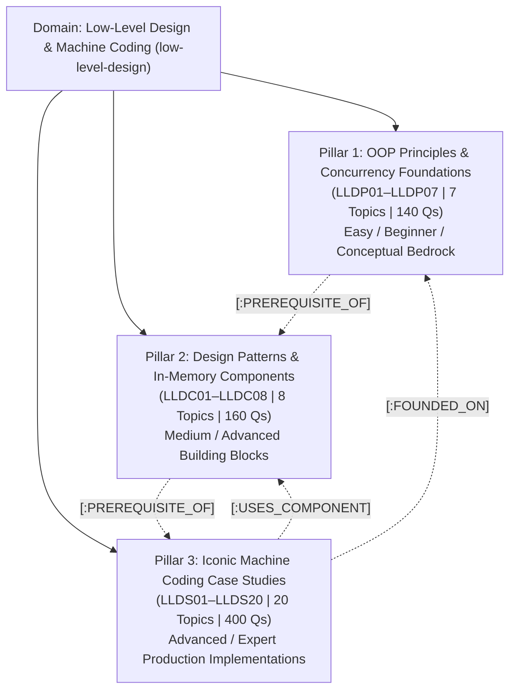

# Low-Level Design & Machine Coding Curriculum Specification
## Object-Oriented Architecture, GoF Patterns & Production Concurrency (35 Topics, 3 Pillars, 700 Questions)

**Domain Slug:** `low-level-design`  
**Domain Name:** `Low-Level Design & Machine Coding`  
**Version:** 1.0.0 (3-Pillar Master Architecture)  
**Target Database:** Neo4j AuraDB Knowledge Graph  
**Structure:** 3 Learning Pillars (Principles, Patterns & Components, Machine Coding Case Studies)  
**Total Thematic Categories:** 6  
**Total Topics:** 35  
**Priority Distribution:** **P0: 19 Core Must-Master | P1: 12 High-Frequency/Senior | P2: 4 Specialized/Staff+**  
**Questions per Topic:** 20 (4 Beginner, 6 Intermediate, 6 Advanced, 4 Expert)  
**Total Master Question Inventory:** **700 Questions**  
**Governing Standard:** [`docs/GENERIC_KNOWLEDGE_GRAPH_SCHEMA_SPEC.md`](../GENERIC_KNOWLEDGE_GRAPH_SCHEMA_SPEC.md)  
**Status:** 🟢 **CURRICULUM SPECIFICATION FROZEN — v1.0 ARCHITECTURAL RELEASE**

---

## 1. High-Level Architecture Overview

This domain addresses technical interviews for **Low-Level Design (LLD)**, **Object-Oriented Design (OOD)**, and **90-Minute Machine Coding Rounds** conducted at Amazon, Uber, Google, Microsoft, Atlassian, Apple, Meta, Swiggy, and Flipkart.

Unlike High-Level Design (HLD) which emphasizes distributed components, QPS sizing, and database partitioning, Low-Level Design evaluates a candidate's ability to:
1. Translate ambiguous business requirements into **modular, extensible class diagrams**.
2. Strictly enforce **SOLID principles** and clean code abstractions (avoiding God classes and tight coupling).
3. Select and implement appropriate **GoF Design Patterns** (Strategy, State, Factory, Observer, Command, Decorator).
4. Safely manage **multithreaded in-process concurrency** (preventing race conditions, deadlocks, and stale state using `ReentrantLock`, `AtomicInteger`, and synchronized blocks).
5. Deliver executable, unit-testable code in modern languages (Java, Python, C++, Go, TypeScript).



---

## 2. Five Progression Levels (Candidate Experience Metadata)

Every topic adheres to the **20-Question Depth Standard** structured by difficulty:

| Level | Level Name | Question Count | Target Candidate Level | Candidate Outcome |
| :---: | :--- | :---: | :--- | :--- |
| **L1** | **Fundamentals (Easy)** | **4 Qs** | SDE-1 / Junior Engineer | Identify class responsibilities, define interfaces, explain OOP pillars, and write basic class skeletons. |
| **L2–L3** | **Intermediate (Medium)** | **6 Qs** | SDE-2 / Mid-Level Engineer | Apply GoF patterns (Strategy, State, Observer), enforce Open-Closed & Dependency Inversion, handle state transitions. |
| **L3–L4** | **Advanced (Hard)** | **6 Qs** | Senior SDE / Lead | Implement thread-safe synchronization locks, prevent deadlocks, design extensible plugin hooks, and eliminate race conditions. |
| **L5** | **Super Advanced (Expert)** | **4 Qs** | Staff Engineer / Principal Architect | Architect high-throughput lock-free concurrency, zero-copy buffer allocations, benchmark memory footprints, and enforce enterprise domain-driven design. |
| **Total** | **Per Topic** | **20 Qs** | **Junior to Principal** | **Complete Interview Mastery Ladder** |

---

## 3. The 6 Canonical Categories

```
┌──────────────────────────────────────────────────────────────────────────────────────────────────┐
│                                LOW-LEVEL DESIGN TAXONOMY (35 Topics)                             │
├────────────────────────────────┬────────────────────────────────┬───────────────────────────────┤
│ Cat 1: OOP Principles &        │ Cat 2: GoF Design Patterns &   │ Cat 3: High-Performance       │
│ Concurrency (7 Topics)         │ Clean Architecture (5 Topics)  │ In-Memory Components (3 Topics│
│ • LLDP01: OOP Pillars          │ • LLDC01: Creational Patterns  │ • LLDC06: Thread-Safe LRU/LFU │
│ • LLDP02: Clean Code & Smells  │ • LLDC02: Structural Patterns  │ • LLDC07: In-Memory Rate Limit│
│ • LLDP03: OOAD & UML Modeling  │ • LLDC03: Behavioral I (Events)│ • LLDC08: In-Memory Pub-Sub   │
│ • LLDP04: SOLID: SRP & OCP     │ • LLDC04: Behavioral II (State)│                               │
│ • LLDP05: SOLID: LSP & ISP     │ • LLDC05: Architectural LLD    │                               │
│ • LLDP06: SOLID: DIP & IoC     │                                │                               │
│ • LLDP07: Concurrency Locks    │                                │                               │
├────────────────────────────────┼────────────────────────────────┼───────────────────────────────┤
│ Cat 4: Hardware, State         │ Cat 5: Booking, Scheduling &   │ Cat 6: Enterprise Platforms   │
│ Machines & Games (8 Topics)    │ Financial Systems (6 Topics)   │ & Consumer Apps (6 Topics)    │
│ • LLDS01: Parking Lot System   │ • LLDS09: Movie Ticket Booking │ • LLDS15: E-Commerce Checkout │
│ • LLDS02: Elevator Dispatcher  │ • LLDS10: Splitwise App        │ • LLDS16: Food Delivery Engine│
│ • LLDS03: Vending Machine      │ • LLDS11: Meeting Scheduler    │ • LLDS17: Community Q&A (SO)  │
│ • LLDS04: ATM Machine System   │ • LLDS12: Car Rental / Fleet   │ • LLDS18: Social Network Feed │
│ • LLDS05: Smart Locker Network │ • LLDS13: Hotel Reservation    │ • LLDS19: Live Sports Score   │
│ • LLDS06: Chess Game Engine    │ • LLDS14: Online Stock Broker  │ • LLDS20: Restaurant KOT      │
│ • LLDS07: Card Game (Blackjack)│                                │                               │
│ • LLDS08: Snake & Ladder Game  │                                │                               │
└────────────────────────────────┴────────────────────────────────┴───────────────────────────────┘
```

---

## 4. Master Topic Inventory & Catalog Breakdown

### Pillar 1: OOP Principles & Concurrency Foundations (7 Topics | 140 Questions)

| Topic ID | Slug | Topic Name | Category | Priority | Difficulty | Core Concepts |
| :---: | :--- | :--- | :--- | :---: | :---: | :--- |
| `LLDP01` | `oop-pillars-production` | OOP Pillars in Production | `lld-principles-concurrency` | **P0** | BEGINNER | Encapsulation, information hiding, abstraction boundaries, inheritance vs composition, dynamic dispatch polymorphism. |
| `LLDP02` | `clean-code-refactoring` | Clean Code & Code Smells | `lld-principles-concurrency` | **P1** | BEGINNER | DRY, KISS, YAGNI, Law of Demeter, avoiding God classes, primitive obsession, feature envy, refactoring strategies. |
| `LLDP03` | `ooad-uml-modeling` | OOAD & Technical Modeling | `lld-principles-concurrency` | **P1** | INTERMEDIATE | Class diagrams, sequence diagrams, state machine diagrams, activity diagrams, interface contracts. |
| `LLDP04` | `solid-srp-ocp` | SOLID: Single Responsibility & Open-Closed | `lld-principles-concurrency` | **P0** | INTERMEDIATE | Single reason to change, cohesion vs coupling, open for extension closed for modification, pluggable strategy interfaces. |
| `LLDP05` | `solid-lsp-isp` | SOLID: Liskov Substitution & Interface Segregation | `lld-principles-concurrency` | **P0** | INTERMEDIATE | Behavioral subtyping, pre/post condition invariance, fat interface hazards, client-specific role interfaces. |
| `LLDP06` | `solid-dip-ioc` | SOLID: Dependency Inversion & IoC | `lld-principles-concurrency` | **P0** | INTERMEDIATE | High-level modules independent of low-level modules, abstraction inversion, constructor dependency injection, IoC containers. |
| `LLDP07` | `concurrency-thread-safety` | In-Process Concurrency & Thread-Safety | `lld-principles-concurrency` | **P0** | ADVANCED | `ReentrantLock`, `ReadWriteLock`, `Semaphore`, Condition variables, atomic primitives (`AtomicInteger`), race conditions, deadlock prevention. |

---

### Pillar 2: GoF Design Patterns & In-Memory Components (8 Topics | 160 Questions)

| Topic ID | Slug | Topic Name | Category | Priority | Difficulty | Core Concepts |
| :---: | :--- | :--- | :--- | :---: | :---: | :--- |
| `LLDC01` | `creational-patterns` | Creational Design Patterns | `lld-design-patterns` | **P0** | INTERMEDIATE | Factory Method, Abstract Factory, Builder with fluent chaining, Singleton variants (Double-checked locking, Bill Pugh, Enum). |
| `LLDC02` | `structural-patterns` | Structural Design Patterns | `lld-design-patterns` | **P0** | INTERMEDIATE | Adapter (legacy bridging), Decorator (runtime feature wrapping), Facade (subsystem simplification), Composite, Proxy (access/caching). |
| `LLDC03` | `behavioral-patterns-events` | Behavioral Patterns: Decoupling & Events | `lld-design-patterns` | **P0** | INTERMEDIATE | Observer (Event Bus, Pub-Sub), Strategy (interchangeable pricing/routing), Command (encapsulated actions, undo/redo history buffer). |
| `LLDC04` | `behavioral-patterns-state` | Behavioral Patterns: State & Workflow | `lld-design-patterns` | **P0** | INTERMEDIATE | State Pattern (explicit state transitions, lifecycle handling), Chain of Responsibility (middleware/approval filters), Template Method. |
| `LLDC05` | `architectural-lld-patterns` | Architectural LLD & Clean Layers | `lld-design-patterns` | **P1** | ADVANCED | Model-View-Controller (MVC), Repository Pattern, Ports & Adapters (Hexagonal Architecture), Domain-Driven Design (DDD) entities & value objects. |
| `LLDC06` | `thread-safe-lru-lfu-cache` | Thread-Safe In-Memory LRU & LFU Cache | `lld-in-memory-components` | **P0** | ADVANCED | Doubly Linked List + ConcurrentHashMap, $O(1)$ get/put, thread-safe synchronized locks, eviction policies (LRU, LFU, FIFO). |
| `LLDC07` | `in-memory-rate-limiter` | Thread-Safe In-Memory Rate Limiter Class | `lld-in-memory-components` | **P0** | ADVANCED | Token Bucket algorithm, Leaky Bucket algorithm, Sliding Window log, thread-safe token refill, multi-threaded caller protection. |
| `LLDC08` | `in-memory-pubsub-broker` | In-Memory Message Broker / Pub-Sub | `lld-in-memory-components` | **P1** | ADVANCED | Topics, consumer groups, offsets, thread-safe bounded buffer, blocking queues, backpressure handling, fan-out event dispatch. |

---

### Pillar 3: Iconic Machine Coding Case Studies (20 Topics | 400 Questions)

#### Category 4: Hardware, State Machines & Games (8 Topics | 160 Questions)

| Topic ID | Slug | Topic Name | Category | Priority | Difficulty | Core Concepts |
| :---: | :--- | :--- | :--- | :---: | :---: | :--- |
| `LLDS01` | `parking-lot-system` | Parking Lot Management System | `lld-hardware-games` | **P0** | INTERMEDIATE | Multi-floor layout, vehicle size hierarchies, dynamic spot allocation strategies, ticket lifecycle, thread-safe spot locking. |
| `LLDS02` | `elevator-system-dispatcher` | Multi-Car Elevator Dispatcher | `lld-hardware-games` | **P0** | ADVANCED | LOOK/SCAN elevator scheduling algorithms, internal/external request queues, state pattern (MovingUp, MovingDown, Idle), emergency stops. |
| `LLDS03` | `vending-machine-system` | Automated Vending Machine | `lld-hardware-games` | **P0** | INTERMEDIATE | State Pattern (NoCoin, HasCoin, Dispense, SoldOut), coin/cash validation, inventory stock locks, change computation algorithm. |
| `LLDS04` | `atm-machine-system` | Automated Teller Machine (ATM) | `lld-hardware-games` | **P0** | ADVANCED | Card validation, PIN authentication, Chain of Responsibility cash dispenser ($100, $50, $20), transaction rollback, hardware states. |
| `LLDS05` | `smart-locker-network` | Smart Locker Delivery Network | `lld-hardware-games` | **P1** | INTERMEDIATE | Compartment size matching, cryptographically secure OTP generation, package delivery/pickup lifecycle, timeout return workflow. |
| `LLDS06` | `chess-game-engine` | Chess Game Engine | `lld-hardware-games` | **P0** | ADVANCED | 8x8 board matrix, piece movement strategy hierarchy (King, Queen, Rook, Bishop, Knight, Pawn), check/checkmate detection, move undo history. |
| `LLDS07` | `card-game-blackjack` | Online Blackjack & Card Engine | `lld-hardware-games` | **P2** | INTERMEDIATE | Standard 52-card deck, Fisher-Yates shuffling, hand score calculation (dynamic Ace 1/11), dealer hit/stand rules, payout strategy. |
| `LLDS08` | `snake-and-ladder-game` | Snake & Ladder Board Game | `lld-hardware-games` | **P2** | BEGINNER | Board grid entities, snake/ladder cell jump mechanics, dice rolling strategies, multiplayer turn orchestrator, winner termination. |

#### Category 5: Booking, Scheduling & Financial Systems (6 Topics | 120 Questions)

| Topic ID | Slug | Topic Name | Category | Priority | Difficulty | Core Concepts |
| :---: | :--- | :--- | :--- | :---: | :---: | :--- |
| `LLDS09` | `movie-ticket-booking-system` | Movie Ticket Booking (BookMyShow) | `lld-booking-financial` | **P0** | ADVANCED | Auditorium layout, dynamic seat pricing, temporary seat reservation lock with timeout, concurrent booking race condition prevention. |
| `LLDS10` | `splitwise-expense-sharing` | Splitwise Expense Sharing Engine | `lld-booking-financial` | **P0** | ADVANCED | Expense splits (Equal, Exact, Percentage), group vs individual balances, ledger transactions, greedy minimum cash-flow debt simplification. |
| `LLDS11` | `meeting-room-scheduler` | Multi-Tenant Meeting Room Scheduler | `lld-booking-financial` | **P1** | INTERMEDIATE | Calendar interval conflict detection (Interval Trees), recurring meeting rules, room capacity/amenity filtering, invitee notifications. |
| `LLDS12` | `car-rental-system` | Car Rental & Fleet Management | `lld-booking-financial` | **P1** | INTERMEDIATE | Fleet vehicle classification, dynamic rate calculation, reservation pickup/drop-off state transitions, damage inspection addons. |
| `LLDS13` | `hotel-room-reservation` | Hotel Room Reservation System | `lld-booking-financial` | **P1** | INTERMEDIATE | Room categories, seasonal pricing strategies, booking calendar holding locks, check-in/check-out lifecycle, overbooking prevention. |
| `LLDS14` | `online-stock-brokerage` | Online Stock Brokerage System | `lld-booking-financial` | **P1** | ADVANCED | Order matching engine (FIFO limit book), Market vs Limit orders, portfolio balance hold/deduct, trade execution event emission. |

#### Category 6: Enterprise Platforms & Consumer Applications (6 Topics | 120 Questions)

| Topic ID | Slug | Topic Name | Category | Priority | Difficulty | Core Concepts |
| :---: | :--- | :--- | :--- | :---: | :---: | :--- |
| `LLDS15` | `ecommerce-shopping-cart` | E-Commerce Shopping Cart & Checkout | `lld-enterprise-platforms` | **P0** | INTERMEDIATE | Cart item management, inventory hold locks, coupon discount strategies, tax calculator adapters, payment gateway facade. |
| `LLDS16` | `food-delivery-fulfillment` | Food Delivery Fulfillment (Swiggy/DoorDash) | `lld-enterprise-platforms` | **P1** | ADVANCED | Restaurant menu hierarchy, delivery partner matching strategies, order status state machine (Placed, Accepted, Preparing, Dispatched). |
| `LLDS17` | `community-qa-platform` | Community Q&A Platform (StackOverflow) | `lld-enterprise-platforms` | **P1** | INTERMEDIATE | Question/answer entities, vote score aggregation, tag taxonomy, reputation reward strategy, comment hierarchy. |
| `LLDS18` | `social-networking-feed` | Social & Professional Network Feed | `lld-enterprise-platforms` | **P1** | ADVANCED | Bi-directional friend graph vs unidirectional follow, activity feed fan-out observer, post privacy access filters, notification dispatcher. |
| `LLDS19` | `sports-live-commentary` | Live Sports Scoreboard & Commentary | `lld-enterprise-platforms` | **P2** | INTERMEDIATE | Ball-by-ball match state modeling, player stats calculation, observer subscriptions for live commentary feeds, inning transitions. |
| `LLDS20` | `restaurant-kitchen-order` | Restaurant Table & KOT Management | `lld-enterprise-platforms` | **P2** | INTERMEDIATE | Table layout & reservation status, Kitchen Order Ticket (KOT) station routing, bill generation, payment split mechanics. |

---

## 5. Question Taxonomy & 20-Slot Archetype Architecture

Every single topic in the Low-Level Design domain contains exactly **20 master questions**, structured across 5 career levels and 4 canonical focus areas:

```
Slot 01–04 [BEGINNER]:     Foundational Concepts, Class Responsibilities & Interface Skeletons
Slot 05–10 [INTERMEDIATE]: Design Pattern Justifications, SOLID Adherence & State Lifecycles
Slot 11–16 [ADVANCED]:     Multithreaded Concurrency, Synchronization Locks & Extensibility Refactoring
Slot 17–20 [EXPERT]:       High-Throughput Lock-Free Scaling, Edge Case Resiliency & Enterprise DDD
```

### The 20 Question Slots per Topic:

1. **Slot 1 (Beginner)**: Problem Scope & Core Entity Identification.
2. **Slot 2 (Beginner)**: Primary Interface Contracts & Class Definitions.
3. **Slot 3 (Beginner)**: OOP Pillar Application (Encapsulation / Abstraction Boundaries).
4. **Slot 4 (Beginner)**: Inheritance vs Composition Trade-offs.
5. **Slot 5 (Intermediate)**: Creational Pattern Selection (Factory vs Builder vs Singleton).
6. **Slot 6 (Intermediate)**: Structural Pattern Selection (Adapter vs Decorator vs Facade).
7. **Slot 7 (Intermediate)**: Behavioral Pattern Selection (Strategy vs State vs Command).
8. **Slot 8 (Intermediate)**: Single Responsibility & Open-Closed Principles in Action.
9. **Slot 9 (Intermediate)**: Liskov Substitution & Interface Segregation Validation.
10. **Slot 10 (Intermediate)**: State Transition Machine & Lifecycle Integrity.
11. **Slot 11 (Advanced)**: Multithreaded Concurrency & Race Condition Identification.
12. **Slot 12 (Advanced)**: Synchronization Primitives (`ReentrantLock`, `ReadWriteLock`, `AtomicInteger`).
13. **Slot 13 (Advanced)**: Deadlock Prevention & Resource Ordering.
14. **Slot 14 (Advanced)**: Extensibility Scenario: "Add a New Business Feature Without Modifying Existing Code".
15. **Slot 15 (Advanced)**: Event-Driven Observer Architecture & Decoupled Notifications.
16. **Slot 16 (Advanced)**: Unit Testing & Mocking Strategy for Core Business Logic.
17. **Slot 17 (Expert)**: High-Throughput In-Memory Scaling & Contention Reduction.
18. **Slot 18 (Expert)**: Failure Recovery, Timeout Sweepers & Transaction Rollback.
19. **Slot 19 (Expert)**: Clean Architecture / Hexagonal Ports & Adapters Isolation.
20. **Slot 20 (Expert)**: Production Machine Coding Evaluation Rubric & Staff-Level Review.

---

## 6. Graph Relationships Standard (Neo4j AuraDB)

The Low-Level Design domain uses 3 primary relationship types:

1. **`[:PREREQUISITE_OF]` (DAG, strictly 0 cycles)**:
   - Fundamental principles are prerequisites to patterns:
     - `oop-pillars-production` $\rightarrow$ `creational-patterns`
     - `solid-srp-ocp` $\rightarrow$ `behavioral-patterns-events`
     - `concurrency-thread-safety` $\rightarrow$ `thread-safe-lru-lfu-cache`
   - In-memory components are prerequisites to complex case studies:
     - `thread-safe-lru-lfu-cache` $\rightarrow$ `movie-ticket-booking-system`
     - `in-memory-rate-limiter` $\rightarrow$ `online-stock-brokerage`
     - `concurrency-thread-safety` $\rightarrow$ `parking-lot-system`

2. **`[:USES_COMPONENT]`**:
   - Case studies link to patterns and utilities:
     - `parking-lot-system` $\xrightarrow{\text{USES\_COMPONENT}}$ `behavioral-patterns-events` (Strategy pattern for pricing)
     - `elevator-system-dispatcher` $\xrightarrow{\text{USES\_COMPONENT}}$ `behavioral-patterns-state` (State pattern for motion)
     - `movie-ticket-booking-system` $\xrightarrow{\text{USES\_COMPONENT}}$ `thread-safe-lru-lfu-cache` (Seat holding cache)
     - `splitwise-expense-sharing` $\xrightarrow{\text{USES\_COMPONENT}}$ `creational-patterns` (Expense factory)
     - `atm-machine-system` $\xrightarrow{\text{USES\_COMPONENT}}$ `behavioral-patterns-state` (State & Chain of Responsibility)

3. **`[:FOUNDED_ON]`**:
   - Case studies and components link directly to architectural principles:
     - `movie-ticket-booking-system` $\xrightarrow{\text{FOUNDED_ON}}$ `concurrency-thread-safety`
     - `parking-lot-system` $\xrightarrow{\text{FOUNDED_ON}}$ `solid-srp-ocp`
     - `splitwise-expense-sharing` $\xrightarrow{\text{FOUNDED_ON}}$ `solid-dip-ioc`

---

## 7. Compliance, Copyright & Originality Verification

- **100% Original IP**: All problem statements, rubric atoms, questions, and descriptions are formulated using PrepInMinutes' proprietary engineering taxonomy.
- **Zero Proprietary Material**: Stripped of any proprietary third-party headers, quiz questions, or text from Educative, DesignGurus, or commercial video courses.
- **Industry Standard Reference**: Models actual machine coding interview formats used by Amazon, Uber, Atlassian, Google, Microsoft, and Swiggy.

