# Mobile Engineering Specification (`mobile-engineering`)

## 1. Domain Overview & Metadata

| Property | Value |
| :--- | :--- |
| **Domain Slug** | `mobile-engineering` |
| **Domain Name** | Mobile Engineering |
| **Domain Version** | `1.0.0` |
| **Total Categories** | **18 Categories** (8 Universal Mobile Systems, 4 Native iOS, 4 Native Android, 2 Cross-Platform: React Native & Flutter) |
| **Total Topics** | **35 Topics** (`MOB01` to `MOB35`) |
| **Total Master Questions** | **700 Questions** (Strictly 20 per topic: 4 Beginner, 6 Intermediate, 6 Advanced, 4 Expert) |
| **Topic Priority Breakdown** | **P0 (21 Essential Core Topics)**, **P1 (14 High-Impact Specialization Topics)**, **P2 (0)** |
| **Target Audience** | Native iOS Engineers, Native Android Engineers, React Native Engineers, Flutter Engineers, and Staff / Principal Mobile Architects |
| **Target Interview Rounds** | Mobile System Design, iOS Swift/SwiftUI Internals, Android Kotlin/Compose Internals, Offline-First Sync & Storage, Mobile App Performance & Profiling, Mobile Security & Release Engineering |

---

## 2. Core Architectural Philosophy: The Decoupled Multi-Platform Model

Candidates rarely interview as generic mobile engineers spanning both native codebases simultaneously. They interview on dedicated platform tracks while sharing deep mobile systems architecture:

```mermaid
flowchart TD
  subgraph TIER1["Tier 1: Universal Mobile Systems Architecture (8 Categories | 16 Topics | 320 Qs)"]
    direction TB
    C01["01. Client Architecture & State (2)"]
    C02["02. Offline-First Sync & Storage (2)"]
    C03["03. Networking & Flaky Connection Resilience (2)"]
    C04["04. Performance: Frame Hitch Rate & Battery (2)"]
    C05["05. Mobile Security & Cryptography (2)"]
    C06["06. Release Engineering & Modularization (2)"]
    C07["07. App Lifecycle, Navigation & Adaptive UI (2)"]
    C08["08. Mobile Quality & Crash Observability (2)"]
  end

  subgraph TIER2_IOS["Tier 2A: Native iOS Track (4 Categories | 7 Topics | 140 Qs)"]
    direction TB
    C09["09. Swift Concurrency & Language (2)"]
    C10["10. SwiftUI & Modern Rendering (2)"]
    C11["11. iOS Memory (ARC) & Backgrounding (2)"]
    C12["12. iOS Testing & XCTest/XCUITest (1)"]
  end

  subgraph TIER2_ANDROID["Tier 2B: Native Android Track (4 Categories | 7 Topics | 140 Qs)"]
    direction TB
    C13["13. Kotlin Coroutines & StateFlow (2)"]
    C14["14. Jetpack Compose & UI Architecture (2)"]
    C15["15. Android Lifecycle & WorkManager (2)"]
    C16["16. Android Testing: JUnit & Espresso (1)"]
  end

  subgraph TIER2_CROSS["Tier 2C: Cross-Platform Tracks (2 Categories | 5 Topics | 100 Qs)"]
    direction TB
    C17["17. React Native Architecture & Integration (3)"]
    C18["18. Flutter Architecture & Platform Channels (2)"]
  end

  TIER1 -.-> TIER2_IOS
  TIER1 -.-> TIER2_ANDROID
  TIER1 -.-> TIER2_CROSS
```

---

## 3. Curriculum Categories & Topics Master Registry

### Category 01: Client Architecture & State Management (`mobile-architecture-patterns`)
* **Focus**: Unidirectional Data Flow, separation of concerns, side-effect isolation, and reactive state stores.
* **Topics**:
  * `MOB01` (P0) – **Mobile Architecture Patterns: MVI, MVVM, Clean Architecture & UDF**: Unidirectional Data Flow (UDF), state immutability, single source of truth, separation of concerns, and testing view models.
  * `MOB02` (P0) – **Client-Side Event Bus, Reactive Streams & State Reducers**: Observer pattern, event emission pipelines, state stores, and resolving race conditions between concurrent UI triggers.

### Category 02: Offline-First Sync & Local Storage (`mobile-offline-sync-storage`)
* **Focus**: Local-first writes, optimistic updates, delta synchronization, conflict resolution, and embedded databases.
* **Topics**:
  * `MOB03` (P0) – **Offline-First Architecture & Conflict Resolution (LWW, CRDTs)**: Optimistic UI mutations, write-ahead logging, two-way delta sync, Last-Write-Wins (LWW) vs Conflict-Free Replicated Data Types (CRDTs).
  * `MOB04` (P0) – **Local Database Storage Engine Design & Schema Migrations**: Relational SQLite optimization, indexing for mobile flash storage, zero-downtime database migrations, and encryption at rest (SQLCipher).

### Category 03: Networking, Image Pipelines & Flaky Connection Resilience (`mobile-networking-resilience`)
* **Focus**: Low-bandwidth resilience, modern protocols, multi-tier disk/memory image caching, and connection pooling.
* **Topics**:
  * `MOB05` (P0) – **Mobile Networking Protocols: HTTP/3 QUIC, gRPC & Connection Pooling**: Resuming interrupted downloads, prefetching data, adaptive payload compression, and handling Wi-Fi to cellular transitions.
  * `MOB06` (P0) – **Image Loading Pipelines, Multi-Tier Caching & Downsampling**: Memory cache (LRU), disk cache, bitmap downsampling to screen dimensions, progressive rendering, and avoiding OOM during infinite scrolling.

### Category 04: Performance: Frame Hitch Rate, Startup & Battery Profiling (`mobile-performance-profiling`)
* **Focus**: 60/120fps display refresh, main-thread jank elimination, cold/warm start time, and battery management.
* **Topics**:
  * `MOB07` (P0) – **UI Frame Rendering, 60/120fps Hitch Rate & Main Thread Jank**: Display refresh sync (V-Sync), frame budget calculation (8.33ms vs 16.6ms), off-loading layout computation, and measuring scroll hitch rate.
  * `MOB08` (P0) – **App Launch Time Optimization (Cold/Warm/Hot) & Battery Efficiency**: Dynamic link loading, binary layout optimization, deferring non-critical initializations, and waking radios efficiently.

### Category 05: Mobile Security, Cryptography & Secure Enclaves (`mobile-security-cryptography`)
* **Focus**: Hardware-backed key generation, biometric authentication, certificate pinning, and binary obfuscation.
* **Topics**:
  * `MOB09` (P0) – **Hardware-Backed Key Storage: Keychain, Android Keystore & Biometrics**: Secure Enclave / TEE, biometric authentication (FaceID/BiometricPrompt), asymmetric key pairs, and hardware encryption.
  * `MOB10` (P1) – **Mobile Threat Defense: Certificate Pinning, Anti-Tamper & Obfuscation**: TLS certificate and public key pinning, detecting rooted/jailbroken devices, and reverse-engineering protection (ProGuard, R8, DexGuard).

### Category 06: Release Engineering, App Sizing & Modularization (`mobile-release-cicd-modularization`)
* **Focus**: Mobile delivery pipelines, phased release rings, remote kill switches, and binary size reduction.
* **Topics**:
  * `MOB11` (P0) – **Mobile CI/CD, Feature Flagging & Staged Rollouts**: Automated build pipelines (Fastlane), phased rollout percentages (1% -> 5% -> 20% -> 100%), and remote kill switches for crash loops.
  * `MOB12` (P1) – **Multi-Module Mobile Architecture & App Binary Sizing**: Dynamic feature delivery, reducing app download size (asset compression, dead code stripping), and avoiding circular module dependencies.

### Category 07: App Lifecycle, Navigation & Adaptive UI (`mobile-lifecycle-navigation`)
* **Focus**: Application process transitions, deep linking, state restoration, screen readers, and multi-window/foldable layouts.
* **Topics**:
  * `MOB27` (P0) – **App Lifecycle, Navigation, Deep Links & State Restoration**: Foreground/background transitions, navigation stack management, universal links / deep links, process recreation, and saved instance state.
  * `MOB30` (P1) – **Accessibility, Localization & Adaptive UI (Foldables & Tablets)**: Screen readers (VoiceOver / TalkBack), dynamic text sizing, touch targets, right-to-left (RTL) localization, and adaptive layouts for tablets and foldable devices.

### Category 08: Mobile Quality Strategy & Crash Observability (`mobile-quality-observability`)
* **Focus**: Mobile testing pyramid, eliminating test flakiness, crash symbolication, ANRs, and live production telemetry.
* **Topics**:
  * `MOB28` (P0) – **Mobile Testing Strategy & Automation (Test Pyramid, Flaky Tests)**: Unit, integration, UI, end-to-end, snapshot testing, test pyramid design, mocking network layers, and mitigating test flakiness.
  * `MOB29` (P0) – **Mobile Observability, Crash Analytics (ANRs) & Diagnostics**: Crash-free sessions, Application Not Responding (ANR) detection, crash symbolication (dSYM / ProGuard mapping), telemetry, and production diagnostics.

---

### Tier 2A: Native iOS Track (4 Categories | 7 Topics | 140 Qs)

### Category 09: iOS Swift Concurrency & Language Internals (`mobile-ios-swift-concurrency`)
* **Topics**:
  * `MOB13` (P0) – **Swift Concurrency: async/await, Structured Tasks & Actors**: Task hierarchies, cooperative cancellation, `@MainActor` thread affinity, and preventing data races with Actor isolation.
  * `MOB14` (P0) – **Swift Generics, Protocols, Opaque Types & Memory Layout**: Protocol-oriented programming, existential containers, value types (structs) vs reference types (classes), and copy-on-write (COW).

### Category 10: iOS SwiftUI & Modern Rendering Engine (`mobile-ios-swiftui-uikit`)
* **Topics**:
  * `MOB15` (P0) – **SwiftUI State Graph, View Lifecycle & Diffing Mechanics**: `@State`, `@Binding`, `@StateObject`, `@Observable` macro, SwiftUI dependency tree evaluation, and preventing unnecessary view body re-evaluations.
  * `MOB16` (P1) – **SwiftUI & UIKit Interoperability and Custom Layouts**: `UIViewRepresentable`, embedding UIKit controllers in SwiftUI, custom Layout protocols, UICollectionView modern compositional layouts, and diffable data sources.

### Category 11: iOS Memory (ARC), Backgrounding & Persistence (`mobile-ios-coredata-lifecycle`)
* **Topics**:
  * `MOB17` (P0) – **Automatic Reference Counting (ARC), Retain Cycles & Memory Debugging**: Strong, weak, and unowned references, closures capturing `self`, memory graph debugging, and Instruments leaks profiling.
  * `MOB18` (P1) – **iOS Background Execution, Core Data / SwiftData & Push Notifications**: Background Tasks framework (`BGAppRefreshTask`), Apple Push Notification Service (APNs), SwiftData schema modeling, and Core Data faulting.

### Category 12: iOS Testing & Quality Engineering (`mobile-ios-testing-quality`)
* **Topics**:
  * `MOB31` (P1) – **iOS Testing, XCTest & XCUITest Automation**: XCTest unit testing, asynchronous expectations, XCUITest UI automation, mock URLProtocol network stubs, and Swift Testing framework.

---

### Tier 2B: Native Android Track (4 Categories | 7 Topics | 140 Qs)

### Category 13: Android Kotlin Coroutines & Reactive Streams (`mobile-android-kotlin-coroutines`)
* **Topics**:
  * `MOB19` (P0) – **Kotlin Coroutines: Structured Concurrency, Scopes & Dispatchers**: CoroutineScope, Job hierarchy, Dispatchers (Main, IO, Default), exception handling, and cooperative cancellation.
  * `MOB20` (P0) – **Kotlin Flow & Channels: Cold vs Hot Streams & StateFlow**: SharedFlow, StateFlow, collecting flows lifecycle-aware in UI (`repeatOnLifecycle`), and backpressure management.

### Category 14: Android Jetpack Compose & UI Architecture (`mobile-android-jetpack-compose`)
* **Topics**:
  * `MOB21` (P0) – **Jetpack Compose Architecture: Recomposition, State & Modifiers**: Recomposition triggers, smart recomposition, `remember`, `rememberSaveable`, Modifiers chained execution, and stability markers (`@Stable`, `@Immutable`).
  * `MOB22` (P1) – **Compose Custom Layouts, Animations & Legacy View Interop**: Compose Layout phase vs Measure phase, SubcomposeLayout, LazyColumn prefetching, and `AndroidView` interop with XML views.

### Category 15: Android Process Lifecycle, WorkManager & Room (`mobile-android-lifecycle-workmanager`)
* **Topics**:
  * `MOB23` (P0) – **Android Process Lifecycle, Memory Pressure & Dependency Injection**: Process death, saved state restoration, LowMemoryKiller (LMK), and Dagger Hilt dependency injection scopes.
  * `MOB24` (P1) – **Android WorkManager, Foreground Services & Room Persistence**: Reliable background scheduling with WorkManager, battery constraints, Room database transactions, and SQLite WAL mode.

### Category 16: Android Testing & Quality Engineering (`mobile-android-testing-quality`)
* **Topics**:
  * `MOB32` (P1) – **Android Testing, JUnit, Espresso & UI Automator**: Local unit tests vs instrumented tests, Compose UI test rules, Espresso UI matching, UI Automator cross-app testing, and TestCoroutineDispatcher.

---

### Tier 2C: Cross-Platform Tracks (2 Categories | 5 Topics | 100 Qs)

### Category 17: React Native Architecture & Integration (`mobile-crossplatform-react-native`)
* **Topics**:
  * `MOB25` (P1) – **React Native New Architecture: Fabric, TurboModules & JSI**: JavaScript Interface (JSI), eliminating JSON bridge serialization, C++ shared core, and Fabric synchronous rendering.
  * `MOB26` (P1) – **React Native Performance, Hermes Engine & Native Bridging**: Hermes bytecode precompilation, memory profiling, writing custom native modules (Swift/Kotlin), and profiling bridge bottlenecks.
  * `MOB33` (P1) – **React Native State Management, Navigation & Native Integration**: React Navigation stacks/tabs, global state (Zustand/Redux Toolkit), lifecycle integration, and platform-specific native UI components.

### Category 18: Flutter Architecture & Platform Channels (`mobile-crossplatform-flutter`)
* **Topics**:
  * `MOB34` (P1) – **Flutter & Dart Fundamentals, Widget Architecture & Rendering Pipeline**: Dart asynchronous isolates, Widget vs Element vs RenderObject trees, rendering pipeline (Layout, Paint, Composite), and Skia/Impeller graphics engine.
  * `MOB35` (P1) – **Flutter State Management, Platform Channels & Performance Profiling**: State management patterns (Riverpod, Bloc, Provider), Platform Channels (MethodChannel/EventChannel), writing native iOS/Android plugins, and DevTools profiling.

---

## 4. Deterministic Role-Based Preparation Pathways

Every candidate role maps to an **explicit, deterministic list of Topic IDs**:

| Target Role | Exact Topic ID List | Count | Questions |
| :--- | :--- | :---: | :---: |
| **Native iOS Engineer** | `MOB01`–`MOB12`, `MOB27`–`MOB30` (Universal 16) + `MOB13`–`MOB18`, `MOB31` (iOS 7) | **23 Topics** | **460 Qs** |
| **Native Android Engineer** | `MOB01`–`MOB12`, `MOB27`–`MOB30` (Universal 16) + `MOB19`–`MOB24`, `MOB32` (Android 7) | **23 Topics** | **460 Qs** |
| **React Native Engineer** | `MOB01`–`MOB12`, `MOB27`–`MOB30` (Universal 16) + `MOB25`, `MOB26`, `MOB33` (React Native 3) | **19 Topics** | **380 Qs** |
| **Flutter Engineer** | `MOB01`–`MOB12`, `MOB27`–`MOB30` (Universal 16) + `MOB34`, `MOB35` (Flutter 2) | **18 Topics** | **360 Qs** |
| **Staff / Principal Mobile Architect** | Universal 16 + Candidate's Primary Platform (iOS 7 or Android 7) + Selected Cross-Platform (`MOB25`, `MOB34`) | **25 Topics** | **500 Qs** |

---

## 5. Question Difficulty & Learning Level Standards

Every single topic strictly contains **exactly 20 questions** adhering to the standard distribution:

| Difficulty | Count per Topic | Total Across Domain | Evaluation Standard |
| :--- | :---: | :---: | :--- |
| **Beginner** | **4** | **140 Questions** | Fundamentals, terminology, view lifecycles, and core language primitives. |
| **Intermediate** | **6** | **210 Questions** | Practical UI rendering, local database queries, networking, and common debugging. |
| **Advanced** | **6** | **210 Questions** | Low-level concurrency, memory leaks, frame hitch rate, and offline sync conflicts. |
| **Expert** | **4** | **140 Questions** | Large-scale modular architecture, multi-platform bridging, and Staff-level trade-offs. |
| **Total** | **20** | **700 Questions** | **100% Balanced Question Bank** |

---

## 6. Prerequisite Topological DAG

```mermaid
graph TD
  MOB01["MOB01: MVI/MVVM & UDF"] --> MOB02["MOB02: Event Bus & Reducers"]
  MOB01 --> MOB03["MOB03: Offline Sync & CRDTs"]
  MOB03 --> MOB04["MOB04: Local SQLite & Migrations"]
  MOB01 --> MOB05["MOB05: HTTP/3 QUIC & gRPC"]
  MOB05 --> MOB06["MOB06: Image Pipelines & Caching"]
  MOB01 --> MOB07["MOB07: UI Frame Hitch Rate"]
  MOB07 --> MOB08["MOB08: App Launch & Battery"]
  MOB04 --> MOB09["MOB09: Keychain & Keystore"]
  MOB09 --> MOB10["MOB10: Certificate Pinning"]
  MOB01 --> MOB11["MOB11: CI/CD & Staged Rollouts"]
  MOB11 --> MOB12["MOB12: Multi-Module Architecture"]
  MOB01 --> MOB27["MOB27: Lifecycle & Deep Links"]
  MOB27 --> MOB30["MOB30: Accessibility & Adaptive UI"]
  MOB01 --> MOB28["MOB28: Mobile Testing Strategy"]
  MOB28 --> MOB29["MOB29: Observability & ANRs"]

  %% iOS Track
  MOB01 --> MOB13["MOB13: Swift Concurrency & Actors"]
  MOB13 --> MOB14["MOB14: Swift Generics & Protocols"]
  MOB01 --> MOB15["MOB15: SwiftUI State Graph"]
  MOB15 --> MOB16["MOB16: SwiftUI & UIKit Interop"]
  MOB13 --> MOB17["MOB17: ARC & Retain Cycles"]
  MOB17 --> MOB18["MOB18: iOS Background Tasks"]
  MOB28 --> MOB31["MOB31: iOS Testing XCTest"]

  %% Android Track
  MOB01 --> MOB19["MOB19: Kotlin Coroutines"]
  MOB19 --> MOB20["MOB20: Kotlin Flow & StateFlow"]
  MOB01 --> MOB21["MOB21: Jetpack Compose Recomp"]
  MOB21 --> MOB22["MOB22: Compose Custom Layouts"]
  MOB19 --> MOB23["MOB23: Android Process Lifecycle"]
  MOB23 --> MOB24["MOB24: WorkManager & Room"]
  MOB28 --> MOB32["MOB32: Android Testing Espresso"]

  %% Cross-Platform Track
  MOB01 --> MOB25["MOB25: React Native JSI & Fabric"]
  MOB25 --> MOB26["MOB26: React Native Hermes Engine"]
  MOB25 --> MOB33["MOB33: RN State & Navigation"]
  MOB01 --> MOB34["MOB34: Flutter & Dart Architecture"]
  MOB34 --> MOB35["MOB35: Flutter Channels & Profiling"]
```

---

## 7. Neo4j Graph Schema & Uniqueness Guarantees

All entities are created using deterministic keys with database engine uniqueness constraints:
1. `(:Domain {slug: "mobile-engineering"})`
2. `(:Category {slug: string})`
3. `(:Topic {slug: string, topicId: string})`
4. `(:Question {id: string})`
5. Relationships:
   * `(Domain)-[:CONTAINS]->(Category)`
   * `(Category)-[:HAS_TOPIC]->(Topic)`
   * `(Topic)-[:HAS_QUESTION]->(Question)`
   * `(Topic)-[:PREREQUISITE_OF]->(Topic)`
