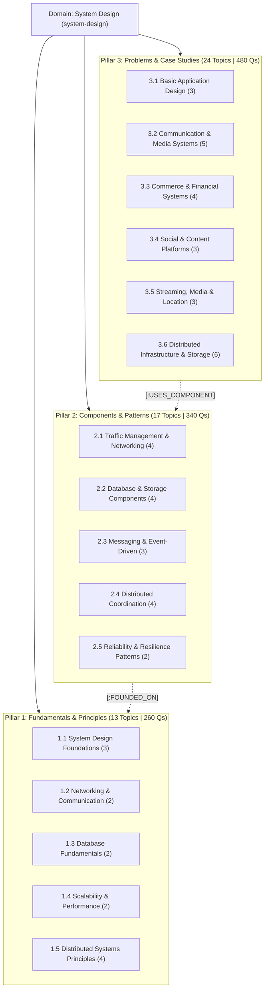
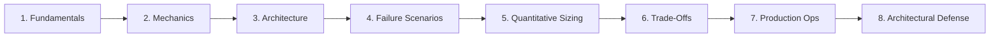

# System Design Domain Curriculum & Taxonomy Specification
## Classical Distributed Systems Master Catalog (54 Topics, 16 Categories, 1,080 Questions)

**Domain Slug:** `system-design`  
**Domain Name:** `System Design`  
**Version:** 5.0 (Aligned with Curriculum Excellence Standard v1.0)  
**Target Database:** Neo4j AuraDB Knowledge Graph  
**Structure:** 3 Learning Pillars (Principles, Components, Case Studies)  
**Total Categories:** 16  
**Total Topics:** 54  
**Priority Distribution:** **P1: 37 Core | P2: 16 Strong | P3: 1 Specialization**  
**Questions per Topic:** 20 (4 Beginner, 6 Intermediate, 6 Advanced, 4 Expert)  
**Total Master Question Inventory:** **1,080 Questions**  
**Governing Standard:** [`docs/SYSTEM_DESIGN_CURRICULUM_EXCELLENCE_STANDARD.md`](../SYSTEM_DESIGN_CURRICULUM_EXCELLENCE_STANDARD.md)  
**Status:** 🟢 **CURRICULUM SPECIFICATION FROZEN — v5.0 MASTER RELEASE**

---

## 1. High-Level Architecture Overview

System Design focuses strictly on **timeless, durable distributed systems engineering**, while generative AI and model infrastructure is isolated in the dedicated [`ai-system-design.md`](./ai-system-design.md) domain:



---

## 2. The 8-Layer Topic Depth Standard

Every topic in the curriculum is authored and evaluated against an **8-Layer Depth Specification**, ensuring that prep progresses from conceptual clarity to battle-tested architectural defense:



| Layer | Focus Area | What the Candidate Must Demonstrate |
| :---: | :--- | :--- |
| **1** | **Fundamentals** | Clear definitions, core motivations, terminology, and component mental model. |
| **2** | **Internal Mechanics** | Algorithms, data structures (e.g., skip lists, B+ trees, SSTables), and network wire protocols. |
| **3** | **Architecture & Data Flow** | Component boundaries, synchronous vs async communication paths, and API schema contracts. |
| **4** | **Failure Scenarios** | Gray failures, node crashes, network splits, asymmetric partitions, split-brain, and recovery procedures. |
| **5** | **Quantitative Engineering** | Back-of-the-envelope capacity estimations (QPS, IOPS, memory, bandwidth, RPO/RTO, and quorum overlap math). |
| **6** | **Trade-Off Analysis** | CAP/PACELC theorem evaluations, consistency vs latency budgets, and technology selection justifications. |
| **7** | **Production Engineering** | Golden signals observability, zero-downtime deployments, schema evolution, and backpressure shedding. |
| **8** | **Architectural Defense** | Defending system designs before Principal Review Boards, balancing business cost (TCO) vs SLA risk. |

---

## 3. Decoupling Readiness from Topic Count

Candidate readiness is evaluated across four distinct dimensions:
$$\text{Readiness Score} = f(\text{Topic}, \text{Depth Layer}, \text{Experience Level}, \text{Scenario Complexity})$$

| Career Level | Target Learning Level | Expected Depth Capability |
| :--- | :---: | :--- |
| **Fresher / Junior** | **L1 – L2** | Explain fundamentals (Layers 1–3), define system boundaries, calculate basic QPS, use standard tools. |
| **Mid-Level** | **L2 – L3** | Design complete components (Layers 1–5), choose appropriate databases/caches, handle timeouts and retries. |
| **Senior** | **L3 – L4** | Lead complex system designs (Layers 4–7), analyze split-brain risk, tune p99 latency, design multi-AZ failovers. |
| **Staff / Principal / Architect**| **L4 – L5** | Platform-wide correctness (Layers 6–8), multi-region active-active, formal failure proofs, TCO, operational risk. |

---

## 4. The 10 Embedded Production Concepts Mapping

Rather than creating minor standalone topics, these 10 critical production concepts are directly embedded into corresponding topics:

1. **Database Connection Management & Connection Storms**: Embedded in `CMP006` (PgBouncer, thread-per-connection vs event-loop pooling, connection exhaustion, AWS RDS Proxy).
2. **Storage Durability & Erasure Coding**: Embedded in `SYS003` & `SYS018` (Reed-Solomon $k+m$ chunking, repair network overhead vs $3\times$ replication cost).
3. **Database Crash Recovery & Point-in-Time Recovery (PITR)**: Embedded in `CMP008` (WAL segment archiving, checkpointing, group commit `fsync` bottleneck).
4. **Distributed Rate Limiting & Global Quotas**: Embedded in `CMP004` (Regional sliding windows, batch token reservation, cross-region latency mitigation).
5. **Distributed Tracing & Context Propagation**: Embedded in `CMP015` & `SYS019` (W3C traceparent headers, baggage context, tail-based sampling, critical path tracing).
6. **Multi-Tenant Isolation & Noisy Neighbors**: Embedded in `FND003` & `CMP004` (Physical vs logical tenant isolation, noisy neighbor throttling, tenant-aware partitioning).
7. **Zero-Downtime Data Migration & CDC**: Embedded in `CMP011` (Expand-contract schema pattern, dual-write queues, CDC backfill consistency verification).
8. **End-to-End Exactly-Once Processing**: Embedded in `CMP009` & `CMP011` (Kafka transactional producer, two-phase commit, read-committed consumer, idempotent effect handling).
9. **Quorum Overlap vs Linearizability Nuance**: Embedded in `CMP006` & `SYS018` (Why $R+W>N$ alone does not guarantee linearizability without monotonic read repair or Paxos generation clocks).
10. **Distributed Time & Spanner TrueTime**: Embedded in `FND012` (Atomic clocks + GPS bounded uncertainty $[\text{earliest}, \text{latest}]$, commit-wait protocol for external consistency).

---

## 5. Master Category & Topic Catalog (54 Topics)

---

### Pillar 1: Fundamentals & Principles (13 Topics | 260 Questions)

#### Category 1.1: System Design Foundations (`system-design-foundations`)
| Topic ID | Topic Title | Slug | Priority | Prerequisites | Core Coverage & 8-Layer Focus |
| :---: | :--- | :--- | :---: | :--- | :--- |
| `FND001` | **Intro to System Design & Architectural Thinking** | `intro-system-design` | **P1** | None | System boundaries, component abstraction, requirement scoping, architectural block diagrams |
| `FND002` | **Functional & Non-Functional Requirements** | `requirements-engineering` | **P1** | `intro-system-design` | Use cases, SLOs/SLAs, latency percentiles (p50/p95/p99), throughput, availability calculations |
| `FND003` | **Architecture Styles: Monolith to Microservices** | `monolith-to-microservices` | **P1** | `intro-system-design` | Service boundaries, coupling, modular monoliths, decomposition, multi-tenant noisy neighbor isolation |

#### Category 1.2: Networking & Communication Fundamentals (`networking-fundamentals`)
| Topic ID | Topic Title | Slug | Priority | Prerequisites | Core Coverage & 8-Layer Focus |
| :---: | :--- | :--- | :---: | :--- | :--- |
| `FND004` | **HTTP, HTTPS, TCP, UDP, DNS & TLS** | `networking-protocols` | **P1** | `intro-system-design` | Request lifecycle, TCP 3-way handshake, DNS hierarchy, TLS termination, socket buffers |
| `FND005` | **REST, RPC, gRPC, WebSockets & API Protocols** | `api-communication-fundamentals` | **P1** | `networking-protocols` | Synchronous RPC, protobuf serialization, duplex WebSockets, SSE, idempotency semantics |

#### Category 1.3: Database Fundamentals (`database-fundamentals`)
| Topic ID | Topic Title | Slug | Priority | Prerequisites | Core Coverage & 8-Layer Focus |
| :---: | :--- | :--- | :---: | :--- | :--- |
| `FND006` | **Relational vs NoSQL & Access Patterns** | `sql-vs-nosql-modeling` | **P1** | `intro-system-design` | Document, key-value, wide-column, relational schema trade-offs, access pattern mapping |
| `FND007` | **ACID Properties, Isolation & Transactions** | `acid-transactions-consistency` | **P1** | `sql-vs-nosql-modeling` | Read committed, snapshot isolation, serializability, write skew, 2PC blocking nature |

#### Category 1.4: Scalability & Performance Principles (`scalability-performance-principles`)
| Topic ID | Topic Title | Slug | Priority | Prerequisites | Core Coverage & 8-Layer Focus |
| :---: | :--- | :--- | :---: | :--- | :--- |
| `FND008` | **Horizontal vs Vertical Scaling & Stateless Services** | `horizontal-vs-vertical-scaling` | **P1** | `intro-system-design` | Shared-nothing architecture, state externalization, auto-scaling thresholds, session offloading |
| `FND009` | **Latency, Throughput, Capacity Planning & SLOs** | `latency-throughput-slos` | **P1** | `requirements-engineering` | Bandwidth calculations, back-of-envelope estimation, tail latency, RPO/RTO durability budgets |

#### Category 1.5: Distributed Systems Principles (`distributed-systems-principles`)
| Topic ID | Topic Title | Slug | Priority | Prerequisites | Core Coverage & 8-Layer Focus |
| :---: | :--- | :--- | :---: | :--- | :--- |
| `FND010` | **CAP & PACELC Theorems in Practice** | `cap-pacelc-theorems` | **P1** | `latency-throughput-slos` | Partitions behaviour, CP vs AP trade-offs, latency vs consistency during normal operations |
| `FND011` | **Consistency Models: Strong to Eventual** | `consistency-models` | **P1** | `cap-pacelc-theorems` | Linearizability, sequential consistency, causal consistency, read-your-writes, monotonic reads |
| `FND012` | **Distributed Time, Ordering & Failure Models** | `distributed-clocks-ordering` | **P2** | `consistency-models` | Lamport clocks, vector clocks, NTP skew, Google Spanner TrueTime commit-wait, crash-stop vs crash-recovery |
| `FND013` | **Byzantine Fault Tolerance & Adversarial Systems** | `byzantine-fault-tolerance` | **P2** | `consistency-models` | Byzantine failure model, arbitrary node behavior, PBFT algorithm, $3f+1$ quorum math vs $2f+1$ CFT |

---

### Pillar 2: Components & Patterns (17 Topics | 340 Questions)

#### Category 2.1: Traffic Management & Networking Components (`traffic-management-components`)
| Topic ID | Topic Title | Slug | Priority | Prerequisites | Core Coverage & 8-Layer Focus |
| :---: | :--- | :--- | :---: | :--- | :--- |
| `CMP001` | **Load Balancers & Traffic Distribution** | `load-balancers-traffic` | **P1** | `networking-protocols` | L4 vs L7 balancing, consistent IP hashing, active/passive health probing, Anycast BGP |
| `CMP002` | **API Gateway & Reverse Proxy Architecture** | `api-gateway-reverse-proxy` | **P1** | `load-balancers-traffic` | Request routing, JWT validation offload, rate limiting, BFF pattern, TLS termination |
| `CMP003` | **CDN & Edge Caching Architecture** | `cdn-edge-caching` | **P1** | `networking-protocols` | Cache hierarchy, origin shielding, stale-while-revalidate, edge workers, byte-range requests |
| `CMP004` | **Rate Limiter, Throttling & Admission Control** | `rate-limiting-admission-control` | **P1** | `distributed-caching-redis` | Token bucket, sliding window log, Redis distributed counters, regional quotas, 429 semantics |

#### Category 2.2: Database & Storage Components (`database-storage-components`)
| Topic ID | Topic Title | Slug | Priority | Prerequisites | Core Coverage & 8-Layer Focus |
| :---: | :--- | :--- | :---: | :--- | :--- |
| `CMP005` | **Database Indexing & Query Optimization** | `database-indexing-optimization` | **P1** | `sql-vs-nosql-modeling` | B+ Trees, composite indexes, covering indexes, query plans, index fragmentation |
| `CMP006` | **Database Replication, Sharding & Partitioning** | `db-replication-sharding` | **P1** | `acid-transactions-consistency` | Primary-replica, read replicas, shard keys, virtual shards, connection pooling (PgBouncer), quorum linearizability races |
| `CMP007` | **Distributed Caching: Redis & Memcached** | `distributed-caching-redis` | **P1** | `horizontal-vs-vertical-scaling` | Cache-aside, write-through, stampede herd prevention, bloom filters, eviction, cross-region invalidation |
| `CMP008` | **Storage Engines: B-Trees vs LSM-Trees & WAL** | `storage-engines-lsm-trees` | **P2** | `database-indexing-optimization` | Write amplification, SSTables, memtable, compaction, WAL `fsync` bottleneck, group commit, PITR recovery |

#### Category 2.3: Messaging & Event-Driven Components (`messaging-event-driven-components`)
| Topic ID | Topic Title | Slug | Priority | Prerequisites | Core Coverage & 8-Layer Focus |
| :---: | :--- | :--- | :---: | :--- | :--- |
| `CMP009` | **Message Queues & Event Streaming: Kafka** | `kafka-event-streaming` | **P1** | `horizontal-vs-vertical-scaling` | Partitions, consumer groups, offsets, High Watermark vs LEO, leader epoch, `min.insync.replicas` |
| `CMP010` | **Event-Driven Architecture & Pub/Sub Brokers** | `event-driven-pub-sub` | **P1** | `kafka-event-streaming` | Event contracts, choreography vs orchestration, dead letter queues, schema evolution |
| `CMP011` | **Transactional Outbox, CDC & Idempotent Consumers** | `transactional-outbox-cdc` | **P1** | `acid-transactions-consistency` | Dual-write problem, Debezium CDC, idempotency keys, zero-downtime expand-contract migration |

#### Category 2.4: Distributed Coordination Components (`distributed-coordination-components`)
| Topic ID | Topic Title | Slug | Priority | Prerequisites | Core Coverage & 8-Layer Focus |
| :---: | :--- | :--- | :---: | :--- | :--- |
| `CMP012` | **Distributed Locks & Fencing Tokens** | `distributed-locks-fencing` | **P2** | `distributed-caching-redis` | Redis Redlock, ZooKeeper ephemeral nodes, lease expiry under GC pauses, fencing tokens |
| `CMP013` | **Leader Election & Consensus (Raft / Paxos)** | `leader-election-raft` | **P2** | `cap-pacelc-theorems` | Quorums, term numbers, log matching invariant, pre-vote phase, split-brain mitigation |
| `CMP014` | **Service Discovery & Health Checking** | `service-discovery-health` | **P1** | `load-balancers-traffic` | Service registries (Consul/Eureka), client vs server-side discovery, heartbeat health checks |
| `CMP017` | **Gossip Protocols, Cluster Membership & Failure Detection** | `gossip-protocols-membership` | **P2** | `service-discovery-health` | Decentralized membership, SWIM protocol, failure detection vs suspicion, indirect probing, $\Phi$-accrual |

#### Category 2.5: Reliability & Resilience Patterns (`reliability-resilience-patterns`)
| Topic ID | Topic Title | Slug | Priority | Prerequisites | Core Coverage & 8-Layer Focus |
| :---: | :--- | :--- | :---: | :--- | :--- |
| `CMP015` | **Circuit Breakers, Retries, Jitter & Bulkheads** | `circuit-breaker-bulkhead` | **P1** | `latency-throughput-slos` | State transitions, exponential backoff with jitter, retry amplification storms, load shedding, distributed tracing spans |
| `CMP016` | **Distributed Transactions, Saga & CQRS Patterns** | `saga-pattern-cqrs` | **P2** | `acid-transactions-consistency` | Compensating transactions, command/query separation, materialized read views, 2PC blocking recovery |

---

### Pillar 3: Problems & Case Studies (24 Topics | 480 Questions)

#### Category 3.1: Basic Application Design (`basic-application-design`)
| Topic ID | Problem Title | Slug | Priority | Used Components | Founded On Principles |
| :---: | :--- | :--- | :---: | :--- | :--- |
| `SYS001` | **Design a URL Shortener (TinyURL)** | `url-shortener` | **P1** | `load-balancers-traffic`, `distributed-caching-redis`, `rate-limiting-admission-control`, `db-replication-sharding` | `latency-throughput-slos`, `cap-pacelc-theorems`, `acid-transactions-consistency` |
| `SYS002` | **Design a Pastebin / Text Sharing Platform** | `pastebin-service` | **P2** | `cdn-edge-caching`, `distributed-caching-redis`, `rate-limiting-admission-control` | `latency-throughput-slos`, `horizontal-vs-vertical-scaling` |
| `SYS003` | **Design a File Upload & Storage Service (S3-like)** | `file-upload-storage` | **P1** | `cdn-edge-caching`, `distributed-caching-redis`, `api-gateway-reverse-proxy` | `latency-throughput-slos`, `acid-transactions-consistency` |

#### Category 3.2: Communication & Media Systems (`communication-systems`)
| Topic ID | Problem Title | Slug | Priority | Used Components | Founded On Principles |
| :---: | :--- | :--- | :---: | :--- | :--- |
| `SYS004` | **Design Real-Time Chat (WhatsApp / Slack)** | `realtime-chat-messaging` | **P1** | `api-gateway-reverse-proxy`, `distributed-caching-redis`, `kafka-event-streaming`, `storage-engines-lsm-trees` | `cap-pacelc-theorems`, `acid-transactions-consistency`, `distributed-clocks-ordering` |
| `SYS005` | **Design a Multi-Channel Notification Platform** | `notification-platform` | **P1** | `kafka-event-streaming`, `circuit-breaker-bulkhead`, `rate-limiting-admission-control`, `distributed-caching-redis` | `acid-transactions-consistency`, `latency-throughput-slos` |
| `SYS006` | **Design an Email Delivery & Campaign Engine** | `email-campaign-system` | **P2** | `kafka-event-streaming`, `distributed-caching-redis`, `rate-limiting-admission-control` | `horizontal-vs-vertical-scaling`, `acid-transactions-consistency` |
| `SYS007` | **Design Video Conferencing & Live Streaming (Zoom/Twitch)** | `video-conferencing-streaming` | **P2** | `load-balancers-traffic`, `service-discovery-health`, `api-gateway-reverse-proxy` | `latency-throughput-slos` |
| `SYS024` | **Design Massive-Scale Live Event & Fan-Out Chat (1M+ in 1 Room)** | `massive-live-event-chat` | **P1** | `load-balancers-traffic`, `distributed-caching-redis`, `kafka-event-streaming`, `circuit-breaker-bulkhead` | `latency-throughput-slos`, `horizontal-vs-vertical-scaling` |

#### Category 3.3: Commerce & Financial Systems (`commerce-transaction-systems`)
| Topic ID | Problem Title | Slug | Priority | Used Components | Founded On Principles |
| :---: | :--- | :--- | :---: | :--- | :--- |
| `SYS008` | **Design an E-Commerce Platform (Amazon)** | `ecommerce-platform` | **P1** | `distributed-caching-redis`, `kafka-event-streaming`, `saga-pattern-cqrs`, `api-gateway-reverse-proxy` | `acid-transactions-consistency`, `cap-pacelc-theorems` |
| `SYS009` | **Design a Payment Gateway & Accounting Ledger** | `payment-gateway-ledger` | **P1** | `transactional-outbox-cdc`, `distributed-locks-fencing`, `db-replication-sharding` | `acid-transactions-consistency`, `cap-pacelc-theorems` |
| `SYS010` | **Design Ticket Booking (Ticketmaster)** | `ticket-booking-platform` | **P1** | `distributed-locks-fencing`, `rate-limiting-admission-control`, `distributed-caching-redis`, `load-balancers-traffic` | `acid-transactions-consistency`, `horizontal-vs-vertical-scaling` |
| `SYS011` | **Design Real-Time Fraud & Risk Detection Engine (Stripe Radar)** | `fraud-risk-detection` | **P2** | `kafka-event-streaming`, `distributed-caching-redis`, `storage-engines-lsm-trees` | `latency-throughput-slos`, `cap-pacelc-theorems` |

#### Category 3.4: Social & Content Platforms (`social-content-platforms`)
| Topic ID | Problem Title | Slug | Priority | Used Components | Founded On Principles |
| :---: | :--- | :--- | :---: | :--- | :--- |
| `SYS012` | **Design a Social Media News Feed (Twitter/X)** | `social-news-feed` | **P1** | `distributed-caching-redis`, `kafka-event-streaming`, `cdn-edge-caching`, `api-gateway-reverse-proxy` | `latency-throughput-slos`, `horizontal-vs-vertical-scaling`, `acid-transactions-consistency` |
| `SYS013` | **Design a Search Engine & Web Crawler** | `search-engine-crawler` | **P2** | `kafka-event-streaming`, `storage-engines-lsm-trees`, `service-discovery-health` | `horizontal-vs-vertical-scaling`, `latency-throughput-slos` |
| `SYS014` | **Design Search Autocomplete / Typeahead (Google)** | `search-autocomplete-typeahead` | **P1** | `cdn-edge-caching`, `distributed-caching-redis`, `load-balancers-traffic` | `latency-throughput-slos`, `horizontal-vs-vertical-scaling` |

#### Category 3.5: Streaming, Media & Location Systems (`media-location-systems`)
| Topic ID | Problem Title | Slug | Priority | Used Components | Founded On Principles |
| :---: | :--- | :--- | :---: | :--- | :--- |
| `SYS015` | **Design Video Streaming & VOD Distribution (YouTube / Netflix)** | `video-streaming-platform` | **P1** | `cdn-edge-caching`, `kafka-event-streaming`, `storage-engines-lsm-trees`, `load-balancers-traffic` | `latency-throughput-slos`, `horizontal-vs-vertical-scaling` |
| `SYS016` | **Design Ride-Sharing & Dispatch (Uber / Lyft)** | `ride-sharing-dispatch` | **P1** | `distributed-caching-redis`, `kafka-event-streaming`, `api-gateway-reverse-proxy`, `distributed-locks-fencing` | `latency-throughput-slos`, `acid-transactions-consistency`, `horizontal-vs-vertical-scaling` |
| `SYS017` | **Design a Real-Time Gaming Leaderboard** | `gaming-leaderboard` | **P2** | `distributed-caching-redis`, `load-balancers-traffic`, `storage-engines-lsm-trees` | `latency-throughput-slos`, `horizontal-vs-vertical-scaling` |

#### Category 3.6: Distributed Infrastructure & Storage Systems (`distributed-infrastructure-systems`)
| Topic ID | Problem Title | Slug | Priority | Used Components | Founded On Principles |
| :---: | :--- | :--- | :---: | :--- | :--- |
| `SYS018` | **Design a Distributed Key-Value Store (Dynamo/Cassandra)** | `distributed-key-value-store` | **P1** | `storage-engines-lsm-trees`, `service-discovery-health`, `gossip-protocols-membership` | `cap-pacelc-theorems`, `acid-transactions-consistency`, `distributed-clocks-ordering` |
| `SYS019` | **Design Metrics, Telemetry & Observability (Prometheus/Datadog)** | `metrics-observability-platform` | **P2** | `storage-engines-lsm-trees`, `kafka-event-streaming`, `service-discovery-health` | `latency-throughput-slos`, `horizontal-vs-vertical-scaling` |
| `SYS020` | **Design Cloud File Storage & Sync (Google Drive / Dropbox)** | `cloud-file-sync` | **P2** | `cdn-edge-caching`, `distributed-caching-redis`, `kafka-event-streaming` | `acid-transactions-consistency`, `latency-throughput-slos` |
| `SYS021` | **Design Real-Time Collaborative Editor (Google Docs / Figma)** | `collaborative-document-editor` | **P2** | `api-gateway-reverse-proxy`, `distributed-caching-redis` | `distributed-clocks-ordering`, `acid-transactions-consistency` |
| `SYS022` | **Design an OTA Firmware Update Platform for Connected Devices** | `ota-firmware-update-platform` | **P3** | `cdn-edge-caching`, `kafka-event-streaming`, `distributed-caching-redis` | `latency-throughput-slos`, `acid-transactions-consistency` |
| `SYS023` | **Design a Distributed Job Scheduler & Durable Workflow Engine (Temporal)** | `distributed-workflow-scheduler` | **P1** | `kafka-event-streaming`, `distributed-locks-fencing`, `db-replication-sharding`, `storage-engines-lsm-trees` | `acid-transactions-consistency`, `distributed-clocks-ordering` |

---

## 6. The 20-Question Distribution Matrix (54 Topics | 1,080 Questions)

Each topic contains exactly **20 questions** (4 Beginner, 6 Intermediate, 6 Advanced, 4 Expert):

| Category | Topics | Beginner Qs | Intermediate Qs | Advanced Qs | Expert Qs | Total Questions |
| :--- | :---: | :---: | :---: | :---: | :---: | :---: |
| **1.1 System Design Foundations** | 3 | 12 | 18 | 18 | 12 | **60** |
| **1.2 Networking & Communication** | 2 | 8 | 12 | 12 | 8 | **40** |
| **1.3 Database Fundamentals** | 2 | 8 | 12 | 12 | 8 | **40** |
| **1.4 Scalability & Performance** | 2 | 8 | 12 | 12 | 8 | **40** |
| **1.5 Distributed Systems Principles** | 4 | 16 | 24 | 24 | 16 | **80** |
| **2.1 Traffic Management & Networking** | 4 | 16 | 24 | 24 | 16 | **80** |
| **2.2 Database & Storage Components** | 4 | 16 | 24 | 24 | 16 | **80** |
| **2.3 Messaging & Event-Driven** | 3 | 12 | 18 | 18 | 12 | **60** |
| **2.4 Distributed Coordination** | 4 | 16 | 24 | 24 | 16 | **80** |
| **2.5 Reliability & Resilience Patterns** | 2 | 8 | 12 | 12 | 8 | **40** |
| **3.1 Basic Application Design** | 3 | 12 | 18 | 18 | 12 | **60** |
| **3.2 Communication & Media Systems** | 5 | 20 | 30 | 30 | 20 | **100** |
| **3.3 Commerce & Financial Systems** | 4 | 16 | 24 | 24 | 16 | **80** |
| **3.4 Social & Content Platforms** | 3 | 12 | 18 | 18 | 12 | **60** |
| **3.5 Streaming, Media & Location** | 3 | 12 | 18 | 18 | 12 | **60** |
| **3.6 Distributed Infrastructure & Storage** | 6 | 24 | 36 | 36 | 24 | **120** |
| **TOTAL** | **54 Topics** | **216** | **324** | **324** | **216** | **1,080 Questions** |

---

## 7. Priority Roadmap Breakdown

The 54 topics follow a strict **P1 (37 Core), P2 (16 Strong), P3 (1 Specialization)** distribution:

```text
Priority Distribution Matrix:
├── P1 (Core Foundation — 37 Topics | 740 Questions)
│   ├── Pillar 1 (Principles): 11 Topics (FND001–FND011)
│   ├── Pillar 2 (Components): 12 Topics (CMP001–CMP007, CMP009–CMP011, CMP014–CMP015)
│   └── Pillar 3 (Problems): 14 Topics (SYS001, SYS003–SYS005, SYS008–SYS010, SYS012, SYS014–SYS016, SYS018, SYS023, SYS024)
│
├── P2 (Strong Depth — 16 Topics | 320 Questions)
│   ├── Pillar 1 (Principles): 2 Topics (FND012 - Distributed Clocks, FND013 - Byzantine Fault Tolerance)
│   ├── Pillar 2 (Components): 5 Topics (CMP008 - Storage Engines, CMP012 - Dist Locks, CMP013 - Raft, CMP016 - Saga/CQRS, CMP017 - Gossip & Membership)
│   └── Pillar 3 (Problems): 9 Topics (SYS002, SYS006, SYS007, SYS011, SYS013, SYS017, SYS019, SYS020, SYS021)
│
└── P3 (Specialization — 1 Topic | 20 Questions)
    └── Pillar 3 (Problems): 1 Topic (SYS022 - OTA Firmware Update Platform)

Total: 54 Topics = 1,080 Questions
```
